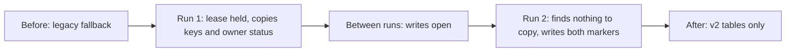
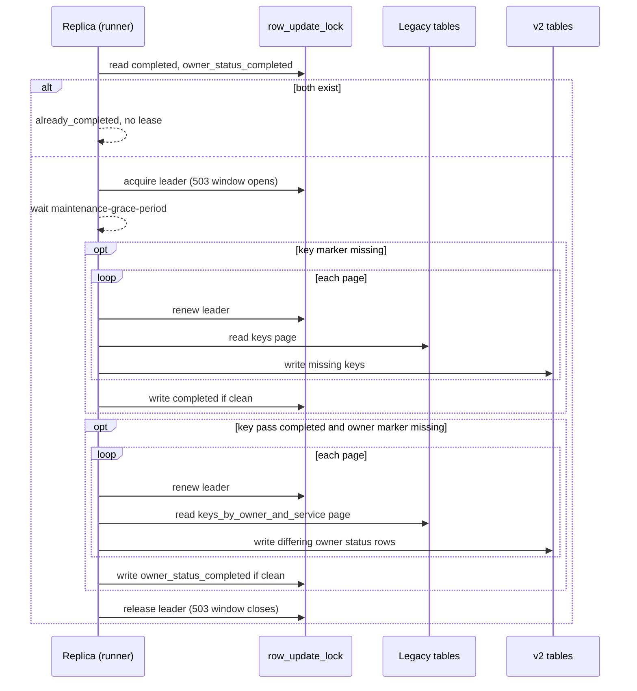

# API Keys legacy key migration: review summary

Status: for team review. The implementation in this change follows Option B
and also copies legacy owner status.

Related issue: [#2054 Async Migration Task](https://github.com/NVIDIA/nvcf/issues/2054),
part of [#2048 Multi-tenancy support in API Keys service](https://github.com/NVIDIA/nvcf/issues/2048).

How to read this document:

- Problem through Design overview explain what changes and why, at a high
  level.
- Current gaps and accepted risks lists what is still open, followed by the
  questions for review.
- Detailed design has the rows, the run steps, per-phase behavior, failures,
  configuration, introspection, and owner status rules.

## Problem

Keys created before multi-tenancy live in the legacy `keys` and
`keys_by_owner_and_service` tables, with no `nca_id`. `KeysV2Service` serves
them for the configured `apikeys.nca-id` by reading `keys_v2` first and falling
back to the legacy tables. The fallback stays until every legacy key has a copy
in `keys_v2` and `keys_by_owner_and_account_and_service`.

This design adds a background task that makes those copies. The same task
then copies legacy owner status into the v2 owner status tables, and the
legacy account switches to those tables on its own.

## Goals and non-goals

Goals:

- Copy every legacy key into both v2 tables, in v2 form.
- Run on one replica at a time, only when turned on in config.
- Bound Cassandra load with small batches and a cursor.
- Be safe to rerun and to stop at any point.
- Never lose a key update or bring back a deleted key while traffic continues.
- Copy legacy owner status into the v2 owner status tables, then switch the
  legacy account to them without a config change or redeploy.

Non-goals:

- Changing or deleting legacy rows. Cleanup is a later step. Owner status is
  still written to the legacy column after the switch, for rollback.

## Assumptions

- One datacenter. Lock and lease writes use `LOCAL_SERIAL`, which coordinates
  within one datacenter only.
- Only the api-keys service writes the legacy tables.
- About 100,000 legacy keys, so a run takes minutes.

## Prerequisites

Before the task is turned on:

- Every pod runs this release. Older pods do not check the lease and can
  write during a run.
- v1 key management is turned off, so the legacy tables change only through
  the v2 code path. See v1 cutoff.
- `apikeys.service-id-map` covers every legacy issuer service. Keys with an
  unmapped issuer are not copied.

## The core problem: concurrent writes

While the task copies a key, a user request can update or delete the same key
in the legacy tables. Without coordination:

| Race | Effect | Severity |
|------|--------|----------|
| Update reads legacy before the copy and writes legacy after it | v2 copy keeps the old state; a revoke is lost | High |
| Delete runs while the key is being copied | Deleted key comes back in `keys_v2` | High |
| Delete removes v2, then the task copies legacy before the legacy delete | Deleted key comes back in `keys_v2` | High |
| Task copies again after a newer v2 write | Newer v2 update is overwritten | Medium |
| Two pods with skewed clocks write the same key | Cassandra keeps the higher timestamp, which may be the older write | Medium |

There are two options that handle this.

## Option A: Per-key lock

The task and the v2 write path serialize on a lock per key. The task takes the
lock, re-reads the key, and copies it only if no v2 copy exists. Status
updates, authorization updates, and deletes of a legacy-account key take the
same lock and write to whichever table holds the key. A held lock returns 429.

Residual risk: a holder that stalls past the lock TTL right before its write
can overlap another holder.

## Option B: Maintenance window

While a run is active, block the writes that race with the task. One replica
holds a lease row in Cassandra for the whole run. Every replica checks that
row and returns 503 for legacy-account status updates, authorization updates,
and deletes while it exists. Creates, reads, listing, introspection, and every
other account stay open.

Before copying, the runner waits a grace period so in-flight writes finish.
It renews the lease before each batch and stops if renewal fails.

Residual risk: if the lease is lost mid-batch, writes reopen while the task
finishes that batch.

## Comparison

| | Option A: Per-key lock | Option B: Maintenance window |
|--|--|--|
| Key management during a run | Available; 429 only for the key being copied | 503 for legacy-account updates and deletes |
| Races removed | Narrowed by the lock | Removed in normal operation; a stall past the grace period can still race |
| Cost per migrated key | Two lightweight transactions | None |
| Code changes in the write path | Lock and reload in three methods | One maintenance check |
| Residual risk | Holder stalls past key lock TTL | Lease lost mid-batch |

## Proposal

Option B. Option A is the alternative if the trade-off below is not
acceptable.

- It is simpler. It removes the races in normal operation. What remains
  needs a request to stall past the grace period or the lease to be lost
  mid-batch.
- Its cost is short. A run takes minutes for about 100,000 keys, and only
  legacy-account updates and deletes are blocked.
- Choose Option A instead if revoking a legacy-account key must stay available
  during a run.

## Design overview

The migration is a background task inside the api-keys service. It is off by
default and turned on in config. Once on, each replica schedules it every
`fixed-delay` (10 minutes by default). One scheduled execution is a run.

Only one replica at a time does a run. It holds a lease row in Cassandra for
the whole run. While the lease exists, every replica rejects legacy-account
key updates and deletes with 503, so a copy never races a user write.

A run first copies keys, then copies owner status. Both copies are safe to
repeat. A completion marker row is written only when a pass finds nothing
left to copy, one marker for keys and one for owner status. So it normally
takes two runs:

1. The first run copies the keys and owner status. It copied something, so it
   writes no marker.
2. The next run, one `fixed-delay` later, finds everything already copied and
   writes both markers.

After that, every run sees both markers and ends without taking the lease.

Request handling never talks to the task. Each pod reads the markers. When the
key marker appears, introspection stops looking in the legacy `keys` table.
When the owner status marker appears, the legacy account reads and writes
owner status in the v2 tables, like every other account. No config change or
redeploy is needed.

v1 key management is turned off before the task starts, so nothing writes
only to the legacy tables while or after the copy runs.

The copy alone is not enough. Once keys and owner status live in the v2
tables, every reader and writer of the legacy account must use those tables
too. This change also:

- Makes introspection find keys in `keys_v2` first. Without this, a key
  created through v2 is not found, and a migrated key revoked through v2 is
  still accepted through its stale legacy row.
- Makes introspection check owner status with the same rule as v2 key create,
  for the key's issuer service. Without this, introspection keeps reading the
  legacy column and never sees a suspend written to the v2 tables.
- Stops v2 updates of a legacy key from rewriting the legacy owner status.
  The old batch write could put back `ACTIVE` over a concurrent suspend.
- Adds a flag that turns off v1 key management with 410. v1 writes only the
  legacy tables, so a v1 revoke after the copy would leave the v2 copy
  active.
- Keeps writing account-level owner status to the legacy column after the
  switch, so a rollback keeps account-level suspends.
- Removes `SynchronousUserStatusService`. It was unused and read only the
  legacy column.



What changes for the legacy account. Other accounts are never affected.

| | Before | During a run | After |
|---|---|---|---|
| Key create and reads | Open | Open | Open |
| Key updates and deletes | Open | 503 | Open |
| Introspection key lookup | `keys_v2`, then legacy | Same | `keys_v2` only |
| Owner status | Legacy column | Account-level updates 503 | v2 tables |
| v1 key management | 410 | 410 | 410 |

The operator turns the task off at the next deploy. A later release removes
the task and the 503 check.

## Current gaps and accepted risks

### Current gaps

1. A suspend can be lost at the switch. For up to 30 seconds after the owner
   status marker is written, a pod that has not seen it yet writes an
   account-level update only to the legacy column, and switched pods miss
   it. Proposed fix: before the switch, write the v2 table too.
2. Skipped keys stop working after the key marker. Keys with an issuer
   service missing from `apikeys.service-id-map` are not copied, and after the
   marker introspection reads only `keys_v2`. Options: keep the legacy
   fallback for keys not found in `keys_v2`, or do not write the marker while
   any key is skipped.
3. The paged v2 list routes omit legacy-only keys until they are copied.
   Options: document it, flag that legacy keys are pending, or merge legacy
   keys when the filter has a user.
4. `nvcf-cli` uses `/v1/keys`, so v1 key management cannot be turned off
   until it moves to v2.
5. Un-suspending a migrated user takes more than one update. See Un-suspend
   after the migration.
6. No end-to-end introspection test for a key only in `keys_v2`, or for an
   owner suspended only in the v2 tables.

### Accepted risks

- A request that passes the 503 check just before the lease is taken and
  stalls past the grace period can write old state to `keys_v2`.
- If the lease is lost mid-batch, writes reopen for up to one batch.
- Introspection caches results for about one minute per pod, so a suspend or
  revoke takes up to a minute to apply. This is unchanged.
- A rollback past this release drops per-service suspends. Account-level
  suspends survive through the dual write.
- The startup check that v1 is off runs per pod. It does not catch pods on an
  older release during a rolling deploy, or pods with different config.
- Lease and marker writes coordinate within one datacenter only.
- A key that fails on every run opens a 503 window every `fixed-delay` until
  it is fixed or the task is turned off.
- Running the migration again needs a marker delete and a pod restart,
  because a seen marker is cached.

## Questions for review

1. Confirm Option B over Option A.
2. Is blocking legacy-account revoke and delete for a few minutes acceptable?
3. Is `PT15S` enough for `maintenance-grace-period`?
4. Which release turns off v1 key management in each environment? It must
   come after `nvcf-cli` moves to v2 and before the task is turned on.
5. For migrated owner status, keep the extra un-suspend step, cascade
   account-level un-suspend, or copy `SUSPENDED` only to the account row?
6. How long to keep the legacy owner status dual write after the switch?
7. For current gaps 1 to 3, which fix to take before the task is turned on?

## Detailed design

### Components

`LegacyKeyMigrationTask` schedules runs on each replica when
`apikeys.migration.legacy-keys.enabled` is `true`. Each tick calls
`LegacyKeyMigrationService`, which does one run: the key pass, then the owner
status pass. `LegacyKeyMaintenance` reads and writes the lease and marker
rows, and `assertWritable` returns 503 while the lease exists.

On the request side, `LegacyMigrationState` gives each pod a cached view of
the two markers. `IntrospectionKeyLoader` uses the key marker to stop the
legacy fallback. `KeysV2Service` uses the owner status marker to pick the
legacy column or the v2 tables. `IntrospectionKeyOwnerValidator` gets owner
status from `KeysV2Service.getEffectiveOwnerStatus`, so introspection follows
the same switch. `V1KeyManagementInterceptor` returns 410 for v1 key
management when `apikeys.v1-key-management-enabled` is `false`.

### State rows

All three rows live in `row_update_lock` with `table_name =
'legacy_key_migration'`. No schema change is needed.

| `record_key` | TTL | Written | Read by | Effect |
|---|---|---|---|---|
| `leader` | `lease-duration`, renewed per page | At run start, released at run end | `assertWritable` on every legacy-account write, without caching | 503 for legacy-account key writes and, before the switch, account-level owner status writes |
| `completed` | None | After a clean key pass, while the lease is held | Each run, and `LegacyMigrationState.isCompleted` | Runs skip the key pass. Introspection stops the legacy fallback |
| `owner_status_completed` | None | After a clean owner status pass, while the lease is held | Each run, and `LegacyMigrationState.isOwnerStatusMigrated` | Runs skip the owner status pass. The legacy account switches to the v2 owner status tables |

A clean key pass has no `migrated` and no `failed` keys. A clean owner status
pass has no `copied` and no `failed` rows. So a pass that copies anything is
never clean, and a later pass that finds everything copied writes the marker.

### Run sequence

The two passes run one after the other in the same run, on one thread, under
one lease and one 503 window. They never run in parallel.

1. Read both markers. If both exist, end with `already_completed`. No lease is
   taken and no 503 window opens.
2. Take the lease. If another replica holds it, end with `lease_not_acquired`.
3. Wait `maintenance-grace-period` (`PT15S`, longer than the Cassandra request
   timeout) so in-flight writes finish. The lease is not renewed during the
   wait, so startup fails unless the grace period is shorter than
   `lease-duration`.
4. Key pass, only if the key marker is missing. Page through legacy `keys`,
   renewing the lease before each page. Each key ends as `migrated`,
   `already_migrated`, `skipped`, or `failed`. If the pass is clean, write the
   key marker.
5. Owner status pass, only if the key pass ended `completed` (or was skipped)
   and the owner status marker is missing. Page through
   `keys_by_owner_and_service`, renewing the lease before each page. Each row
   ends as `copied`, `already_copied`, `skipped`, or `failed`. If the pass is
   clean, write the owner status marker.
6. Release the lease. The 503 window closes. If the task crashes, the lease
   TTL expires and writes resume on their own.

The key pass does not have to be clean for the owner status pass to run. It
only has to finish without `failed`, `lease_lost`, or `interrupted`. A normal
rollout therefore takes two runs: the first copies keys and owner status and
writes no marker, the second finds everything copied and writes both.



### Key copy rules

- One runner at a time. The lease is renewed before every batch.
- The cursor is the Cassandra paging state, kept in memory for one run. A
  restart starts over; copies are idempotent, and a key already copied costs
  two point reads.
- Keys are decrypted with the raw converter, so stored `ACTIVE` status is not
  rewritten as `EXPIRED`. Expired keys are copied as they are.
- Keys with an issuer service missing from `apikeys.service-id-map` are skipped
  with a warning and do not block completion, because no later run can copy
  them. After the key marker, introspection no longer finds them. See current
  gap 2.
- Both v2 rows are written in one logged batch with `KeysV2Dao.save`.
- The task stops scheduling on a replica after a run that leaves both markers
  set, or after a run that finds both markers (outcome `already_completed`).

### Completion markers

Without a marker, every replica needs its own clean run before it stops, and
every restart schedules again. Each of those runs takes the lease and opens a
new 503 window, even when nothing is left to copy.

- Records: `("legacy_key_migration", "completed")` for keys and
  `("legacy_key_migration", "owner_status_completed")` for owner status, next
  to the lease row.
- Written with the existing `lock` query and TTL `0`, so they never expire.
- Written only after a clean pass, while the lease is still held, so no
  replica starts another pass between the end of the pass and the write.
- Every run reads both before taking the lease. If both exist, the run ends
  with `already_completed`, takes no lease, and opens no 503 window. If only
  the key marker exists, the run skips the key copy and copies owner status.
- They do not block writes. Only the lease row does.
- If a write fails, the run still ends on that replica, and another replica
  records the marker on its next clean pass.
- The check and the lease are not atomic. Two replicas that check at the same
  moment can run one extra pass. That costs one extra window, not data.
- To run the key migration again, delete the row and restart the pods:

  ```sql
  DELETE FROM row_update_lock
  WHERE table_name = 'legacy_key_migration' AND record_key = 'completed';
  ```
- The authorization throttle always uses the `keys_v2` lock name, so a migrated
  key keeps its update interval.

### How each pod decides

| Check | Reads | Cache | Used by |
|---|---|---|---|
| `LegacyKeyMaintenance.assertWritable` | Lease row | None | Key status, authorizations, delete; account-level owner status before the switch |
| `LegacyMigrationState.isCompleted` | Key marker | `true` cached forever; otherwise re-read every 30 seconds | `IntrospectionKeyLoader` legacy fallback |
| `LegacyMigrationState.isOwnerStatusMigrated` | Owner status marker | `true` cached forever; otherwise re-read every 30 seconds | Every owner status read and write in `KeysV2Service` |
| Introspection caches | Response, key by hash, owner status | 60 seconds each, per pod | `IntrospectionFacade`, `CachingKeysLoader`, `IntrospectionKeyOwnerValidator` |

A failed marker read keeps the last known value, or the before value if there
is none. Before reads both tables and the legacy owner status column, which is
correct in every phase until the switch.

Timing after the last marker write:

- Each pod sees the marker within 30 seconds.
- Introspection can serve cached results for up to 60 more seconds.
- Deleting a marker to run again takes effect only after a pod restart,
  because a seen marker is cached for the life of the process.

### Phases

Each pod derives the phase from the rows above.

| Phase | Signal | Meaning |
|---|---|---|
| Before | No lease, no key marker | Also covers the time between runs |
| During | Lease exists | A run is copying keys or owner status |
| After keys | Key marker, no owner status marker | Normally lasts only until the owner status pass of the same or next run ends |
| After | Both markers | Migration done. Each pod switches within 30 seconds |

### Behavior by phase

For the legacy account (`apikeys.nca-id`). Every other account uses only the
v2 tables in every phase and is never blocked.

| Operation | Before | During | After |
|---|---|---|---|
| v2 create key | Writes `keys_v2`. Owner check reads the legacy column | Same, not blocked | Writes `keys_v2`. Owner check reads the v2 tables |
| v2 get key | `keys_v2` first, then legacy | Same | Same. Every mapped key is in `keys_v2` |
| v2 scoped list | `keys_v2` plus legacy, deduplicated | Same | All from `keys_v2` |
| v2 paged list | `keys_v2` only, legacy-only keys missing | Fills in as keys are copied | Complete |
| v2 key status, authorizations, delete | Writes the table that holds the key. Legacy updates write only key columns | 503 | Writes `keys_v2`. Delete removes both rows |
| v2 get owner status | Legacy column, no per-service rows | Same | v2 tables |
| v2 account-level owner status update | Legacy column only | 503 | v2 table and the legacy column |
| v2 per-service owner status update | 400 | 400 | v2 table |
| Introspection | `keys_v2`, then legacy. Owner status from the legacy column | Same, not blocked. During the owner status pass the key marker exists, so `keys_v2` only | `keys_v2` only. Owner status from the v2 tables |
| v1 key management | 410 once `apikeys.v1-key-management-enabled` is `false` | 410 | 410 |

### Run lifecycle

This walks through Option B with the settings in Configuration and three
replicas, A, B, and C.

#### Phase 0: deploy with the task disabled

- Every replica runs the `assertWritable` check. It returns 503 only while the
  lease row exists, so nothing is blocked yet.
- Every pod must run this release before any pod enables the task. A pod on
  the old code skips the check and can write during a run.
- Set `apikeys.v1-key-management-enabled=false` before the next phase. See
  v1 cutoff. Introspection moves to `keys_v2` and the shared owner status
  check in this release.

#### Phase 1: enable

- Each replica schedules the task after `initial-delay`, then every
  `fixed-delay` after the previous run ends.

#### Phase 2: first run

1. Each replica reads the markers. They are absent.
2. Each replica tries to take the lease. A wins. B and C end with
   `lease_not_acquired` and try again after `fixed-delay`.
3. The 503 window opens on every replica for legacy-account status updates,
   authorization updates, deletes, and account-level owner status updates.
   The response has `Retry-After` equal to `lease-duration`.
4. A waits `maintenance-grace-period` without renewing the lease.
5. A copies keys page by page. It renews the lease before each page and waits
   `batch-delay` after it. Keys were copied, so the key pass is not clean and
   no key marker is written.
6. A copies owner status the same way. Rows were copied, so no owner status
   marker is written.
7. A releases the lease. The window closes.

During the window:

| Call for the legacy account | Behavior |
|---|---|
| v2 create | Allowed, written to `keys_v2` |
| v2 status update, authorization update, delete | 503 |
| v2 account-level owner status update, before the owner status marker | 503 |
| v2 get and list | Allowed, `keys_v2` first, then legacy fallback |
| Introspection | Allowed, `keys_v2` first, then legacy fallback, and its local caches |
| v1 key management | 410, turned off before the task can be enabled |
| Any other account | Never blocked |

#### Phase 3: between runs

- Writes are open. A v2 update of a copied key writes only `keys_v2`. The
  legacy row goes stale, which v2 reads never see.
- No new legacy keys appear, because v1 key management is off.

#### Phase 4: second run

1. The first replica to take the lease runs. It does not have to be A.
2. Marker check, lease, grace period, and copy run as in phase 2. Most keys
   are `already_migrated` and most owner status rows are `already_copied`, so
   both passes only read.
3. Both passes are clean, so the replica writes both markers.
4. The replica releases the lease, cancels its schedule, and sets the
   `completed` gauge to `1`.
5. If a key or owner status row failed, that pass is not clean and phase 4
   repeats.

#### Phase 5: other replicas stop

- On their next run, B and C find both markers. They end with
  `already_completed`, take no lease, wait no grace period, and cancel their
  schedules.
- A restarted pod with the task still enabled does the same after
  `initial-delay`. No further 503 windows open.

#### Phase 6: cleanup

- Set `enabled=false` at the next deploy.
- Remove the task and the write check in one later release. The marker rows
  can be deleted then.

### Failures

| Event | What happens | Effect |
|---|---|---|
| Pod killed during a run | The lease expires `lease-duration` after the last renewal. The next run starts from the first page. Copied keys are `already_migrated`. | Up to one `lease-duration` of extra 503s |
| Graceful shutdown during a run | The run is interrupted (`interrupted`) and releases the lease. | The window ends at shutdown |
| Page read fails `page-fetch-attempts` times | Outcome `failed`. The lease is released. The next run starts over. | One window with no progress |
| One key fails | Counted as `failed`. The run continues and is not clean. The next run retries the key. | One more window |
| The same key fails on every run | No run is ever clean. A window opens every `fixed-delay`. | Repeated 503s until the key is fixed or the task is disabled. Alert on `failed` keys across runs. |
| One page takes longer than `lease-duration` | The next renewal fails. Outcome `lease_lost`. | Writes reopen while the run stops early. Lower `page-size` or raise `lease-duration`. |
| `maintenance-grace-period` reaches `lease-duration` | The lease expires during the wait. Writes reopen and the first renewal fails with `lease_lost`. | A window that copies nothing |
| Lease row deleted by hand | The 503s stop. The next renewal fails with `lease_lost`. | Writes resume, the run is lost |
| Marker write fails | Warning logged. The lease is still released. Another replica runs one more clean pass and writes the marker. | One more short window |
| Cassandra unavailable | The marker read or the lease insert fails. Outcome `failed`, no lease. | No 503s from the migration |
| A request passes the check just before the lease is taken and is slow | If its write lands within the grace period, the copy reads the final state. If it lands later, the copy can write the old state to `keys_v2`, which can undo a revoke or bring back a deleted key. `already_migrated` never corrects it. | The risk the grace period reduces but cannot remove |
| v1 updates or deletes a key after it was copied | Only the legacy row changes. `keys_v2` keeps the old copy, because the copy checks only that the key exists. | Stale v2 data. Prevented by the v1 cutoff, which startup enforces. |
| Key skipped for an unmapped issuer | Does not block completion. Not retried after the marker exists. Introspection stops finding it after the key marker. | See current gap 2. Fix the mapping, then delete the marker and restart to run again |

To run the migration again, delete the marker row (see Completion markers)
and restart the pods. The next run starts from phase 2, and it takes two runs
again: one that copies and one clean run that writes the marker.

### Configuration

```yaml
apikeys:
  v1-key-management-enabled: true    # set to false before enabling the task
  migration:
    legacy-keys:
      enabled: false
      initial-delay: PT1M
      fixed-delay: PT10M
      page-size: 500
      batch-delay: PT0.2S
      page-fetch-attempts: 3
      page-fetch-backoff: PT1S
      lease-duration: PT2M
      maintenance-grace-period: PT15S
```

### Observability

- Logs: run start and end with counts, each skipped or failed key, lost lease.
  Logs never include the key hash.
- Span `apikeys.legacy-key-migration.run` with `nvcf.org.id`.
- Metrics, pre-initialized to zero:
  - `nvcf_api_keys_legacy_key_migration_keys_total{result}`
  - `nvcf_api_keys_legacy_key_migration_owner_statuses_total{result}`, with
    `copied`, `already_copied`, `skipped`, `failed`
  - `nvcf_api_keys_legacy_key_migration_runs_total{outcome}`, including
    `already_completed`
  - `nvcf_api_keys_legacy_key_migration_run_duration_seconds`
  - `nvcf_api_keys_legacy_key_migration_completed` gauge

### Rollout

1. Deploy with `enabled=false`. The 503 check runs on every replica whether
   or not the task is enabled, so every pod must run this release before any
   run starts.
2. Move v1 key management clients to the v2 endpoints, then set
   `apikeys.v1-key-management-enabled=false`. See v1 cutoff.
3. Turn the task on in one environment. Watch run summaries and metrics.
4. Confirm both marker rows exist and the `completed` gauge is `1` on every
   replica. Check the `skipped` count and the skip warnings for keys
   whose issuer service needs a mapping.
5. Set `enabled=false` at the next deploy.
6. Remove the task and the write check in one release, tracked in a public
   issue. The marker rows can be deleted then; leaving them is harmless.
7. Removing the legacy fallback and tables is follow-up work.

### v1 cutoff

The v1 key management endpoints read and write only the legacy tables, with no
maintenance check. After the copy, a v1 revoke or delete changes only the
legacy row, so the `keys_v2` copy stays `ACTIVE` and keeps passing
introspection. After the key marker, a key created through v1 is never copied
and never found by introspection. A v1 owner status change after the switch is
ignored.

`apikeys.v1-key-management-enabled`, default `true`, turns these endpoints off.
When it is `false`, every endpoint on a controller marked `@V1KeyManagement`
returns 410 with a pointer to the v2 endpoints, reads included:

- `/v1/keys/**`
- `/v1/service-admin/users/**`
- `/v1/admin/lookup` and `/v1/admin/users/**`

These stay available: `/v1/introspect`,
`/v1/namespaces/{namespace}/evaluations/{policy-name}`, and `/v1/services`.

Startup fails if `apikeys.migration.legacy-keys.enabled` is `true` while
`apikeys.v1-key-management-enabled` is still `true`. This catches an operator
who enables the task but forgets to turn v1 off.

The check runs on each pod, at startup, against that pod's own config. It does
not catch:

- Pods on an older release during a rolling deploy. They have no flag and no
  interceptor, so they keep serving v1. Every pod must run this release before
  the flag is turned off and the task is enabled. See Rollout.
- Pods with different config. A pod with v1 on and the task off passes its
  check while another pod runs the task. Set both values the same way for
  every pod, for example in the chart values.

`nvcf-cli` creates, lists, and deletes keys through `/v1/keys`. It must move to
the v2 key owner endpoints before the flag is turned off.

The v1 cutoff has a unit test for the interceptor, a test for the startup
check, and an integration test that every v1 key management route returns 410
while introspection and service lookups still work.

### Introspection

Before this change, introspection found keys only in the legacy `keys` table
and read owner status from the legacy column. Both break once the v2 tables
hold the data:

- A key created through v2 exists only in `keys_v2`, so introspection
  returned 404.
- A migrated key revoked through v2 changes only `keys_v2`. The legacy row is
  still `ACTIVE`, so introspection kept accepting the revoked key.
- A per-service suspend written to the v2 tables was never seen.

Key lookup, in `IntrospectionKeyLoader`:

- Read `keys_v2` first.
- Before and during the migration, fall back to legacy `keys` when the key is
  not in `keys_v2`.
- After the key marker, read `keys_v2` only.

Owner status, in `IntrospectionKeyOwnerValidator`:

- Calls `KeysV2Service.getEffectiveOwnerStatus`, the same check v2 key create
  uses, so the two never disagree.
- Uses the issuer service stored on the key, not the audience in the request.
  A user suspended for `nvct` can still use an `nvcf` key whose audience
  includes `nvct`.
- For the legacy account it reads the legacy column until the owner status
  marker is seen, then the v2 tables. See The switch.

Introspection keeps three local caches per pod, each for 60 seconds: the
response for a key and audience, the key looked up by hash, and the owner
status. A suspend or revoke takes up to about one minute to reach every pod.
This is unchanged. There is no cross-pod invalidation.

### Owner status

The migration task copies owner status after the key copy, and the legacy
account then switches to the v2 owner status tables.

#### v2 rules

Owner status endpoints manage owner status. Key management manages keys and
only reads owner status. Creating a key never writes an owner status row.

`OwnerStatusByAccountDao.getEffectiveStatus(nca_id, owner, issuer service)`
decides:

- Account `SUSPENDED` denies all of the owner's keys in that account, for every
  issuer service.
- Service `SUSPENDED` denies only keys issued by that service in that account.
  Keys issued by other services still pass, if every other key check passes.
- Service `ACTIVE` does not override account `SUSPENDED`.

No record means `ACTIVE`. An owner status row exists only after an owner
status endpoint writes one. A missing account row or a missing service row
adds no restriction. A new owner with no rows can create and use keys. The
get endpoints return `ACTIVE` for an owner with no row, not 404. The update
endpoints require `status` and return 400 without it.

| Account row | Service row for the key's issuer | Effective status |
|---|---|---|
| none | none | `ACTIVE` |
| none | `ACTIVE` | `ACTIVE` |
| none | `SUSPENDED` | `SUSPENDED` |
| `ACTIVE` | none | `ACTIVE` |
| `ACTIVE` | `SUSPENDED` | `SUSPENDED` |
| `SUSPENDED` | any, or none | `SUSPENDED` |

A null status follows the same rule: it means `ACTIVE`.

The issuer service is the service that owns the key, not the audience. A user
suspended for one service can still use a key issued by another service whose
audience includes it.

Key create checks the account and the issuer service of the new key.
Introspection applies the same check to the key's issuer service.

#### Before this change

- Legacy owner status is the `STATIC` column `owner_status` on the
  `(owner_type, owner_id)` partition of `keys_by_owner_and_service`. Each
  owner has one value, shared by every service and key.
- For the legacy account, `KeysV2Service` reads and writes that column.
  Per-service owner status returns 400.
- Introspection checked owner status through `IntrospectionKeyOwnerValidator`,
  which read the same column. It accepted only `ACTIVE`, so a null status was
  denied, while v2 key create treated it as `ACTIVE`.
- Current code never writes a null legacy owner status. Every key write and
  status update sets `ACTIVE` or `SUSPENDED`. A null can come only from data
  written outside the service.
- A v2 update of a legacy key row rewrote the static column with the value
  read before the write. A suspend that lands between the read and the write
  is overwritten. This is the one place where key management writes owner
  status.

#### Copy

- The copy runs in the same lease and maintenance window as the key copy,
  after the key copy is complete.
- Source: page through `keys_by_owner_and_service`. Each row gives the owner,
  the issuer service, and the shared status. An owner with no keys left has
  one row with only the static columns, so it is copied too.
- Each owner's status is copied, with the same value, into:
  - `owner_status_by_account`, one row per owner.
  - `owner_status_by_account_and_service`, one row per issuer service the
    owner has legacy keys in.
- `nca_id` is `apikeys.nca-id`. Each legacy issuer service ID is mapped to its
  canonical ID through `apikeys.service-id-map`. An unmapped issuer gets only
  the account row.
- `created_at` and `updated_at` come from `owner_status_updated_at`, or the
  run time when it is null.
- A row is written only when the stored v2 status differs. Results are
  `copied`, `already_copied`, `skipped`, and `failed`.
- A null status is not expected. It is counted as `skipped`, logged once per
  owner, and gets no row, so the owner is `ACTIVE`. Its keys then pass
  introspection, which denied them before this change.
- A pass with no `copied` and no `failed` rows writes the owner status marker.
  It is separate from the key marker, so an environment that already finished
  the key copy still copies owner status.

#### The switch

The switch is the point where the legacy account stops using the legacy
`owner_status` column and starts using the v2 owner status tables, like every
other account. It happens on its own when the owner status marker is written.

- `KeysV2Service` decides per call with `usesLegacyOwnerStatus(ncaId)`: the
  legacy account, and the owner status marker not seen yet. Every owner status
  read and write goes through it, including
  `KeysV2Service.getEffectiveOwnerStatus`, which key create and introspection
  share.
- Before the marker, account-level updates for the legacy account write only
  the legacy column and return 503 while the lease is held. Per-service updates
  return 400.
- After the marker, account-level updates write the v2 table and also the
  legacy column. A pod that has not seen the marker yet, or an older release
  after a rollback, still sees the change. Per-service updates write only the
  v2 table.
- v2 updates of a legacy key row write only the key columns, through
  `KeysDao.saveKeyOnly`. Key management no longer writes owner status.
- Requires the v1 cutoff. v1 admin calls write only the legacy column, so a v1
  write after the copy is lost.
- `SynchronousUserStatusService` is removed. It was unused and read only the
  legacy column, so it would return stale status after the switch.
- To copy owner status again, delete the owner status marker and restart the
  pods, because the switch is cached.

#### Un-suspend after the migration

This follows from the v2 rules: an `ACTIVE` account row does not clear a
`SUSPENDED` service row.

Example: a user is suspended in legacy and has keys in `nvcf` and `nvct`.

1. The copy writes `SUSPENDED` to the account row and to both service rows.
   The user is blocked everywhere, as in legacy.
2. Later, an admin un-suspends the user at the account level. The account row
   becomes `ACTIVE`. The two service rows stay `SUSPENDED`.
3. The user calls `nvcf`. The account row passes, the `nvcf` row is
   `SUSPENDED`, and the call is denied.

So after the migration, un-suspending a migrated user takes an account-level
update plus one update per copied service. In legacy, one update was enough.
Owners copied as `ACTIVE` are not affected.

Options to remove the extra step:

- Cascade: an account-level un-suspend also sets the owner's service rows to
  `ACTIVE`. This changes v2 behavior for every account.
- Copy `SUSPENDED` only to the account row, and `ACTIVE` to both tables.

### Tests

Done in this branch:

- the introspection key lookup in each migration state,
- the key and owner status marker caches,
- the shared owner status rule, including a null legacy status,
- the owner status copy: both tables, service ID mapping, an owner with no
  keys, a null status skipped, timestamps, failures, and its marker,
- the switch: v2 tables after the marker, the dual write, 503 during the
  lease, and per-service updates after the marker,
- both markers written by a second clean run, end to end,
- a legacy key update that leaves the legacy owner status unchanged,
- the v1 cutoff interceptor, startup check, and 410 routes.

Still needed: see current gap 6.
