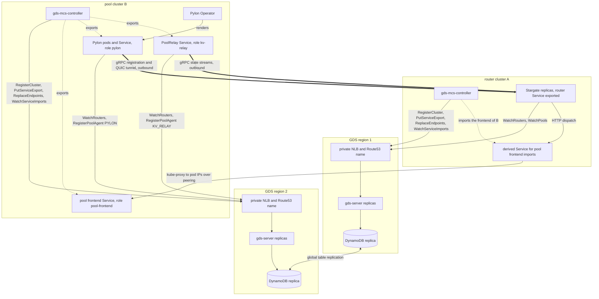
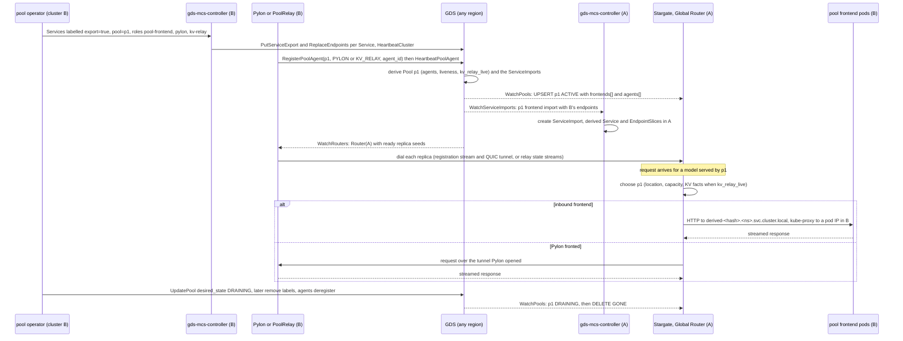

# Global Discovery Service: architecture overview

This directory holds the design of the Global Discovery Service (GDS),
`global-discovery-service-design.md`. This page is the short version: what the
components are, how they talk to each other, and how the Global Router use
case of the HLD flows through them. Section numbers refer to the design.

## Components

| Component | Where it runs | Language | Role |
| :---- | :---- | :---- | :---- |
| gds-server | Every GDS region, several stateless replicas behind a private NLB and a Route53 name | Go | The discovery registry: clusters, Service exports and endpoints, pools and pool agents, routers. Serves gRPC and REST, streams watches, evaluates leases at read time |
| Store | DynamoDB Global Table replicated to every GDS region (in-memory for tests) | | The only durable state. Every replica reads and writes the same table |
| gds-mcs-controller | Every member Kubernetes cluster | Go, controller-runtime | Registers the cluster with a lease, exports labelled Services and their endpoints to GDS, and materialises the Multi-Cluster Services API (KEP-1645) in its cluster from GDS: ServiceImport, derived Service, EndpointSlices |
| Stargate (router) | Router clusters, per region | Rust | The LLM request router and the HLD Global Router. Exports its router Service, reads other clusters' routers from GDS, accepts registrations and reverse tunnels from pylons and state streams from relays |
| Pylon | Pool clusters, one Deployment per InferenceEndpoint | Rust | Ingress agent of a pool: dials every router replica (gRPC registration, QUIC tunnel), carries requests back over the tunnel, registers as the pool's PYLON agent |
| Pool frontend | Pool clusters (Dynamo frontend) | | Ingress agent of a pool reachable inbound: routers dispatch HTTP to it through the derived VIP of its import |
| PoolRelay | Pool clusters (Dynamo) | Rust, Python | KV_RELAY agent of a pool: publishes KV catalog, readiness and load to routers over gRPC, registers as the pool's relay |
| Pylon Operator | Pool clusters | Go | Renders Pylon transports, the Pylon Service exported to GDS, and the GDS flags |
| gds-client (Rust), pkg/client (Go) | Linked into the consumers above | | Failover connection to GDS, pool and router caches, seed URL helpers, agent registration helpers |

Two design rules hold everything together:

- GDS stores facts, not projections. Clusters, exports, endpoint sets, pool
  overlays and agent registrations are written; ServiceImports, routers, pool
  state and liveness are computed in every server's view from them (4.2, 4.8).
- MCS is the dialing abstraction. A consumer in cluster A reaches a Service of
  cluster B through the derived Service the controller created in A, computed
  from the import's namespace and name. Concrete pod addresses are returned
  only where a protocol needs them, which is router seeds (4.5).

## Topology

Every arrow into GDS goes to the nearest region by DNS and fails over to
another region when it is unreachable (4.7). Nothing dials into a pool except
the HTTP dispatch to a frontend, and even that is optional: a pool fronted only
by Pylon is reached through the tunnel Pylon opened.

## The HLD use case

The Global Router HLD needs every router replica in every region to know
every pool, pools to join and leave without redeploying routers, and requests
to be dispatched to the best pool wherever it is. In GDS terms:

1. A pool joins. Its operator labels the Services of its processes:
   `gds.nvidia.com/export=true`, `gds.nvidia.com/pool=<name>` and a role
   (`pool-frontend`, `pylon`, `kv-relay`), plus model and hardware
   annotations. The controller exports them. The processes that dial out
   also register themselves as typed agents of the pool with their own
   leases, so N Pylon pods or relay replicas never fence each other (4.6).
2. GDS derives one Pool record from the exports, the optional API overlay and
   the agents. The pool is ACTIVE once an ingress agent (frontend or Pylon) is
   live, carries `kv_relay_live` when its relay is live, and becomes
   UNHEALTHY or GONE on its own when leases expire or exports disappear.
3. Every router replica everywhere sees the pool within a few seconds through
   `WatchPools`, and every controller imports the pool's frontend Service,
   giving the router cluster a local VIP for it.
4. Pylon and the relay find the routers through `WatchRouters`: one seed per
   ready router replica per cluster, built from the Router record. They dial
   out, so a pool behind NAT or a non-peered boundary still works.
5. The router dispatches. For an inbound frontend it dials the derived VIP in
   its own cluster, kube-proxy sends the request to a ready frontend pod in
   the pool cluster over the peering, and the pool's relay facts (when live)
   let a KV-aware router pick the pool holding the prefix. For a Pylon-fronted
   pool the request rides the tunnel Pylon already holds.
6. A pool leaves by draining (overlay DRAINING, routers stop choosing it),
   then removing its labels or Services and deregistering its agents.

## Routers in two modes

Stargate clusters export their router Service with `gds.nvidia.com/role=router`.
In `backend-router` mode (the existing LLM stack layout) the exported Service
fronts stargate-k8s-router pods that forward registration streams by HTTP/2
authority and QUIC by SNI to the Stargate pod named in them. In `direct` mode
the exported Service selects the Stargate pods themselves, each advertising its
pod IP, and Stargate fills the per-pod dial addresses it publishes from the GDS
Router record of its own cluster. Both modes are announced on the Router
record, both work in one clusterset, and the chart keeps backend-router mode as
the default so existing deployments render unchanged (4.5, 10).

## Where to read more

- Requirements and non-goals: design sections 1 and 1.6.
- Identifiers, labels and annotations: section 3.
- Data model and flows, including the cross-region request path: 4.2 to 4.6.
- API: section 5. The module's `docs/api.md` has the REST shapes.
- Server, storage and controller internals: 6 to 8, and the module docs under
  `src/control-plane-services/global-discovery/docs/`.
- Client libraries and integrations: 9 and 10.
- Operations: `docs/dev/global-discovery-quickstart.md`, the charts under
  `deploy/helm/global-discovery*`, and `tests/e2e/global-discovery-k3d`.
