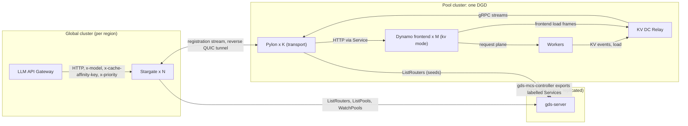
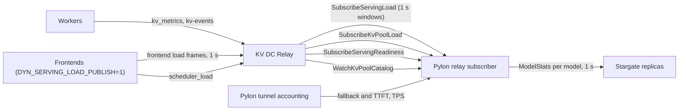
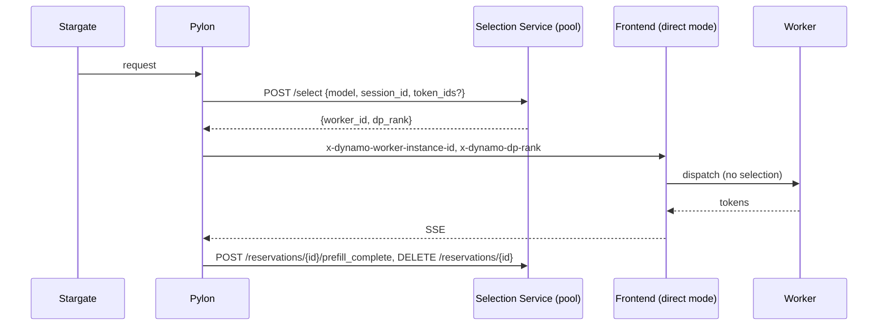

# Dynamo integration design: the LLM stack as the Global Router tier

Status: Draft v0.1, 2026-10-27. Sibling of `global-discovery-service-design.md`. This document
designs how the LLM stack (LLM API Gateway, Stargate, Pylon, Pylon Operator) is used as the
Global Router tier over Dynamo pools and how the contract between a pool's Dynamo frontend and
Pylon or Stargate changes. It consumes the Global Discovery Service (GDS) as-is: nothing here
changes the GDS API, labels, controller or clients. Where this document and the GDS design use
the same word for different things, the GDS design wins for GDS objects and this document says
so explicitly.

Sources: `ai-dynamo/dynamo` `main` at `7460ce96` (2026-10-27); nvcf `feat/inference-in-a-box`
at `eb29b23e` (Stargate workspace, Pylon Operator, gateway); the Global Router HLD (Kiro
edition) and its LLD "The Global View"; the GDS design v0.4 and the upstream comparison note
in this directory. File references are relative to those repositories.

## 0. Scope and summary

### 0.1 The question

The GDS design treats Stargate as the HLD Global Router and Pylon as the HLD Pool Relay and
gives both a discovery backend. This document goes one step further and asks what else has to
change so that the LLM stack, rather than a new set of Dynamo components, is the global tier:

1. The contract between the Dynamo frontend and Pylon or Stargate. Today the pool frontend
   chooses the worker itself. Can an upstream router override or bypass that choice?
2. Stats. Pylon forwards stats to Stargate; for a DynamoGraphDeployment (DGD) that serves
   several models, do they need to be disaggregated by worker or replica, and how do they get
   from the frontend to Stargate?
3. KV awareness. Is KV-cache-aware routing available in the LLM stack, and can routing on a
   hash of the first turn substitute for it?
4. Requirement mapping. Which HLD and sub-design requirements does the LLM stack meet, which
   does it meet differently, and which not at all. The LLM stack is not changed to fit the
   HLD; differences are recorded.

### 0.2 Decisions

| Topic | Decision |
|---|---|
| Frontend contract | Override. The pool frontend stays in `--router-mode kv`. Stargate selects the pool (its `cluster_id`) and a Pylon replica; the frontend's KV router places the worker. Stargate may pin a worker with the `x-dynamo-*` routing headers, which the frontend honours as an exact pin. Passthrough (`--router-mode direct`) and query-then-pin are optional profiles. |
| Stats path | Pylon subscribes to the pool's KV DC Relay and maps its per-model and per-pool views into Stargate's `ModelStats`, one entry per model. Pylon's own tunnel accounting and the OpenAI `usage` fallback remain the sources when the relay is absent. |
| Affinity | The gateway's multi-turn key continues to reach Stargate as `X-Cache-Affinity-Key` for the pool choice. Pylon maps it to `X-Dynamo-Session-ID` so the pool frontend's own session affinity keeps the worker sticky. Stargate holds no worker ids. |
| Multi-model DGD | One InferenceEndpoint per frontend Service with `modelName` optional. The operator omits `--model-name` and Pylon discovers models from the frontend's `GET /v1/models`, advertising every model with its own stats and status. |
| GDS | Consumed as-is: router seeds for Pylon, remote watch URLs for Stargate, the Pool catalog for pool attributes and lifecycle, the `gds.nvidia.com/*` labels on pool Services. |

### 0.3 Answers in short

1. Override exists in Dynamo today. Any HTTP request can carry `x-dynamo-worker-instance-id`
   and `x-dynamo-dp-rank` (or `nvext.backend_instance_id`); a kv-mode frontend treats it as an
   exact pin that is validated, booked and never rerouted. Passthrough also exists:
   `--router-mode direct` rejects requests without a pin and is what the Gateway API Inference
   Extension (GAIE) endpoint picker uses. A query-only mode (`nvext.annotations:
   ["query_instance_id"]`) returns the worker the frontend would choose without dispatching.
   This design keeps the frontend in kv mode and sends no pins in v1, because Stargate has no
   per-worker state and no tokenizer; the pin headers are reserved for a later feature and the
   contract for them is specified (section 3).
2. Stargate's contract has no worker grain. Stats are keyed by inference server (one Pylon
   replica) and model, and aggregated per pool (`cluster_id`). Stats do not travel on the
   QUIC tunnel; they travel on the gRPC `RegisterInferenceServer` stream. The refactoring a
   multi-model DGD needs is on the source side: one `ModelStats` per model from the relay's
   per-model frontend load and per-pool scheduler and KV load, plus a Stargate aggregation
   rule so that N Pylon replicas publishing the same pool numbers are not summed N times
   (section 5). Per-worker stats are not required for the override profile; the frontend
   scrape that would provide them is recorded for the passthrough profile.
3. The LLM stack has no KV-aware routing. Stargate never parses the body and hashes only the
   opaque `x-cache-affinity-key`, and only to a cluster under two of its algorithms. Inside a
   pool Dynamo's KV router does real prefix matching, so no substitute is needed there. Across
   pools the affinity key gives locality: a conversation stays in the pool that already holds
   its prefix, which is the HLD's "KV aware if valuable" at the global layer. A hash of the
   first turn works only when it is derived from the first user turn plus the system prompt,
   or when the client echoes the gateway's `x-multi-turn-session-id`; the gateway's default
   whole-array hash changes every turn. True global KV awareness needs token ids, which
   Stargate does not have; the paths to it are recorded as future work (section 6).
4. Section 9 maps every HLD item. Met: FR1, FR3, FR6, FR7, no global queue, PoolRelay FR2 to
   FR6, GDS 7 to 10. Partial: FR2, FR4, admission control, PoolRelay FR1. Unmet or different:
   tokenize once at the global frontend (the pool frontend tokenizes), priority retry until the
   Pylon overload classification in section 3 lands, pool tombstoning, Global Router replica
   sync (Stargate replicas hold independent registries fed all-to-all by Pylon), Global View
   KV state.

### 0.4 Relation to the GDS design and to upstream Dynamo

GDS stays as designed: a membership and metadata service with no load or KV state. This
document adds consumers and conventions on top of it (section 8) and one naming difference,
the Stargate `cluster_id` of a Dynamo pool (section 2), which it states rather than hides.

Upstream Dynamo's `global-router-v2` branch builds its own Global Frontend (`global-ingress`)
that polls a discovery service and forwards round robin to pool frontends (see
`upstream-dynamo-comparison.md`). This design is an alternative global tier over the same
pools and the same GDS: it brings the reverse QUIC tunnel (pool clusters need no inbound
path), Stargate's production load-balancing algorithms and the gateway's authentication, and
it gives up tokenization at the global tier. Both can consume GDS; nothing here precludes
running `global-ingress` next to Stargate.

### 0.5 Vocabulary

| Term here | HLD | LLM stack | Dynamo |
|---|---|---|---|
| Global Frontend | Global Frontend | LLM API Gateway plus Stargate's HTTP proxy | `global-ingress` (upstream branch) |
| Global Router | Global Router | Stargate (`llm-request-router`) | none on `main` |
| Pool | Pool, nominally one DGD | Stargate cluster (`cluster_id`) | DGD, one Dynamo namespace |
| Pool Frontend | Pool Frontend | Pylon's upstream (`--upstream-http-base-url`) | `dynamo.frontend` in `--router-mode kv` |
| Local Router | Local (Pool) Router | none | the frontend's embedded `KvRouter` (`RoutingHost`) |
| Pool Relay | PoolRelay | Pylon transport replica (registration stream and tunnel) | KV DC Relay (`dynamo.kvrelay.v1.KvEventRelay`) as the state source |
| Worker | Worker | not visible | engine instance, `worker_id` plus `dp_rank` |
| Inference server | none | one Pylon replica fronting one upstream URL | none |
| Global View | Global View | Stargate `routing_state` plus the GDS PoolCache | PoolRelay streams |

## 1. Component mapping

| HLD component | This design | Where it runs | Notes |
|---|---|---|---|
| Regional load balancer and Global Frontend | LLM API Gateway behind the regional NLB; Stargate's HTTP proxy | global (router) cluster per region | Gateway authenticates, maps `model` to `(routing_key, model)`, mints the multi-turn key, estimates input tokens. No tokenization. |
| Global Router | Stargate | global cluster, N replicas, no shared state | Level 1 picks a `cluster_id` (pool), level 2 round-robins Pylon replicas of that pool. |
| Global Discovery Service | GDS | GDS VPC per region, DynamoDB Global Table | As designed. Stargate reads routers and pools; Pylon reads routers; pool Services are labelled. |
| Pool Relay (transport, registration, heartbeats) | Pylon transport Deployment, N replicas per pool | pool cluster, next to the DGD | Registers with every Stargate replica from GDS seeds, opens one reverse QUIC tunnel per replica, pushes `ModelStats` every second. |
| Pool Relay (state aggregation) | KV DC Relay | pool cluster, per Dynamo namespace | Aggregates worker KV events, worker load, frontend load frames and readiness; serves gRPC streams; Pylon subscribes. |
| Pool Frontend | Dynamo frontend, `--router-mode kv` | pool cluster, M replicas behind `<dgd>-frontend` | Tokenizes, selects the worker, dispatches, post-processes. Publishes serving load for the relay. |
| Local Router | embedded `KvRouter` | inside each frontend replica | KV overlap plus load cost, session affinity, busy thresholds, 529 rejection. |
| Worker | engine instances | pool cluster | Publish KV events (`kv-events`) and load (`kv_metrics`). |
| Global View | Stargate `RoutedClusterSnapshot` per (routing key, model, cluster); GDS `PoolCache` | each Stargate replica | Load from `ModelStats`; catalog and lifecycle from GDS; no KV state. |
| Replica sync | none | | Each Pylon registers with every Stargate replica, so every replica sees every pool. Reservations and affinity are per replica. |



## 2. Pool identity and catalog

### 2.1 One DGD, one pool, one Stargate cluster

A pool is one DGD with its own Dynamo namespace (`<k8s-namespace>-<dgd-name>`, the operator's
default `DYN_NAMESPACE_PREFIX`). Stargate's unit of level-1 selection is the `cluster_id`
carried in every Pylon registration. For a Dynamo pool the two must coincide, otherwise two
DGDs of one model in one Kubernetes cluster collapse into one Stargate cluster, their stats are
summed, and blue/green (one pool DRAINING, one ACTIVE) is invisible to Stargate.

Today the Pylon Operator renders one `--cluster-id` for every InferenceEndpoint it manages,
taken from its own configuration (`pylon-operator/internal/transport/render.go:150-163`,
`internal/config/config.go:82-83,132`), and that value is also the LLM stack `clusterId`
that the GDS design equates with the KEP cluster id (`global-discovery-service-design.md`,
section 3, row `cluster`: "Equals the LLM stack `clusterId` of that cluster"). This design
keeps that equality for the operator's identity (registration, the SRD's cluster
registration) and introduces a second value for the Stargate `cluster_id` of a Dynamo pool:

```
cluster_id = <gds cluster>.<gds pool name>
```

where `<gds cluster>` is the KEP cluster id and `<gds pool name>` is the value of the
`gds.nvidia.com/pool` label on the pool's Services, unique within (clusterset, cluster) per
the GDS design. The composite is unique within the clusterset and joins to the GDS Pool record
on `(location.cluster, name)`. This is a difference from the GDS design's assumption that
Stargate `cluster_id` equals the KEP cluster id; it applies only to Dynamo pools, and the
`inference_server_id` keeps its `<clusterId>.<namespace>.<name>.<pod>` shape with the KEP
cluster id in front.

InferenceEndpoint changes (section 10): a new `spec.pool` (the GDS pool name) from which the
operator renders `--cluster-id=<clusterId>.<pool>`; when `spec.pool` is empty the current
behaviour (operator-wide `--cluster-id`) is unchanged. Stargate's `ListModels` then returns one
`ClusterListing` per pool, which is the correct shape for a UI that counts pools.

### 2.2 What the catalog provides

The GDS Pool record is the pool catalog (GDS design 4.2 and 5.4): `name`, `pool_id`,
`location{region, dc, cluster, zones}`, `hardware_class`, `models[]`, `worker_count`,
`ready_worker_count`, `ready_endpoint_count`, `frontends[]` (role `OPENAI` or `KV_RELAY`),
`services[]`, `labels`, `desired_state`, `state` (REGISTERED, ACTIVE, DRAINING, UNHEALTHY,
GONE), `lease`, `endpoints[]`. It is populated from the labels on the pool's Services:

| Service | Labels and annotations | GDS result |
|---|---|---|
| `<dgd>-frontend` (port 8000) | `gds.nvidia.com/export=true`, `gds.nvidia.com/role=pool-frontend`, `gds.nvidia.com/pool=<pool>`, annotations `gds.nvidia.com/pool-models=<comma list>`, `gds.nvidia.com/hardware-class`, `gds.nvidia.com/dc` | Pool record, `frontends[]` role OPENAI, `ready_endpoint_count` |
| `<dgd>-kv-relay` (port 5561) | `gds.nvidia.com/export=true`, `gds.nvidia.com/role=kv-relay`, `gds.nvidia.com/pool=<pool>` | `frontends[]` role KV_RELAY, `services[]` entry |

Stargate joins each `RoutedClusterSnapshot` whose `cluster_id` parses as `<cluster>.<pool>` to
the PoolCache entry with that `(cluster, name)`. The join supplies what Stargate lacks today:
`location.region` and `location.dc` (Stargate has no region concept; the gateway forwards
`X-NVCF-Target-Region` but no load balancer reads it), `hardware_class`, and `state`. The
first use is a candidate filter: pools whose GDS state is DRAINING or GONE are excluded from
level-1 selection for new sessions (requests carrying an affinity key bound to a DRAINING
pool keep going there until the pool is GONE, which is the HLD draining order), and an
optional regional preference keeps candidates in `X-NVCF-Target-Region` while any ACTIVE pool
there has capacity. Both are new optional Stargate inputs, off by default, and both read the
cache asynchronously so GDS is never on the request path.

### 2.3 Worker counts and draining from Pylon

GDS carries `worker_count` and `ready_worker_count` only when something writes them through
the Pool API; a pool derived purely from labels has none (GDS design 4.2). The relay knows the
pool's live workers (`PoolDeploymentStatus.live_workers`, `relay.proto:380-386`). Pylon, which
already subscribes to the relay for stats (section 5), can optionally act as the pool's GDS
writer with the `gds-client` `PoolRegistration` helper: `report_workers(live_workers,
live_workers)` on each relay window, `set_desired_state(Draining)` when the InferenceEndpoint
is deleted or marked draining, and a final deregister. This closes the GDS `worker_count` gap
for Dynamo pools without touching the DGD. It is optional because label-derived pools already
have `ready_endpoint_count` and lifecycle from the cluster lease.

## 3. Request path, override profile

### 3.1 Sequence

```mermaid
sequenceDiagram
  participant C as Client
  participant GW as LLM API Gateway
  participant SG as Stargate replica
  participant PY as Pylon (pool P, replica k)
  participant FS as Service dgd-frontend
  participant FE as Dynamo frontend (kv)
  participant W as Worker
  C->>GW: POST /v1/chat/completions (model rk/m, optional x-multi-turn-session-id)
  GW->>GW: authn, split rk/m, mint mt:v1 key, estimate input tokens, strip x-dynamo-*
  GW->>SG: x-model, x-routing-key, x-cache-affinity-key, x-priority, x-input-tokens
  SG->>SG: level 1: pick cluster_id (pool) by algorithm, optionally filtered by GDS state and region
  SG->>SG: level 2: round robin over inference servers of the pool, skip failed
  SG->>PY: request over the reverse QUIC tunnel (+ trace context, x-stargate-expected-queue-ms)
  PY->>PY: buffer body, require stream true, drop inbound x-dynamo-*, derive x-dynamo-request-priority and X-Dynamo-Session-ID
  PY->>FS: HTTP request
  FS->>FE: one frontend replica
  FE->>FE: tokenize, session binding lookup, KV overlap plus load cost, pick worker (or honour an exact pin)
  FE->>W: dispatch on the request plane
  W-->>FE: tokens
  FE-->>PY: SSE (529 before first byte when all workers are busy)
  PY-->>SG: SSE through the tunnel; Pylon records TTFT and TPS
  SG-->>GW: SSE + x-inference-server-id, x-stargate-cluster-id
  GW-->>C: SSE + x-multi-turn-session-id
```

Stargate decides the pool and the Pylon replica; the frontend decides the worker. Nothing is
decided twice: Stargate never evaluates workers, and the frontend never evaluates pools. The
duplication the question started from exists only when both tiers try to place on the same
unit, which the override profile avoids by construction. The optional pin (3.3) lets Stargate
take over the worker decision for a request when it has information the frontend lacks.

### 3.2 Header matrix

Request direction. "Keep" means forwarded unchanged.

| Header | Gateway to Stargate | Stargate to Pylon | Pylon to frontend | Consumed by |
|---|---|---|---|---|
| `x-request-id` | set | keep | keep | all hops, tracing |
| `x-model`, `x-routing-key` | set | keep | keep | Stargate routing key; frontend ignores |
| `x-routing-method` | set from `ModelSpec` | stripped | | Stargate algorithm override |
| `x-cache-affinity-key` | set (`mt:v1:<source>:<sha256>`) | keep | keep, and mapped (new) | Stargate affinity; Pylon mapping |
| `x-multi-turn-session-stable` | set to `true` when the key did not come from a fresh payload hash (new); client copies stripped | keep | stripped | Pylon mapping decision |
| `X-Dynamo-Session-ID` | stripped at ingress (new) | | set by Pylon to the affinity key when `x-multi-turn-session-stable: true` (new) | frontend session affinity |
| `x-priority` | set | keep | keep | Pylon mapping |
| `x-dynamo-request-priority`, `x-dynamo-request-strict-priority` | stripped at ingress (new) | | set by Pylon (exists) | frontend queue and engine priority |
| `x-input-tokens`, `x-token-estimate` | set (about length/4) | keep | keep | Stargate cost; frontend ignores |
| `x-nvcf-target-region` | set | keep | keep | Stargate regional preference (new, optional) |
| `x-stargate-expected-queue-ms`, trace context | | set | stripped (`x-stargate-*`) | Pylon |
| `x-stargate-route-worker-instance-id`, `x-stargate-route-dp-rank`, `x-stargate-route-prefill-instance-id`, `x-stargate-route-prefill-dp-rank` | | set only when a pin feature is enabled (new, reserved) | translated to `x-dynamo-worker-instance-id`, `x-dynamo-dp-rank`, `x-dynamo-prefill-instance-id`, `x-dynamo-prefill-dp-rank` (new) | frontend exact pin |
| any client `x-dynamo-*` | stripped (new) | | stripped (new) | nobody |
| `x-tenant-id` | not set | | not set | frontend cache salt; not used by this design |

Pins travel in Stargate's own `x-stargate-*` namespace, which Pylon already strips before the
upstream hop (`crates/pylon-lib/src/quic_http_tunnel/core.rs:1401-1408`), and Pylon
translates them. That makes Pylon the only writer of `x-dynamo-*` headers on the upstream hop:
a client cannot smuggle a pin or a session id past the gateway and Pylon. The gateway strips
inbound `x-dynamo-*` as a second line.

Response direction: the frontend sets nothing routing-related in headers; `nvext.worker_id`
exists only in the body and only when requested (`lib/llm/src/protocols/openai/
chat_completions/delta.rs:355-360`). Stargate adds `x-inference-server-id`,
`x-inference-server-url` and `x-stargate-cluster-id` (`crates/stargate/src/http_proxy/
attempt.rs:482-507`). The gateway returns `x-multi-turn-session-id`. An optional Pylon feature
(section 11) adds `nvext.extra_fields: ["worker_id"]` to the upstream body and lifts the first
chunk's worker id into an `x-dynamo-worker-id` response header for attribution.

Body: Stargate never parses the body (`docs/api-gateway-contract.md`); Pylon buffers and
validates it as JSON and requires `"stream": true` on chat and responses
(`core.rs:1067-1079`). Non-streaming callers are converted by the gateway, which already
rewrites `model`, `stream`, `stream_options`, `service_tier` and `debug`.

### 3.3 Pin semantics and the v1 rule

Dynamo's pin contract, verified on `main`:

- Headers win over the body: `x-dynamo-worker-instance-id` sets `backend_instance_id` and
  `decode_worker_id`; `x-dynamo-prefill-instance-id` sets `prefill_worker_id`;
  `x-dynamo-dp-rank` and `x-dynamo-prefill-dp-rank` set the ranks
  (`lib/llm/src/protocols/common/extensions.rs:289-302,383`).
- In kv mode the pin is validated against the frontend's discovered workers
  (`lib/llm/src/kv_router/routing_host.rs:637-667`, `InvalidArgument` "does not identify a
  known worker") and then goes through the scheduler as an exact pin: load is booked, a
  multi-rank worker needs an explicit `dp_rank`, and an overloaded pin fails as
  `PinnedWorkerOverloaded` (HTTP 529 by default) rather than being rerouted
  (`lib/kv-router/src/scheduling/selector/mod.rs:548-557`, `lib/llm/src/kv_router.rs:541-575`).
- The frontend picks the WorkerSet for a model by weighted random before it sees the pin
  (`lib/llm/src/discovery/model.rs:778-847`). During a rolling update that runs `model-a` in
  two Dynamo namespaces visible to one frontend, a pin into the other set fails with 4xx.
- A pin that disagrees with a hard-mode session binding fails
  (`lib/llm/src/kv_router/routing_host/builtin.rs:328-333`).
- `DYN_DISABLE_FRONTEND_NVEXT` drops every routing header except `x-tenant-id`
  (`lib/llm/src/http/service/service_v2.rs:1325`, `extensions.rs:498-509`).
- The KServe gRPC frontend never applies the routing headers
  (`lib/llm/src/grpc/service/openai.rs:322`); the override profile is HTTP only.

Rule for v1: Stargate sends no pins. It has no per-worker view (Stargate never sees workers,
section 5) and no tokenizer, so any pin it produced would be worse than the frontend's own
choice. The pin path is specified so that a later feature can use it under these conditions:
the pool runs `--router-session-affinity-mode soft`; the request carries no affinity key
(otherwise the binding and the pin can conflict); the relay readiness entry for the model
shows exactly one member per role (`TopologyEntry.members`, `relay.proto:250-264`), which
rules out the multi-WorkerSet case; and Pylon retries once without the pin on a 4xx
`InvalidArgument` or a `PinnedWorkerOverloaded` 529 (3.4). The first candidate feature is a
Stargate-side session-to-worker table learned from the optional `x-dynamo-worker-id` response
header; it duplicates Dynamo's affinity coordinator and is therefore not planned.

### 3.4 Overload, rejection and retry

The HLD asks for priority retry (the local router rejects, the Global Router picks another
pool), outright rejection (propagate to the client) and pool tombstoning. What exists:

- The Dynamo frontend rejects with HTTP 529 (`DYN_HTTP_OVERLOAD_STATUS_CODE` changes it) when
  every eligible worker is above the busy thresholds (`ResourceExhausted`) or a pinned worker
  is (`PinnedWorkerOverloaded`), counted in `dynamo_frontend_model_rejection_total`
  (`lib/llm/src/http/service/error.rs:12-21`, `metrics.rs:1951-1955`). The rejection arrives
  before the first SSE byte.
- Pylon classifies an upstream response as retryable only when the status is 429 or 503 and
  the upstream set `x-stargate-upstream-retryable: true`
  (`crates/pylon-lib/src/quic_http_tunnel/core.rs:94-99,1205-1216`). Stargate retries only
  when the status is 429 or 503 and `x-stargate-retryable: true` is present
  (`crates/stargate/src/http_proxy/retry.rs:48-51,173-185`), first on another backend of the
  same cluster, then on another cluster (`http_proxy/run.rs:203-233`), excluding failed
  backends and failed clusters for the rest of that request.
- Stargate's own admission gate `max_input_work_seconds` returns 503 before dispatch
  (`http_proxy/run.rs:139-152`), which the gateway maps to 529 for the client.

Dynamo sets neither Pylon header, so today every Dynamo 529 passes through Stargate to the
client and `RetryAlternateCluster` is never reached. The design adds overload classification
to Pylon's `dynamo` upstream backend (`crates/pylon-lib/src/quic_http_tunnel/backend.rs`):

| Frontend response | Pylon action | Stargate action |
|---|---|---|
| 529 (or the configured overload status) with a `ResourceExhausted` body, no pin | mark retryable, `x-stargate-retry-reason: upstream_admission_rejected` | alternate backend is pointless (same pool); go straight to alternate cluster; if none, pass the 529 through |
| 529 with `PinnedWorkerOverloaded`, pin present | re-issue once upstream with the pin stripped (body is buffered); if still 529, as above | as above |
| 400 `InvalidArgument` naming the pin | re-issue once upstream with the pin stripped | none |
| 503 from the frontend or the Service | retryable, `upstream_unavailable` | alternate backend, then alternate cluster |
| tunnel down, Pylon unreachable | | existing failed-backend handling |

With this change the HLD's priority retry is met for the overload case; the HLD's
deadline-based rejection (a request past its due time) has no counterpart in either stack and
stays unmet. Tombstoning: Stargate's failed-cluster set is per request
(`run.rs:227-230,243-245`); there is no time-based exclusion of a pool that keeps rejecting.
The GDS DRAINING filter (2.2) covers planned departure; a time-based tombstone fed by the
rejection rate is listed as future work (section 11).

## 4. Optional profiles

| Profile | Frontend mode | Who picks the worker | Extra per request | Needs | Use when |
|---|---|---|---|---|---|
| Override (default) | `kv` | frontend; Stargate may pin | none | nothing beyond this design | always, unless one of the cases below |
| Passthrough | `direct` | Stargate or Pylon, every request | one in-cluster RTT to the pool's Selection Service (`POST /select` or `/select_and_reserve`, `docs/.../router/standalone-selection.md`), or a `query_instance_id` round trip to a kv frontend | a Selection Service per pool with ZMQ reachability to worker KV event endpoints and the same worker catalog on every replica; or per-worker frontend sidecars as in GAIE | an operator wants one scheduler per pool outside the frontend (for example several frontends with divergent views), or the frontend must be a pure proxy |
| Query-then-pin | `kv` | frontend decides, Stargate re-sends with the pin and `nvext.token_data` | two tunnel round trips | nothing | only to let Stargate record the decision before dispatch; no routing benefit |

In the passthrough profile the pin is mandatory (`builtin.rs:294`, "worker ID required ...
in Direct routing mode", and the prefill side `prefill_router/mod.rs:555-559`), so Pylon
would call the pool's Selection Service with `token_ids` it does not have; the only
token-free inputs are `session_id` and precomputed hashes, so passthrough implies either the
engines' `POST /v1/chat/completions/render` tokenization endpoint (as the standalone GAIE
endpoint picker uses) or a tokenizer in Pylon. Neither is adopted. The profile is documented
so that the header contract of 3.2 covers it without change: the same `x-stargate-route-*`
headers, translated by Pylon, drive a direct-mode frontend.

## 5. Stats

### 5.1 What Stargate consumes

Stats reach Stargate on the gRPC `RegisterInferenceServer` stream, not on the QUIC tunnel.
Every message carries the complete `models` map of the registration
(`crates/proto/proto/stargate.proto:94-186`, excerpt in appendix A): one `ModelStats` and one
status per model, sent at least every `--min-update-interval-ms` (1000) and on change,
coalesced by `--stats-update-coalesce-ms` (10). Stargate keeps one
`RoutedInferenceServerSnapshot` per (inference server, routing target) and rolls them up into a
`RoutedClusterSnapshot` per (routing key, model, cluster): it sums queue sizes, running and
phase counts, input sizes and TPS across the inference servers of a cluster and takes the
latest value for the KV fields and `max_engine_concurrency`
(`crates/stargate/src/routing_state/cluster_snapshots.rs:171-313`). RTT comes from Stargate's
own `/health` probe through each tunnel every second. There is no worker grain anywhere in
this contract, and the override profile needs none: Stargate chooses pools and Pylon
replicas, not workers.

What a multi-model DGD needs is therefore one accurate `ModelStats` per model per pool, which
today Pylon cannot produce against a real Dynamo frontend: its engine stats stream
(`GET /pylon/v1/stats/stream`) is served only by Stargate's `mock-dynamo`, the KV poll
(`--kv-cache-stats-path`) has no Dynamo endpoint, and the OpenAI `usage` fallback sees only
the requests that flowed through that Pylon replica. The relay fixes the source.

### 5.2 Pylon as a relay subscriber



New Pylon flags, rendered by the operator from new InferenceEndpoint fields (section 10):

- `--kv-relay-address <host:port>` (from `spec.kvRelay.service` and `port`; plaintext gRPC
  inside the pool cluster, an mTLS sidecar if the operator requires it).
- `--kv-relay-namespace <dynamo namespace>` (from `spec.kvRelay.namespace`, default
  `<k8s-namespace>-<dgd>`), the `ModelServingLoad.namespace` to read.
- `--stats-source relay|tunnel` (default `tunnel`; `relay` falls back to `tunnel` while the
  relay is unavailable).

The subscriber keeps the relay's four streams as independent state machines, per the
contract's consumer lifecycle rules (`lib/llm/src/kv_dc_relay/docs/grpc-contract.md`,
"Consumer lifecycle rules"): reconnect with backoff on EOF, resubscribe from scratch on
`RESOURCE_EXHAUSTED` (`SUBSCRIBER_LAGGED`), treat `FAILED_PRECONDITION` as deployment skew
(log, stop retrying until restart), and treat `UNIMPLEMENTED` on `SubscribeServingLoad` as
"old relay, serving load unavailable", not as an outage. Freshness is tracked by local
receive time.

### 5.3 Field mapping

`ModelServingLoad` is keyed by `(namespace, canonical_model_id)`; `PoolServingLoad` and
`KvPoolLoadEntry` by `ProducerIdentity`; `ModelServingLoad.deployment.serving_pools` links a
model to its pools. A disaggregated DGD has two relay pools for one model (prefill and
decode); an aggregated DGD has one. Aggregation over `serving_pools` is spelled out per row.

| `ModelStats` field | Relay source | Rule |
|---|---|---|
| `queue_size`, `input_processing_queries` | `ModelServingLoad.load.requests.requests_awaiting_first_token` | set only when `load.status == COMPLETE` |
| `output_generation_queries` | `requests_generating` | same |
| `num_running_queries` | sum of the two above | same |
| `queued_input_size` | `load.tokens.awaiting_first_token_input_tokens` | same; the scheduler view `PoolServingLoad.load.tokens.active_prefill_tokens` summed over `serving_pools` is the alternative when a prefill load model is configured |
| `total_query_input_size` | `load.tokens.inflight_input_tokens` | same |
| `output_tps` | delta of `output_tokens_total` per window | within one `relay_incarnation`; reset on incarnation change; `max_output_tps` from Pylon's own estimator |
| `last_mean_input_tps`, `max_input_tps` | none | not from relay token totals: they are observed throughput, and wait-and-widen reads them as capacity (`crates/stargate/src/load_balancer/wait_and_widen.rs:41-44`); keep Pylon calibration and `--initial-input-tps` |
| `queue_time_estimate_ms_by_priority` | none | keep Pylon's per-priority estimator from tunnel accounting |
| `max_engine_concurrency` | `PoolServingLoad.deployment.max_concurrency` | sum over `serving_pools` whose `pool_roles` include DECODE or AGGREGATED; unset entries leave the field 0 ("did not report") |
| `kv_cache_capacity_tokens` | `KvPoolLoadEntry.total_kv_blocks * kv_block_size` | `kv_block_size` from the catalog `KvQuerySemantics`; only pools whose roles exclude PREFILL; only when `kv_observed_ranks == kv_expected_ranks` and capacity is nonzero; sum over qualifying pools |
| `kv_cache_used_tokens` | `kv_used_blocks * kv_block_size` | same gate |
| `kv_cache_free_tokens` | capacity minus used | same gate |
| `stats_observed_at_unix_ms` | window `observed_ms` | Stargate keeps the maximum and never ages it, so Pylon clears stale relay fields itself (5.4) |
| `stats_sources` | add `kv_relay_serving_load`, `kv_relay_pool_load` | sticky labels: "relay has been seen", not a per-window status |
| `stats_capabilities` | add `kv_cache`, `concurrency` when the respective fields are populated | sticky |

Per-model status (`InferenceServerModelRegistration.status`) comes from
`SubscribeServingReadiness`: `READY` maps to `ACTIVE`, `UNAVAILABLE` to `INACTIVE`, `UNKNOWN`
leaves the previous value. Pylon's existing bring-up and active canaries still gate `ACTIVE`;
readiness from the relay can only demote.

### 5.4 Degraded data and fallback

The relay sets gauges only when a view is `COMPLETE` ("never read an unset gauge as zero",
`grpc-contract.md`, SubscribeServingLoad). Pylon's rule: on `DEGRADED` or `UNAVAILABLE`, hold
the last `COMPLETE` values for at most three windows (the relay's own freshness horizon),
then clear the relay-sourced fields and let tunnel accounting repopulate them. The same rule
applies when the stream ends, lags or the relay is unreachable. `stats_sources` keeps
`kv_relay_*` (sticky) so operators can tell "relay configured" from "relay never seen";
`stats_observed_at_unix_ms` then reflects the tunnel source again.

### 5.5 The aggregation rule Stargate needs

Every Pylon replica of a pool subscribes to the same relay and would publish the same
pool-wide numbers. Stargate sums `queue_size`, `queued_input_size`, `num_running_queries`,
`total_query_input_size`, `output_tps` and `last_mean_input_tps` across the inference servers
of one cluster (`cluster_snapshots.rs:181-215`); only the KV fields and
`max_engine_concurrency` are latest-wins (`:34-39,298`). With K Pylon replicas the pool would
look K times busier. The design therefore requires one Stargate change: when every inference
server of a cluster reports `stats_sources` containing `kv_relay_serving_load`, treat the
request gauges of that cluster as cluster-scoped (latest-wins, the rule already applied to the
shared-engine fields; the proto comment at `stargate.proto:95-98` reserves this behaviour for
shared engine state). Mixed clusters (some replicas on the relay, some on tunnel accounting)
fall back to summing, which is wrong in the same direction as today and is logged.

### 5.6 Prerequisites on the pool

- `DYN_SERVING_LOAD_PUBLISH=1` on every frontend replica (otherwise every serving-load view is
  `UNAVAILABLE` and the relay logs a warning after 30 s).
- Workers publish KV events and load (`--kv-events-config`, the default `kv_metrics` path).
- One relay per pool, `--namespaces <k8s-namespace>-<dgd>` (or `--watch-all` in a namespace
  that holds one DGD), `--bind 0.0.0.0:5561`, a Service `<dgd>-kv-relay` labelled for GDS.
  The relay's Kubernetes discovery sees one Kubernetes namespace.
- Relay and frontends on a Dynamo release that has `SubscribeServingLoad` (merged 2026-10-22,
  `b84f3a7c`, PR #13187).

### 5.7 Per-worker stats

Not adopted. The override profile never needs them, and Stargate's contract has no slot for
them. For the passthrough profile the source would be the frontend's `/metrics`: per-worker
`dynamo_frontend_worker_active_decode_blocks`, `..._active_prefill_tokens`,
`..._active_requests{request_phase}`, `..._last_time_to_first_token_seconds`,
`..._last_input_sequence_tokens`, `..._last_inter_token_latency_seconds`, labelled
`{worker_id, dp_rank, worker_type}` without a `model` label, joined to models through
`dynamo_frontend_router_worker_state{model, target_namespace, target_component,
target_endpoint, worker_type, router_worker_id, state, reason}`
(`lib/llm/src/kv_router/metrics.rs:601-693`, `lib/llm/src/http/service/worker_metrics.rs:22-102`).
The proto slot would be `repeated WorkerStats workers` under
`InferenceServerModelRegistration` with `worker_id`, `dp_rank`, `worker_type`,
`active_requests`, `active_prefill_tokens`, `active_decode_blocks`, `last_ttft_ms`,
`last_itl_ms`. It is recorded here so that the field numbers are reserved, not added.

## 6. Affinity and KV awareness

### 6.1 What exists

LLM stack:

- The gateway mints a multi-turn key per request with precedence `prompt_cache_key`, then the
  `x-multi-turn-session-id` request header, then SHA-256 of the whole `messages` array
  (Responses: `conversation.id`; Messages: the Claude Code session header), formatted
  `mt:v1:<source>:<sha256hex>` with sources `prompt_cache_key`, `conversation_id`, `session`
  (a hashed client session id) and `payload`; a header value that already is an affinity key
  is reused verbatim, so an echoed turn-one key keeps its `payload` source string. The key
  is returned as `x-multi-turn-session-id` and sent to Stargate as `X-Cache-Affinity-Key`
  (`llm-api-gateway/api/session_affinity.go:35-207`).
- Stargate uses the key only for cluster selection and only under `wait-and-widen` with
  `cache_affinity_backend_selection_count` (consistent hash ring, 150 virtual nodes per
  cluster, `load_balancer/wait_and_widen/cache_affinity.rs:197-306`) and under the `pulsar`
  variants (rendezvous hash, `load_balancer/pulsar/ranking.rs:245-373`). The default
  `power-of-n` ignores it. Level 2 (which Pylon replica) is always round robin. A model may
  set `require_cache_affinity_key`.
- Stargate never reads the body; Pylon forwards the key upstream unchanged.

Dynamo:

- Session affinity, off by default: `--router-session-affinity-ttl-secs` plus
  `--router-session-affinity-mode hard|soft`; the header is `X-Dynamo-Session-ID`
  (`X-Dynamo-Parent-Session-ID` groups sub-agents, not needed here). The first dispatched
  request binds the session to a worker and rank; hard mode dispatches exactly to the binding
  and retries normal selection once if it is gone; soft mode feeds the binding to the selector
  as an advisory target. Bindings replicate across frontend replicas over the event plane,
  best effort (`lib/llm/src/session_affinity/replica_sync.rs:29-86`); identifiers are capped at
  256 bytes and the table at 65536 entries; a router restart clears bindings.
- Real prefix matching inside the pool: the KV router hashes the token sequence in blocks and
  scores each worker by device, host and disk overlap against prefill and decode load
  (`docs/.../router/routing-concepts.md`); `--router-predicted-ttl-secs` closes the window
  between a decision and the engine's first stored-block event.
- Cross-pool KV presence: the relay's `SubscribeKvPool` publishes a Cuckoo filter per pool
  that a consumer can query with block hashes of a tokenized prompt.

### 6.2 Design

```mermaid
sequenceDiagram
  participant C as Client
  participant GW as Gateway
  participant SG as Stargate
  participant PY as Pylon
  participant FE as Frontend
  C->>GW: turn 1, no session header
  GW->>GW: key = mt:v1:payload:sha256(messages)
  GW->>SG: X-Cache-Affinity-Key (payload source)
  SG->>SG: pulsar or wait-and-widen: pool A for this key
  SG->>PY: request
  PY->>FE: no X-Dynamo-Session-ID (fresh payload hash, not stable)
  FE->>FE: KV router places by overlap and load
  FE-->>C: response; GW adds x-multi-turn-session-id: mt:v1:payload:...
  C->>GW: turn 2 with x-multi-turn-session-id echoed
  GW->>GW: key reused verbatim; x-multi-turn-session-stable: true
  GW->>SG: X-Cache-Affinity-Key (same value), x-multi-turn-session-stable
  SG->>SG: same hash inputs, pool A again
  SG->>PY: request
  PY->>FE: X-Dynamo-Session-ID: mt:v1:payload:... (stable)
  FE->>FE: binding lookup; soft mode keeps the worker while eligible
```

Rules:

1. Level 1 locality. Dynamo pools are configured with an algorithm that honours the affinity
   key (`pulsar`, `pulsar-wait-and-widen`, or `wait-and-widen` with a selection count) in the
   per-model `--lb-config-path`. `power-of-n` stays available for models where locality does
   not matter. This keeps a conversation in the pool whose workers already hold its prefix.
2. Level 2 stays round robin. Which Pylon replica carries the request does not affect KV
   placement because every replica dials the same frontend Service, and Dynamo replicates
   bindings across frontend replicas.
3. Pylon maps `x-cache-affinity-key` to `X-Dynamo-Session-ID` only when the gateway marks the
   key stable with a new header, `x-multi-turn-session-stable: true`, set for keys from
   `prompt_cache_key`, `conversation.id`, a client session header or an echoed
   `x-multi-turn-session-id`, and never for a fresh hash of the message array. The source
   string inside the key cannot carry this distinction because an echoed turn-one key keeps
   its `payload` label. A fresh payload hash changes every turn and would only churn the
   frontend's binding table (65536 entries). The mapped value (about 80 bytes) is within
   Dynamo's 256-byte cap. The gateway strips any client-supplied copy of the new header.
4. Pool frontends run `--router-session-affinity-ttl-secs` (300 suggested) in `soft` mode. Hard
   mode rejects when a binding and an explicit target disagree, and a concurrent same-session
   request on a replica that has not yet received the binding would be placed anew in either
   mode (a cache miss, not an error). Soft mode also lets the KV router move a session off an
   overloaded worker.
5. `x-tenant-id` and `nvext.cache_salt` are KV isolation (they salt block hashes), not
   affinity, and are not used by this design.

### 6.3 First-turn hash as a substitute

The question was whether routing on a hash of the first message can replace KV-aware routing.

- Inside a pool, no substitute is needed: the frontend's KV router matches the actual prefix
  blocks of every request, including turn two of a conversation whose turn one landed on a
  worker chosen by load alone.
- Across pools, a stable per-conversation key gives locality, which is what the HLD's FR4
  ("KV aware routing if it is valuable at the global layer") can mean without a tokenizer: the
  pool that served turn one holds the prefix, so routing turn two there yields the reuse.
  The key does not know whether the prefix is still cached; a pool that evicted it still gets
  the request, and a pool that happens to hold a shared system prompt is never preferred. That
  is the gap between locality and KV awareness.
- The gateway's default key is not a first-turn hash: it hashes the whole array, so turn two
  hashes differently unless the client echoes `x-multi-turn-session-id` or sends
  `prompt_cache_key` (the OpenAI field that exists for exactly this). For clients that cannot
  echo, an optional gateway mode derives the key from the system prompt plus the first user
  turn. Its limits: two conversations with the same opening collide onto one pool (harmless
  for routing, and useful for a shared system prompt); a conversation that edits its first turn
  moves pools; the key must stay a hash so no prompt text leaves the gateway.
- What first-turn hashing cannot give is the cost-function input the HLD describes
  (predicted reusable blocks per pool). That needs token ids and either the relay's Cuckoo
  filters or a per-pool overlap query (`/overlap_scores` on a Selection Service). Stargate
  has neither tokens nor a tokenizer. Three future paths, none adopted: a tokenizer in
  Stargate (one per model family, the HLD's own "text tokenization at the Global Frontend"
  decision); the engines' `POST /v1/chat/completions/render` endpoint, as the standalone
  GAIE endpoint picker uses (one extra RTT, and it needs a reachable engine before the pool
  is chosen); or the frontend's `query_instance_id` round trip, which returns `token_ids` and
  the frontend's choice but only for the pool it was sent to.

Verdict: the first-turn or session key substitutes for KV-aware pool selection as locality,
not as KV awareness, and nothing substitutes for it inside the pool because Dynamo already
provides it there. FR5 (do not preclude global KV awareness later) holds: the key and the
pool choice are inputs a later token-aware scorer can extend.

## 7. Multi-model DGD

A DGD may serve several models behind one frontend Service (the frontend watches every model
in its Dynamo namespace; WorkerSets are keyed by namespace, component, endpoint, model and
worker type). The InferenceEndpoint CR today is one model per Service (`modelName` required,
`inferenceAPIFormat`, `service{name,port}`, `health{path}`, `canary`, `maxEngineConcurrency`,
`gpu`; `pylon-operator/api/v1alpha1/inferenceendpoint_types.go:92-122`), the operator always
renders `--model-name` (`internal/transport/render.go:164`), and the prober fails `Ready` with
`ModelNameMismatch` when the upstream listing lacks that name and scales the transport to
zero (`internal/prober/prober.go:139-167`, `internal/transport/transport.go:84-110,286-290`).

Design:

- `spec.modelName` becomes optional. When empty, the operator omits `--model-name`, Pylon
  uses its existing `--model-discovery-provider=dynamo` poll of the frontend's `GET /v1/models`
  (every 5 s, `crates/pylon-lib/src/model_discovery.rs:27-126`), and advertises every listed
  model with its own `ModelStats` (section 5) and status. When set, behaviour is unchanged.
- Status gains `models[]` per server (`inferenceServerId`, model id, advertised status),
  sourced from Pylon's metrics (`pylon_model_advertised_status`), and the `Ready` condition
  requires at least one advertised model instead of the named one. The print column shows the
  model count when `modelName` is empty.
- The GDS `gds.nvidia.com/pool-models` annotation on the frontend Service lists every model
  the DGD serves; it is static metadata for the catalog and does not drive Pylon.
- Stargate is unchanged: a registration already carries a map of models.

Caveats and rules:

- The frontend lists only models whose WorkerSet is complete
  (`lib/llm/src/http/service/openai.rs:4760-4766`). A disaggregated model disappears from
  `/v1/models` during a prefill restart; Pylon retires removed models immediately
  (`crates/pylon-lib/src/model_lifecycle.rs:341-399`) and Stargate drops the routing target
  (`crates/stargate/src/routing_state/registration.rs:134-150,414-432`), and re-adding runs
  bring-up again. Pylon's discovery therefore requires N consecutive misses (3 suggested, 15 s)
  before retiring a model and marks it `INACTIVE` in the meantime; the relay readiness stream,
  when configured, is the authoritative demotion signal.
- Per-DGD Dynamo namespaces are a hard requirement for pools. With `globalDynamoNamespace:
  true` the frontend's prefix becomes the global namespace
  (`deploy/operator/api/v1beta1/dynamocomponentdeployment_types.go:469-473`), it lists and
  forwards to other DGDs' workers, and pool identity, DRAINING and stat attribution all
  break. Pylon can cross-check `/v1/models` against the relay catalog registrations of its
  namespace and log models that the pool's workers do not serve.
- Two DGDs of one model visible to one frontend (a rolling update that keeps one frontend)
  make the frontend choose the WorkerSet by weighted random; this is fine for the override
  profile and is the reason the pin rule in 3.3 requires one member per role.
- `maxEngineConcurrency` on the CR is per endpoint; with several models it applies to each
  unless the relay supplies `max_concurrency` per pool, which takes precedence.

## 8. GDS usage (as-is)

| Consumer | GDS API or client | Purpose |
|---|---|---|
| Pylon | `RouterCache`, `pylon_seed_urls` | Stargate seeds: the per-cluster replica addresses of every router cluster, replacing `--stargate-address` (GDS design 4.5 and 10). |
| Stargate | `RouterCache`, `remote_watch_urls` | Remote `WatchStargates` peers (GDS design 10). |
| Stargate | `PoolCache` (`ListPools`, `WatchPools`) | Pool attributes (region, DC, hardware class, models) and lifecycle (DRAINING, GONE) joined by `(cluster, name)` to `cluster_id` (2.2). |
| Pylon (optional) | `PoolRegistration` | `worker_count`, `ready_worker_count`, `desired_state` for the pool (2.3). |
| gds-mcs-controller | labels on `<dgd>-frontend` and `<dgd>-kv-relay` | Pool record and relay endpoint in the catalog (2.2). |
| Global Router (Dynamo, upstream) | unchanged | `global-ingress` may consume the same records; out of scope here. |

No GDS field, label, RPC or client changes. The relay address Pylon dials comes from the
InferenceEndpoint (`spec.kvRelay`), not from GDS, because Pylon and the relay share a cluster
and the CR is the operator's source of truth; the GDS `services[]` kv-relay entry is the
fallback when `spec.kvRelay` is unset and `spec.pool` names a pool whose record carries one.

## 9. Requirement mapping

Verdicts: Met, Partial, Different (met by another mechanism with a stated gap), Unmet.

### 9.1 Functional requirements (HLD 1.3)

| Item | Verdict | What the LLM stack provides | Difference |
|---|---|---|---|
| FR1 route to workers across nodes, DGDs, clusters, DCs, regions | Met | Stargate picks any registered pool; Pylon's reverse tunnel reaches pools in any cluster or region; GDS lists them | Workers are reached through the pool frontend, never directly; the HLD's picture is the same |
| FR2 topology-aware routing at all layers | Partial | RTT per inference server (health probe through the tunnel), `X-NVCF-Target-Region`, GDS `location` through the PoolCache join | Cross-region and cross-DC only; no inter-node or intra-node input at the global tier (that is the pool's job in both designs) |
| FR3 load-aware and session-affinity routing | Met | `ModelStats` with optimistic reservations, comparators `ttft`, `queue-time`, `utilization`, `num-requests-queued`; affinity key under `pulsar` and `wait-and-widen` | Affinity is a hash, not a binding table; `power-of-n` ignores it |
| FR4 KV-aware routing if valuable globally | Partial | Locality by affinity key (6.3) | No predicted-reuse input; no token ids at the global tier |
| FR5 do not preclude global KV awareness | Met | Body is opaque and untouched; the relay's CKF streams exist; three token-source paths identified | |
| FR6 do not limit stateful response APIs | Met | Stargate does not parse the body; gateway supports Responses and Messages keys | |
| FR7 pools enter and leave without breaking routers | Met | GDS membership, Pylon registration and heartbeats, DRAINING filter | |

### 9.2 Key decisions and request lifecycle (HLD 2.2)

| Item | Verdict | Notes |
|---|---|---|
| Text tokenization at the Global Frontend, MM in the pool | Different | The gateway sends an input token estimate (about length/4); the pool frontend tokenizes once. No token ids cross Pylon. Tokenize-once holds, at the pool instead of the global tier. |
| No queue in the Global Router | Met | Stargate has reservations and an admission gate; `wait-and-widen` is a bounded in-request wait per replica, not a queue. |
| Two separate services (global and pool router) | Met | Stargate and the frontend's `KvRouter`. |
| EPD disaggregation inside one pool | Met | The pool frontend coordinates prefill and decode; Stargate sees one pool. |
| VPC peering for connectivity | Different | Not required for the request path (reverse tunnel, outbound only from the pool). Still required by GDS for ClusterSetIP imports and by Dynamo's own request plane if used across clusters. |
| Admission control: priority retry | Partial | Met for overload once Pylon classifies Dynamo 529 (3.4); unmet for deadline-based proactive rejection, which neither stack implements. |
| Admission control: outright rejection | Met | 529 passes through to the client when no alternate pool exists; Stargate's `max_input_work_seconds` returns 503 (529 at the gateway). |
| Admission control: pool tombstoning | Unmet | Failed clusters are excluded per request only; GDS DRAINING covers planned departure; time-based tombstoning is future work. |

### 9.3 PoolRelay functional requirements (LLD 1.1)

| Item | Verdict | Notes |
|---|---|---|
| FR1a discovery events (registered, active, draining, unhealthy, gone) | Met | GDS states plus Pylon status (`ACTIVE`, `INACTIVE`) and relay readiness. |
| FR1b load state (requests, input tokens in flight, KV utilisation, prefill and decode pressure) | Met | `ModelStats` from the relay (5.3): running, awaiting first token, inflight tokens, KV used and capacity, `active_prefill_tokens` and `active_decode_blocks` as alternatives. |
| FR1c KV cache state into the Global Router's KV indexer | Unmet | Stargate has no KV indexer; the relay's CKF stream is not consumed. |
| Staleness within one publish interval | Met | Relay windows 1 s, Pylon heartbeat 1 s, coalesce 10 ms; relay freshness 3 s. |
| FR2 dynamic discovery, routable once healthy, removed before frontends stop | Met | Pylon registers after bring-up canaries; DRAINING in GDS precedes removal; a departing Pylon closes its streams and Stargate drops the target. |
| FR3 descriptive metadata (location, hardware, models, worker count, frontend endpoints) | Met | GDS Pool record; `models` in the registration; worker counts via `PoolRegistration` (2.3). |
| FR4 cross-region registration, one-way, tolerant of latency | Met | Pylon dials every Stargate replica in every region from GDS seeds. |
| FR5 off the request path | Different | Pylon is on the request path (it is the transport); the relay is off it. A Pylon failure degrades one tunnel, Stargate fails over to another replica of the pool. |
| FR6 same inputs as a frontend, no new engine instrumentation | Met | The relay consumes worker KV events, load and frontend frames; Pylon consumes the relay and its own traffic. |

### 9.4 Global Router sync (LLD 1.2)

| Item | Verdict | Notes |
|---|---|---|
| 1 every replica sees every pool | Met | Every Pylon registers with every Stargate replica (all-to-all); connection count is pools times Pylon replicas times Stargate replicas. |
| 2 replicas exchange dispatched-but-unreported load and affinity decisions | Unmet | Stargate replicas do not talk to each other; each holds its own reservations until the next heartbeat (1 s). Affinity is a hash, so replicas agree without exchange. |
| 3 eventual consistency, agree on routability within a timeout | Met | Registration streams and GDS leases bound disagreement to seconds. |
| 4 no external coordination store, rebuild from relays | Met | Stargate rebuilds from Pylon registrations on restart; GDS is a membership service, not a routing store, and Stargate works from its last registrations if GDS is unavailable. |
| 5 cross-region, hierarchical alternative possible | Met | Pylon registers across regions; a regional Stargate could register as an inference server of a parent Stargate (not designed). |

### 9.5 GDS requirements (LLD Global View 1.1, items 7 to 10)

| Item | Verdict | Notes |
|---|---|---|
| 7a pool registry and lifecycle | Met | GDS. |
| 7b load-bearing state | Met | `ModelStats` from the relay, not GDS (GDS non-goal). |
| 7c KV cache state | Unmet | Not consumed. |
| 8 at-will participation | Met | GDS plus Pylon. |
| 9 descriptive metadata and queries | Met | GDS `ListPools` filters. |
| 10 cross-region availability, least-loaded pools across regions | Met | GDS is multi-region; Stargate holds pools from every region with load. |

### 9.6 LLD Global Router API table

| LLD endpoint | This design |
|---|---|
| `generate`, `prefill_generate`, `decode_generate` with outcome contract and retry-next-best | Stargate proxy with `AlternateCluster` retry after the Pylon classification (3.4); no explicit Ambiguous outcome. |
| `RegisterPool`, `Heartbeat`, `DeregisterPool` | GDS `PoolService` (labels or `PoolRegistration`) for the catalog; `RegisterInferenceServer` for the live registration with Stargate. |
| `GET /pools`, `GET /pools/{id}` | GDS `ListPools`, `GetPool`; Stargate `ListModels` per cluster. |
| `POST /overlap_scores` | Not available (no tokens). |
| `GET /loads`, `POST /potential_loads` | `ModelStats` per cluster inside Stargate; no external API. |
| `POST /select`, `/select_and_reserve`, `/reservations` | Internal to Stargate (reservations per replica); the pool's Selection Service exists for the passthrough profile. |
| Session placement (AffinityCoordinator) | Hash-based at the global tier; Dynamo's coordinator at the pool. |

### 9.7 LLD open questions

| # | Question | Answer in this design |
|---|---|---|
| 1 | push, pull or discovery for registration | Push: Pylon registers with routers found through GDS; the relay stays pull-only for its own streams. |
| 2 | CKF vs RAW default | Neither consumed by the global tier. |
| 3 | metadata in `KvPoolDescriptor` vs registration | In GDS (labels) and the Stargate registration (`models`); the relay keeps its descriptor. |
| 4 | load source: event plane vs Prometheus | Event plane through the relay (`SubscribeServingLoad`), not Prometheus. |
| 5 | proxy layer: Dynamo Frontend vs Pingora | Stargate plus the Pylon tunnel in front of the Dynamo frontend. |
| 6 | request-plane load per model vs per pool | Both: the relay reports per model and per pool; Stargate consumes per model per pool. |
| 7 | PoolRelay HA model | K Pylon replicas per pool, each a full registration; relay replicas are a Dynamo concern. |
| 8 | rename timing | Not applicable. |
| 9 | how a PoolRelay learns Global Router addresses | GDS `ListRouters` through `RouterCache` (`pylon_seed_urls`). |

## 10. Change list

Sizes: S under a day, M a few days, L a week or more. Nothing here changes GDS.

### 10.1 LLM stack

| Component | Change | Why | Where | Size |
|---|---|---|---|---|
| Pylon | Relay subscriber: four gRPC streams, `ModelStats` mapping (5.3), degraded handling (5.4), readiness to status | Per-model stats for multi-model DGDs from an authoritative source | new module next to `crates/pylon-lib/src/stats/engine_stats_stream.rs`; flags in `crates/pylon/src/main.rs` | L |
| Pylon | Map `x-cache-affinity-key` (`prompt` and `session` sources) to `X-Dynamo-Session-ID` | Worker stickiness inside the pool | `crates/pylon-lib/src/quic_http_tunnel/backend.rs` (`UpstreamBackend::Dynamo`) | S |
| Pylon | Drop inbound `x-dynamo-*`; translate `x-stargate-route-*` to `x-dynamo-*` | Pylon is the only writer of routing headers upstream | `backend.rs`, `core.rs` header filtering | S |
| Pylon | Overload classification for Dynamo 529 and pin failures, one retry without pin | HLD priority retry | `core.rs:94-99,1205-1216` retry disposition | M |
| Pylon | Model discovery hysteresis (N misses before retire, `INACTIVE` meanwhile) | `/v1/models` flaps during prefill restarts | `crates/pylon-lib/src/model_discovery.rs`, `model_lifecycle.rs` | S |
| Pylon (optional) | `nvext.extra_fields: ["worker_id"]` injection and `x-dynamo-worker-id` response header | Worker attribution | `core.rs` body rewrite next to `stream_options` | S |
| Pylon (optional) | GDS `PoolRegistration` writer for worker counts and draining | Fill GDS `worker_count` for Dynamo pools | new, uses `gds-client` | M |
| Stargate | Cluster-scoped request gauges when all backends report `kv_relay_serving_load` | K replicas must not sum pool-wide numbers | `crates/stargate/src/routing_state/cluster_snapshots.rs:171-313` | M |
| Stargate | PoolCache join by `(cluster, name)`; DRAINING and GONE filter; optional regional preference | Pool lifecycle and topology inputs | new `routing_state/pool_catalog.rs`, candidate filter in `load_balancer/router.rs` | M |
| Stargate | `x-stargate-route-*` emission hook (behind a feature flag, off) | Reserved pin contract | `http_proxy/upstream.rs:105-121` (`headers_for_upstream_attempt`) | S |
| Stargate | Retry reasons `upstream_admission_rejected` to alternate cluster directly | Skip the pointless same-pool retry | `http_proxy/retry.rs`, `run.rs:203-233` | S |
| Gateway | Emit `x-multi-turn-session-stable`; strip inbound `x-dynamo-*` and client copies of that header; optional first-turn key mode | Pylon's mapping decision; header trust; clients that cannot echo the session header | `api/session_affinity.go`, `provider/stargate.go` | S |
| Pylon Operator and CRD | `spec.pool`, `spec.kvRelay{service, port, namespace}`, `spec.modelName` optional, `status.servers[].models[]`, per-endpoint `--cluster-id=<clusterId>.<pool>`, render the new Pylon flags, skip the name check when unset | Pool identity, relay address, multi-model | `api/v1alpha1/inferenceendpoint_types.go`, `internal/transport/render.go`, `internal/prober/prober.go` | M |
| Charts | `llm-request-router`: lb config examples for Dynamo pools (`pulsar`, `wait-and-widen` with selection count), GDS pool filter values; `pylon-operator`: nothing beyond the CRD | Operability | `deploy/helm/llm-request-router`, `deploy/helm/pylon-operator` | S |
| Docs | `docs/dev/` quickstart for a Dynamo pool behind Pylon with the relay | | | S |

### 10.2 Dynamo pool (chart and values, no Dynamo code)

| Change | Why |
|---|---|
| Frontend: `--router-mode kv`, `--router-session-affinity-ttl-secs 300`, `--router-session-affinity-mode soft`, `DYN_SERVING_LOAD_PUBLISH=1`, optionally `--router-predicted-ttl-secs 5` | Worker placement, session stickiness, relay serving load |
| Workers: KV events and load publishing enabled | Relay KV and load views |
| KV DC Relay Deployment and Service `<dgd>-kv-relay` per pool, `--namespaces <k8s-ns>-<dgd>`, port 5561 | Stats source |
| Service labels and annotations (2.2) on `<dgd>-frontend` and `<dgd>-kv-relay` | GDS catalog |
| One Dynamo namespace per DGD (no `globalDynamoNamespace`) | Pool identity |
| InferenceEndpoint per DGD: `service: <dgd>-frontend:8000`, `pool: <pool>`, `kvRelay: <dgd>-kv-relay:5561`, `modelName` empty for multi-model | Pylon in front of the pool |

### 10.3 Dynamo code

None required. Two items would help and are candidates for upstream issues, not
prerequisites: an `x-dynamo-worker-id` response header set by the frontend (removes the body
rewrite in Pylon), and a frontend-side option to keep a model listed in `/v1/models` while
its WorkerSet is temporarily incomplete.

## 11. Risks and open points

1. Stats summing. Until the Stargate cluster-scoped rule (5.5) lands, enabling the relay source
   on a pool with K Pylon replicas inflates its load K times; ship the Pylon relay source behind
   a flag and the Stargate rule in the same release.
2. Input TPS. Relay token totals are throughput, not capacity; `wait-and-widen` and the `ttft`
   comparator depend on `last_mean_input_tps` as capacity. Calibration stays Pylon's job; a pool
   that only ever sees light traffic keeps a low estimate.
3. Degraded gauges. While a relay view is `DEGRADED` (a frontend starting, a router roster
   change) the gauges are unset; Pylon holds the last values for 3 s and then falls back. A
   pool will look idle for a moment after a long degradation; the busy-threshold 529 path
   protects the workers.
4. Relay transport. Plaintext gRPC in the pool cluster; an mTLS sidecar is the relay's own
   answer. One relay per Kubernetes namespace limits namespace layouts.
5. Retry classification depends on error bodies. Pylon must recognise Dynamo's
   `ResourceExhausted` and `PinnedWorkerOverloaded` responses; a frontend configured with
   `DYN_HTTP_OVERLOAD_STATUS_CODE=503` is the simpler contract and should be the recommended
   pool setting.
6. Affinity staleness. Bindings replicate best effort across frontend replicas; a burst of
   concurrent turns of one session may land on different workers until the binding propagates.
   Soft mode makes this a cache miss, never an error.
7. Header trust. The design makes Pylon the only writer of `x-dynamo-*` upstream and strips
   them at the gateway; any other ingress into the pool frontend (direct access, Dynamo's own
   gateway) bypasses that and is out of scope.
8. gRPC frontend. The override profile is HTTP only; a pool exposing the KServe gRPC frontend
   gets no pins and no session header.
9. First-turn key collisions and edits: see 6.3; the gateway mode is optional.
10. Tombstoning. Time-based exclusion of a pool with a high rejection rate is not designed;
    `dynamo_frontend_model_rejection_total` and Stargate's retry counters are the inputs.
11. Multi-pool models in one relay namespace. If a Dynamo namespace ever holds two DGDs of one
    model, `ModelServingLoad` merges them; the one-DGD-per-namespace rule prevents it.
12. Two selection levels versus the HLD's one. Stargate chooses a pool and then a Pylon replica
    round robin; the HLD describes one cost function over pools. The second level has no
    routing effect in this design (every replica reaches the same frontend Service) but it does
    spread tunnel load; the Stargate shared-engine rule keeps the stats consistent.
13. `x-dynamo-routing-mode`. Emitted by Dynamo's own endpoint picker and not consumed by the
    frontend; this design does not emit it.
14. Upstream alignment. The pin header names (`x-stargate-route-*`), the `kv_relay_*` source
    labels and the `WorkerStats` reservation should be raised with the Stargate owners before
    the port to `ai-dynamo/stargate`; the relay consumer rules should be checked against the
    Dynamo relay owners' plans for a relay-to-router stream transport (upstream comparison,
    section 1.2).

## 12. Appendix

### A. Proto excerpts

Stargate registration and stats (`crates/proto/proto/stargate.proto:94-186`, comments omitted):

```proto
message ModelStats {
  double last_mean_input_tps = 1;
  double output_tps = 2;
  uint64 queue_size = 3;
  uint64 queued_input_size = 4;
  double max_output_tps = 5;
  uint64 kv_cache_capacity_tokens = 6;
  uint64 kv_cache_used_tokens = 7;
  uint64 kv_cache_free_tokens = 8;
  uint64 num_running_queries = 9;
  uint64 max_engine_concurrency = 10;
  uint64 total_query_input_size = 11;
  map<uint32, uint64> queue_time_estimate_ms_by_priority = 12;
  uint64 input_processing_queries = 13;
  uint64 output_generation_queries = 14;
  uint64 stats_observed_at_unix_ms = 15;
  repeated string stats_capabilities = 16;
  repeated string stats_sources = 17;
  optional double max_input_tps = 18;
}
message InferenceServerRegistration {
  string inference_server_id = 1;
  string inference_server_url = 2;
  map<string, InferenceServerModelRegistration> models = 3;
  bool reverse_tunnel = 4;
  string cluster_id = 5;
}
message InferenceServerModelRegistration {
  ModelStats stats = 1;
  InferenceServerStatus status = 2;
}
```

Relay serving load (`lib/llm/src/kv_dc_relay/wan/grpc/protocol/relay.proto:306-441`,
abridged):

```proto
enum DataStatus { UNSPECIFIED = 0; COMPLETE = 1; DEGRADED = 2; UNAVAILABLE = 3; }
message RequestLifecycleStats {
  uint64 requests_started_total = 1; uint64 requests_completed_total = 2;
  uint64 requests_failed_total = 3;  uint64 requests_cancelled_total = 4;
  optional uint64 requests_awaiting_first_token = 5; optional uint64 requests_generating = 6;
}
message TokenLoadStats {
  optional uint64 active_prefill_tokens = 1; optional uint64 active_decode_blocks = 2;
  optional uint64 awaiting_first_token_input_tokens = 3; optional uint64 inflight_input_tokens = 4;
  optional uint64 input_tokens_total = 5; optional uint64 output_tokens_total = 6;
}
message LoadView { RequestLifecycleStats requests = 1; TokenLoadStats tokens = 2; DataStatus status = 3; uint64 source_observed_ms = 4; }
message PoolDeploymentStatus { optional uint64 live_workers = 1; optional uint64 max_concurrency = 2; }
message PoolServingLoad { ProducerIdentity producer = 1; LoadView load = 2; PoolDeploymentStatus deployment = 3; }
message ModelDeploymentStatus { uint64 expected_frontends = 1; uint64 observed_frontends = 2; uint64 ready_frontends = 3; repeated KvPoolId serving_pools = 4; }
message ModelServingLoad { string namespace = 1; string canonical_model_id = 2; LoadView load = 3; ModelDeploymentStatus deployment = 4; }
message ServingLoadUpdate { uint32 protocol_version = 1; RelayIdentity relay = 2; uint64 window_sequence = 3; uint64 observed_ms = 4; uint64 window_ms = 5; repeated PoolServingLoad pools = 6; repeated ModelServingLoad models = 7; }
message KvPoolLoadEntry { ProducerIdentity producer = 1; uint64 kv_used_blocks = 2; uint64 total_kv_blocks = 3; uint32 kv_observed_ranks = 4; uint32 kv_expected_ranks = 5; }
```

### B. Dynamo routing headers consumed by the frontend

| Header | Sets | Note |
|---|---|---|
| `x-dynamo-worker-instance-id` | `backend_instance_id`, `decode_worker_id` | exact pin |
| `x-dynamo-prefill-instance-id` | `prefill_worker_id` | disaggregated prefill pin |
| `x-dynamo-dp-rank` | `dp_rank` | required for multi-rank workers |
| `x-dynamo-prefill-dp-rank` | `prefill_dp_rank` | |
| `x-dynamo-request-priority` | `agent_hints.priority` | Pylon sets it from `x-priority` |
| `x-dynamo-request-strict-priority` | `agent_hints.strict_priority` | Pylon sets 0 |
| `x-dynamo-session-id` | session identity | affinity only with a TTL configured |
| `x-dynamo-meta-<key>` | request metadata | `x-dynamo-meta-policy-class` picks a router queue |
| `x-tenant-id` | `cache_salt` | isolation, not used here |

Source: `lib/llm/src/protocols/common/extensions.rs:289-302`, `lib/llm/src/protocols/
agents.rs:18-20`, `lib/llm/src/http/service/metadata.rs:21`.

### C. Passthrough profile sequence



Without token ids the Selection Service scores on load and session only; see section 4.

### D. Glossary

- Affinity key: the gateway's `mt:v1:<source>:<sha256>` value sent as `X-Cache-Affinity-Key`.
- Cluster (Stargate): the level-1 routing unit, `cluster_id` in a registration; a pool here.
- Cluster (GDS, KEP): a Kubernetes cluster in the clusterset; the operator's `clusterId`.
- Inference server: one Pylon transport replica and its upstream URL.
- Override profile: frontend in kv mode, optional pins.
- Passthrough profile: frontend in direct mode, mandatory pins.
- Pool: one DGD, one Dynamo namespace, one GDS Pool record.
- Relay: the KV DC Relay (`dynamo.kvrelay.v1.KvEventRelay`).
- WorkerSet: the frontend's admitted set of replicas for (namespace, component, endpoint, model, worker type).

### E. References

- `global-discovery-service-design.md` (v0.4), `network-interaction-comparison.md`,
  `qa-gds-value-for-llm-stack.md`, `upstream-dynamo-comparison.md` in this directory.
- Global Router HLD (Kiro edition) and LLD "The Global View", Google Docs
  `1RAof5FdJAuyYVt2qf2CaL6-GY8hYxc1C7XAZ6g2DK1k`, `1YsF88FWGO0-vU1n6lkCP7x-kaqqj6MLoRgGPBoBs7gY`.
- Dynamo: `docs/fern/pages/developer-guide/knowledge-base/modular-components/router/`
  (`routing-concepts.md`, `configuration-and-tuning.md`, `worker-filtering.md`,
  `standalone-selection.md`, `multi-dc-kv-routing.md`), `docs/fern/pages/reference/components/
  gateway-api-routing.mdx`, `docs/fern/pages/developer-guide/additional-resources/
  nvidia-request-extensions-nvext.md`, `docs/fern/pages/use-cases/agents/session-ids.mdx`,
  `lib/llm/src/kv_dc_relay/docs/grpc-contract.md`.
- LLM stack: `src/libraries/rust/stargate/docs/load-balancer-configuration.md`,
  `multi-backend-clusters.md`, `runtime-stats-interface.md`, `api-gateway-contract.md`;
  `docs/overview/llm-gateway.md`; `/Users/estroczynski/projects/nvidia/inference-endpoints-design.md`.
