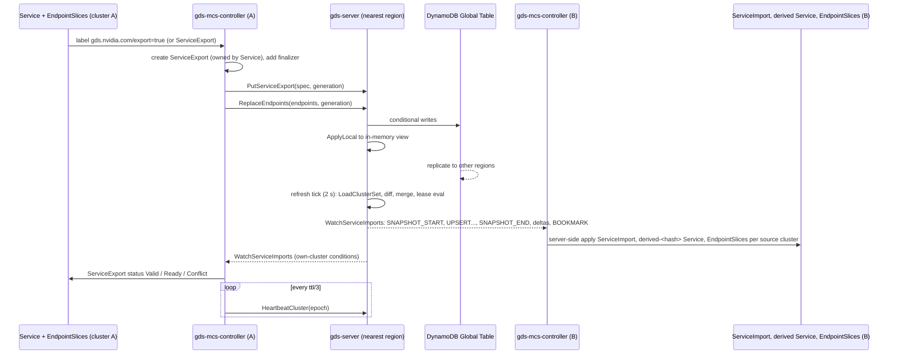

# Global Discovery Service (GDS): Design

Status: Draft v0.6, 2026-10-28 (v0.1 initial design; v0.2 adds the cross-region request path
flow and its prerequisites, the explicit pool dispatch address, the draining order and the
registration-direction neutrality, from `network-interaction-comparison.md`; v0.3 replaces the
derived-VIP pylon seed with per-cluster router replica seeds, 4.5; v0.4 records the integration
decisions on the advertised dial address and the seed scheme, 4.5 and 10; v0.5 models the
PoolRelay and Pylon as distinct typed pool agents with their own Services and registrations,
3, 4.2, 4.3, 4.5, 4.6, 5.4, 9 and 10; v0.6 adds the direct router mode, in which pylons and
relays dial Stargate pods found through GDS and the stargate-k8s-router becomes an optional,
backwards-compatible mode, 2.3, 3, 4.5, 10, 11 and 15). Author:
E. Stroczynski. Design for the Global Discovery Service
of the Dynamo Global Router (Global Router HLD, Kiro edition, section 2.4 "Discovery", and the
"LLD: The Global View" GDS requirements), scoped by the "Global Discovery Service" workstreams of
the Kiro Global Router Task Breakdown (the "Validate Karmada + MCS" item is out of scope). Code
facts about the LLM stack refer to `nvcf/nvcf-2`, branch `feat/inference-in-a-box` at
`eb29b23ea`; Dynamo facts refer to `ai-dynamo/dynamo` main at `95cadce97d`. The implementation
plan derived from this document lives at
`docs-gds/implementation-plan.md`.

Vocabulary: "router" means the LLM Request Router (Stargate) and the HLD's Global Router.
"Pylon" means the LLM stack's Pylon transport, an ingress of a pool interchangeable with the
HLD's local frontend (a frontend may embed Pylon). "PoolRelay" means the Dynamo Pool Relay
(formerly KV DC Relay), the publisher of a pool's KV catalog, readiness and load; it is a
separate process from Pylon with its own Service. "Pool" is the HLD's unit of routing
(nominally one DGD); "clusterset" and "cluster id" follow KEP-1645.

## 0. Scope and summary

Every Global Router replica in every region must know every Pool globally, and pools must join
and leave without redeploying routers (HLD FR7, blue/green pools). The HLD rejects AWS Cloud Map
because a single region would hold the discovery store, and names "Custom MCS controller with
DynamoDB Global Tables" as the alternative. This document designs that alternative:

1. GDS server: a stateless Go service, multi-replica in every region, behind a regional private
   NLB, in front of a pluggable store. The first store is one DynamoDB Global Table replicated to
   every GDS region; an in-memory store serves development and tests. The service plus the table
   are the discovery backend. Nothing depends on Cloud Map or any managed discovery product.
2. GDS MCS controller: one Deployment per Kubernetes cluster that implements the Multi-Cluster
   Services API (KEP-1645) with GDS as its backend. It exports Services (ServiceExport plus
   EndpointSlices) to GDS and materialises ServiceImport, a derived Service and EndpointSlices
   for every service exported anywhere in the clusterset. Exports are created declaratively from
   a Service label; explicit ServiceExport objects also work.
3. A pool and router registry layered on the MCS registry: Pools and Routers are derived from
   labelled exports, with an API overlay for dynamic pool state and for pools that are not
   Kubernetes Services.
4. Client libraries: a Rust crate for Stargate, Pylon and the Dynamo PoolRelay, and a Go module
   for Pylon Operator, the LLM API gateway and the controller itself. Both provide endpoint
   failover, typed calls, a TTL-cached PoolState with watch-driven updates and a router cache.

GDS runs in its own VPC and clusters. Consumers reach it through a global Route53 name over VPC
peering. Routers reach pool frontends through the MCS objects the controller materialises,
which resolve to a local VIP that kube-proxy routes to the remote pod IPs over the same peering.
Pylons reach routers through the ready replica addresses GDS reports for each router cluster
(4.5), over the same peering.

## 1. Requirements

### 1.1 Functional

| ID | Priority | Requirement | Source |
| :---- | :---: | :---- | :---- |
| D1 | P0 | Every router replica can obtain the set of all pools in its clusterset, with location (region, DC, cluster), hardware class, models served, worker counts, frontend endpoints and lifecycle state, and can filter by any of those attributes without contacting a pool. | HLD LLD 1.1 (7, 9), Kiro "Fetch All Pools" |
| D2 | P0 | Every pylon (pool relay) can obtain the set of router replicas with the region and cluster each runs in, and an address it can dial from its own cluster. | Kiro "Fetch All Global Router Replicas" |
| D3 | P0 | A pool can register, update and deregister itself, and a pool that stops heartbeating is marked unhealthy and later removed, without any router restart. | HLD LLD 1.1 (8), FR7 |
| D4 | P0 | A Service exported from one cluster becomes a ServiceImport with EndpointSlices in every other cluster of the clusterset, following KEP-1645 semantics (namespace sameness, labels `multicluster.kubernetes.io/service-name` and `source-cluster`, ClusterSetIP or Headless type, oldest-export conflict resolution). | Kiro "MCS Backed" items, user requirement |
| D5 | P0 | Exports can be created by labelling a Service (`gds.nvidia.com/export=true`) or by creating a ServiceExport; both converge on one record in GDS. | Discussion of 2026-10-26 |
| D6 | P0 | Routers and Pools are derived from labelled exports (role labels), so neither Stargate nor a pool chart needs a GDS write path; the Pool API remains available as an overlay for dynamic state and for non-Kubernetes pools. | Discussion of 2026-10-26 |
| D7 | P0 | The API is gRPC with server streaming watches and a REST/JSON mirror of every call. | Kiro "HTTP Service", clients in Rust and Go |
| D8 | P0 | Watches deliver a snapshot followed by deltas with bookmarks; a reconnecting client resumes or receives a fresh snapshot, never a gap. | HLD "instantaneous state" |
| D9 | P1 | A pool's HA frontends and relays can be exported either as one VIP per importing cluster or as per-replica endpoints, by the operator's choice of Service type. | Discussion of 2026-10-26 |
| D10 | P1 | A Python client for the Dynamo Global Router. | Deferred |

### 1.2 Reliability and multi-region

| ID | Priority | Requirement |
| :---- | :---: | :---- |
| R1 | P0 | No single region is a point of failure. Loss of one GDS region must not stop registration, discovery or MCS propagation for clusters in other regions, and clients in the failed region must fail over to another region. |
| R2 | P0 | GDS replicas are stateless. Any replica in any region serves any request; there is no leader. |
| R3 | P0 | A change made in one region is visible to clients of other regions within 5 s under normal conditions (replication plus one refresh interval). |
| R4 | P0 | Loss of a controller or of a cluster is detected by lease expiry (default 30 s plus skew) and removes that cluster's endpoints from every view; a controller restart does not drop the cluster's exports. |
| R5 | P0 | Client bootstrap uses one global DNS name with health-checked regional failover; clients re-resolve on every reconnect and may hold an ordered fallback list. |
| R6 | P1 | GDS tolerates clock skew between replicas and controllers of at least 2 s without false expiries. |

### 1.3 Security

| ID | Priority | Requirement |
| :---- | :---: | :---- |
| S1 | P0 | v1 ships without authentication (the HLD assumes a high-trust network behind private NLBs). The server keeps an interceptor seam (Authenticator and Principal) so a later implementation can bind a caller to its cluster without API changes. |
| S2 | P0 | TLS is supported on every listener and client; plaintext is permitted for development and for in-VPC deployments behind a TLS-terminating NLB. |
| S3 | P0 | No credentials or tokens appear in logs, metrics or traces. |

### 1.4 Operability

| ID | Priority | Requirement |
| :---- | :---: | :---- |
| O1 | P0 | Prometheus metrics named `nvcf_gds_*`, `nvcf_gds_mcs_controller_*` and `nvcf_gds_client_*`, pre-initialised counters, OpenTelemetry traces, structured logs. |
| O2 | P0 | Health and readiness endpoints for NLB health checks; readiness reflects store reachability and view freshness. |
| O3 | P0 | ServiceExport and ServiceImport status conditions carry the server's conflict and readiness decisions so operators can debug with `kubectl`. |
| O4 | P0 | Admin tooling to create the DynamoDB table and remove a cluster. |

### 1.5 Platform and packaging

| ID | Priority | Requirement |
| :---- | :---: | :---- |
| P1 | P0 | Code lives in the nvcf monorepo (branch `feat/global-discovery-service`) as a self-contained subtree, to be ported as a unit to `github.com/ai-dynamo/stargate`. |
| P2 | P0 | Helm charts for the server and the controller; Bazel targets for images and tests; buf for the proto contract. |
| P3 | P0 | Works on EKS with VPC peering between clusters and the GDS VPC, and on k3d for development and e2e. |

### 1.6 Non-goals

- Request routing. GDS is off the request path. It does not forward inference traffic and does
  not carry load or KV state; those flow between PoolRelays and Global Routers directly.
- Replacing Stargate's intra-cluster peer discovery (headless DNS, `WatchStargates`).
- Providing `clusterset.local` DNS. The CoreDNS multicluster plugin is documented as an optional
  add-on; the design does not depend on it.
- Cross-cluster network connectivity. VPC peering, routable and non-overlapping pod CIDRs and
  security groups allowing cross-cluster pod traffic are prerequisites of the ClusterSetIP and
  headless import paths (HLD section 2.5); the controller cannot verify them. Pools behind a
  non-peered boundary use a LoadBalancer URL or an outbound-dialing relay instead (4.3).
- Choosing the PoolRelay registration direction. Pull (the router subscribes to the relay, DEP
  11225) and push (the relay registers with routers, the Pylon pattern) are both supported;
  the choice belongs to the Global Router owners.
- Authentication and authorization (v1).

## 2. Background

### 2.1 The Multi-Cluster Services API

KEP-1645 defines two CRDs in `multicluster.x-k8s.io`. A ServiceExport, created in the same
namespace and with the same name as a Service, declares that the Service is visible to the
clusterset. An mcs-controller then creates a ServiceImport of that name in every cluster of the
clusterset where the namespace exists, with the union of ports and either a clusterset VIP
(ClusterSetIP) or no VIP (Headless), and may create EndpointSlices labelled
`multicluster.kubernetes.io/service-name=<import>` and
`multicluster.kubernetes.io/source-cluster=<cluster id>`, one slice set per source cluster. When
exports from several clusters disagree on a global property, the oldest ServiceExport wins and a
`Conflict` condition is set on the others. The KEP recommends per-source-cluster leases: when a
cluster's lease expires, its slices are removed. Cluster identity comes from a ClusterProperty
`cluster.clusterset.k8s.io` and the clusterset from `clusterset.k8s.io`.

`sigs.k8s.io/mcs-api` v0.5.2 ships the `v1beta1` Go types, the CRDs, well-known label constants,
a `controllers` package that creates a `derived-<hash>` ClusterIP Service for a ServiceImport
(the name is `derived-` plus the first ten characters of the lowercase base32hex SHA-256 of
`namespace/name`), and a conformance suite.

### 2.2 Reference implementations

AWS Cloud Map MCS controller. Its only backend seam is a five-method client interface
(`ListServices`, `CreateService`, `GetService`, `RegisterEndpoints`, `DeleteEndpoints`). It
polls Cloud Map every 2 s across all namespaces, has no watch, denormalises every service
property onto every endpoint record, performs no conflict resolution, cannot deregister a whole
cluster, caps a service at 1000 instances and creates one derived Service per source cluster.
Its export-side mapping (Service plus EndpointSlices to endpoint records joined on port name) and
its EndpointSlice packing are sound and are reused in spirit.

Cilium `pkg/clustermesh/mcsapi`. It separates a per-(cluster, namespace, name) export record
(`MCSAPIServiceSpec`: labels, annotations, export creation timestamp, ports, type, session
affinity, IP families, traffic policies) from endpoint propagation, resolves conflicts at import
time with "oldest export wins" (`orderSvcExportByPriority`, `mergePorts`, `intersectIPFamilies`,
`checkConflictExport`), writes `Valid`, `Ready` and `Conflict` conditions, and creates one
`derived-<hash>` Service per import. GDS ports this record shape and these rules, but runs them
once, server side, so every cluster sees the same answer.

### 2.3 The LLM stack today

Components and languages: Stargate (router) and Pylon are Rust (`src/libraries/rust/stargate`,
tonic 0.14, axum, quinn); Pylon Operator and the LLM API gateway are Go (controller-runtime
0.22, echo). The router chart creates:

- one ClusterIP Service for HTTP and gRPC;
- one headless Service for all replicas (`llm-request-router-headless`, ports `grpc` and
  `quic`, `publishNotReadyAddresses: true`), not one Service per replica;
- for a multi-replica Deployment, a `backend-router` Service (`sessionAffinity: ClientIP`) in
  front of `stargate-k8s-router` pods that watch the headless Service's EndpointSlices and
  forward each registration stream to the Stargate pod named in the HTTP/2 authority and each
  QUIC tunnel to the pod named in the SNI.

Each Stargate advertises `$(POD_IP):50071`; `WatchStargates` publishes a full snapshot of
replicas every second (heartbeat 5 s) with per-pod hostnames rendered from
`--advertised-hostname-template` and `grpc_pylon_dial_addr` set to the backend-router address,
plus `watch_stargate_urls`, the seeds for remote regions (`--remote-stargate-url`). Pylon opens
`WatchStargates` on each seed, follows `watch_stargate_urls` recursively, and for every replica
builds an endpoint from (authority, dial address): it dials the dial address and sets the per-pod
hostname as the HTTP/2 authority, and does the same for QUIC with SNI. The per-pod hostname is
never resolved. Pylon then opens one `RegisterInferenceServer` stream and one reverse QUIC tunnel
per replica, sends a full snapshot every second, and reconnects with backoff.

The k8s-router exists because a multi-replica Deployment has no stable per-pod DNS
(Kubernetes may publish dashed-IP SRV records), so a pylon could not dial a pod identity by
name; the router gives every cluster one dialable address and keeps the pod identity in the
authority and SNI. It terminates TLS on both legs, re-originates each QUIC connection, relays
streams but not datagrams, and decodes and re-encodes registration messages. A multi-replica
StatefulSet runs without it, advertising `$(POD_IP):50071` and `$(POD_IP):50072`; the chart
refuses a multi-replica Deployment without it. Section 4.5 adds the direct mode that removes
this constraint when GDS is in use.

Pylon Operator renders a transport Deployment per `InferenceEndpoint` with `--transport-replicas`
pods (default 1) and no Service. Each pod has its own `inference_server_id`
(`<cluster>.<namespace>.<name>.<pod>`), and the router load-balances a model across its
registered servers. Pylon high availability is N independent registrations; nothing fronts the
pods because they only dial out. The operator passes a static `--router-grpc-address` to Pylon.

Each Stargate pod keeps registrations in memory and does not replicate them; `ListModels` is "an
eventually consistent discovery hint". Multi-region exists today only as hand-configured
`--remote-stargate-url` lists.

### 2.4 Dynamo today

The PoolRelay is upstream's KV DC Relay (`lib/llm/src/kv_dc_relay`, gRPC service
`dynamo.kvrelay.v1.KvEventRelay`, Python CLI wrapper). It is a passive gRPC server on `--bind`
with no registration, no outbound connection and no configured consumer list; consumers dial a
ClusterIP Service. The Global Router is Python (`components/src/dynamo/global_router`) and reads
a static JSON list of pool namespaces at startup. Nothing in Dynamo mentions global discovery,
MCS or Cloud Map. The Kiro task breakdown asks for a library crate vending a
`GlobalDiscoveryClient` with a TTL cache of PoolState, and for the PoolRelay to register itself
and fetch router endpoints on startup.

### 2.5 Gaps this design closes

1. No cross-cluster registry exists; routers and pylons know each other only through static
   configuration.
2. Nothing represents a Pool as an entity with location, hardware and models.
3. Cloud Map would make one region the discovery point of failure.
4. Each router replica is a separate registration target, so pylons in other clusters need
   dialable addresses that each reach one router cluster, plus the per-replica identities
   Stargate already publishes.

## 3. Identifiers and well-known names

| Identifier | Definition | Where it appears |
| :---- | :---- | :---- |
| `clusterset` | Name of the trust and namespace-sameness domain, a DNS label. One per Kiro environment. | Every GDS key; controller flag or ClusterProperty `clusterset.k8s.io` |
| `cluster` | KEP cluster id, a DNS label, unique within the clusterset. Equals the LLM stack `clusterId` of that cluster. | Export and pool keys; label `multicluster.kubernetes.io/source-cluster`; controller flag or ClusterProperty `cluster.clusterset.k8s.io` |
| `(namespace, name)` | Exported Service identity, clusterset-wide by namespace sameness. | ServiceExport, ServiceImport, derived Service |
| derived Service name | `derived-` + first 10 chars of lowercase base32hex (no padding) of SHA-256 of `namespace/name`. Deterministic, identical to mcs-api. | Importing clusters; computed client side for pool frontends (not for router seeds, 4.5) |
| pool name | Client-chosen DNS label, unique within (clusterset, cluster). From label `gds.nvidia.com/pool` or `RegisterPool`. | Pool records, API overlay join key |
| `pool_id` | Server-assigned UUID unless provided; stable for the pool's life. | Pool API paths |
| `generation` | Writer-supplied monotonic integer per record, `max(previous+1, unix_ms)`. | Export and endpoint writes |
| `lease.epoch` | Server-minted incarnation number per cluster, API pool registration or pool agent registration. | Heartbeats |
| agent role | One of the pool roles (`pool-frontend`, `kv-relay`, `pylon`); keys an agent within a pool. | `agents[]`, agent API paths |
| `revision` | Opaque `view_epoch:seq` token per GDS replica. | Watch resume |

Well-known labels and annotations (constants in `api/labels.go`, mirrored in the Rust crate):

| Key | Kind | Values | Meaning |
| :---- | :---- | :---- | :---- |
| `gds.nvidia.com/export` | Service label | `"true"` | Controller creates and owns a ServiceExport for this Service |
| `gds.nvidia.com/role` | Service label | `router`, `pool-frontend`, `kv-relay`, `pylon` | What GDS derives from the export |
| `gds.nvidia.com/roles` | Service annotation | comma list of pool roles | A process that fills several roles (a frontend embedding Pylon); overrides the `role` label for pool derivation; `router` not allowed |
| `gds.nvidia.com/pool` | Service label | pool name | Associates the export with a Pool record |
| `gds.nvidia.com/pool-models` | Service annotation | comma list of model ids | Pool metadata |
| `gds.nvidia.com/hardware-class` | Service annotation | free string, e.g. `b200-ib` | Pool metadata |
| `gds.nvidia.com/dc` | Service annotation | DC name | Pool location |
| `gds.nvidia.com/dial-scheme` | Service annotation | `http`, `https` | Scheme clients use for router seeds and the derived VIP |
| `gds.nvidia.com/grpc-port-name`, `gds.nvidia.com/http-port-name`, `gds.nvidia.com/quic-port-name` | Service annotation | port names, default `grpc`, `http`, `quic` | Which Service ports carry gRPC, HTTP and the QUIC tunnel |
| `gds.nvidia.com/hostname-template` | Service annotation on router exports | template with one `{pod_name}` | How a router replica's identity (gRPC authority, QUIC SNI, TLS SAN) is formed from its pod name, 4.5 |
| `gds.nvidia.com/router-mode` | Service annotation on router exports | `direct`, `backend-router` | Whether the replicas are Stargate pods dialled directly or k8s-router pods that forward by authority and SNI, 4.5 |
| `gds.nvidia.com/managed-by` | label on objects the controller creates | `gds-mcs-controller` | Ownership marker |
| `gds.nvidia.com/clusterset` | label on objects the controller creates | clusterset | Scoping |
| `gds.nvidia.com/pool-id` | label on auto-created ServiceExports | pool id | Created from an API-registered pool |
| `gds.nvidia.com/service-export` | finalizer on ServiceExport | | Deregisters before deletion |
| `endpointslice.kubernetes.io/managed-by` | label on imported slices | `gds-mcs-controller.gds.nvidia.com` | KEP requirement |
| `multicluster.kubernetes.io/service-name`, `multicluster.kubernetes.io/source-cluster`, `multicluster.kubernetes.io/derived-service` | KEP labels and annotation | | Unchanged |

## 4. Architecture

### 4.1 Components and topology

```
 region A (GDS VPC)                                     region B (GDS VPC)
 internal NLB -> gds-server x3 -> DynamoDB replica <== Global Table replication ==> DynamoDB replica <- gds-server x3 <- internal NLB
        ^                                                                                        ^
 Route53 private zone: gds.<env>.internal (latency + health checks), gds.<region>.<env>.internal
        |                                                                                        |
 cluster 1 (EKS, region A, VPC peered)         cluster 2 (region A)            cluster 3 (region B)
   gds-mcs-controller  --export/watch-->  GDS  <--export/watch--  gds-mcs-controller  <--export/watch--  gds-mcs-controller
   Service + EndpointSlices (labelled)         ServiceImport, derived Service, EndpointSlices (from every cluster)
   Stargate x N, stargate-k8s-router           Pylon pods (gds-client)         pool frontend, PoolRelay (Dynamo)
   Pylon Operator (Go client)                  Global Router replicas (gds-client)
```

Components:

- gds-server (Go). Stateless. Serves gRPC and REST, maintains an in-memory view per clusterset
  refreshed from the store, computes merged ServiceImports, derived Pools and Routers, evaluates
  leases, fans out watches.
- Store. `Store` interface; `dynamodb` (Global Table) and `memory` implementations.
- gds-mcs-controller (Go, controller-runtime). Per cluster. Export side: label-driven and
  explicit ServiceExports to GDS records; import side: GDS merged view to ServiceImport, derived
  Service and EndpointSlices; cluster lease heartbeat; pool auto-export.
- gds-client (Rust) and `pkg/client` (Go). Endpoint failover, typed clients, caches,
  registration helpers.
- gds-admin (Go CLI). Table creation, inspection, cluster removal.

### 4.2 Data model

Two layers, both keyed by clusterset.

MCS layer:

- Cluster: id, region, zones, provider, labels, agent id and version, lease (epoch, ttl,
  renewed_at, expires_at, state), generation.
- ServiceExport record per (cluster, namespace, name): the Cilium-shaped spec (ports, type,
  session affinity, IP families, traffic policies, exported labels and annotations,
  export_creation_timestamp) plus generation.
- EndpointSet per export: the full set of endpoints (addresses, address type, ready, serving,
  terminating, hostname, node name, zone, ports, attributes) with a writer generation. Full-set
  replace is the only write.
- ServiceImport (computed): merged type, ports, IP families, affinity, labels and annotations
  from the winning export; conflict; per-cluster status (lease state, participating, conflict,
  counts); endpoints grouped by source cluster. Not stored.

Pool layer:

- Pool: name, pool_id, location (region, dc, cluster, zones), hardware class, models, worker
  counts, frontends (static URLs and/or references to exported Services), `services[]`
  (exported Services in the pool's cluster used for the endpoint join), `agents[]` (one per
  pool role present, see below), labels, desired state (ACTIVE or DRAINING), derived state
  (REGISTERED, ACTIVE, DRAINING, UNHEALTHY, GONE), `kv_relay_live`, `ready_ingress_count`,
  optional pool lease, generation, owner.
- Pool agent (per pool and role): role (OPENAI, KV_RELAY or PYLON), source (LABEL, API or BOTH),
  the exported Service and port name when label-derived, endpoint and ready endpoint counts,
  dial mode (INBOUND for OPENAI, OUTBOUND for PYLON and KV_RELAY), the agent's own lease, agent
  id and attributes when API-registered, and a derived `live` flag. Stored as its own record
  (`PA#`) when API-registered; computed from exports otherwise.
- Router (computed): one per exported Service with role `router`: cluster, region, namespace,
  name, type, port numbers (gRPC, HTTP, QUIC) and the full Service port list, dial scheme,
  replicas (address, ready, hostname, zone), labels and annotations.

A Pool record exists when a labelled export names it, when the API registered it or one of its
agents, or any combination; all are merged by (cluster, pool name), and the deterministic
`pool_id` (UUIDv5 of clusterset, cluster and name) makes independent writers converge on one
record. Static metadata comes from labels and annotations; dynamic state (worker counts,
DRAINING) comes from the API overlay; per-process liveness and identity come from the agents.
Ingress agents are OPENAI and PYLON: they take requests, by inbound dispatch or by the reverse
tunnel. A pool is live when its cluster lease is active and at least one ingress agent has a
ready endpoint, or when an ingress agent's lease is active; an API-only pool with no agents
keeps using its pool lease. A live KV_RELAY alone makes a pool known (REGISTERED) but not
routable; it sets `kv_relay_live` so KV-aware routers know the pool's cache facts are available.

### 4.3 Data flows

Export and import:



Router path (a pylon in cluster B reaching routers in cluster A):

```mermaid
sequenceDiagram
    participant R as backend-router Service (A), labelled role=router
    participant G as GDS
    participant P as Pylon (B), gds-client
    participant K as stargate-k8s-router pods (A), the seeds
    participant X as Stargate pods (A)
    R->>G: exported by controller A (ports grpc, quic; annotations dial-scheme)
    P->>G: WatchRouters (RouterCache)
    G-->>P: Router{cluster A, namespace, name, grpc_port, replicas[]}
    P->>P: seeds = <dial scheme>://<replica address>:50071 per ready replica of A
    P->>K: WatchStargates, one stream per seed
    K->>K: snapshot of A's Stargate pods from the headless Service's EndpointSlices
    K-->>P: stargates[] with per-pod authorities, grpc_pylon_dial_addr
    P->>K: RegisterInferenceServer stream per replica to A's dial address, authority = per-pod hostname
    K->>X: k8s-router forwards by authority to the named pod
    P->>K: QUIC tunnel per replica, SNI = routing target
    K->>X: k8s-router forwards by SNI
```

Pool path (a Global Router learning pools):

```mermaid
sequenceDiagram
    participant F as frontend, PoolRelay and Pylon Services (cluster C)
    participant CC as gds-mcs-controller (C)
    participant G as GDS
    participant O as pool operator (optional overlay)
    participant A as PoolRelay and Pylon processes (typed agents)
    participant GR as Global Router (gds-client PoolCache)
    F->>CC: labels export=true, role=pool-frontend | kv-relay | pylon, pool=<name>, annotations
    CC->>G: PutServiceExport + ReplaceEndpoints (one export per Service)
    O->>G: RegisterPool / UpdatePool / HeartbeatPool (worker counts, DRAINING)
    A->>G: RegisterPoolAgent(role KV_RELAY | PYLON, agent_id) + HeartbeatPoolAgent
    G->>G: derive Pool: exports + overlay + agents; live = cluster lease and a live ingress agent
    GR->>G: ListPools(filter) then WatchPools, full re-list every TTL
    G-->>GR: Pool{..., agents[], kv_relay_live, endpoints grouped by cluster}
    GR->>GR: dial frontend via derived VIP or per-replica endpoints; use KV facts when kv_relay_live
```

Cross-region request path (a Global Router in cluster A dispatching to a Pool Frontend in
cluster B). Dynamo's internal request plane does not span clusters, so cross-region dispatch is
HTTP (or gRPC) to the Pool Frontend, and the Pool record carries a dialable frontend address
per router cluster (a `frontends[]` entry with role OPENAI, resolved either to the computable
derived name of the exported frontend Service or to a static URL) plus `ready_endpoint_count`.

```mermaid
sequenceDiagram
    participant GR as Global Router (A), PoolCache
    participant G as GDS
    participant V as derived VIP (A) for B's frontend import
    participant PF as Pool Frontend pods (B)
    GR->>G: WatchPools (include_endpoints)
    G-->>GR: Pool{frontends[], services[], ready_endpoint_count, state}
    GR->>GR: choose pool; address = derived-<hash>.<ns>.svc.cluster.local:<port> or frontends[].url
    GR->>V: HTTP request
    V->>PF: kube-proxy DNAT to a ready remote pod IP over VPC peering
    PF-->>GR: streamed response
    Note over GR: on connect failure or rejection, retry next-best pool (HLD admission control)
```

Four ways to make A reach a frontend in B, with their prerequisites:

| Option | Requires | GDS provides | Controller provides |
| :---- | :---- | :---- | :---- |
| ClusterSetIP import of the frontend Service | VPC peering; routable, non-overlapping pod CIDRs; security groups allowing A's pod CIDR to B's frontend port | The import (client computes the derived name) and `ready_endpoint_count` | Derived Service and mirrored EndpointSlices; kube-proxy DNAT on the router's node, no extra hop |
| Headless import | Same network prerequisites | Per-replica endpoints in the pool record | Mirrored EndpointSlices; the router picks a replica |
| LoadBalancer or PrivateLink in front of the frontend | No peering; one LB per pool | `frontends[].url` | Nothing; the pool opts out of MCS for its data path |
| Reverse tunnel (a Pylon at the pool dials the router cluster) | Outbound reachability only | Router discovery for the pylon | Export of the router Service only |

Health propagation through MCS takes roughly 3 to 6 s (EndpointSlice change, controller
`ReplaceEndpoints`, replication, up to one refresh tick, watch delivery, controller apply),
compared with about 1 s for kube-proxy inside one cluster. In that window a VIP may still
select a dead remote pod; the Global Router's retry-next-best covers it, and the controller
treats readiness changes as the fast path and propagates `serving` and `terminating`. GDS
supplies candidate pools; whether cluster A can currently reach pool B is observed and
tombstoned by the routers in A (HLD per-pool latency), never inferred by GDS. NetworkPolicy
cannot select remote pods, so cross-cluster allow rules are CIDR based; selectorless derived
Services with controller-written EndpointSlices work with kube-proxy (iptables, IPVS) and with
Cilium's kube-proxy replacement.

Lease and departure: a controller heartbeats every ttl/3. When the lease is past
`expires_at + skew`, every replica's view marks the cluster EXPIRED at read time: its endpoints
disappear from every ServiceImport and pool join, its exports are excluded from conflict
resolution (so a dead cluster cannot pin the winner), its pools become UNHEALTHY, and importing
controllers delete the slices for that source cluster. The records are retained for
`--retention` (24 h) so a returning controller keeps its export creation timestamps, then a
compaction loop removes them. `DeregisterCluster` removes everything immediately.

### 4.4 How exports and imports are created

Exports, three equivalent paths that converge on one GDS record:

1. Label-driven (primary). A Service carries `gds.nvidia.com/export: "true"`. The controller
   creates a ServiceExport of the same name owned by the Service (owner reference and
   `gds.nvidia.com/managed-by`), and deletes it when the label is removed. It never touches
   ServiceExports it did not create.
2. Explicit. A chart or operator creates the ServiceExport itself (KEP behaviour). The controller
   handles it identically from that point.
3. API-registered pools. When `RegisterPool` names `services[]` in the controller's own cluster,
   the controller ensures a ServiceExport per referenced Service, labelled
   `gds.nvidia.com/pool-id`, and removes only those when the pool is gone.

For every ServiceExport the controller forwards the Service's `gds.nvidia.com/*` labels and
annotations as exported labels and annotations, in addition to `spec.exportedLabels` and
`spec.exportedAnnotations`, so role and pool metadata reach GDS. The Service type maps to
HEADLESS when `clusterIP: None` and to CLUSTER_SET_IP otherwise (NodePort and LoadBalancer
Services export their pod endpoints, as in the KEP). ExternalName is rejected with
`Valid=False/InvalidServiceType`.

Imports. The controller holds one `WatchServiceImports` stream for its clusterset with endpoints
included. For every import whose namespace exists locally it applies, with server-side apply
and field manager `gds-mcs-controller`:

- a ServiceImport (`multicluster.x-k8s.io/v1beta1`) with the merged spec, exported labels and
  annotations, annotation `multicluster.kubernetes.io/derived-service`, status clusters and
  conditions from GDS;
- a derived Service `derived-<hash>` with no selector, ClusterIP for CLUSTER_SET_IP and
  `clusterIP: None` for HEADLESS, owned by the ServiceImport; `spec.ips` of the import is the
  derived Service's ClusterIPs;
- EndpointSlices `<derived>-<cluster>-<i>` (100 endpoints per slice), one set per source cluster
  including the local one, labelled `kubernetes.io/service-name=<derived>`,
  `multicluster.kubernetes.io/service-name=<name>`,
  `multicluster.kubernetes.io/source-cluster=<cluster>` and the managed-by labels, ports
  filtered to the names present in the merged import, owned by the ServiceImport.

If the namespace does not exist the import is held pending (metric
`imports_pending_namespace`) and applied when a Namespace informer sees it;
`--create-namespaces` opts into creation. After each `SNAPSHOT_END` the controller deletes
managed ServiceImports and slices that are not in the snapshot. The ServiceImport exists in the
exporting cluster too, as the KEP requires, and the local cluster's endpoints are mirrored, so
the derived VIP reaches local and remote pods alike.

Reachability. A derived ClusterIP works when pod IPs of the source clusters are routable from
the importing cluster (EKS with VPC peering and non-overlapping pod CIDRs, HLD 2.5). Where they
are not, operators export a headless Service or front the workload with a LoadBalancer whose
address travels as a pool frontend URL. The controller does not detect routability.

### 4.5 Routers and pylon seeds

Routers are derived, not registered. The router chart labels the Service pylons dial (the
backend-router Service when replicas exceed one, else the ClusterIP Service) with
`gds.nvidia.com/export=true` and `gds.nvidia.com/role=router` and annotates
`gds.nvidia.com/dial-scheme`. GDS produces one Router per (cluster, namespace, name) with the
port numbers and the replica list from the EndpointSlices.

A pylon needs addresses that reach each router cluster, because `WatchStargates` supplies the
per-replica identities and a cluster's stargate-k8s-router forwards by authority and SNI only to
the Stargate pods of its own cluster. The seeds are therefore per cluster: for each Router
record the clients return `<scheme>://<replica address>:<grpc_port>` for every ready replica
(IPv6 addresses in brackets), with the scheme from `gds.nvidia.com/dial-scheme` (`https` when
unset), and skip routers whose cluster lease expired. A router cluster contributes N seeds, the
addresses of its k8s-router pods (or of its Stargate pods when the ClusterIP Service selects
them directly), and Pylon already watches several seeds and fails over between them. The port is
the Service's gRPC port, so the router Service keeps its port equal to its target port, as the
llm-request-router chart does. Replica addresses are pod IPs: this path has the routability
prerequisite of ClusterSetIP imports (4.4) and needs no `clusterset.local` DNS.

From there the existing Pylon machinery is unchanged: it opens `WatchStargates` on each seed,
receives per-pod authorities and `grpc_pylon_dial_addr`, and opens one registration stream and
one QUIC tunnel per Stargate replica to that dial address, with the per-pod name as authority
and SNI. The dial address a router cluster advertises must therefore also be specific to that
cluster and reachable from the others. The integration (section 10) keeps the existing
configuration: Stargate and the k8s-router advertise `--grpc-pylon-dial-addr` (chart
`backendRouter.pylonGrpcDialAddress`, with `pylonReverseTunnelDialAddress` for QUIC) unchanged,
or the advertised hostname without the backend router. Their in-cluster defaults resolve in every
cluster to that cluster's own router, so a router cluster that serves pylons of other clusters
sets them to addresses the peers reach, such as its gateway listener; no new networking is
added. The Stargate and k8s-router gRPC listeners serve plaintext gRPC on the pod port, so the
chart exports dial scheme `http` by default and the seeds need no router certificate covering
pod IPs; registration and tunnel traffic keep their own TLS on the dial addresses. `https`
seeds would need TLS terminated on the pod port with a certificate covering the pod IPs.

Router modes. A router export is in one of two modes, recorded in the annotation
`gds.nvidia.com/router-mode` and reported on the Router record, so a client can tell what
the replicas are:

- `backend-router` (the existing path, kept for backwards compatibility): the exported Service
  is the backend-router Service and the replicas are stargate-k8s-router pods. A pylon dials a
  replica, learns per-pod authorities from its `WatchStargates`, and the k8s-router forwards
  registration by authority and QUIC by SNI to the Stargate pod. Static-address pylons
  (`--stargate-address`) and pylons outside the peered network (through a gateway in front of
  the k8s-router) keep working unchanged. Nothing in this mode changes.
- `direct` (new): the exported Service selects the Stargate pods themselves (the ClusterIP
  Service, or the headless Service when not-ready replicas should be visible), and the
  replicas are Stargate pods. Each Stargate advertises `$(POD_IP):50071` as its gRPC address
  and `$(POD_IP):50072` as its tunnel dial address, keeps the templated hostname as its
  identity (`reverse_tunnel_target`, the TLS SAN) and sets no `--grpc-pylon-dial-addr`. The
  pylon dials the pod directly. The registration and the tunnel therefore land on the same
  pod by construction, there is no second TLS termination and no re-encoding hop. Direct
  mode is allowed for a multi-replica Deployment only when `globalDiscovery.enabled` is set,
  because the per-pod addresses then come from GDS instead of DNS; StatefulSets may use it
  without GDS as today.

Direct mode needs two more facts on the Router record, both derived from the export. Each
`RouterReplica` carries its identity: the EndpointSlice `hostname` when set, else the pod
name the controller already exports as the endpoint attribute `targetRef.name`. The export
carries the annotation `gds.nvidia.com/hostname-template` (the chart's
`advertisedHostnameTemplate`), so a client can form a replica's authority and SNI as the
template with `{pod_name}` replaced by the identity, plus the gRPC port, without resolving a
name. The clients expose `replica_authority(router, replica)` for it. In backend-router mode
the identities are k8s-router pod names and are not used as authorities; the per-pod
authorities come from `WatchStargates` as before.

Peers in `WatchStargates` under direct mode. Stargate's headless DNS discovery lists its peers
by templated hostname with no dial address, which a pylon in another cluster cannot resolve.
With `--gds-url` set, `GdsDiscovery` finds the Router record of its own cluster (the one whose
replicas contain its own pod IP), and fills each peer's `grpc_pylon_dial_addr` with that
peer's `<scheme>://<replica address>:<grpc_port>`, keeping the hostname as the authority. A
pylon that follows `WatchStargates` from any one replica therefore gets a dialable address per
peer, and Pylon itself needs no change: dial address and authority already differ today.

Network prerequisites of direct mode are the ones already stated for routable pod IPs (1.6,
4.4) plus UDP: TCP 50071 and UDP 50072 must be admitted to router pod IPs from every pool
cluster, with path MTU discovery working across the peering. ClientIP session affinity is no
longer needed, since each pylon pins itself to each pod. Pylons that cannot reach pod IPs,
for example from a non-peered network, stay on backend-router mode behind a gateway.

Why not the derived VIP. Every cluster deploys the same router Service (for example
`nvcf/llm-request-router-backend`), and by MCS semantics exports of one namespace and name merge
into one ServiceImport. Its derived Service in any cluster spreads across the k8s-router pods
of all router clusters, so a pylon could reach cluster B's k8s-router while registering with a
Stargate pod of cluster A, which B cannot forward to; ClientIP affinity does not help, since it
pins a client to a pod, not to a cluster. Two ways to keep a VIP per router cluster were
rejected: a derived Service per source cluster deviates from KEP-1645, which defines one derived
Service per import, and a unique router Service name per cluster is an operational burden
(per-cluster names and chart values in every deployment). The derived VIP remains the path for pool frontends (4.3,
4.6), whose consumers want any ready replica behind the import, and both clients keep a helper
for it (`RouterState.DerivedServiceURL`, `derived_service_url`) for callers that deliberately
want the merged VIP; it is never returned as a seed.

Two kinds of pool-side process dial routers, and both start from the same Router record. Pylon
opens `WatchStargates` on the gRPC seed, then one registration stream and one QUIC tunnel per
Stargate replica; the Router's `quic_port` (annotation `gds.nvidia.com/quic-port-name`, default
`quic`) is informational for Pylon, whose tunnel address comes from the registration ack. The
PoolRelay opens its state streams over gRPC to the same 50071 listener and uses no QUIC. The
clients therefore expose two helpers over the same data, `pylon_seed_urls` and
`relay_seed_urls` (Go `SeedURLs` and `RelayURLs`), both `<scheme>://<replica>:<grpc_port>`
today, kept separate so that a relay-specific listener or scheme can be introduced without
touching Pylon. The Router record also carries `ports[]`, every port of the exported Service
with name and protocol, so a consumer with a protocol GDS does not name can still find its
port.

A Stargate learns other clusters' routers the same way (for `watch_stargate_urls`): the Rust
client's `remote_watch_urls` returns the replica seeds of every router in another cluster, which
`WatchStargates` unions with the static `--remote-stargate-url` list every poll tick.

Why not explicit registration by Stargate: it would add a GDS write path, a second lease and
exact advertised addresses that pylons do not need, since they never resolve per-pod hostnames.
Explicit registration stays an extension point (a `RouterService` could be added without changing
existing messages) for routers that are not Kubernetes Services.

### 4.6 Pools, pool agents and pool HA

A pool is served by up to three kinds of process, each a typed agent of the pool with its own
Kubernetes Service in the pool's namespace and its own role label:

| Role | Label | Process | Dial mode | What routers get from it |
| :---- | :---- | :---- | :---- | :---- |
| OPENAI | `pool-frontend` | The HLD local frontend (Dynamo frontend) | INBOUND: routers dispatch HTTP to it through the derived VIP or per-replica endpoints | The dispatch address; `ready_endpoint_count` |
| PYLON | `pylon` | Pylon transport | OUTBOUND: dials every router replica, gRPC registration plus QUIC tunnel; routers proxy requests back over the tunnel | Per-server stats and a request path that needs no inbound reachability |
| KV_RELAY | `kv-relay` | Dynamo PoolRelay | OUTBOUND: dials router replicas over gRPC and publishes KV catalog, readiness and load (its own gRPC server stays for pull consumers) | KV-aware pool selection; `kv_relay_live` |

OPENAI and PYLON are the ingress roles; they are interchangeable from the pool's point of view
(a pool reachable by inbound dispatch, by reverse tunnel, or both), and a frontend process that
embeds Pylon is one Service with the annotation `gds.nvidia.com/roles: pool-frontend,pylon`,
which yields two agents backed by the same endpoints. A pool may have any subset of the three:
frontend only (HLD default), Pylon only (the LLM stack), frontend plus relay (KV-aware Global
Router), or all three. The exports are independent Services, so each process scales, restarts
and drains on its own and GDS reports each one's readiness separately in `agents[]`.

Each agent has two optional sources that GDS merges by (pool, role). The label source is the
exported Service: endpoint counts and readiness, the Service reference and port name, and
liveness through the cluster lease. The API source is a typed registration,
`RegisterPoolAgent(cluster, pool name, role, agent_id, attributes)` with its own lease and
`HeartbeatPoolAgent`, made by the process itself: Pylon with `--gds-pool-name`, the PoolRelay
through the Rust `AgentRegistration` helper. The registration carries what the Service cannot
(the process identity and writer-owned attributes such as the model list) and keeps the pool
visible for the lease when no export exists yet or the pool is not a Kubernetes Service. A
registration before any export creates the pool under the deterministic `pool_id`, so the
export and the registration converge on one record whichever arrives first. `source` reports
LABEL, API or BOTH.

Pool state follows from the agents: REGISTERED until an ingress agent is live; then
`desired_state` (ACTIVE or DRAINING) while the cluster lease is active and an ingress agent has
a ready endpoint, or while an ingress agent's lease is active; UNHEALTHY otherwise. A pool whose
only live agent is the relay stays REGISTERED: routers can learn its cache facts but have
nowhere to send requests. An API-only pool registered with `RegisterPool` and no agents keeps
the pool-lease rule of earlier versions. GONE after `DeregisterPool`, or when the exports, the
overlay and every agent registration are gone.

Pylon high availability is N transport pods, each with its own `inference_server_id`, each
registering with every router replica through the seeds in 4.5. The Pylon Operator creates the
Service in front of them when pool export is enabled (10), with the `pylon` role and the pool
name of the InferenceEndpoint; the Service exists for GDS to count ready Pylons and for policy,
not for routers to dial, since the tunnel is outbound. The PoolRelay's Service type is the
operator's choice as before: ClusterIP exports as CLUSTER_SET_IP for pull consumers that want
any replica, headless as HEADLESS for consumers that subscribe to every replica. The frontend
Service follows the same rule for inbound dispatch.

Every pool record still carries an explicit dispatch address for routers: a `frontends[]` entry
with role OPENAI that GDS fills from the labelled frontend export, which clients resolve to the
derived Service name in their own cluster, or a static `url` supplied through the API for pools
fronted by a LoadBalancer. A Pylon-only pool has no OPENAI entry and `ready_endpoint_count` 0;
its `ready_ingress_count` counts the ready Pylons and routers that work through the tunnel use
that instead.

Pool departure follows the HLD order: set the pool DRAINING (through the overlay; routers stop
choosing it), keep the frontend export until in-flight traffic completes, then remove the
Services or their labels and let the agents deregister. Deleting a Service first would remove
the import and the VIP in every cluster and break in-flight responses. The controller keeps a
pool's exports while the pool is DRAINING and removes them only on GONE. Pylon deregisters its
agent after its tunnel drain; a failed deregistration is covered by the agent lease.

The Pool API overlay (`RegisterPool`, `UpdatePool`, `HeartbeatPool`, `DeregisterPool`) is
unchanged: worker counts, ready counts and the DRAINING signal for blue/green, and pools that are
not Kubernetes Services (static frontend URLs). Wiring `AgentRegistration` and `relay_seed_urls`
into the Dynamo PoolRelay happens in the Dynamo repository (10).

### 4.7 Bootstrap and failover

Every consumer takes an ordered list of GDS URLs. The chart default is one entry, the global
Route53 private name `gds.<env>.internal`, a latency record set with one entry per GDS region,
each health-checked against that region's NLB `/readyz`. Per-region names
`gds.<region>.<env>.internal` exist as optional fallbacks. Clients:

- build a new connection and re-resolve DNS on every reconnect, so Route53 failover applies;
- after the primary fails, try the next configured URL, then the fallbacks GDS itself advertises
  in `GetServerInfo.endpoints`, and periodically return to the primary;
- treat every replica as equivalent, since all serve the same replicated data;
- on a reconnect to a different replica, accept a fresh watch snapshot (different `view_epoch`).

Route53 health checks take 30 to 90 s to flip and record TTLs add a cache window; the fallback
list shortens that window. A region can run with the global name alone.

### 4.8 Consistency model

- Writes are conditional in the store and applied to the handling replica's view immediately
  (write-through), so a writer's own region reads its write at once.
- Sibling replicas in the same region converge within one refresh interval (2 s). Other regions
  converge after Global Table replication (about 1 s) plus one interval. Target under 5 s.
- Every item has one logical writer (the controller of its cluster or the operator of its pool).
  Writers keep `generation` monotonic across restarts and region failover
  (`max(previous+1, unix_ms)`, enforced by both client libraries), so Global Table last-writer-wins
  agrees with generation order even when a writer fails over mid-flight.
- Leases are evaluated at read time from server-assigned timestamps; nothing writes expiry to the
  store. Replicas may disagree on lease state by the skew allowance (2 s); the KEP semantics
  tolerate that because the only effect is a slice set appearing or disappearing a moment later.
- Revisions are per replica (`view_epoch:seq`). Resume on the same replica replays from a ring
  buffer; anything else yields a fresh snapshot. Clients therefore never miss a change and never
  apply events out of order; what they lose on failover is only the replay shortcut.

## 5. API

Package `nvidia.gds.v1`, files `api/proto/nvidia/gds/v1/{common,cluster,mcs,pool,server}.proto`
plus vendored `google/api/{annotations,http}.proto` so both protoc-based Go generation and
tonic-prost-build compile the same sources. Additive-only; a breaking change means `v2`. REST
paths are `google.api.http` annotations rendered by grpc-gateway; JSON uses proto3 canonical
names and string enums; streams are newline-delimited JSON `{"result": {...}}`.

### 5.1 Common

```
message ClusterKey { string clusterset; string cluster; }
message ServiceKey { string clusterset; string namespace; string name; }
message ExportKey  { string clusterset; string cluster; string namespace; string name; }
message PoolKey    { string clusterset; string pool_id; }
message Lease { uint64 epoch; Duration ttl; Timestamp renewed_at; Timestamp expires_at; LeaseState state; }  // ACTIVE | EXPIRED
message Condition { string type; ConditionStatus status; string reason; string message; Timestamp last_transition_at; }
message LabelSelector { map<string,string> match_labels; }
enum EventType { SNAPSHOT_START; UPSERT; DELETE; SNAPSHOT_END; BOOKMARK; }
```

### 5.2 ClusterService

| RPC | REST | Notes |
| :---- | :---- | :---- |
| RegisterCluster | PUT `/v1/clustersets/{clusterset}/clusters/{cluster}` | Idempotent; mints a new `lease.epoch`; `lease_ttl` clamped to [10 s, 5 m], default 30 s |
| HeartbeatCluster | POST `.../clusters/{cluster}:heartbeat` | Requires current epoch; stale epoch is ABORTED `LEASE_EPOCH_MISMATCH`; returns lease and server time |
| DeregisterCluster | DELETE `.../clusters/{cluster}` | Cascades exports, endpoint sets and pools of the cluster |
| GetCluster, ListClusters, WatchClusters | GET `.../clusters[/{cluster}]`, `...:watch` | `include_expired` on list |
| ListClusterSets | GET `/v1/clustersets` | Counts of clusters, exports, pools |

`Cluster{clusterset, cluster, region, zones[], provider, labels, agent_id, agent_version, lease,
generation, registered_at, updated_at}`.

### 5.3 ServiceExportService (writers) and ServiceImportService (readers)

| RPC | REST | Notes |
| :---- | :---- | :---- |
| PutServiceExport | PUT `.../clusters/{cluster}/exports/{namespace}/{name}` | `generation` must exceed the stored one |
| DeleteServiceExport | DELETE same path | Cascades the endpoint set |
| ListServiceExports | GET `.../clusters/{cluster}/exports` | Controller resync |
| ReplaceEndpoints | PUT `.../exports/{namespace}/{name}/endpoints` | Full-set replace; FAILED_PRECONDITION `STALE_GENERATION` carries `current_generation` |
| GetServiceImport, ListServiceImports | GET `.../imports[/{namespace}/{name}]` | `include_endpoints`, `namespace`, `selector` |
| WatchServiceImports | GET `.../imports:watch` | `resume_revision` |

```
message ServiceExportSpec { map<string,string> annotations; map<string,string> labels; Timestamp export_creation_timestamp;
  repeated ServicePort ports; ServiceType type; SessionAffinity session_affinity; SessionAffinityConfig session_affinity_config;
  repeated IPFamily ip_families; InternalTrafficPolicy internal_traffic_policy; string traffic_distribution; }
message ServicePort { string name; Protocol protocol; string app_protocol; int32 port; }
message Endpoint { repeated string addresses; AddressType address_type; EndpointConditions conditions; string hostname;
  string node_name; string zone; repeated EndpointPort ports; map<string,string> attributes; }
message ServiceImport { string clusterset; string namespace; string name; ServiceType type; repeated ServicePort ports;
  repeated IPFamily ip_families; SessionAffinity session_affinity; SessionAffinityConfig session_affinity_config;
  map<string,string> annotations; map<string,string> labels; Conflict conflict; repeated ClusterStatus clusters;
  repeated ClusterEndpoints endpoints; Timestamp updated_at; }
message ClusterStatus { string cluster; string region; LeaseState lease_state; bool participating; Conflict conflict;
  int32 endpoint_count; int32 ready_endpoint_count; uint64 export_generation; repeated Condition conditions; }
message Conflict { string reason; string message; string winning_cluster; }
```

Full-set endpoint replace is chosen over per-endpoint upserts because the controller's truth is
the set of local EndpointSlices: a replace is idempotent across restarts, needs no tombstones and
cannot leak stale endpoints (the AWS controller's main failure mode). Sets are capped at 1000
endpoints per export per cluster.

Conflict resolution runs server side with Cilium's rules: order exports by
`export_creation_timestamp` then cluster name, skipping clusters whose lease is expired; union
ports by (port, protocol) resolving name and app protocol disagreements to the oldest;
intersect IP families; compare type, session affinity and its config, labels, annotations,
internal traffic policy and traffic distribution against the oldest. Condition reasons use the
mcs-api constants (`NoConflicts`, `PortConflict`, `TypeConflict`, `SessionAffinityConflict`,
`SessionAffinityConfigConflict`, `AnnotationsConflict`, `LabelsConflict`,
`InternalTrafficPolicyConflict`, `TrafficDistributionConflict`) plus `IPFamilyConflict` and
`ClusterLeaseExpired`. Controllers copy the per-cluster conditions onto their ServiceExports.

### 5.4 PoolService

| RPC | REST | Notes |
| :---- | :---- | :---- |
| RegisterPool | POST `/v1/clustersets/{clusterset}/pools` | Idempotent on (cluster, name); server assigns `pool_id` unless given |
| UpdatePool | PATCH `.../pools/{pool_id}` | FieldMask; generation must exceed stored |
| HeartbeatPool | POST `.../pools/{pool_id}:heartbeat` | Epoch; optional worker counts and `desired_state` |
| DeregisterPool | DELETE `.../pools/{pool_id}` | Tombstone visible to watchers; cascades to the pool's agents |
| RegisterPoolAgent | POST `/v1/clustersets/{clusterset}/pool-agents` | Idempotent on (cluster, pool name, role); creates the pool if absent; mints the agent's lease epoch |
| HeartbeatPoolAgent | POST `.../pools/{pool_id}/agents/{role}:heartbeat` | Agent epoch; optional attribute replacement |
| DeregisterPoolAgent | DELETE `.../pools/{pool_id}/agents/{role}` | Idempotent |
| GetPool, ListPools, WatchPools | GET `.../pools[/{pool_id}]`, `...:watch` | Filters: region, dc, cluster, hardware_class, model, states, selector, include_endpoints |
| ListRouters, WatchRouters | GET `.../routers`, `...:watch` | Filters: region, cluster |

```
message Pool { string clusterset; string pool_id; string name; Location location; string hardware_class;
  repeated ModelServed models; int32 worker_count; int32 ready_worker_count; repeated FrontendEndpoint frontends;
  repeated ServiceRef services; map<string,string> labels; PoolState desired_state; PoolState state; Lease lease;
  uint64 generation; string owner_id; Timestamp registered_at; Timestamp updated_at; repeated ClusterEndpoints endpoints;
  int32 ready_endpoint_count; repeated PoolAgent agents; bool kv_relay_live; int32 ready_ingress_count; }
enum FrontendRole { OPENAI; KV_RELAY; PYLON; }
enum AgentSource { LABEL; API; BOTH; }   enum DialMode { INBOUND; OUTBOUND; }
message PoolAgent { FrontendRole role; AgentSource source; ServiceRef service; string port_name; int32 endpoint_count;
  int32 ready_endpoint_count; Lease lease; string agent_id; DialMode dial_mode; map<string,string> attributes; bool live;
  uint64 generation; Timestamp registered_at; Timestamp updated_at; }
message RegisterPoolAgentRequest { string clusterset; string cluster; string pool_name; string pool_id; PoolAgent agent;
  Duration lease_ttl; uint64 generation; }
message HeartbeatPoolAgentRequest { string clusterset; string pool_id; FrontendRole role; uint64 epoch; map<string,string> attributes; }
message Location { string region; string dc; string cluster; repeated string zones; }
message ModelServed { string model_id; repeated string aliases; map<string,string> attributes; }
message FrontendEndpoint { FrontendRole role; string url; ServiceRef service; string port_name; }
message ServiceRef { string namespace; string name; FrontendRole role; }
message Router { string cluster; string region; string namespace; string name; ServiceType type; LeaseState cluster_lease_state;
  int32 grpc_port; int32 http_port; string dial_scheme; repeated RouterReplica replicas; map<string,string> labels;
  map<string,string> annotations; int32 quic_port; repeated ServicePort ports; RouterMode router_mode;
  string hostname_template; }
enum RouterMode { BACKEND_ROUTER; DIRECT; }
message RouterReplica { string address; AddressType address_type; bool ready; string hostname; string zone;
  string identity; }
```

`frontends[]` always contains the dispatch entry (role OPENAI): for a label-derived pool GDS
sets `service` to the exported frontend Service so a client resolves it to the local derived
name; for an API-registered pool the caller supplies `url`. `ready_worker_count` and the
frontend `ready_endpoint_count` (reported in `endpoints[]`) let routers avoid pools with no
ready frontend.

Pool state derivation: REGISTERED until an ingress agent (OPENAI or PYLON) is live; then
`desired_state` (ACTIVE or DRAINING) while the owning cluster lease is active and an ingress
agent has a ready endpoint, or while an ingress agent's lease is active, or, for API-only pools
without agents, while the pool lease is active; UNHEALTHY otherwise; GONE after
`DeregisterPool` or when the labelled exports, the overlay and every agent registration are
gone, retained for one bookmark interval as a tombstone. `kv_relay_live` is true while a
KV_RELAY agent is live; `ready_ingress_count` sums ready OPENAI and PYLON endpoints;
`ready_endpoint_count` keeps counting OPENAI endpoints only. Agent registrations accept the
roles OPENAI, KV_RELAY and PYLON; errors are `LEASE_EPOCH_MISMATCH`, `STALE_GENERATION` and
`POOL_NAME_TAKEN` when an explicit `pool_id` disagrees with the pool's.

### 5.5 ServerInfoService

`GetServerInfo` (GET `/v1/serverinfo`) returns `{region, version, view_epoch, endpoints[]{region,
grpc_url, http_url, primary}, server_time}` from `--advertise-endpoints`. Clients use
`endpoints` as fallbacks after their configured list.

### 5.6 Watch semantics, errors, limits

Watches send `SNAPSHOT_START`, one `UPSERT` per object, `SNAPSHOT_END` with the revision, then
deltas, with a `BOOKMARK` every 5 s (keeps the NLB 350 s idle timeout and REST chunked streams
alive and matches the 5 s heartbeat Stargate consumers expect). With a usable `resume_revision`
the server sends only deltas. Per-watcher queues hold 1024 events; an overflowing watcher is
re-snapshotted rather than disconnected; `--max-watchers` (5000) returns RESOURCE_EXHAUSTED.
Filters (namespace, selector, region, model, include_endpoints) are applied per subscriber.

Errors are `google.rpc.Status` with `ErrorInfo{domain: gds.nvidia.com, reason}` and, where
relevant, `BadRequest` or `PreconditionFailure` details. Reasons: `STALE_GENERATION`,
`LEASE_EPOCH_MISMATCH`, `CLUSTER_NOT_REGISTERED`, `POOL_NAME_TAKEN`, `TOO_MANY_ENDPOINTS`,
`TOO_MANY_WATCHERS`, `STORE_UNAVAILABLE`, `SHUTTING_DOWN`. Limits: DNS-1123 identifiers; labels
64 entries; annotations 32 entries and 16 KiB; ports 64; endpoints per export 1000; attributes
per endpoint 16; models per pool 256; messages 4 MiB.

## 6. Server design

Listeners: gRPC (h2c, `:9090`, the NLB TCP target), REST (`:8080`, grpc-gateway dialling the
gRPC port over loopback so streaming works), admin (`:9091`, `/metrics`, `/healthz`, `/readyz`,
`/debug/pprof`). gRPC health is registered for every service. Readiness requires a store ping,
one completed refresh per known clusterset and a view age under three refresh intervals; it
turns false at the start of shutdown. Shutdown: not ready, health NOT_SERVING, drain 5 s so the
NLB deregisters, close watches with UNAVAILABLE `SHUTTING_DOWN`, GracefulStop 25 s, flush
telemetry (chart `terminationGracePeriodSeconds: 40`).

Packages: `internal/config` (flags with `GDS_` env fallback), `internal/server` (listeners,
interceptors: recovery, logging, prometheus, otelgrpc, auth seam), `internal/auth`
(Authenticator, Principal, NoopAuthenticator), `internal/api` (thin handlers, validation, error
mapping), `internal/registry` (domain types, lease math, pool state) and `registry/merge`
(Cilium port), `internal/view` (per-clusterset materialised view with indexes model to pools and
label to imports; `refresher` ticks every 2 s calling `LoadClusterSet`, diffs against the
previous snapshot, re-evaluates leases every 1 s, and applies the handling replica's own writes
immediately; `hub` holds subscribers, the ring buffer of the last 10000 events per clusterset,
snapshot streaming and backpressure; `compaction` removes records past retention with
conditional deletes), `internal/store`, `internal/metrics`, `internal/version`. Logging is zap
JSON; tracing is OpenTelemetry over OTLP with `otelgrpc` server spans and store child spans.
Every replica runs every loop; nothing elects a leader.

Scaling path: the 2 s full-partition refresh scales with clusterset size times replica count. The
table is created with a `by_updated_at` local secondary index so a later incremental refresh can
query only changed keys; DynamoDB Streams (per-region, replicated writes appear in every region's
stream) can later trigger refreshes through the declared `ChangeHinter` seam. Neither is in v1.

## 7. Storage design

`Store` is composed of per-aggregate interfaces (ClusterStore, ExportStore, EndpointStore,
PoolStore) plus `ListClusterSets`, `LoadClusterSet` (one snapshot of a clusterset), `Ping` and
`Close`. Errors are typed: `ErrNotFound`, `ErrLeaseEpochMismatch`, `ErrPoolNameTaken`,
`ErrTooLarge`, `ErrUnavailable`, `ErrStaleGeneration{Current}`. A conformance suite runs against
every implementation.

DynamoDB single table, Global Table (2019.11.21), on-demand capacity, point-in-time recovery,
TTL attribute `expires_at`, keys `pk` and `sk`, record bodies as serialized protobuf blobs with a
few top-level attributes for conditions (`gen`, `lease_epoch`, `lease_renewed_at`, `owner_id`,
`updated_at`, `expires_at`):

| Item | pk | sk |
| :---- | :---- | :---- |
| Clusterset index | `CSX` | `CS#<clusterset>` |
| Cluster | `CS#<clusterset>` | `CL#<cluster>` |
| ServiceExport | `CS#<clusterset>` | `EX#<cluster>#<namespace>#<name>` |
| Pool | `CS#<clusterset>` | `PL#<cluster>#<pool_id>` |
| Pool name index | `CS#<clusterset>` | `PN#<cluster>#<name>` |
| EndpointSet | `EP#<clusterset>#<cluster>` | `<namespace>#<name>` |

Endpoint sets live in per-cluster partitions because they are large and change often, which keeps
the clusterset metadata partition (heartbeat-heavy, small items) far below the per-partition
write ceiling and lets cluster deletion and loading work with prefix queries alone. No global
secondary index is needed; all filters are answered from the in-memory view, which always holds
whole clustersets.

Conditional writes: registration `attribute_not_exists(pk) OR lease_epoch < :new`; heartbeat
`lease_epoch = :epoch`; export, endpoint set and pool puts `attribute_not_exists(pk) OR gen <
:gen` returning the old item on failure so `ErrStaleGeneration.Current` is exact; pool name
uniqueness through a transaction with the `PN#` item; cluster deletion through prefix queries and
batched deletes, idempotent and safe for any replica. `LoadClusterSet` is one query of the
clusterset partition plus parallel queries of each cluster's endpoint partition, eventually
consistent and paginated.

The in-memory store has the same conditional semantics and backs development, k3d e2e and unit
tests (single replica). The DynamoDB store is tested against `amazon/dynamodb-local` in
testcontainers. Infrastructure notes (table definition, least-privilege IAM for the server role,
IRSA, NLB and Route53 records) ship as documents next to the code; no CDK is written here.

## 8. MCS controller design

A controller-runtime manager with these parts, all leader-only except the manager itself:

- Identity. Flags `--clusterset-id` and `--cluster-id` win; otherwise the ClusterProperty objects
  `clusterset.k8s.io` and `cluster.clusterset.k8s.io`. Region from `--region` or node label
  `topology.kubernetes.io/region`; zones from nodes. `--write-cluster-properties` publishes the
  identity as ClusterProperty objects for other MCS tooling.
- Lease runnable. `RegisterCluster`, then `HeartbeatCluster` every ttl/3 with jitter; an ABORTED
  or NOT_FOUND re-registers and triggers a full resend of exports. `--deregister-on-shutdown`
  defaults to false so a restart never drops the cluster's exports.
- Auto-export reconciler. Watches Services with `gds.nvidia.com/export=true` and creates or
  deletes the owned ServiceExport; watches `WatchPools` filtered to its own cluster and ensures
  pool-labelled ServiceExports for `services[]` while the pool is REGISTERED, ACTIVE or
  DRAINING, removing them only when the pool is GONE, so a draining pool keeps its import and
  VIP in every cluster until traffic has moved.
- ServiceExport reconciler. Watches ServiceExport, the Service of the same name and the Service's
  EndpointSlices (excluding slices the controller itself manages), plus an in-process channel from
  the importer carrying this cluster's conditions. It adds the finalizer, validates the Service,
  puts the export spec when its hash changes, replaces the endpoint set when its hash changes with
  a monotonic generation (retrying with `current+1` on `STALE_GENERATION`), writes `Valid`
  locally and copies `Ready` and `Conflict` from GDS, and on deletion calls `DeleteServiceExport`
  before removing the finalizer. On start and on every client reconnect it lists its own exports
  in GDS, deletes records without a local ServiceExport and resends everything.
- Importer runnable. One `WatchServiceImports` stream with endpoints. `SNAPSHOT_START` clears the
  local snapshot map, `UPSERT` and `DELETE` apply, `SNAPSHOT_END` garbage-collects managed
  ServiceImports and stale slices. Apply is described in 4.4. Unmanaged ServiceImports (another
  MCS implementation) are skipped unless `--adopt-unmanaged-imports`.
- RBAC: serviceexports (get, list, watch, update, patch; create and delete for auto-export),
  serviceexports/status, serviceimports and status (full), services (full, for derived Services),
  endpointslices (full), namespaces (read; create when enabled), nodes (read), events,
  clusterproperties (read; write when enabled), leases in its namespace.
- Flags: `--gds-url` (repeatable, env `GDS_URLS`), `--gds-tls-ca-file`,
  `--gds-allow-insecure-http`, identity flags, `--lease-ttl`, `--watch-namespaces`,
  `--create-namespaces`, `--adopt-unmanaged-imports`, `--auto-export-pools`,
  `--write-cluster-properties`, `--deregister-on-shutdown`, `--endpoints-per-slice`,
  `--max-concurrent-reconciles`, metrics, health, leader election.

Metrics: exports by state, reconcile durations, endpoints replaced and exported, imports and
import events, stream reconnects and full resyncs, GC deletions, pending-namespace imports,
heartbeat failures and registration state, pool exports.

## 9. Client libraries

### 9.1 Go (`pkg/client`)

`Config{URLs, CAFile or TLS, AllowInsecureHTTP, timeouts, PrimaryRetryInterval, Backoff,
MaxAttempts, UserAgent, Registerer, Resolver}`. Failover is a per-client gRPC resolver: it
re-resolves every configured hostname in order on every `ResolveNow`, sets the TLS server name
per URL, uses `pick_first` without shuffling plus a retry policy on UNAVAILABLE for unary calls,
merges `GetServerInfo.endpoints` after the configured list, and periodically returns to the
primary. One `ClientConn` serves unary calls and streams. Helpers: `WatchLoop[T]` (reconnect with
backoff, snapshot handling, resync callback), `PoolCache` and `RouterCache` (initial list, watch
deltas, anti-entropy full list every TTL, `Stale` after two TTLs, `Snapshot`, `Updates`,
`WaitSynced`), router seeds (`RouterState.SeedURLs`, `RouterSeedURLs` and `SeedRouters`, one URL
per ready replica as in 4.5, `RelayURLs` and `RouterRelayURLs` for the PoolRelay, `RouterQUICAddrs`,
and `DerivedServiceURL` for the merged VIP), pool helpers (`PoolState.Ingress`, pools with a live
ingress agent, and `Agent(pool, role)`), a monotonic generation helper, `OnReconnect` hooks. Metrics `nvcf_gds_client_*` through interceptors. Consumers: the
controller, Pylon Operator, optionally the gateway.

### 9.2 Rust (`crates/gds-client`)

Dependency-light so Dynamo can adopt it: tonic (TLS features), tonic-prost, prost, tokio,
tokio-stream, tokio-util, futures, thiserror, tracing, rand, http; optional `prometheus`
(feature `metrics`) and `stargate-proto` (feature `stargate`). No reqwest, hickory-resolver,
moka or serde. It re-exports `tonic` and `prost` and accepts an injected channel. The proto
sources are a vendored, byte-identical copy of the Go module's files, enforced by a Bazel
`diff_test`, so a plain Cargo build works after the port.

Modules: `error`; `endpoints` (URL set, TLS options, backoff, connect policy); `channel`
(ChannelManager: a fresh tonic Endpoint per reconnect so DNS is re-resolved, ordered failover,
return-to-primary timer, ServerInfo fallbacks, connection state watch); `client` (typed async
calls for pools, routers, clusters, service imports, server info; retries on UNAVAILABLE and
DEADLINE_EXCEEDED); `cache` (`PoolState` with by-cluster, by-model and active iterators;
`PoolCache::spawn` publishing `watch::Receiver<Arc<PoolState>>`, list then watch deltas then a
full re-list every TTL, stale flag); `routers` (`RouterCache`; `router_seed_urls(router)`, one
`<scheme>://<replica address>:<grpc_port>` per ready replica; `pylon_seed_urls(state)` and
`remote_watch_urls(state, own_cluster)`, the replica seeds of every router cluster, or of every
other one, whose lease has not expired; `relay_seed_urls(state)` and `router_relay_urls(router)`
for the PoolRelay; `quic_port(router)`; `derived_service_url(router)`, the merged VIP of the
router's import, never a seed, per 4.5); `derived`
(`derived_service_name`, golden-tested against the Go implementation); `register`
(`PoolRegistration::register` with a heartbeat task, `set_desired_state`, `update`, graceful
`shutdown` that drains then deregisters, cancellation through `CancellationToken`;
`AgentRegistration::register(client, AgentSpec{clusterset, cluster, pool_name, role, agent_id,
attributes, lease_ttl}, stop)` with its own heartbeat task, `state`, `subscribe` and
`shutdown`, the typed registration of a Pylon or PoolRelay); `stargate`
(diagnostic conversions to `StargateInfo`); `metrics`.

## 10. Integration

- Stargate. Flags `--gds-url` (repeatable, env `GDS_URLS`), `--gds-clusterset`,
  `--gds-cluster-id`, `--gds-tls-ca-cert-path`. A `GdsDiscovery` wraps the existing DNS or
  self-only discovery (which stays authoritative for local peers) and implements a new defaulted
  trait method `discover_remote_watch_urls`; the `WatchStargates` publisher unions those URLs with
  the static `--remote-stargate-url` list every poll tick. Chart values
  `globalDiscovery.{enabled, urls, clustersetId, clusterId, tlsCaConfigMap}` render the flags,
  and `globalDiscovery.export.enabled` and `dialScheme` (default `http`) add the export and role
  labels and the dial-scheme annotation to the Service pylons dial. No ServiceExport template is
  needed. In backend-router mode Stargate advertises its `--grpc-pylon-dial-addr` unchanged
  (4.5). The k8s-router has no GDS client and answers `WatchStargates` with its static remote
  URLs, so the GDS remote URLs reach pylons that watch a Stargate pod; pylons with `--gds-url`
  read every router cluster from GDS directly. In direct mode (chart `backendRouter.enabled:
  false` with `globalDiscovery.enabled: true` on a multi-replica Deployment) the chart renders
  `--advertise-addr=$(POD_IP):50071`, `--reverse-tunnel-pylon-dial-addr=$(POD_IP):50072`, no
  `--grpc-pylon-dial-addr`, the wildcard SAN for the hostname template, the annotations
  `gds.nvidia.com/router-mode: direct`, `gds.nvidia.com/hostname-template` and
  `gds.nvidia.com/quic-port-name` on the exported ClusterIP Service, and `GdsDiscovery` fills
  peer dial addresses from the own-cluster Router record. The backend-router templates, RBAC
  and render checks stay in the chart; `backendRouter.enabled` keeps its default (on for a
  multi-replica Deployment) so existing values files render exactly as before.
- Pylon. `InferenceServerRegistrationConfig.seeds` becomes a watch receiver of a URL set; the
  watch discovery loop reacts to changes (it already diffs desired watch URLs each iteration).
  `--stargate-address` becomes optional when `--gds-url` is set; both are unioned when present.
  Existing tests asserting `seeds` are updated. `--gds-pool-name` (env `GDS_POOL_NAME`, requires
  `--gds-url`) registers the process as the pool's PYLON agent with `--cluster-id` as the cluster,
  `--inference-server-id` as the agent id and the served model list as an attribute; the agent
  is deregistered after the tunnel drain on shutdown.
- Pylon Operator. `--router-source=static|gds` with `--gds-url`, `--gds-clusterset-id` and
  `--gds-tls-ca-configmap` (the same ConfigMap as the router trust bundle when both are set). In
  `gds` mode the transport renderer passes the GDS flags to Pylon instead of `--stargate-address`,
  so router churn never rolls transport pods; the operator uses a `RouterCache` only for a startup
  warning and `status.registration.routers`. With `--gds-pool-export` (chart
  `globalDiscovery.poolExport.enabled`, valid only with `router.source=gds`) the operator also
  renders, per InferenceEndpoint, a Service over the transport pods (port `metrics`, labels
  `gds.nvidia.com/export=true`, `role=pylon`, `pool=<pool name>`, annotations `pool-models` from
  `spec.modelName` and `hardware-class` from the GPU product when known) and passes
  `--gds-pool-name` to Pylon. The pool name is `spec.globalDiscovery.poolName`, default the
  bounded InferenceEndpoint name.
- Dynamo. Pool charts label their frontend (`pool-frontend`) and PoolRelay (`kv-relay`)
  Services; the PoolRelay registers itself as the pool's KV_RELAY agent with
  `AgentRegistration`, finds Global Router replicas with `RouterCache` and `relay_seed_urls`,
  and may use `PoolRegistration` for worker counts and draining. Those changes land in the
  Dynamo repository.

## 11. Packaging

- Chart `global-discovery`: Deployment (3 replicas, rolling update with zero unavailable,
  readiness `/readyz` on the admin port, grace 40 s), ClusterIP Service, optional internal NLB
  Service with documented AWS annotations (IP targets, cross-zone, health check `/readyz`),
  ServiceAccount with an IRSA annotation, PodDisruptionBudget, optional HPA and ServiceMonitor,
  zone topology spread, `values.schema.json`, render checks, CI values.
- Chart `global-discovery-mcs-controller`: pylon-operator shape with the ServiceExport,
  ServiceImport and ClusterProperty CRDs under `crds/`, RBAC, leader election, values for GDS
  URLs, identity, lease, import and pool options. Two charts because the server runs in hub
  clusters and the controller in every member cluster with different cadences and RBAC.
- Bazel: a Go module registered in `go.work.bazel`, gazelle BUILD files, `go_oci_image` targets
  for `gds-server` and `gds-mcs-controller`, new third-party deps (`genproto googleapis/api`,
  `aws-sdk-go-v2/service/dynamodb` and `attributevalue`, `sigs.k8s.io/mcs-api`), the Rust crate
  added to the stargate workspace and `stargate_crates` manifests with the lockfile repinned
  through Bazel, a codegen guard for generated Go and a `diff_test` for the vendored protos.
- Infrastructure documents: DynamoDB table definition and regions, IAM policies, NLB and
  Route53 records, consistency notes, REST and streaming examples.
- stargate-k8s-router: the crate, its image and the chart's backend-router templates remain
  built and tested while any deployment uses backend-router mode. Direct mode is the
  recommended path for GDS deployments; the k8s-router is documented as the compatibility
  path for static-address pylons and non-peered networks. Its removal is a separate decision
  once no deployment depends on it.

## 12. Observability

Metrics (`nvcf_gds_*`): clusters by lease state, exports, endpoints, service imports by conflict,
pools by state, lease expirations, watchers, watch events sent, watch resyncs by reason,
rejected watches, view refresh duration, failures and age, store request duration and
conditional failures, compaction deletions, build info, plus standard gRPC server metrics.
Controller and client metrics are listed in sections 8 and 9. Traces: one server span per RPC
with the clusterset and cluster as attributes, store child spans, refresh spans; W3C context
propagated. Logs: zap JSON with `clusterset`, `cluster`, `namespace`, `name`, `pool_id`,
`revision`, `rpc` and `peer` fields; never a credential.

## 13. Testing and acceptance

- Unit: Cilium's named merge cases ported (type, port name, app protocol, duplicated port name,
  port union, session affinity and config, annotations, labels, traffic policies, IP family
  intersections) plus lease and pool state matrices, hub resume and lag behaviour with a fake
  clock, store conformance against memory and dynamodb-local, bufconn API flows, REST streaming
  round trips, controller mapping tables, derived name golden values, slice packing, generation
  retry, pending namespaces; envtest scenarios for export, import, deletion, GC and status
  propagation; Rust tests against an in-process fake GDS for failover, registration heartbeats,
  cache TTL and stale flags. Race detector everywhere, 85 percent coverage of `internal/`.
- E2e on k3d. Phase 1: one cluster, server with the memory store, REST register and list, watch
  bookmarks. Phase 2: three clusters on one Docker network with distinct pod and service CIDRs
  and static routes between node containers; export a labelled sample Service in cluster A;
  assert ServiceImport, derived Service and EndpointSlices in B, conditions in A, a successful
  curl through the derived VIP, scale-down propagation, a labelled pool appearing in `ListPools`,
  the DRAINING overlay, an API-registered pool creating a labelled export, survival of a
  controller restart, and removal when the label is removed. Phase 3: Stargate exported from A
  and B under the same router Service name, Pylon in C registering with the Stargates of both
  through their replica seeds.
- HLD acceptance cases. Blue/green: two pools with the same model, one DRAINING; `ListPools`
  reports both states and the router's cost function reads them. Pool failure: cluster lease or
  endpoint readiness loss turns the pool UNHEALTHY within ttl plus skew. PoolRelay replica
  failure: with a headless export the replica's endpoint leaves the import; with a VIP export
  kube-proxy stops selecting it.

## 14. Work breakdown

Phase 0: worktree and module skeleton. Phase 1 (core server): barebones Pool API over the memory
store with the REST mirror and a minimal chart; clusters, leases, view, hub and watches; the
DynamoDB store and admin tool; the MCS registry with server-side merge, derived pools and
routers; production chart and hardening. Phase 2: Go client, then the controller (identity,
lease, exports, imports, auto-export), its chart and the multi-cluster e2e. Phase 3: the Rust
crate. Phase 4: Stargate, Pylon and Pylon Operator integration and the end-to-end router path.
The approved step list with files and tests is in the implementation plan.

## 15. Risks and open questions

1. ClusterSetIP and headless imports require routable, non-overlapping pod IPs across clusters
   and permissive security groups; the controller cannot verify it. This is a stated deployment
   prerequisite (1.6); pools behind a non-peered boundary use a LoadBalancer URL or an
   outbound-dialing relay.
1a. Health propagation across clusters through MCS is roughly 3 to 6 s versus about 1 s in
   cluster; routers must keep retry-next-best and per-pool tombstoning (4.3).
1b. Registration direction for the PoolRelay (pull per DEP 11225 or push per the Pylon pattern)
   is left to the Global Router owners; both are supported. The Pylon evidence favours push
   where pools may be unreachable inbound (see `network-interaction-comparison.md`).
2. Writers must keep `generation` monotonic across restarts and region failover; the clients
   enforce it, third-party REST writers could not.
3. The clusterset metadata partition carries every heartbeat of a clusterset (1000 WCU/s per
   partition). Thousands of pools heartbeating every 20 s fit; beyond that, lengthen the pool
   heartbeat or move pools to per-cluster partitions (store-internal).
4. Per-replica revisions give no resume continuity across replicas; snapshots are streamed per
   object so the cost is bounded, and a shared revision source can be introduced behind the
   opaque token.
5. `sigs.k8s.io/mcs-api` may pull newer `k8s.io/*` modules than the repo's 0.34; only the types
   and CRDs are imported.
6. Lockfile regeneration for the Rust crate must go through Bazel on machines without cargo.
7. Dynamic Pylon seeds change `InferenceServerRegistrationConfig` and its tests.
7a. Direct router mode exposes Stargate pod ports (TCP 50071, UDP 50072) to every pool cluster
   and loses the single gateway address the k8s-router offered; deployments that need either
   stay on backend-router mode. Both modes are exported with the same role, so a mixed
   clusterset works, and a client tells them apart by `router_mode`.
8. Open: whether `ServiceImport.endpoints` should carry ports once per slice set rather than per
   endpoint (size versus client simplicity); whether to project the `by_updated_at` index with
   all attributes; the PoolRelay HA model (HLD question 7) determines whether relays export
   headless or as a VIP.

## 16. Alternatives considered

- MCS with AWS Cloud Map (HLD "recommended-ish"). Rejected by the HLD: the region holding Cloud
  Map is a single point of failure for discovery; the controller is alpha; it has no conflict
  resolution and no watch.
- Adopting Cilium's MCS controller. Requires Cilium cluster mesh and its kvstore in every
  cluster; AppSec concerns for Kiro noted in the HLD. Its conflict rules and record shape are
  reused instead.
- Single seed approach (each pool broadcasts to a first-contact router that replies with the
  known pools). Pushes membership into router memory with no durable store; a router restart
  loses the catalog until pools re-register; no MCS objects for other consumers.
- Explicit router registration by Stargate. Not needed because pylons never resolve per-pod
  hostnames; kept as an extension point.
- The derived VIP of the router import as the pylon seed. Rejected: same-named router Services
  of all clusters merge into one import whose VIP spans every cluster's k8s-routers (4.5). A
  derived Service per source cluster (a KEP-1645 deviation) and unique router Service names per
  cluster (operational burden) were rejected as fixes; seeds are the per-cluster replicas.
- API-first pools (RegisterPool creates the ServiceExport). Replaced by label-driven exports with
  the API as an overlay, so a pool chart is declarative and the same mechanism serves routers.
- Per-endpoint upserts. Rejected for leak risk and reconciliation complexity; full-set replace
  with a generation is simpler and matches the registration SRD's snapshot pattern.
- Controller-side conflict resolution. Rejected; every cluster would reimplement the rules and
  could disagree.
- DynamoDB Streams as the primary change feed. Deferred; polling with write-through meets the
  5 s target and Streams add shard workers and checkpointing. Kept as the `ChangeHinter` seam.
- Requiring the CoreDNS multicluster plugin. Deferred; the derived Service name is deterministic
  so clients need no new DNS.

## 17. References

- Global Router High Level Design [Kiro Edition], section 2.4 and "LLD: The Global View"
  (Google Doc `1RAof5FdJAuyYVt2qf2CaL6-GY8hYxc1C7XAZ6g2DK1k`).
- Kiro Global Router Task Breakdown, "Global Discovery Service" workstreams
  (Google Doc `1YsF88FWGO0-vU1n6lkCP7x-kaqqj6MLoRgGPBoBs7gY`).
- KEP-1645 Multi-Cluster Services API:
  https://github.com/kubernetes/enhancements/blob/master/keps/sig-multicluster/1645-multi-cluster-services-api/README.md
- `sigs.k8s.io/mcs-api` v0.5.2 (types, CRDs, controllers, conformance).
- AWS Cloud Map MCS controller: https://github.com/aws/aws-cloud-map-mcs-controller-for-k8s
- Cilium MCS API support: `pkg/clustermesh/mcsapi` in https://github.com/cilium/cilium
- CoreDNS multicluster plugin: https://github.com/coredns/multicluster
- Inference endpoints quickstart:
  https://github.com/NVIDIA/nvcf/blob/feat/inference-in-a-box/docs/dev/inference-endpoints-quickstart.md
- `inference-endpoints-design.md` v1.0, `pylon-operator-design.md` v0.9,
  `llm-stack-registration-srd.md` v0.2 and `llm-stack-registration-survey.md` v0.3 (in
  ~/projects/nvidia).
- Stargate sources: `src/libraries/rust/stargate/crates/{stargate,pylon-lib,stargate-k8s-router}`
  and chart `deploy/helm/llm-request-router`.
- Dynamo KV DC Relay: `lib/llm/src/kv_dc_relay` and `docs/grpc-contract.md` in
  https://github.com/ai-dynamo/dynamo
- DynamoDB Global Tables, TTL and conditional writes documentation.
