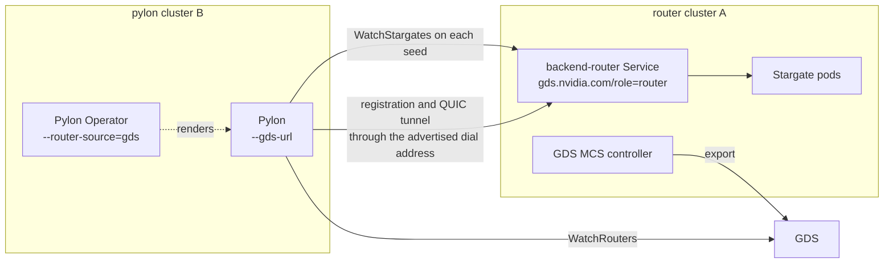

# Global Discovery Quickstart

This page connects the LLM stack to the Global Discovery Service (GDS): the
LLM request router (Stargate) exports itself and learns the routers of the
other clusters, and Pylon finds every router of the clusterset without a
static address. Use it to develop and test the integration. The design is
`docs-gds/global-discovery-service-design.md` (sections 4.5 and 10).

## How it fits together

- Every router cluster labels the Service pylons dial with
  `gds.nvidia.com/export: "true"` and `gds.nvidia.com/role: router`. The GDS
  MCS controller of that cluster exports it, and GDS derives one Router record
  per cluster with the ready replica addresses of that Service.
- A seed is one ready replica: `<scheme>://<pod IP>:<gRPC port>`, the scheme
  from the `gds.nvidia.com/dial-scheme` annotation. With the backend router
  the replicas are the `stargate-k8s-router` pods, otherwise the Stargate
  pods.
- Pylon (`--gds-url`) watches the seeds of every router cluster whose lease is
  live, calls `WatchStargates` on each, and registers with every Stargate
  replica through the dial address the router advertises. Seed changes start
  and stop watches without a restart.
- Stargate (`--gds-url`) adds the seeds of the routers in the other clusters to
  the `watch_stargate_urls` of its `WatchStargates` responses, next to the
  static `--remote-stargate-url` list, on every poll tick. Pylons that watch a
  Stargate pod directly and do not use GDS follow them.
- Pylon Operator (`--router-source=gds`) gives transport pods the GDS flags
  instead of `--stargate-address`, so router churn never rolls transport pods.



## Prerequisites

- A GDS deployment reachable from every cluster, see
  `src/control-plane-services/global-discovery/README.md`, and the GDS MCS
  controller in every router cluster.
- One clusterset id shared by all clusters and a cluster id per cluster, the
  one the MCS controller registers. Ids are DNS labels.
- Routable pod IPs: pylons dial the router replica pod IPs on the gRPC port
  (`50071`), so the pod CIDRs of the router clusters must be reachable from the
  pylon clusters (for example VPC peering with non-overlapping CIDRs), and
  network policies and security groups must allow that port.
- Reachable dial addresses: after `WatchStargates`, a pylon registers and
  opens its QUIC tunnel through the addresses the router advertises. With the
  backend router those are `backendRouter.pylonGrpcDialAddress` and
  `backendRouter.pylonReverseTunnelDialAddress`; without it, the advertised
  hostname (`kubernetes.advertisedHostnameTemplate`). The in-cluster defaults
  resolve in every cluster to that cluster's own router, which cannot forward
  to another cluster's Stargate pods. For cross-cluster pylons set them to
  addresses of the router cluster that the pylon clusters reach, such as the
  gateway listener in front of the backend router. Pylons in the router's own
  cluster work with the defaults.
- Credentials: every router cluster's worker auth file holds the credential
  entry of every cluster whose pylons register with it.

## TLS

- GDS: pass the CA that signs the GDS server certificate with
  `--gds-tls-ca-cert-path` (Stargate and Pylon) or a ConfigMap
  (`llmRequestRouter.globalDiscovery.tlsCaConfigMap`,
  `globalDiscovery.trustBundle.configMap`). It is trusted in addition to the
  system roots. `http://` GDS URLs are for development: Stargate accepts them
  only with `--allow-insecure-remote-watch-http`.
- Router seeds: the Stargate and backend router gRPC listeners serve plaintext
  gRPC on the pod port, so the router chart exports dial scheme `http` by
  default. Use `https` only when TLS is terminated on the pod port by a
  certificate that covers the pod IPs. Registration and tunnel traffic then
  goes to the advertised dial addresses with their own TLS, as without GDS. A
  custom gRPC CA in Pylon (`--grpc-tls-ca-cert-path`) applies to `https://`
  endpoints only, so it cannot be combined with `http` seeds.

## Router clusters

Export the router and, optionally, let Stargate discover the other clusters:

```yaml
llmRequestRouter:
  globalDiscovery:
    enabled: true
    urls:
      - https://gds.example.internal
    clustersetId: prod
    clusterId: cluster-a
    tlsCaConfigMap: gds-ca
    export:
      enabled: true
    dialScheme: http
  backendRouter:
    pylonGrpcDialAddress: https://llm-router.cluster-a.example.internal:443
    pylonReverseTunnelDialAddress: llm-router.cluster-a.example.internal:8080
```

`export.enabled` only labels and annotates the Service; it does not need
`enabled`. The chart README describes the values in "Global Discovery
Service".

The Stargate flags behind `enabled`:

| Flag | Environment | Meaning |
| --- | --- | --- |
| `--gds-url` | `GDS_URLS` | GDS gRPC URL, repeatable or comma-separated, in failover order |
| `--gds-clusterset` | `GDS_CLUSTERSET_ID` | Clusterset id, required with `--gds-url` |
| `--gds-cluster-id` | `GDS_CLUSTER_ID` | This cluster's id; its routers are not remote. Required with `--gds-url` |
| `--gds-tls-ca-cert-path` | `GDS_TLS_CA_CERT_PATH` | PEM CA bundle for `https://` GDS URLs |

Stargate keeps advertising `--grpc-pylon-dial-addr` unchanged. Its own
cluster's peers still come from DNS discovery.

The backend router answers `WatchStargates` itself and publishes only the
static `discovery.remoteWatchUrls`. Pylons that dial the backend router learn
other clusters from GDS directly, through `--gds-url`.

## Pylon clusters

With Pylon Operator:

```yaml
router:
  source: gds
globalDiscovery:
  urls:
    - https://gds.example.internal
  clustersetId: prod
  trustBundle:
    configMap: platform-ca
trustBundle:
  configMap: platform-ca
```

`router.grpcAddress` is optional with `source: gds`; when set, transport pods
watch it in addition. The operator caches one CA ConfigMap name, so when the
router CA and the GDS CA are both needed, put both certificates in the
`ca.crt` of one ConfigMap.

A standalone Pylon takes the flags directly:

| Flag | Environment | Meaning |
| --- | --- | --- |
| `--gds-url` | `GDS_URLS` | GDS gRPC URL, repeatable or comma-separated, in failover order |
| `--gds-clusterset` | `GDS_CLUSTERSET_ID` | Clusterset id, required with `--gds-url` |
| `--gds-tls-ca-cert-path` | `GDS_TLS_CA_CERT_PATH` | PEM CA bundle for `https://` GDS URLs |
| `--stargate-address` | | Optional with `--gds-url` and unioned with the GDS seeds; defaults to `127.0.0.1:50071` without it |

```bash
pylon \
  --upstream-http-base-url http://127.0.0.1:8000 \
  --gds-url https://gds.example.internal \
  --gds-clusterset prod \
  --gds-tls-ca-cert-path /etc/pylon/gds-ca.crt \
  --inference-server-id cluster-b.models.llama.pylon-0 \
  --cluster-id cluster-b \
  --backend-connectivity reverse \
  --auth-token-file /var/run/pylon/cluster-token
```

## Check it

- GDS lists the routers: `GET /v1/clustersets/prod/routers` on the GDS REST
  listener returns one router per exporting cluster with its ready replicas
  (`src/control-plane-services/global-discovery/docs/api.md`).
- Stargate logs `GDS remote watch URLs changed` with the added seeds, and its
  `WatchStargates` responses carry them in `watch_stargate_urls`.
- Pylon logs `GDS Stargate seeds changed` and then `Stargate watch seeds
  changed`; its `pylon_registration_stream_connected{router}` series show one
  stream per Stargate replica of every router cluster.
- Pylon Operator logs `GDS lists routers for the clusterset` at startup, or an
  error when GDS lists none, and sets `status.registration.routers` on every
  InferenceEndpoint.

## Behaviour to expect

- A router cluster whose lease expired, for example because its MCS
  controller stopped, drops out of the seeds. Pylons stop watching it and
  close their registrations there until the lease is renewed.
- When GDS is unreachable the clients keep their last router view (it turns
  stale after 60 seconds, which Stargate and Pylon log) and reconnect with
  failover across the configured URLs.
- A Pylon with GDS seeds and no static address starts with no seed and
  registers as soon as GDS lists a router.
