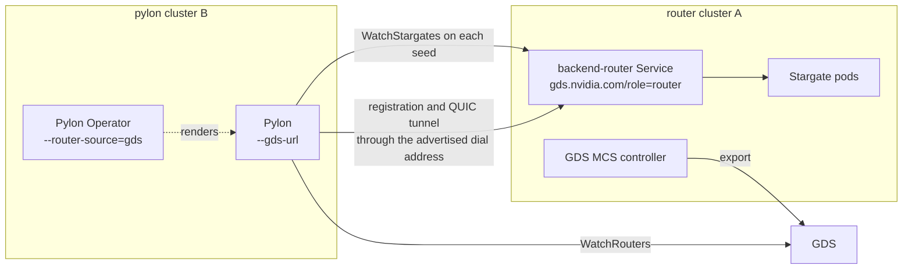

# Global Discovery Quickstart

This page connects the LLM stack to the Global Discovery Service (GDS): the
LLM request router (Stargate) exports itself and learns the routers of the
other clusters, and Pylon finds every router of the clusterset without a
static address. Use it to develop and test the integration. The design is
`docs-gds/global-discovery-service-design.md` (sections 4.5 and 10).

## How it fits together

- Every router cluster labels the Service pylons dial with
  `gds.nvidia.com/export: "true"` and `gds.nvidia.com/role: router`. The GDS
  MCS controller of that cluster exports it, and GDS derives one Router record
  per cluster with the ready replica addresses of that Service.
- A seed is one ready replica: `<scheme>://<pod IP>:<gRPC port>`, the scheme
  from the `gds.nvidia.com/dial-scheme` annotation. With the backend router
  the replicas are the `stargate-k8s-router` pods, otherwise the Stargate
  pods.
- Pylon (`--gds-url`) watches the seeds of every router cluster whose lease is
  live, calls `WatchStargates` on each, and registers with every Stargate
  replica through the dial address the router advertises. Seed changes start
  and stop watches without a restart.
- Stargate (`--gds-url`) adds the seeds of the routers in the other clusters to
  the `watch_stargate_urls` of its `WatchStargates` responses, next to the
  static `--remote-stargate-url` list, on every poll tick. Pylons that watch a
  Stargate pod directly and do not use GDS follow them.
- Pylon Operator (`--router-source=gds`) gives transport pods the GDS flags
  instead of `--stargate-address`, so router churn never rolls transport pods.
- Pools are known to GDS through their agents: the processes that serve a
  pool, each with a role (see [Pool agents](#pool-agents)). A Pylon is the
  PYLON agent of its pool.



## Prerequisites

- A GDS deployment reachable from every cluster (chart
  `deploy/helm/global-discovery`), and the GDS MCS controller (chart
  `deploy/helm/global-discovery-mcs-controller`) in every router cluster. See
  [Install GDS and the MCS controller](#install-gds-and-the-mcs-controller).
- One clusterset id shared by all clusters and a cluster id per cluster, the
  one the MCS controller registers. Ids are DNS labels.
- Routable pod IPs: pylons dial the router replica pod IPs on the gRPC port
  (`50071`), so the pod CIDRs of the router clusters must be reachable from the
  pylon clusters (for example VPC peering with non-overlapping CIDRs), and
  network policies and security groups must allow that port.
- Reachable dial addresses: after `WatchStargates`, a pylon registers and
  opens its QUIC tunnel through the addresses the router advertises. With the
  backend router those are `backendRouter.pylonGrpcDialAddress` and
  `backendRouter.pylonReverseTunnelDialAddress`; with one replica and no
  backend router, the advertised hostname
  (`kubernetes.advertisedHostnameTemplate`). The in-cluster defaults
  resolve in every cluster to that cluster's own router, which cannot forward
  to another cluster's Stargate pods. For cross-cluster pylons set them to
  addresses of the router cluster that the pylon clusters reach, such as the
  gateway listener in front of the backend router. Pylons in the router's own
  cluster work with the defaults. In direct mode (see
  [Router modes](#router-modes)) the dial addresses are the Stargate pod IPs
  from GDS, so routable pod IPs on TCP 50071 and UDP 50072 are enough.
- Credentials: every router cluster's worker auth file holds the credential
  entry of every cluster whose pylons register with it.

## Install GDS and the MCS controller

GDS runs in its own hub clusters, one release per GDS region; the module
README (`src/control-plane-services/global-discovery/README.md`,
"Deployment") and the chart README describe the DynamoDB table, IAM and the
internal load balancer. For development, one replica with the memory store
is enough:

```bash
helm install global-discovery deploy/helm/global-discovery/global-discovery \
  --namespace global-discovery --create-namespace \
  --set image.repository=<registry>/nvcf-global-discovery \
  --set region=dev --set store.kind=memory --set replicaCount=1 --wait
```

Every router cluster runs the MCS controller with its cluster id. It
registers the cluster, exports the labelled router Service and keeps the
cluster lease that decides whether the router's seeds are listed:

```bash
helm install gds-mcs-controller deploy/helm/global-discovery-mcs-controller/global-discovery-mcs-controller \
  --namespace gds-system --create-namespace \
  --set fullnameOverride=gds-mcs-controller \
  --set image.repository=<registry>/nvcf-gds-mcs-controller \
  --set 'gds.urls={https://gds.example.internal}' \
  --set gds.tlsCaConfigMap=gds-ca \
  --set clusterset.id=prod --set cluster.id=cluster-a \
  --wait
```

The ConfigMap `gds-ca` (key `ca.crt`) must exist in `gds-system` when GDS
serves TLS with a private CA. A plaintext development GDS needs
`gds.allowInsecureHttp=true` and an `http://` URL. The chart installs the
ServiceExport, ServiceImport and ClusterProperty CRDs; set
`crds.install=false` when another MCS implementation owns them. Pylon
clusters need the controller only when they export or import Services
themselves; pylons read GDS directly.

`tests/e2e/global-discovery-k3d` runs this whole path on three k3d
clusters: gds-server in a hub, the controller in clusters `a` and `b`,
Stargate exported from `a` (two replicas in direct router mode by default,
`E2E_ROUTER_MODE`), and a Pylon in `b` that is the PYLON agent of its pool
and registers once with each Stargate pod through GDS (phase 3).

## TLS

- GDS: pass the CA that signs the GDS server certificate with
  `--gds-tls-ca-cert-path` (Stargate and Pylon) or a ConfigMap
  (`llmRequestRouter.globalDiscovery.tlsCaConfigMap`,
  `globalDiscovery.trustBundle.configMap`). It is trusted in addition to the
  system roots. `http://` GDS URLs are for development: Stargate accepts them
  only with `--allow-insecure-remote-watch-http`.
- Router seeds: the Stargate and backend router gRPC listeners serve plaintext
  gRPC on the pod port, so the router chart exports dial scheme `http` by
  default. Use `https` only when TLS is terminated on the pod port by a
  certificate that covers the pod IPs. Registration and tunnel traffic then
  goes to the advertised dial addresses with their own TLS, as without GDS. A
  custom gRPC CA in Pylon (`--grpc-tls-ca-cert-path`) applies to `https://`
  endpoints only, so it cannot be combined with `http` seeds.

## Router clusters

Export the router and, optionally, let Stargate discover the other clusters:

```yaml
llmRequestRouter:
  globalDiscovery:
    enabled: true
    urls:
      - https://gds.example.internal
    clustersetId: prod
    clusterId: cluster-a
    tlsCaConfigMap: gds-ca
    export:
      enabled: true
    dialScheme: http
  backendRouter:
    pylonGrpcDialAddress: https://llm-router.cluster-a.example.internal:443
    pylonReverseTunnelDialAddress: llm-router.cluster-a.example.internal:8080
```

`export.enabled` only labels and annotates the Service; it does not need
`enabled`. The chart README describes the values in "Global Discovery
Service".

The Stargate flags behind `enabled`:

| Flag | Environment | Meaning |
| --- | --- | --- |
| `--gds-url` | `GDS_URLS` | GDS gRPC URL, repeatable or comma-separated, in failover order |
| `--gds-clusterset` | `GDS_CLUSTERSET_ID` | Clusterset id, required with `--gds-url` |
| `--gds-cluster-id` | `GDS_CLUSTER_ID` | This cluster's id; its routers are not remote. Required with `--gds-url` |
| `--gds-tls-ca-cert-path` | `GDS_TLS_CA_CERT_PATH` | PEM CA bundle for `https://` GDS URLs |

In backend-router mode Stargate keeps advertising `--grpc-pylon-dial-addr`
unchanged, and its own cluster's peers still come from DNS discovery. In
direct mode the peer identities come from GDS: Stargate lists each pod of its
own cluster's router record under the record's replica identity (the pod
name), with the hostname template as authority and
`<dial scheme>://<pod IP>:50071` as dial address, so every replica names each
pod the same way and a pylon registers once per pod. Peers that GDS does not
list keep the names DNS gives them.

### Router modes

The chart records the mode in the annotation `gds.nvidia.com/router-mode`
of the exported Service, and GDS reports it as `routerMode` on the Router
record:

- `backend-router` (the default for a multi-replica Deployment): the
  exported Service is the backend-router Service and the replicas are
  `stargate-k8s-router` pods, which forward registration and tunnels to the
  Stargate pods. Pylons register through `backendRouter.pylonGrpcDialAddress`
  and `pylonReverseTunnelDialAddress`, as without GDS.
- `direct`: the exported ClusterIP Service selects the Stargate pods, and
  pylons dial each pod IP: TCP 50071 for registration and UDP 50072 for the
  QUIC tunnel, with the pod's templated hostname as authority and SNI. Set
  `backendRouter.enabled: false` with `globalDiscovery.enabled: true` on a
  multi-replica Deployment; the hostname template must contain `{pod_name}`
  once (the chart default is
  `{pod_name}.<headless Service>.<namespace>.svc.cluster.local`). The Router
  record then carries `hostnameTemplate` and one `identity` per replica.
  Pylons need routable pod IPs on both ports and do not resolve the
  hostnames.

```yaml
llmRequestRouter:
  replicaCount: 2
  backendRouter:
    enabled: false
  globalDiscovery:
    enabled: true
    urls:
      - https://gds.example.internal
    clustersetId: prod
    clusterId: cluster-a
    export:
      enabled: true
    dialScheme: http
```

The backend router answers `WatchStargates` itself and publishes only the
static `discovery.remoteWatchUrls`. Pylons that dial the backend router learn
other clusters from GDS directly, through `--gds-url`.

## Pylon clusters

With Pylon Operator:

```yaml
router:
  source: gds
globalDiscovery:
  urls:
    - https://gds.example.internal
  clustersetId: prod
  trustBundle:
    configMap: platform-ca
trustBundle:
  configMap: platform-ca
```

`router.grpcAddress` is optional with `source: gds`; when set, transport pods
watch it in addition. The operator caches one CA ConfigMap name, so when the
router CA and the GDS CA are both needed, put both certificates in the
`ca.crt` of one ConfigMap.

To publish each InferenceEndpoint's transport as the PYLON agent of a GDS
pool, also set:

```yaml
globalDiscovery:
  poolExport:
    enabled: true
```

The operator then passes `--gds-pool-name` to Pylon and keeps a Service over
the transport pods with the labels `gds.nvidia.com/export: "true"`,
`gds.nvidia.com/role: pylon` and `gds.nvidia.com/pool: <pool name>` (port
`metrics`). The pool name is `spec.globalDiscovery.poolName` of the
InferenceEndpoint, by default its name. The pool belongs to the cluster
named by the operator's `clusterId` (Pylon's `--cluster-id`); set it to the
cluster id the GDS MCS controller of that cluster registers, so that the
exported Service and the Pylon registrations join one pool. The controller
must run in the pylon cluster to export the Service; without it GDS still
sees each Pylon's own registration. `poolExport.enabled` requires
`router.source: gds`.

A standalone Pylon takes the flags directly:

| Flag | Environment | Meaning |
| --- | --- | --- |
| `--gds-url` | `GDS_URLS` | GDS gRPC URL, repeatable or comma-separated, in failover order |
| `--gds-clusterset` | `GDS_CLUSTERSET_ID` | Clusterset id, required with `--gds-url` |
| `--gds-tls-ca-cert-path` | `GDS_TLS_CA_CERT_PATH` | PEM CA bundle for `https://` GDS URLs |
| `--stargate-address` | | Optional with `--gds-url` and unioned with the GDS seeds; defaults to `127.0.0.1:50071` without it |
| `--gds-pool-name` | `GDS_POOL_NAME` | GDS pool this Pylon serves, a DNS label. Registers the Pylon as the pool's PYLON agent in cluster `--cluster-id`, with `--inference-server-id` as the agent id and the served models as the `models` attribute; deregisters after the tunnel drain. Requires `--gds-url` and an explicit `--cluster-id` |

```bash
pylon \
  --upstream-http-base-url http://127.0.0.1:8000 \
  --gds-url https://gds.example.internal \
  --gds-clusterset prod \
  --gds-tls-ca-cert-path /etc/pylon/gds-ca.crt \
  --inference-server-id cluster-b.models.llama.pylon-0 \
  --cluster-id cluster-b \
  --gds-pool-name llama-blue \
  --backend-connectivity reverse \
  --auth-token-file /var/run/pylon/cluster-token
```

## Pool agents

GDS models the processes of a pool as typed agents, one per role: the
OpenAI-compatible frontend (`pool-frontend`, role OPENAI), Pylon (`pylon`,
PYLON) and the Dynamo PoolRelay (`kv-relay`, KV_RELAY). An agent has two
sources that GDS merges: an exported Service labelled with
`gds.nvidia.com/role` and `gds.nvidia.com/pool` (one process in several
roles uses the annotation `gds.nvidia.com/roles: pool-frontend,pylon`), and
the registrations the processes make themselves, one per process with its
own lease, so the Pylon pods of a pool never fence each other. A pool whose
Pylon agent is live is ACTIVE without an OpenAI frontend: `ready_ingress_count`
counts its ready Pylons, while `ready_endpoint_count` stays 0. A pool with
only a live relay is REGISTERED, known but not routable. The module's
`docs/api.md` (Pools) describes the rules and the agent RPCs.

## Check it

- GDS lists the routers: `GET /v1/clustersets/prod/routers` on the GDS REST
  listener returns one router per exporting cluster with its ready replicas
  (`src/control-plane-services/global-discovery/docs/api.md`).
- Stargate logs `GDS remote watch URLs changed` with the added seeds, and its
  `WatchStargates` responses carry them in `watch_stargate_urls`.
- Pylon logs `GDS Stargate seeds changed` and then `Stargate watch seeds
  changed`; its `pylon_registration_stream_connected{router}` series show one
  stream per Stargate replica of every router cluster.
- Pylon Operator logs `GDS lists routers for the clusterset` at startup, or an
  error when GDS lists none, and sets `status.registration.routers` on every
  InferenceEndpoint.
- With `--gds-pool-name` or pool export, `GET
  /v1/clustersets/prod/pools?cluster=cluster-b` lists the pool with an agent
  of role `FRONTEND_ROLE_PYLON`: source `AGENT_SOURCE_API` for the Pylon
  registrations, `AGENT_SOURCE_LABEL` for the exported Service, or
  `AGENT_SOURCE_BOTH`, with one entry in `registrations[]` per Pylon pod.

## Behaviour to expect

- A router cluster whose lease expired, for example because its MCS
  controller stopped, drops out of the seeds. Pylons stop watching it and
  close their registrations there until the lease is renewed.
- When GDS is unreachable the clients keep their last router view (it turns
  stale after 60 seconds, which Stargate and Pylon log) and reconnect with
  failover across the configured URLs.
- A Pylon with GDS seeds and no static address starts with no seed and
  registers as soon as GDS lists a router.
