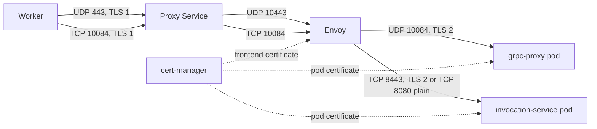
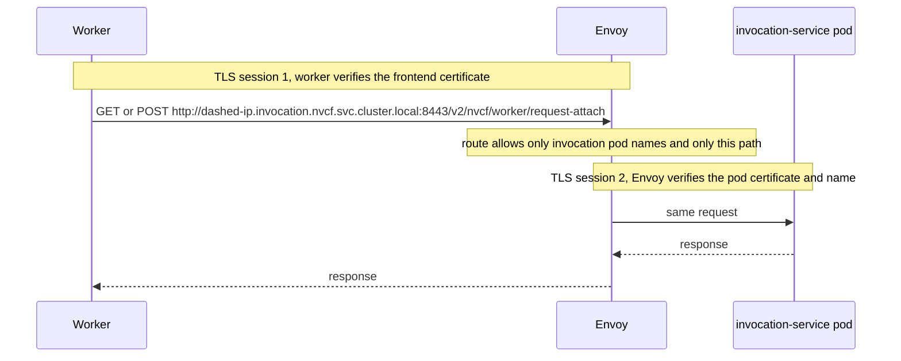
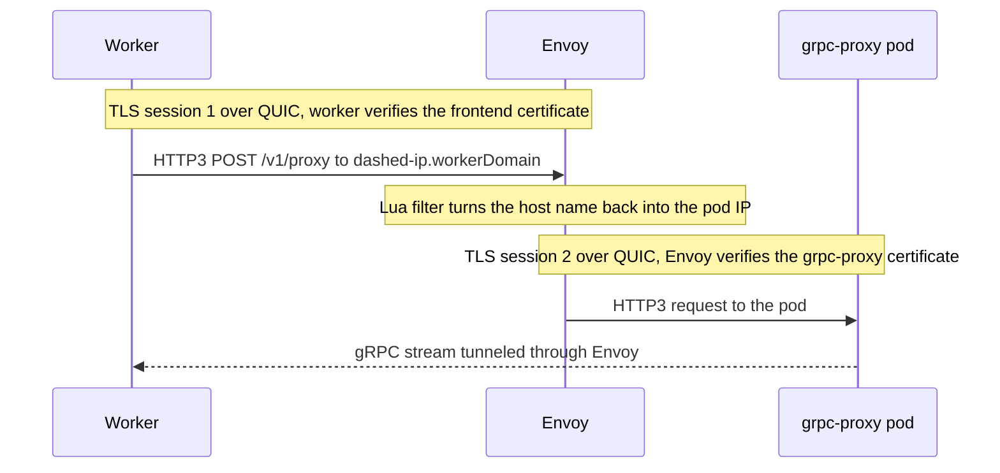
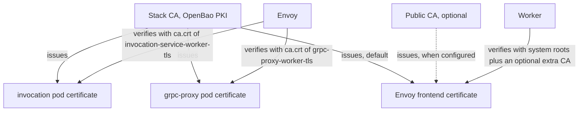

# SDD: Worker Callback Proxy

Status: draft. Tracking issue: #2440.

## Goal

Let workers in another cluster call back into a control plane that runs more
than one `grpc-proxy` and `invocation-service` replica, and let those workers
validate the callback endpoints with the trust they already have.

A worker's callback has to reach the exact pod that holds its request. Inside
one cluster the worker calls the pod directly. From another cluster it can only
reach a Service or load balancer, and with two replicas a callback can land on a
replica that does not hold its state. `grpc-proxy` then rejects it with
`403 token unknown`.

This design puts an optional Envoy deployment, the worker callback proxy, in
front of both services. It is off by default. Single-cluster installs do not
need it.

Non-goals:

- Creating the load balancer or the DNS records that expose the proxy. The
  operator owns both.
- Changing the gRPC callback flow.
- Owning CA distribution to workers. With the default frontend issuer, workers
  receive the stack CA through `workerCallbackCaPem` in the compute-plane
  stack. With a public frontend certificate they need no extra CA.

## How it fits together

```text
  Worker (other cluster)                    Control-plane cluster
  ----------------------                    ---------------------------------------------

  gRPC callback
    QUIC / HTTP3 ---- UDP 443 ----+
                                  |   +-------------------+   UDP 10084    +------------+
                                  +-->|                   |--------------->| grpc-proxy |
                                      |  Envoy            |   TLS 2        | pod A, B   |
  HTTP callback                       |  worker-callback- |                +------------+
    HTTPS ---------- TCP 10084 ---+-->|  proxy            |   TCP 8443     +------------+
                                      |                   |--------------->| invocation |
                                      +-------------------+   TLS 2        | pod A, B   |
                                        ends the worker's                  +------------+
                                        TLS session (TLS 1)
```

TLS 1 is the session from the worker to Envoy. TLS 2 is a second, separate
session from Envoy to the pod. Envoy picks the pod from the host name in the
callback address, which carries the pod IP with dashes, for example
`10-42-0-5.grpc-worker.example.com`.



## HTTP callback flow



The diagram shows the default. With `upstreamTls.enabled: false` the target port
is 8080 and session 2 is plain HTTP, so only session 1 is TLS.

How the pieces fit:

- invocation-service advertises the target
  `http://<dashed-pod-ip>.invocation.nvcf.svc.cluster.local:8443`, or port 8080
  when `upstreamTls.enabled` is false. The `http` scheme makes the worker send a
  forward-proxy request through its TLS session to Envoy, not a CONNECT tunnel.
  It does not make the worker's connection plain.
- The proxy address is `https://invocation.<workerDomain>:10084`. The worker
  verifies Envoy's certificate for `*.<workerDomain>`.
- Envoy accepts only absolute-form requests for
  `<dashed-pod-ip>.<serviceName>.<namespace>.svc.<clusterDomain>:<port>` and
  only the path `/v2/nvcf/worker/request-attach`. The pod's worker port also
  serves the rest of the invocation API, so any other path gets a 404.
- Envoy opens its own TLS session to the pod. `auto_sni` and
  `auto_san_validation` take the pod name from the request authority, and Envoy
  verifies the pod certificate against that name and the invocation CA.
- The worker never sees the pod certificate and needs no CA for it.

## gRPC callback flow

This flow is unchanged by the HTTP design.



## Who trusts what



| Connection | Server certificate | Client verifies with |
| --- | --- | --- |
| Worker to Envoy | Envoy frontend certificate for `*.<workerDomain>` | The worker's trust store. It holds the system roots plus any CA given through `NVCF_PROXY_CA_PEM`. For the default issuer the worker needs the stack CA. For a public certificate the system roots are enough. |
| Envoy to invocation pod | Pod certificate for `*.invocation.<namespace>.svc.<clusterDomain>` | `ca.crt` of Secret `invocation-service-worker-tls`, and the pod name |
| Envoy to grpc-proxy pod | Pod certificate for `*.grpc-headless.<namespace>.svc.<clusterDomain>` | `ca.crt` of Secret `grpc-proxy-worker-tls`, and the fixed name `grpcProxy.tlsServerName`, not the individual pod |

The pod certificates always come from the stack CA. Only the frontend
certificate is a choice. Envoy reads each CA through file-based SDS and watches
the mounted Secret, so a rotated CA or certificate applies without a restart.

## Configuration

Operators set these values in the self-managed stack. The stack derives the
chart values.

| Stack value | Default | Effect |
| --- | --- | --- |
| `workerCallbackProxy.enabled` | `false` | Deploys the proxy and turns on grpc-proxy HTTP/3. It also turns on the invocation-service worker TLS listener, unless `invocation.upstreamTls.enabled` is false. |
| `workerCallbackProxy.workerDomain` | none, required | Callback host names are `<dashed-pod-ip>.<workerDomain>`. Must be a plain DNS name. |
| `workerCallbackProxy.tls.frontend.existingSecret` | empty | Use a `kubernetes.io/tls` Secret for `*.<workerDomain>`, for example a public certificate |
| `workerCallbackProxy.tls.frontend.certificate.issuerRef` | the stack's OpenBao issuer | Issue the frontend certificate from another cert-manager issuer, for example Let's Encrypt |
| `workerCallbackProxy.invocation.upstreamTls.enabled` | `true` | `true`: Envoy opens TLS to the pod on 8443. `false`: plain HTTP to the pod on 8080. |
| `workerCallbackProxy.invocation.connect.enabled` | `false` | Allow CONNECT tunnels. Needed only for workers older than worker-utils 1.3.2. |
| `workerCallbackProxy.service` | ClusterIP | Passed to the chart. Set `type: LoadBalancer` to expose the proxy. |

The stack derives these chart values from the switches above:

| Chart value | Derived from |
| --- | --- |
| `invocation.port` | 8443 when `upstreamTls.enabled`, otherwise 8080 |
| `invocation.upstream.tls.enabled` | `upstreamTls.enabled` |
| `invocation.upstream.tls.caSecret.name` | The pod certificate Secret name, set once in the stack and also given to the invocation-service chart |
| `invocation.connect.enabled` | `connect.enabled` |
| invocation-service `WORKER_STREAM_PROPERTIES__SERVICE_ADDRESS` | `http://invocation.nvcf.svc.cluster.local:<port>` |
| invocation-service `WORKER_STREAM_PROPERTIES__PROXY_ADDRESS` | `https://invocation.<workerDomain>:10084`, or `global.workerEndpoints.invocationProxyURL` |

The render fails when the proxy is enabled together with
`global.workerEndpoints.invocationServiceURL`,
`global.workerEndpoints.grpcProxyWorkerConnectURL`,
`grpcproxy.workerConnectBaseURL`, or
`invocation.env.WORKER_STREAM_PROPERTIES__SELF_ADDRESS`, because the proxy
replaces those callback paths. It also fails on a non-boolean switch and, in the
chart, when `invocation.port` disagrees with `invocation.upstream.tls.enabled`.

### Choosing a configuration

| Frontend certificate | Envoy to invocation pod | Workers need | Use when |
| --- | --- | --- | --- |
| Stack CA (default) | TLS (default) | The stack CA, through `workerCallbackCaPem` | Workers start through NVCA and can receive the CA |
| Public CA or existing Secret | TLS | Only their system roots | Workers cannot receive a per-stack CA |
| Public CA or existing Secret | Plain HTTP | Only their system roots | As above, and the network between Envoy and the pod is trusted |
| Stack CA | Plain HTTP | The stack CA | Unusual. Allowed. |

### Examples

Default. Workers get the stack CA:

```yaml
workerCallbackProxy:
  enabled: true
  workerDomain: grpc-worker.example.com
  service:
    type: LoadBalancer
```

Public frontend certificate from an issuer:

```yaml
workerCallbackProxy:
  enabled: true
  workerDomain: grpc-worker.example.com
  tls:
    frontend:
      certificate:
        issuerRef:
          kind: ClusterIssuer
          name: letsencrypt
```

Public frontend certificate from an existing Secret:

```yaml
workerCallbackProxy:
  tls:
    frontend:
      existingSecret: worker-public-tls
```

Plain HTTP from Envoy to the invocation pod:

```yaml
workerCallbackProxy:
  invocation:
    upstreamTls:
      enabled: false
```

Allow CONNECT for older workers:

```yaml
workerCallbackProxy:
  invocation:
    connect:
      enabled: true
```

## Port contract

| Hop | Protocol and port |
| --- | --- |
| Worker to the proxy Service, gRPC | UDP 443 |
| Service to Envoy, gRPC | UDP 10443 |
| Envoy to grpc-proxy pod | UDP 10084 |
| Worker to the proxy Service, HTTP | TCP 10084 |
| Envoy to invocation pod, TLS | TCP 8443 |
| Envoy to invocation pod, plain | TCP 8080 |

The operator creates the load balancer and the DNS records. `*.<workerDomain>`
must resolve to the proxy Service from the worker's cluster, because each
callback name starts with the pod IP in dashes. A publicly trusted frontend
certificate lives on Envoy, because QUIC through a UDP load balancer is
passthrough.

## Security considerations

- Envoy ends the worker's TLS, so it can read gRPC callbacks and forward-proxy
  HTTP callbacks. A CONNECT tunnel, when it is turned on, is different: Envoy
  passes raw TCP and cannot read the worker's inner TLS session.
- The invocation route is not an open proxy. Its authority regex limits targets
  to invocation-service pod names on one port, and its path match limits
  requests to the worker callback path.
- The grpc-proxy route accepts any host under `*.<workerDomain>`, and the Lua
  filter turns the dashed IP in the host name into the upstream address. Envoy
  can therefore start a QUIC handshake with any IP a caller encodes in that
  name. The upstream certificate check decides which peer can complete the TLS
  session, but it does not stop the handshake. Limit who can reach the Service,
  and where the CNI enforces it add the egress NetworkPolicy from the chart
  README.
- The two upstream checks differ. For the invocation pod, Envoy verifies the
  certificate chain against the CA Secret and the certificate name against the
  pod name from the request authority. For the grpc-proxy pod, it verifies the
  chain against the CA Secret and a fixed name, `grpcProxy.tlsServerName`
  (default `*.grpc-headless.<namespace>.svc.<clusterDomain>`), not the
  individual pod. A certificate that the right CA signed for another name is
  refused on both.
- A CONNECT tunnel is a raw TCP connection that Envoy cannot read or restrict,
  so the stack turns it off.
- Plain HTTP to the pod is for trusted networks only. TLS is the default.
- The Envoy admin API listens on `127.0.0.1` only. Probes and metrics have their
  own listeners.
- Restrict the exposed Service to the worker cluster's addresses, for example
  with a private load balancer. Where the CNI enforces NetworkPolicy, add an
  egress policy that limits Envoy to the backend pods. The chart README has an
  example.

## Compatibility and rollout

- Workers must send `http://` callback targets as forward-proxy requests.
  worker-utils 1.3.2 and later do. Older workers need
  `invocation.connect.enabled: true`.
- Turning the proxy on is a cutover. The stack removes the shared callback
  addresses and switches grpc-proxy to HTTP/3 only, so the UDP path to Envoy
  and the HTTP path on TCP 10084 must work from the worker cluster first.
- Only function pods created after the change receive a new CA, so redeploy
  existing functions after changing `workerCallbackCaPem`.
- With `invocation.upstreamTls.enabled: false` the stack does not turn on the
  invocation-service worker TLS listener.

## Validation

- Chart render tests check the route and cluster layout, the SDS mounts, and the
  failing combinations: `deploy/helm/worker-callback-proxy/tests/chart-render/verify-render.sh`.
- A real Envoy test loads the rendered config and checks a forward-proxy GET and
  a 1 MiB POST through Envoy's own TLS session to a TLS pod, a chunked response
  forwarded as it arrives, a pod certificate from another CA refused, a pod
  certificate for another name refused, other paths getting a 404, CONNECT
  refused when it is off, and a CA rotation applied without a restart:
  `deploy/helm/worker-callback-proxy/tests/chart-render/validate-envoy.sh`.
- Stack wiring tests check the derived values and the invalid combinations:
  `deploy/stacks/self-managed/tests/worker-callback-proxy-wiring.sh`.
- Not covered by automation: a multi-cluster run with real workers, and a real
  public certificate.

## Source references

- Chart and its README: `deploy/helm/worker-callback-proxy/`
- Stack wiring: `deploy/stacks/self-managed/global.yaml.gotmpl`,
  `deploy/stacks/self-managed/environments/base.yaml`
- Operator guide: `docs/self-managed/worker-callback-proxy.md`
- Callback address generation: `src/invocation-plane-services/http-invocation/crates/server/src/worker_streams/mod.rs`
- Worker proxy client: `src/compute-plane-services/worker-utils/worker/httpstream/request_stream.go`
