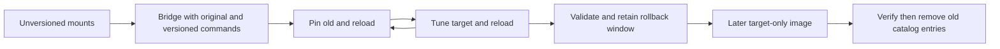

# OpenBao JWT Plugin Upgrade

JWT signing mounts store plugin selection in OpenBao storage. Changing a
Kubernetes image does not change that selection. This procedure introduces
versioned entries without rewriting the existing unversioned catalog digest.
Use a published, qualified bridge server image and its matching chart and
migrations image. Do not substitute a pre-bridge image during rollback.

The bridge packages the exact plugin from the digest-pinned public
`2.6.3-nv-1.3.6` image as both the original command and the explicit old
version. It builds the target from repository source. Catalog identities are
recorded in `/openbao/jwt-plugin-versions.env`, independently of the server
version. If your stored unversioned digest differs, stop. Your bridge must
retain that deployment's exact binary instead. A source rebuild is insufficient.

## Preflight

Take a Raft snapshot and secure the unseal material. Require a healthy,
unsealed three-member cluster with one active member. Record the cluster ID,
images, current catalog entries, mount inventory, and a successful signed JWT
and its public verification key. Use the status and standby rotation checks in
the [patch upgrade procedure](openbao-patch-upgrade.md).

All members must use the same CPU architecture. The image generates SHA-256
values from its own binaries, so amd64 and arm64 images need no chart checksum
overrides. A catalog version has one cluster-wide digest; mixed-architecture
OpenBao clusters are not supported by this lifecycle. Do not move a member to
another architecture during the rollback window.

Stop concurrent mount creation, tuning, and other plugin upgrade operations for
the duration of each state transition and cleanup. The driver validates the
complete inventory before tuning, but multiple tune operations are not atomic.
Rerun the same command after fixing a failure to resume.

Commands below use Bash, `kubectl`, `jq`, the default namespace, and the
chart-managed root-token Secret. Use an authorized operator credential if your
installation manages tokens differently. Do not enable shell tracing.

```bash
kubectl config current-context
BAO_POD=<current-active-pod>
bao_admin() {
  set -o pipefail
  kubectl -n vault-system get secret openbao-server-root-token -o json |
    jq -er '.data.root_token | @base64d' |
    kubectl -n vault-system exec -i "$BAO_POD" -c openbao -- sh -ec '
      IFS= read -r BAO_TOKEN
      test -n "$BAO_TOKEN"
      export BAO_TOKEN
      export BAO_ADDR=http://127.0.0.1:8200
      exec "$@"
    ' sh "$@"
}
bao_admin bao secrets list -detailed
bao_admin bao plugin info secret vault-plugin-secrets-jwt
```

Confirm the unversioned catalog SHA equals the bridge's original binary SHA
for every server architecture. Compare before replacing any pod; otherwise
an incompatible bridge can make existing mounts unusable on restart.

```bash
BRIDGE_IMAGE=<qualified-bridge-image-reference>
docker run --rm --entrypoint sha256sum "$BRIDGE_IMAGE" \
  /openbao/plugins/vault-plugin-secrets-jwt
```

## Deploy the Bridge

Prepare release values with the qualified bridge server and injected-agent
image tags and matching migrations image. Set the lifecycle mode explicitly:

```yaml
openbao:
  jwtPluginLifecycle:
    mode: bridge
```

The default `legacy` mode supports published pre-bridge images and retains
the catalog refresh hook. Its preflight rejects bridge and target-only images
before the release changes. `bridge` disables the refresh hook and migrations
while checking existing mount compatibility. Keep this setting in the Helm
values and stack environment used for subsequent applies.

The bridge image entrypoint adds `-config=/openbao/plugin-config` to server
startup. Custom commands that bypass that entrypoint must supply the argument.
The image config enables `plugin_auto_register` and declares old and target
versions with their binary hashes.

Update the existing Helm release with hooks enabled. The bridge preflight
compares the candidate's legacy bytes against existing mount and catalog state
before any server template changes:

```bash
BRIDGE_CHART=<qualified-bridge-chart-reference>
RELEASE_VALUES=<existing-release-values-with-bridge-images>
helm upgrade openbao-server "$BRIDGE_CHART" -n vault-system \
  -f "$RELEASE_VALUES" --set openbao.jwtPluginLifecycle.mode=bridge
```

Bridge mode defers migrations until all servers have the target binary and
declarative registration. Do not use `--no-hooks`; that skips the compatibility
check. Bridge mode must not be used for a fresh install.
Do not run the normal stack apply yet. With `OnDelete`, rotate standbys one at
a time, verify recovery, transfer leadership to an upgraded standby, and then
rotate the former active. Follow the patch procedure for those commands and
health checks. Reassign `BAO_POD` after leadership changes. Require every
member's image digest to equal the qualified bridge digest.

Existing unversioned mounts must still issue JWTs after this rotation. Check
each member's versioned binaries and config, then run:

```bash
bao_admin jwt-plugin-lifecycle preflight
bao_admin jwt-plugin-lifecycle status
```

The driver also runs outside Kubernetes or Helm using an authenticated `bao`:
set `JWT_VERSIONS_FILE` to the image's version manifest and `JWT_PLUGIN_DIR` to
its extracted plugin directory. It does not register plugins or restart servers.

## Pin, Reload, Then Upgrade

```bash
bao_admin jwt-plugin-lifecycle pin-old
bao_admin bao plugin reload -plugin vault-plugin-secrets-jwt
bao_admin jwt-plugin-lifecycle status
```

Require every legacy mount's configured and running versions to equal the old
version and its running SHA to equal the old catalog SHA. Existing mounts
already on the target stay there when `pin-old` is repeated. New mounts use the
target version. The next command refuses any mount still running unversioned.

```bash
bao_admin jwt-plugin-lifecycle upgrade
bao_admin bao plugin reload -plugin vault-plugin-secrets-jwt
bao_admin jwt-plugin-lifecycle verify
```

Tuning updates configured metadata; reloading switches the running backend.
If reload fails, stop and inspect `status`. A checked member rotation is an
alternative to reload. After every leadership transfer, rerun verification
against the active member and repeat signed JWT issuance and signature
verification. Preserve existing keys, roles, and policies.

After every member runs the bridge and verification passes, change
`openbao.jwtPluginLifecycle.mode` to `versioned` in the persistent release
values and stack environment. Apply with hooks enabled:

```bash
helm upgrade openbao-server "$BRIDGE_CHART" -n vault-system \
  -f "$RELEASE_VALUES" --set openbao.jwtPluginLifecycle.mode=versioned
```

The preflight checks every member's target binary before migrations can
create version-pinned mounts. Migrations read the target version from the
server image manifest. Existing mounts stay untouched; the upgrade driver
owns tuning. Repeat the normal stack apply in `versioned` mode to check
idempotence. Test an existing consumer and create a separate test consumer
before declaring the upgrade complete. Do not revert to `legacy` or `bridge`
after enabling versioned mount creation.

For a fresh installation, use qualified matching images with
`openbao.jwtPluginLifecycle.mode=versioned` from the first install. `bridge`
mode rejects fresh installations.

If an earlier install failed before creating any JWT mounts, the versioned
deployment preflight accepts an empty inventory only after checking the target
catalog against the candidate binary. Migrations can then create their first
mount. Manual `verify`, tuning, and cleanup still reject empty inventories.

## Rollback During the Window

Keep both versioned binaries and their declarative config throughout the
rollback window. Roll back plugin selection explicitly:

```bash
bao_admin jwt-plugin-lifecycle rollback
bao_admin bao plugin reload -plugin vault-plugin-secrets-jwt
bao_admin jwt-plugin-lifecycle status
```

Require configured and running versions to equal the explicit old version,
with the old SHA, and repeat JWT issuance and signature verification. Pause
migrations and new mount creation during rollback. If migrations must run,
set their `BAO_JWT_PLUGIN_VERSION` environment variable to the explicit old
version for this window. Restore the target setting before resuming upgrade.
Do not clear version pins or roll back to a pre-bridge image. Such an image
lacks the versioned command paths now referenced in storage. OpenBao server
downgrades and snapshot restore need a separately validated recovery plan.

## Cleanup in a Later Release

Do not combine setup/tune and cleanup in one release. After the rollback
window and successful consumer validation, freeze mount changes and run:

```bash
bao_admin jwt-plugin-lifecycle check-cleanup
```

The gate rejects old, unversioned, missing, or unexpected configured/running
versions and running SHA values. Check every member is on the intended image.
Qualify a later target-only image built with `JWT_INCLUDE_LEGACY=false`.
It must retain exactly the same target binary and catalog digest as the bridge.
The target-only image omits old command paths and old registration stanzas.
Deploy and rotate it with the same health checks, without changing the target
plugin version. Keep `openbao.jwtPluginLifecycle.mode=versioned` and use hooks
so the target-only preflight verifies mounts before the rollout. Verify again
after leadership changes.

```bash
bao_admin jwt-plugin-lifecycle verify
bao_admin jwt-plugin-lifecycle cleanup
bao_admin bao secrets list -detailed
bao_admin bao plugin list -detailed
```

Cleanup rechecks mount state and refuses to deregister entries from a local
image that still carries the old paths. It removes the explicit old and
unversioned catalog entries only. Removing declarations first prevents a
later restart from registering the old entries again. Never delete binary
paths from a running container. Retain backups according to your recovery
policy; rollback to the retired plugin ends after cleanup.


