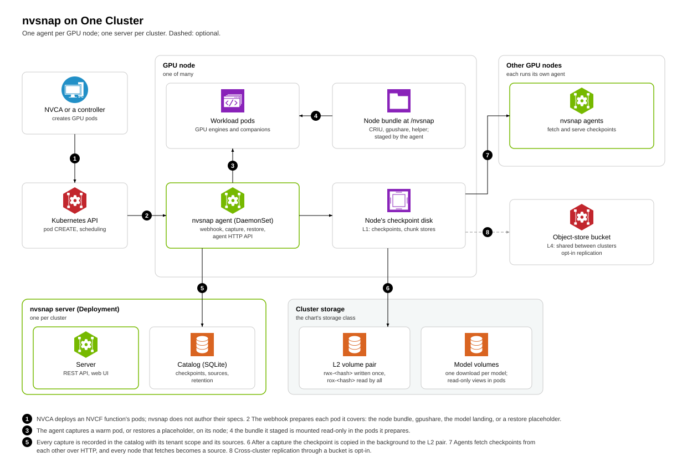
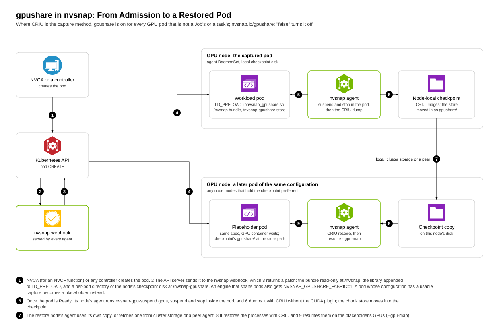
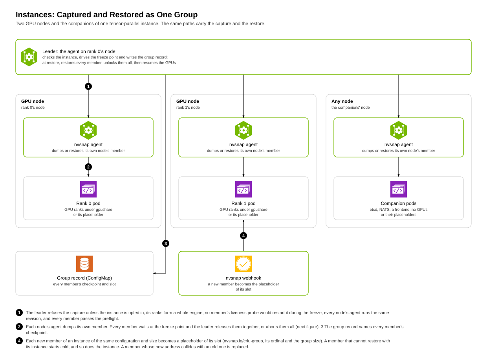
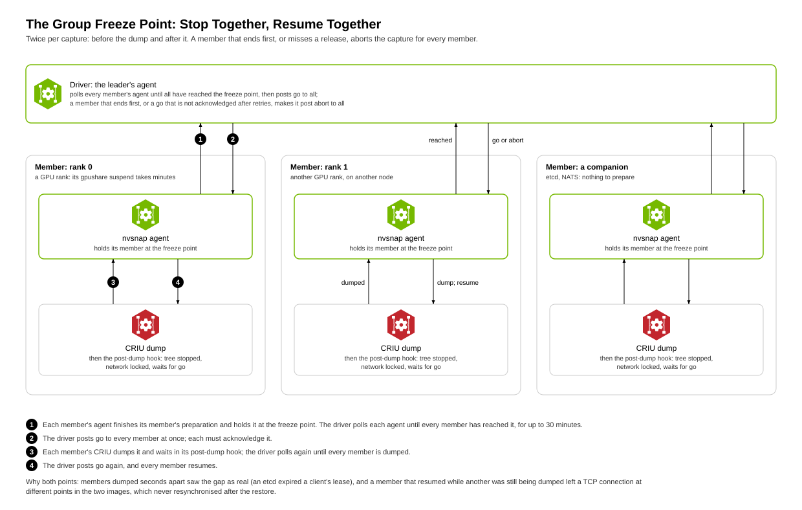
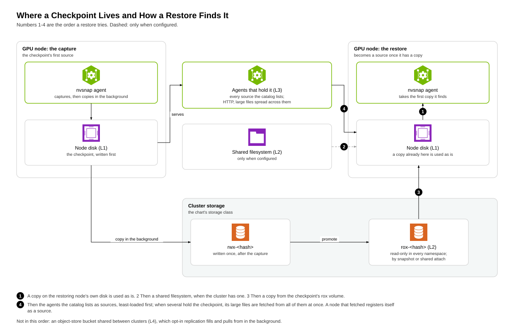
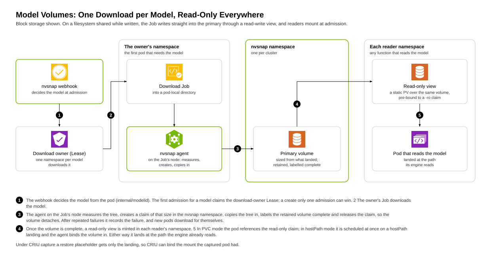

<!--
SPDX-FileCopyrightText: Copyright (c) 2026 NVIDIA CORPORATION & AFFILIATES. All rights reserved.
SPDX-License-Identifier: Apache-2.0
-->
# nvsnap architecture

This is the one technical document for nvsnap. It says what nvsnap does, how
each mechanism works, which code enforces each rule, how it fails, and what is
not done yet. Read it before changing the agent, the webhook or the chart.
Each section names the source files that implement it, by path and symbol, so
the reference survives edits.

*Words have the meanings in the [glossary](GLOSSARY.md); annotation keys,
environment variables and agent routes are in the generated
[reference](REFERENCE.md). Every number names its hardware and date and links
to where it was recorded; a number is a record of that run, not a promise
about the current build. Checked against the code of branch
`nvsnap/instance-restore` on 2026-10-21.*

<!-- toc: generated by scripts/docs/docs-toc.py; edit the headings, not this list -->
**Contents**

- [0. Evidence levels](#0-evidence-levels)
- [1. What nvsnap is and what a deployment runs](#1-what-nvsnap-is-and-what-a-deployment-runs)
- [2. The two capture methods and how one is chosen](#2-the-two-capture-methods-and-how-one-is-chosen)
  - [Restoring a cachedir capture](#restoring-a-cachedir-capture)
- [3. Single-pod CRIU capture and restore](#3-single-pod-criu-capture-and-restore)
  - [Capture](#capture)
  - [Restore](#restore)
  - [Rules a restore depends on](#rules-a-restore-depends-on)
- [4. gpushare: GPU memory shared between processes](#4-gpushare-gpu-memory-shared-between-processes)
- [5. Instances: group capture and restore](#5-instances-group-capture-and-restore)
  - [Who is captured](#who-is-captured)
  - [Group capture](#group-capture)
  - [Group restore](#group-restore)
- [6. Where bytes live and how they move](#6-where-bytes-live-and-how-they-move)
- [7. Model volumes and the election](#7-model-volumes-and-the-election)
- [8. Catalog and lifecycle](#8-catalog-and-lifecycle)
- [9. Security model](#9-security-model)
- [10. Failure modes and recovery](#10-failure-modes-and-recovery)
- [11. Platform integration (NVCF and NVCA)](#11-platform-integration-nvcf-and-nvca)
- [12. Measured performance](#12-measured-performance)
- [13. Known gaps](#13-known-gaps)
- [14. Where other documents disagree with the code](#14-where-other-documents-disagree-with-the-code)
<!-- /toc -->

## 0. Evidence levels

**Measured**: run on GPU hardware with a recorded result. **Exercised**: covered
by unit tests that run in CI, or run on hardware without a recorded result.
**Documented**: the code exists; nothing here shows it working. **Open**: not
built. Anything not listed here is not claimed.

| Capability | Level | Proof |
|---|---|---|
| cachedir capture and restore, 1 to 8 GPUs | Measured | [results/BENCHMARK.md](results/BENCHMARK.md#warm-cache-restore-cachedir-june-2026) (H100, June 2026) |
| Single-GPU CRIU capture and restore | Measured | [results/BENCHMARK.md](results/BENCHMARK.md#faster-criu-v2-restore-levers-a--b-july-2026) (H100, July 2026) |
| Multi-GPU CRIU capture and restore on one node, under gpushare | Measured | [design/GPUSHARE.md](design/GPUSHARE.md#validation) (4x GB300 TP=4, restored on another node; 4x H100 TP=4) |
| In-place suspend and resume of a two-node instance under gpushare | Measured | [design/GPUSHARE.md](design/GPUSHARE.md#validation) (2 nodes x 4 GB300) |
| Group capture and restore of a multi-pod instance, with companions | Exercised | `internal/agent/criu_group_test.go`, `gpushare_group_restore_test.go`, `group_freeze_test.go`; no recorded end-to-end run on hardware |
| Model volume, one download per model per cluster | Measured | [design/helm-shared-model-volume.md](design/helm-shared-model-volume.md) results (H100, NVMesh, 2026-09-26) |
| Election, one downloader per hash | Measured | [design/helm-chart-cache-election.md](design/helm-chart-cache-election.md) results (H100, NVMesh, 2026-09-25) |
| L2 volume pair and promotion | Exercised | `internal/checkpointstore/*_test.go` (`TestPerCapturePVCBackend_*`) |
| L3 peer fetch | Exercised | `internal/agent/cascade_fetch_test.go` (`TestEnsureLocal_*`) |
| L4 cross-cluster replication | Exercised | `internal/agent/replication_test.go` (`TestReplicateFromObjectStore_RoundTrip`) |
| Tenant scope on restore | Exercised | `TestCRIURestore_SameScopeInAnotherNamespace`, `TestRecordCRIUCapture_RecordsTheTenantScope`, `TestCRIUGroupKey_ScopedByTenant` |
| Agent API authentication | Exercised | `internal/agent/auth_test.go` (`TestTokenGuard*`) |
| Fetched node-bundle verification | Exercised | `internal/agent/bundle_digest_test.go` (`TestFetchedBundleIsVerified`) |
| Checkpoint transfer over RDMA (rails tier) | Exercised | `internal/agent/rails_fetch_test.go`; no restore through the agent on hardware yet. A manual bedrock-peer copy of a 1.06 TB checkpoint between GB300 nodes ran at 13.2 GiB/s, 97 % of the destination disk's write rate (2026-10-21) |

## 1. What nvsnap is and what a deployment runs

nvsnap starts GPU inference pods warm. It captures a pod (or a multi-pod
instance) once it is serving, and starts later pods of the same configuration
from that capture instead of from scratch. It needs no change to the workload
image.

The Helm chart (`deploy/helm/nvsnap`) installs:

| Component | What it does | Code |
|---|---|---|
| Agent (DaemonSet, one per GPU node) | Captures and restores on its node, serves the agent HTTP API, fetches checkpoints for its node, and serves the mutating admission webhook | `cmd/agent`, `internal/agent` |
| Webhook registration | Sends pod creation to the agents' webhook; which namespaces it covers is the inject scope | `templates/webhook.yaml`, `internal/webhook` |
| Server (Deployment) | REST API, web UI and the checkpoint catalog | `cmd/nvsnap-server`, `internal/server`, `internal/db` |
| Node bundle | CRIU, gpushare and the helper, staged by the agent on every node and mounted read-only at `/nvsnap` into the pods it puts under gpushare | `internal/webhook/gpushare.go` `gpusharePatches`; `internal/webhook/bundle_mount.go` `bundleDir` |

## 2. The two capture methods and how one is chosen

The operator sets one capture method for the whole cluster with the chart
value `agent.captureMethod`; the chart passes it to the agent as
`NVSNAP_DEFAULT_CAPTURE_PATH` (`templates/agent-daemonset.yaml`).

- **cachedir** (default): for a pod labelled `nvsnap.io/capture: "true"`, or
  the one the election picks, the webhook points the engine's caches at one
  directory (`internal/webhook/cachedir.go` `cacheDirCapturePatchesFor`), the
  agent captures that directory and the model once the pod is Ready, and a later pod of the same hash mounts it read-only and starts fresh
  against it. It saves the download and compilation, not engine start-up.
- **criu**: the agent checkpoints the processes themselves (CRIU, plus the CUDA
  checkpoint API through gpushare) and a later pod resumes them. It saves
  engine start-up as well. Under `criu` none of the cachedir machinery runs:
  no cachedir volume or cache environment on pods, no compile-cache set, no
  cachedir capture watcher and no election (`internal/webhook/model_volume.go`
  `criuModelEnvPatches`; `internal/agent/criu_auto_restore.go` `criuIsDefault`
  gates the rest). The model volume, when enabled, still shares the model.

| Condition | What runs | Enforcing code |
|---|---|---|
| `captureMethod: cachedir` | cachedir capture; CRIU only for a request that asks for `criu` | `internal/agent/nim_backend.go` `RootfsIsDefault`, `resolveCheckpointRedirect` |
| Riva or Triton backend | Never CRIU: an explicit `criu` request is an error, any other is refused with a redirect to the cachedir capture; under `captureMethod: criu` such a pod is not captured | `internal/agent/nim_backend.go` `BackendKind.UseRootfsCapture`, `resolveCheckpointRedirect` |
| More than one distinct GPU, gpushare not loaded | CRIU capture is refused | `internal/agent/checkpoint.go` `countDistinctGPUDevices`; `internal/agent/gpushare.go` `gpushareLoadedBy` |
| More than one distinct GPU under gpushare | CRIU with gpushare | `internal/agent/gpushare.go` |
| Multi-pod instance | group capture, only when opted in (a single pod needs no opt-in) | `internal/agent/criu_group.go` `considerGroupCapture`, `captureOptedIn` |

There is no architecture gate: amd64 and arm64 follow the same rules.

### Restoring a cachedir capture

A pod whose hash has a cachedir capture is restored by one of three paths,
chosen at admission from the capture method the manifest records
(`internal/webhook/mutate.go` `Mutate`). An older capture whose method is
`rootfs` (a set of cache paths from the container's writable layer) is
restored the same way, through an overlay.

| Path | When | What the pod gets | Enforcing code |
|---|---|---|---|
| L2 cachedir | The capture's `rox-<hash>` volume is bound | The volume mounted read-only at the cachedir root, the same cache environment as at capture, and `nvsnap-rootfs-restore` as the entrypoint: it reads the tree into the page cache, then runs the recorded entrypoint | `internal/webhook/cachedir.go` `tryL2CacheDir`; `cmd/nvsnap-rootfs-restore` |
| L2 overlay (`rootfs` captures) | The `rox-<hash>` volume is bound | One OverlayFS per pod, the volume as the read-only lower and a scratch upper, built by `nvsnap-rootfs-restore`, which then switches the workload's root into it; the Pod object carries one mount however many paths the capture holds | `internal/webhook/rootfs_l2_overlay.go` `tryL2RootfsOverlay`; `cmd/nvsnap-rootfs-restore` |
| L1 host overlay | No bound `rox-<hash>` volume | The pod is pinned to a node that holds the capture; the agent there builds the overlay mounts in the background while the `nvsnap-mount-prep` init container waits for them, because mount work inside the admission webhook timed out on captures with hundreds of paths | `internal/webhook/mutate.go` `buildPatches`, `nodeAffinityPatches`; `internal/webhook/mount_prep_init.go`; `internal/agent/restore_prep.go` |

Election followers that restore from a capture still being promoted wait in
the `nvsnap-l2-wait` init container until the server reports the volume
ready or failed (`cmd/nvsnap-l2-wait`; `internal/webhook/election.go`).

## 3. Single-pod CRIU capture and restore

### Capture

At admission the webhook prepares every GPU pod for a later capture. It stamps
the pod's identity (`nvsnap.io/cache-uri`, its rank and group size;
`internal/webhook/criu_identity.go` `criuIdentityPatches`) and, unless the pod
runs to completion (`restartPolicy` `Never` or `OnFailure`) or is annotated
`nvsnap.io/gpushare: "false"`, mounts the node bundle at `/nvsnap`, adds
gpushare to `LD_PRELOAD` and gives it a per-pod chunk store
(`internal/webhook/gpushare.go` `gpushareMode`). It also widens liveness probes
too tight to survive the freeze (section 10). Only a pod under gpushare is
captured (`criu_group.go` `gpushareEnabledFor`), and only one with a controller
(a StatefulSet, LeaderWorkerSet, Grove group or the like: `hasInstance`).

The agent finds the pod's container through the node's container runtime
(containerd or CRI-O, detected at start; `internal/runtime`) and its GPU
processes from `/proc` (`internal/cuda` `FindAllGPUPIDsForContainer`). CRIU
runs inside the container's namespaces, from a bundle the agent stages into
the container at `/criu-bundle` (`internal/agent/checkpoint_v2.go`
`stageV2Bundle`). Under gpushare the dump omits CRIU's CUDA plugin, because
`nvsnap-gpu-suspend` has already checkpointed the GPU state; without gpushare
the plugin runs the staged `cuda-checkpoint` (`dumpV2Args`).

When the pod is Ready, the agent on its node:

1. suspends the GPU processes through gpushare, which saves their GPU memory
   to the chunk store (`internal/agent/gpushare.go`);
2. dumps the process tree with CRIU (`internal/agent/checkpoint_v2.go`
   `dumpV2`); a container whose workload is pid 1 is dumped from outside its
   pid namespace with its mounts declared external
   (`internal/agent/pidns_capture.go`);
3. saves the container's writable layer as `rootfs-diff.tar`
   (`internal/agent/rootfs_diff.go` `archiveOverlayDir`) and the contents of
   its in-memory mounts that are on the allowlist (`internal/agent/replay_mounts.go`
   `ReplayMountAllowlist`);
4. moves the chunk store into the checkpoint, registers the node in the
   catalog as the checkpoint's first source, records the capture with its
   tenant scope (`internal/agent/criu_auto_restore.go` `recordCRIUCapture`),
   and starts the copy to the L2 volume pair in the background
   (`internal/agent/checkpoint.go`, `runL2PromoteAsync`).

### Restore

1. At admission, a pod whose hash has a usable CRIU capture from its own tenant
   scope becomes a placeholder: same spec, its GPU container waiting, nodes that
   hold the checkpoint preferred but not required
   (`internal/webhook/criu_restore.go` `criuRestoreFor`, `criuRestorePatches`,
   `criuNodePreference`). A checkpoint that failed to restore before is skipped
   and the pod starts cold.
2. When the placeholder runs, the agent on its node fetches the checkpoint if
   it is not local (section 6), raises the pid namespace's next pid above the
   dumped range (`criuReservePIDArgs`), replays the rootfs diff and the saved
   mounts, restores with CRIU, and resumes the GPU processes through gpushare
   with the placeholder's GPUs (`internal/agent/criu_auto_restore.go`
   `startCRIUAutoRestore`).

### Rules a restore depends on

| Condition | Why | Enforcing code |
|---|---|---|
| The placeholder has every mount the captured pod had, at the same paths | CRIU binds external mounts from the placeholder; a missing one fails the restore | `internal/webhook/criu_restore.go` `criuRestorePatches` (same spec); `internal/webhook/model_volume.go` `placeholderModelPatches` (the model landing) |
| The chunk store is at the same path at capture and restore | Restored processes keep the path they saved to | `internal/agent/gpushare.go` `GPUShareStoreInContainer` |
| A rootfs diff keeps owners and modes | Files such as an etcd database are refused with other modes | `internal/agent/rootfs_diff.go` `archiveOverlayDir` (one tar archive, numeric owners) |
| The engine runs unmodified: no preload but gpushare, stock libuv and uvloop | io_uring rings are dumped and restored by the bundled CRIU, so nothing in the engine has to quiesce them | `internal/agent/checkpoint_v2.go` (package comment); the CRIU fork, [design/THIRD-PARTY-FORKS.md](design/THIRD-PARTY-FORKS.md) |
| A restore never reuses a checkpoint that failed | A failing checkpoint would fail every pod that tries it | `internal/agent/criu_auto_restore.go` `markFailed` (ConfigMap `nvsnap-criu-restore-failed`) |

## 4. gpushare: GPU memory shared between processes

The CUDA checkpoint API cannot checkpoint a process that maps GPU memory
another process exported (NCCL peer-to-peer and NVLS, CUDA IPC, fabric
handles), which every tensor-parallel engine does. gpushare is an
`LD_PRELOAD` shim that tracks that memory, releases it before the driver
checkpoint and re-creates it at the same virtual addresses after restore, so
pointers and captured CUDA graphs stay valid. `nvsnap-gpu-suspend` drives it.
Across nodes, the members' tools vote on the quiesce and exchange fabric
handles through the agents (`internal/agent/gpushare_fabric.go`).

The full description, limits and validation are in
[design/GPUSHARE.md](design/GPUSHARE.md); the sources are under
`docker/agent/gpushare/`.

## 5. Instances: group capture and restore

An instance (a StatefulSet, LeaderWorkerSet or Grove group) is captured and
restored as one group, because its pods hold connections to each other and
must stop and start together.

### Who is captured

Rank 0's agent leads the capture once the instance is Ready and has not been
captured from (`internal/agent/criu_group.go` `criuGroupCaptureLeader`). It
refuses unless every check passes:

| Check | Enforcing code |
|---|---|
| The instance is opted in, when it has more than one pod | `criu_group.go` `captureOptedIn` |
| Every rank runs under gpushare | `criu_group.go` `gpushareEnabledFor` |
| The ranks form a whole engine | `criu_group_guard.go` `instanceCoversEngine` |
| No member's liveness probe would restart it during the freeze | `criu_group_guard.go` `freezeTolerated` |
| Every node agent runs the same revision | `criu_group_guard.go` `agentsSettled` |
| Every member passes the preflight (spec and host checks) | `capture_preflight.go` `capturePreflight` |
| No GPU pod names its own instance in a way a restore would break | `criu_group.go` `identityBlocksCapture` |

The preflight's host checks read every member's processes on its node. Two kinds of state CRIU cannot dump block
the capture before anything is frozen, each finding naming the process:

- RDMA devices open or mapped (`/dev/infiniband/uverbs*`, `rdma_cm`): CRIU cannot dump them
  (checkpoint-restore/criu#267), and their state would be useless after a restore (`rdmaDevices`).
- MPTCP sockets (`IPPROTO_MPTCP`, 262): CRIU cannot dump them (`inet: Unsupported proto 262`). Go 1.24 and later
  open MPTCP listeners by default, so a recent Go service such as a NATS server holds them without asking.
  Setting `GODEBUG=multipathtcp=0` on that service makes it capturable. Support is tracked in
  [#2926](https://github.com/NVIDIA/nvcf/issues/2926) (`socketScan`).

A refused instance keeps running and later instances of it start cold.

Companions are captured with the ranks: the pods of the namespace without GPUs
that the ranks hold TCP connections to (an etcd, a NATS), directly or through a
Service, and the pods connected to those (a frontend)
(`internal/agent/criu_companion.go` `discoverCompanions`).

### Group capture

Each member is dumped by its own node's agent. Every member waits at a freeze
point; the leader releases them all at once when every member has arrived, or
aborts them all when one ends first or a release is not acknowledged; the same
happens after the dump (`internal/agent/group_freeze.go` `driveGroupFreeze`,
`awaitGroupFreeze`). This keeps members that count time between each other
(an etcd lease, a heartbeat) from seeing one stop before another. The result
is a group record: a ConfigMap naming every member's checkpoint
(`criu_group.go` `criuGroupConfigMapName`, `updateGroupRecord`).

### Group restore

1. At admission, each new member of an instance of the same configuration and
   size becomes a placeholder of its slot (`nvsnap.io/criu-group`, its
   ordinal and the group size; `internal/webhook/criu_group.go`). A member that
   cannot restore with its instance starts cold; the instance's other
   placeholders then cannot restore together, and are deleted once the restore
   stalls (section 10).
2. The leader's agent restores every member with one address map for the whole
   instance and its connections locked. The GPU ranks go first: each reloads
   its GPU memory, exchanging fabric handles with the others, before it reports
   restored. The companions are restored once every rank has, so an etcd's
   clock starts after the reload. Then the leader unlocks every member's
   connections together (`internal/agent/gpushare_group_restore.go`
   `groupRestore`).
3. A member whose new address collides with an old one is replaced
   (`criu_group.go` `replaceColliding`).

## 6. Where bytes live and how they move

A restore takes the first copy of a checkpoint it finds, in this order
(`internal/agent/cascade_fetch.go` `EnsureLocal`):

| Tier | Where | Code |
|---|---|---|
| L1 | The node's own disk | `localCheckpointComplete` |
| Rails | Another node that holds it, over the nodes' RDMA NICs (opt-in, `agent.rails`): short-lived bedrock-peer pods claim the NICs through DRA for the copy | `internal/agent/rails_fetch.go` `fetchOverRails`; the node registers as a peer after the copy |
| L2 | A shared filesystem, when configured; then the checkpoint's `rox-<hash>` read-only volume | `EnsureLocal` (FSStore), `fetchFromL2`; `internal/checkpointstore` |
| L3 | Another agent that holds it, over HTTP; the agent tries first the peers it has the fewest fetches in flight from, and spreads large files over every peer that holds them | `sortPeersByLoad`, `fetchFromPeer`; every node that fetches registers as a peer (`registerAsPeer`) |
| L4 | An object-store bucket shared between clusters (opt-in) | `internal/objectstore`, `internal/agent/replication*.go` |

The L2 pair is written after the capture, in the background: an `rwx-<hash>`
volume is written once, then promoted to a `rox-<hash>` volume by snapshot or
by a shared read-only attach, depending on the storage
(`internal/checkpointstore/promoter_snapshot.go`, `promoter_shared.go`).

A node bundle version that a node lacks is fetched from a peer agent and
installed only when its digest matches the one its staging agents recorded
(`internal/agent/bundle_digest.go` `verifyBundle`).

## 7. Model volumes and the election

A model volume holds one model for the whole cluster: the first pod that needs
it downloads it once into a primary volume, and every other pod reads it
through a read-only view, landed at the path the engine already reads
(`internal/modelid` decides the model at admission; `internal/modelvolume`
owns the volume; `internal/webhook/model_volume.go` lands it).

Under cachedir, the election chooses one pod per hash to download and capture
when a chart starts many workers at once: a Lease create, which only one
admission can win (`internal/election`). The winner leads; the followers wait
behind a scheduling gate and restore from its capture. The election does not
run under CRIU.

The design and its measured results are in
[design/helm-shared-model-volume.md](design/helm-shared-model-volume.md) and
[design/helm-chart-cache-election.md](design/helm-chart-cache-election.md).

## 8. Catalog and lifecycle

A cachedir capture is keyed by its hash: what the pod runs and the GPU's
compute capability (`internal/checkpointstore/hash.go`). A CRIU instance
capture is keyed by the configuration of its members and the tenant scope
(`internal/agent/criu_group_scope.go` `criuGroupKey`). The first CRIU capture
recorded for a hash is the one restores use
(`TestRecordCRIUCapture_FirstCaptureOfAHashWins`). The server's catalog
(SQLite, `internal/db`) records checkpoints, their sources and retention
policies, and enforces retention. An agent that restarts and finds an instance capture in progress
with a rank on its node fails the capture and deletes the instance's pods, so
their controllers replace them instead of leaving ranks suspended
(`internal/agent/criu_group_recover.go` `recoverInterruptedCaptures`). A configuration is captured at most
`criuGroupMaxCaptures` times (3), and gives up restoring after
`criuGroupMaxStalls` restores that never ran or `criuGroupMaxReplacements`
replacements (3 each), starting cold from then on (`criu_group.go`).

## 9. Security model

| Condition | Enforcing code |
|---|---|
| With `agent.auth.enabled`, the agent API checks a bearer token: `required` rejects a call without it, `permissive` logs and counts the failure and serves the call (the rollout state). The chart default is `enabled: false`, which checks nothing | `internal/agent/auth.go` `tokenGuard`, `ParseAuthMode` |
| Every route variable is checked before it reaches a path or selector (namespace and pod names by Kubernetes' rules, others as one path segment) | `internal/agent/pathsafe.go` `pathVarGuard`, `validRouteVar` |
| A pod restores only a CRIU capture from its own tenant scope, recorded at capture time; the restore-from annotation is the pod author's to write | `internal/webhook/criu_restore.go` `criuScopeMismatch`; `internal/agent/criu_group_scope.go` |
| A fetched node bundle is installed only with the digest its staging agents recorded | `internal/agent/bundle_digest.go` `verifyBundle` |
| A stamped hash is honoured only when the election vouches for it | `internal/rootfsonly/watcher.go` `StampVerifier` |

A checkpoint holds the captured processes' memory, which may include tokens,
keys and request data.

## 10. Failure modes and recovery

| Failure | What nvsnap does | Code |
|---|---|---|
| No usable capture for a pod's hash | The pod is admitted without a restore and starts cold (under CRIU it is still prepared for a later capture) | `internal/webhook/mutate.go` |
| A CRIU restore fails, or the restored engine dies | The checkpoint is blocked and the pod deleted; its replacement starts cold | `internal/agent/criu_auto_restore.go` `markFailed`; `restored_watch.go` `failRestored` |
| The checkpoint could not be fetched | The placeholder is deleted so its replacement tries again; not blocked | `criu_auto_restore.go` (`errCheckpointUnavailable`) |
| A group restore fails | The group's members are deleted. A restore that failed blocks the group's checkpoints and lets the next Ready instance capture anew; a restore that never ran keeps them | `criu_group.go` `failGroup`, `endGroup` (`TestFailGroup_RestoreFailureBlocksAndAllowsRecapture`, `TestFailGroup_StallKeepsCheckpointsAndDeletesEveryRank`) |
| A member ends before the freeze, or a release is not taken | Every member's capture is aborted. Before gpushare's quiesce vote has passed, the instance runs on; after it, the instance's pods are deleted and their replacements start cold | `group_freeze.go` `driveGroupFreeze`; `criu_group.go` `checkpointInstance` (`stopped`), `captureGroup` |
| A liveness probe would restart a pod during a capture | The webhook widens probes too tight to survive the freeze, on pods a capture may freeze; an instance with a tighter probe is not captured | `internal/webhook/liveness.go` `livenessBudgetPatches`; `criu_group_guard.go` `freezeTolerated` |
| The captured pod's model volume is missing at restore | The instance starts cold | `internal/webhook/model_volume.go` `placeholderModelPatches` |
| An agent rollout during a capture | Captures do not start until every agent runs one revision; an agent that restarts mid-capture fails it (section 8) | `criu_group_guard.go` `agentsSettled`; `criu_group_recover.go` `recoverInterruptedCaptures` |

## 11. Platform integration (NVCF and NVCA)

NVCF functions are deployed by NVCA, so nvsnap does not author their pod
specs. The webhook covers a function's namespace through the inject scope
(`webhook.injectScope`: `all`, or `optIn` for namespaces labelled
`nvsnap.io/inject=true`). A multi-pod function is captured when its pods match
`agent.criuCaptureOptIn` (for example by `function-id`). NVCA's
capture-once state machine and its hooks are NVCA's code
(`src/compute-plane-services/nvca`), and are described there, not here.

## 12. Measured performance

| Workload | Hardware | Cold | Restore | Source |
|---|---|---:|---:|---|
| DeepSeek-V4-Flash, SGLang TP=8, cachedir | H100, June 2026 | 1162 s | 289 s | [results/BENCHMARK.md](results/BENCHMARK.md#warm-cache-restore-cachedir-june-2026) |
| Llama-3.1-8B, vLLM, single-GPU CRIU (agent restore time) | H100, July 2026, app v0.2.22 | | 32.4 s | [results/BENCHMARK.md](results/BENCHMARK.md#faster-criu-v2-restore-levers-a--b-july-2026) |
| Qwen2.5-72B-Instruct, vLLM 0.20.0 TP=4, CRIU with gpushare, restored on another node (new pod to first token) | 4x GB300, driver 610.57.04 | 363 s (242 s without the download) | 87.8 s from the store, 66.7 s from the node's copy | [design/GPUSHARE.md](design/GPUSHARE.md#validation) |

These are headline rows; every number is in [RESULTS.md](RESULTS.md), and
each source holds the full record with its method.

## 13. Known gaps

In the order they matter for multi-node instances:

1. **End-to-end group restore on hardware has no recorded result.** The
   mechanism is covered by unit tests only (section 0).
2. **Checkpoint transfer is bound by cluster storage.** L2 and L3 move bytes
   over the storage network and HTTP; there is no RDMA path.
3. **Agent API authentication is off by default** (`agent.auth.enabled:
   false`); deployments must turn it on.
4. **Design notes that disagree with the code** are listed below until they
   are corrected.

## 14. Where other documents disagree with the code

None: every design note and guide was checked claim by claim against the code on 2026-10-21 and corrected. A disagreement found later is listed here until the document is fixed.
