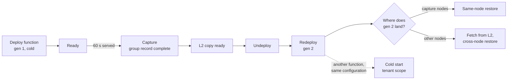

<!--
SPDX-FileCopyrightText: Copyright (c) 2026 NVIDIA CORPORATION & AFFILIATES. All rights reserved.
SPDX-License-Identifier: Apache-2.0
-->

# CRIU test matrix

Goal: every workload shape nvsnap claims to capture and restore with CRIU is
deployed as an NVCF function, captured, and restored, on the capture node and
on another node, and every shape it refuses is shown to start cold.



## How to run a case

Each case is a values file for one chart, `tests/criu-matrix/chart`.
`create-functions.sh` turns every case into an NVCF Helm function, and every
single-pod Deployment case into a container function as well, since NVCF
builds the two kinds of pod differently:

```sh
cd tests/criu-matrix
# Every case for arm64 nodes, as nvsnap-reg-<case> (Helm) and
# nvsnap-reg-ctr-<case> (container). PREFIX=tst for ad hoc tests,
# MODE=helm|container for one kind, CASES="..." for some cases,
# DRY_RUN=1 to print the commands.
ORG=<org> NGC_CLI_API_KEY=... HF_TOKEN=... NGC_API_KEY=... ./create-functions.sh
```

Each case is pushed as its own chart version, with the case's values as the
defaults, so a deployment needs no configuration. Deploy a function on a CRIU
cluster (`agent.captureMethod=criu`), wait for Ready and the capture,
undeploy, deploy again. A case declares its inference URL, health path,
secrets, node architectures and required cluster features under `function:`.

A multi-pod case is captured only on request: its pods carry
`nvsnap.io/criu-capture: "true"` (`criuCapture: true`), or the cluster's chart
values list the function under `agent.criuCaptureOptIn`.

What to read, in the agent logs on the instance's nodes:

| Step | Agent log line | Object |
| --- | --- | --- |
| Capture | `CRIU group capture: recorded` | ConfigMap `nvsnap-system/nvsnap-criu-group-<key>`, `state: complete` |
| L2 | `L2 promote complete` | claim `rox-<hash>` Bound in the function's namespace |
| Admission | `CRIU group restore: pod admitted as its rank's restore placeholder` | pod annotation `nvsnap.io/criu-restore` |
| Fetch (other node) | `EnsureLocal: fetched from the L2 volume`, `L2 fetch: copy complete` (with GB/s) | |
| Restore | `CRIU auto-restore: restored` or `CRIU group restore: restored` | pod annotation `nvsnap.io/criu-restored` |

Time each run from the namespace's creation to every pod Ready, and compare
with the cold deploy of the same case.

## Workload shapes

| Case | Controller | Pods | Engine start | Exercises | Expected | Status |
| --- | --- | --- | --- | --- | --- | --- |
| `sts-setsid` | StatefulSet | 1 | detached with `setsid` | the plain CRIU path (control) | restored | Verified |
| `sts-shell` | StatefulSet | 1 | child of the shell | engine below the container's pid 1 | restored | Verified |
| `deploy-pid1` | Deployment | 1 | `exec`, pid 1 | pid-namespace dump and nested restore, unix listeners, stdio | restored | Verified |
| `deploy-pid1-nonroot` | Deployment | 1 | `exec`, uid 1000 | chunk store and model reachable by a non-root engine | restored | New |
| `deploy-hfhome` | Deployment | 1 | `exec`, chart sets `HF_HOME` | model lands where the chart says | restored | New |
| `pod-bare` | Pod | 1 | `exec` | no controller, no instance | never captured | Verified |
| `sts-tp2` | StatefulSet | 2 | `exec`, TP=2 over the network | group capture, address remap of the ranks' connections | restored | Verified: cold 150 s, restored 39 s |
| `lws-tp2` | LeaderWorkerSet | 2 | `exec`, TP=2 | LWS grouping and rank | restored | New (needs the LWS CRD) |
| `deploy-sglang` | Deployment | 1 | SGLang, pid 1 | a second engine | restored | New |
| `dynamo-1gpu` | DynamoGraphDeployment | 1 + frontend | Dynamo vLLM worker on one GPU, snapshot point | capture at the snapshot point, registration under the restored pod's identity | restored | New (needs the Dynamo operator) |
| `dynamo-grove-tp2` | DynamoGraphDeployment | 2 + frontend | Dynamo vLLM worker over two nodes, snapshot point | Grove PodCliques, the shape production Dynamo functions run | restored | Captured at the snapshot point; restore blocked on the allocation issue below |
| `deploy-noshell` | Deployment | 1 | `exec`, image with no shell | every injected step (model wait, cache seed, prewarm, placeholder) runs without `/bin/sh` | restored | New (needs a GPU image without a shell) |

Real models, deployed as their own functions:

| Workload | Shape | Exercises | Status |
| --- | --- | --- | --- |
| 2-pod TP=8 vLLM (about 1.2 TB GPU memory per pod), NVCF Helm StatefulSet | multi-node NVLink, gpushare fabric | group capture, cross-node restore from L2 | Verified: cold 14m33s, same node 3m24s, other nodes 6m26s |
| Dynamo, aggregated and disaggregated (`examples/function-samples/helmchart-samples/dynamo-operator-sample`) | frontend, workers, etcd, NATS | non-root engine, connections to etcd and NATS after restore, prefill/decode KV transfer | In progress |
| vLLM Llama 3.1 8B and 70B, gpt-oss 120B, DeepSeek V4 Pro, GLM 5.1, Qwen3.6 35B, Nemotron 3 Nano; SGLang Gemma 4 31B, DeepSeek V4 Flash, Qwen3.5 397B, MiniMax M2.7 and M3, Kimi K2.6; NIM Llama 3.1 8B; e5-mistral embeddings | one case each under `cases/`, TP=8 as two pods of four GPUs | each engine's own capture and restore | New |

## Restore paths

Run on any case that restores; the 1-pod Deployment cases are the cheapest.

| Path | How to get it | Expected |
| --- | --- | --- |
| Same node | Undeploy, deploy again; the placeholders prefer the capture nodes | no fetch; restore only |
| Other node, from L2 | Keep gen 1 running and deploy a second instance; its pods land elsewhere | `fetched from the L2 volume` |
| Other node, function namespace gone | Undeploy, then deploy where the capture nodes are full | the L2 claim is minted in the L2 namespace |
| Another function, same configuration | Deploy the same case as a second function | cold start, no placeholder (tenant scope) |
| Restore fails | Break the checkpoint (for example, remove its directory on the node) | checkpoints blocked, pods replaced, configuration captured again |
| Restored engine dies | Kill the engine in a restored pod | pod replaced within a minute, checkpoints blocked |
| Agent restarts mid-capture | Roll the agents during a capture | instance replaced, record failed, captured again later |

## Model sources

| Source | Case | Expected landing |
| --- | --- | --- |
| Hugging Face, fetched by the engine, no `HF_HOME` | every default case | `/opt/nvsnap/hf`, `HF_HOME` set to it |
| Hugging Face, chart sets `HF_HOME` | `deploy-hfhome` | the chart's path |
| NGC download in an init container | the 2-pod TP=8 model | the chart's volume |

## Injected steps

Every step nvsnap adds to a pod (model wait and download, cache seed, prewarm)
runs `nvsnap-helper`, and restore placeholders and staging pods run
`nvsnap-idle`, both from the node's nvsnap bundle, which the agent stages and
the pod mounts read-only through a hostPath volume. `nvsnap-idle` is
single-threaded: a placeholder must hold no pid or thread id the checkpoint
uses. The
steps need nothing from the workload image, not even a shell. A cluster that
enforces a Kyverno policy against hostPath volumes needs an exception for the
bundle directory (`agent.l2.hostBundleRoot`, `/nvsnap` below it).

Every case mounts a memory-backed `/dev/shm` (`shmSize`): NCCL keeps its
buffers there, and the container default of 64 MiB does not fit two ranks.
Without it rank 0 fails at startup and the other ranks wait for it forever.

## Dynamo workers

A Dynamo worker registers with its instance's discovery under its pod's
identity, which it keeps in memory. Captured after that, it cannot serve in
another instance. A case sets `dynamo.snapshotPoint`, which declares
`DYN_SNAPSHOT_CONTROL_DIR`: the worker pauses its loaded engine before it
registers, the agent captures it there, then releases it with the identity
of the pod it runs in, on a cold start and after a restore.

Only rank 0 of a multi-pod instance takes the point. The webhook empties the
variable on the other ranks, which Dynamo refuses it on, and gives them the
NCCL settings rank 0's engine sets for itself.

## Not covered

- Ray-based multi-node engines (`ray start --address`): not recognized as
  multi-node, so a Ray worker pod could be captured alone.
- An engine that creates GPU memory after a gpushare capture: a new
  allocation can be refused ("operation not supported"). vLLM's sleep mode,
  which the Dynamo snapshot point uses, does so on wake. Under investigation
  in the gpushare library.
- Pods with an IMEX channel restore only when the channel is the same on the
  new pods.
