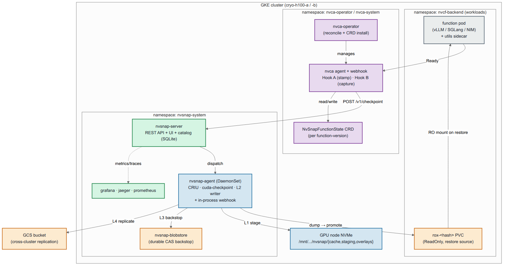
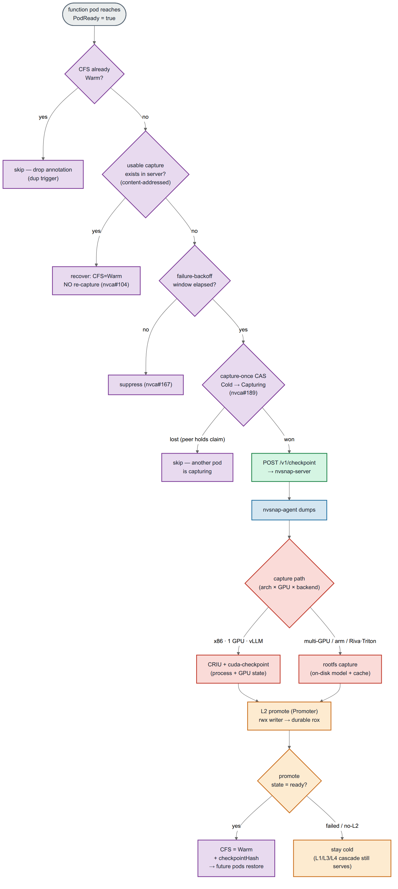
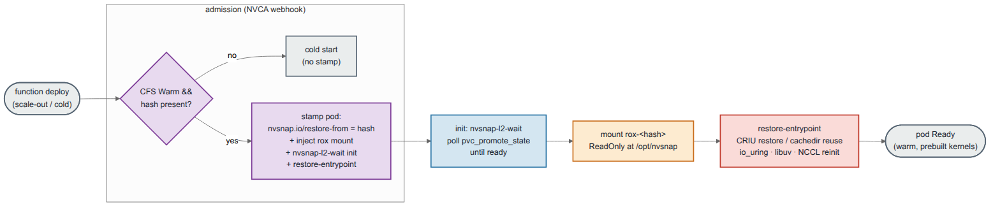
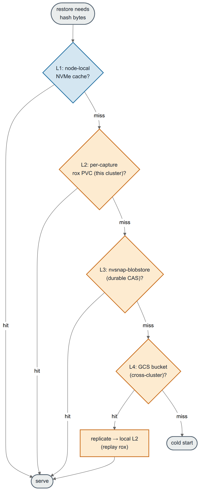
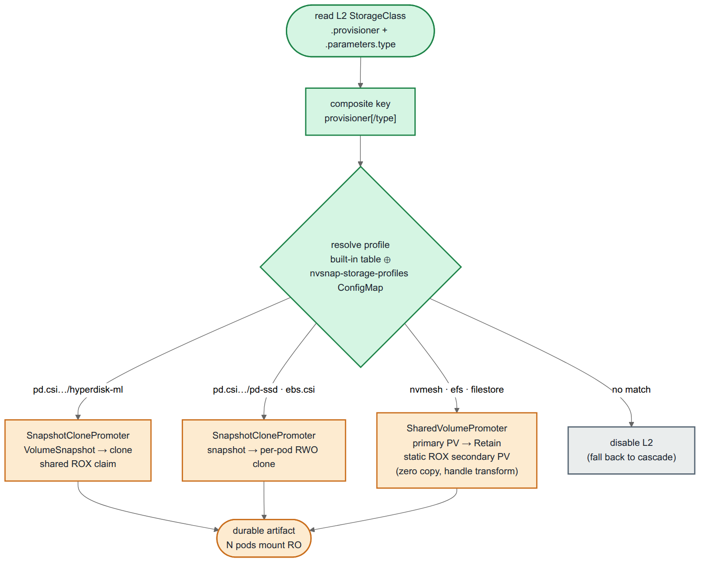
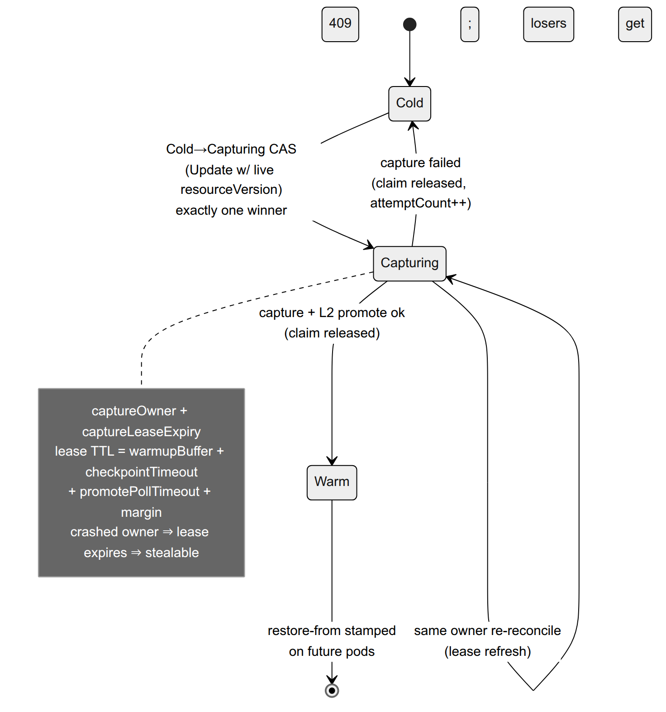

# NvSnap Architecture

> **History.** Replaced by [ARCHITECTURE.md](../../ARCHITECTURE.md) on 2026-10-21.
> Kept as a record; not maintained.

Transparent GPU checkpoint/restore for Kubernetes. NvSnap snapshots a
running GPU workload's process + GPU state (or its on-disk rootfs cache),
stores it across a tiered fabric, and restores it onto N pods — turning a
multi-minute cold start into a sub-minute warm restore, with **zero
application changes**.

This document is the current-state architecture: the node agent, the
control-plane server, the L1–L4 data fabric, the storage-agnostic L2
promotion tier (nvsnap#171), and the NVCA integration (Hook A/B + the
CryoFunctionState → **NvSnapFunctionState** controller, capture-once
nvca#189).

> Diagram palette (draw.io-classic): 🟦 agent/node · 🟩 control-plane ·
> 🟧 storage · 🟪 NVCA · 🟥 capture/CRIU · ⬜ external/workload.

---

<!-- toc: generated by scripts/docs/docs-toc.py; edit the headings, not this list -->
**Contents**

- [1. System overview](#1-system-overview)
- [2. Capture flow (NVCA Hook B → agent → L2 promote)](#2-capture-flow-nvca-hook-b--agent--l2-promote)
- [3. Restore flow (NVCA Hook A → webhook → rox mount)](#3-restore-flow-nvca-hook-a--webhook--rox-mount)
- [4. L1–L4 data fabric (restore-side cascade)](#4-l1l4-data-fabric-restore-side-cascade)
- [5. Storage-agnostic L2 promotion (nvsnap#171)](#5-storage-agnostic-l2-promotion-nvsnap171)
- [6. Capture-once: NvSnapFunctionState lifecycle (nvca#189)](#6-capture-once-nvsnapfunctionstate-lifecycle-nvca189)
- [7. How the capture method is chosen](#7-how-the-capture-method-is-chosen)
- [8. Cross-references](#8-cross-references)
<!-- /toc -->

## 1. System overview

**Components**

- **nvsnap-agent** (DaemonSet, one per GPU node) — process/GPU discovery,
  CRIU + `cuda-checkpoint` dump, rootfs capture, the single-copy L2
  writer, and an in-process mutating webhook the operator points BYOC
  workloads at. Runs privileged-ish with `/host` mount + containerd access.
- **nvsnap-server** — REST API + embedded React UI + the checkpoint
  catalog (SQLite on a PVC). Dispatches captures, tracks
  `pvc_promote_state`, serves the cross-cluster replicate API, reverse-
  proxies the observability stack into one pane.
- **nvsnap-blobstore** — content-addressed durable store (L3 backstop).
- **NVCA** (operator + agent/webhook) — the NGC autoscaler. Hook A stamps
  restore intent on admission; Hook B drives the post-Ready capture. State
  lives in the per-function-version `NvSnapFunctionState` (CFS) CRD.

---

## 2. Capture flow (NVCA Hook B → agent → L2 promote)

The reconciler is a gated state machine: each gate (already-Warm,
recovery, failure-backoff) short-circuits cheaply before the **capture-
once CAS** that guarantees exactly one in-flight capture per function-
version (see §6). Only the CAS winner dumps; everyone else backs off.

---

## 3. Restore flow (NVCA Hook A → webhook → rox mount)

`nvsnap-l2-wait` is the gate that makes WaitForFirstConsumer binding work:
the webhook injects it as an init container so the engine container only
starts once the rox PVC is promote-ready, avoiding the
admission-needs-bound / bound-needs-pod deadlock.

---

## 4. L1–L4 data fabric (restore-side cascade)

Tiers are tried fastest-first. L2 is the fan-out hero — one capture, N
read-only mounts on the same cluster. L4 (GCS) bridges clusters: a miss
that hits L4 replicates into the local L2 so subsequent pods stay warm.

---

## 5. Storage-agnostic L2 promotion (nvsnap#171)

The L2 tier is split into storage-**agnostic** orchestration (lease,
single-copy write, detach barrier, `pvc_promote_state` machine, namespace
scoping) and a pluggable **Promoter** that owns the storage-**specific**
rwx→durable transition + the restore-side mount. The Promoter is selected
at agent startup from the L2 StorageClass.

| Storage | provisioner[/type] | strategy | fan-out |
|---|---|---|---|
| Hyperdisk-ML | `pd.csi.storage.gke.io/hyperdisk-ml` | snapshot-clone | one shared **ROX** |
| Regular PD | `pd.csi.storage.gke.io/pd-ssd` | snapshot-clone | per-pod **RWO** clone |
| AWS EBS | `ebs.csi.aws.com` | snapshot-clone | per-pod **RWO** clone |
| NVMesh | `nvmesh-csi.excelero.com` | shared-volume | **zero-copy** ROX |
| EFS / Filestore | `efs.csi.aws.com` / `filestore.csi…` | shared-volume | **zero-copy** ROX |

A new/3rd-party backend is one `kubectl edit cm nvsnap-storage-profiles`
away — no agent rebuild. No match → L2 is disabled (logged), and restore
falls back to the L3/L4 cascade.

---

## 6. Capture-once: NvSnapFunctionState lifecycle (nvca#189)

When N pods of one function-version deploy cold at once, all N reconciles
would otherwise each fire a capture. The CFS state machine guarantees
exactly one, via a Kubernetes optimistic-concurrency CAS plus a lease.

The lease TTL provably exceeds the longest legitimate hold, so a valid
in-flight capture is never stolen; only a crashed/hung capturer's claim
expires and becomes stealable. Losers bump
`nvca_nvsnap_checkpoint_attempt_skipped_inflight_total` (≈ N−1 per
capture) — the observable proof the herd was contained.

---

## 7. How the capture method is chosen

The cluster operator sets one capture method for the whole cluster with the
chart value `agent.captureMethod` (`cachedir`, the default, or `criu`); the
chart passes it to the agent as `NVSNAP_DEFAULT_CAPTURE_PATH`
(`deploy/helm/nvsnap/templates/agent-daemonset.yaml`). The rules below apply
on top of it:

| Condition | What runs | Enforcing code |
|---|---|---|
| `captureMethod: cachedir` | rootfs/cachedir capture; CRIU only for a request that explicitly asks for `criu` | `internal/agent/nim_backend.go` `RootfsIsDefault`, `resolveCheckpointRedirect` |
| `captureMethod: criu` | CRIU + cuda-checkpoint; no cachedir machinery runs | same; `internal/agent/criu_auto_restore.go` `criuIsDefault` |
| Riva or Triton backend | always rootfs; an explicit `criu` request is an error (cuda-checkpoint cannot serialize their host-pinned memory) | `internal/agent/nim_backend.go` `BackendKind.UseRootfsCapture` |
| more than one distinct GPU, gpushare not loaded | CRIU capture is refused | `internal/agent/checkpoint.go` `countDistinctGPUDevices`, `gpushareLoadedBy` |
| more than one distinct GPU under gpushare | CRIU + gpushare (validated on GB300, arm64; see [GPUSHARE.md](../../design/GPUSHARE.md#validation)) | `internal/agent/gpushare.go` |
| multi-pod instance (StatefulSet, LeaderWorkerSet, Grove group) | captured and restored as one group, only when opted in | `internal/agent/criu_group.go` `captureOptedIn` |

The agent has no architecture gate: arm64 and x86 follow the same rules.

`cachedir` mode (canonical `/opt/nvsnap` cache path, identical at capture
and restore) lets engines reuse prebuilt JIT/CUDA-graph kernels instead of
recompiling — the bulk of the warm-restore win on compile-heavy models.

---|---|---|---|
| x86 | single | vLLM/SGLang/TRT-LLM/NIM-vLLM | **CRIU + cuda-checkpoint** |
| x86 | multi | any | **rootfs** (no NCCL state in cuda-checkpoint) |
| x86 | single | Riva / Triton | **rootfs** (host-pinned mem unregister aborts) |
| arm | any | any | **rootfs** (cuda-checkpoint unsupported) |

`cachedir` mode (canonical `/opt/nvsnap` cache path, identical at capture

- restore) lets engines reuse prebuilt JIT/CUDA-graph kernels instead of
recompiling — the bulk of the warm-restore win on compile-heavy models.

---

## 8. Cross-references

- Storage-agnostic L2 design: `docs/design/STORAGE-AGNOSTIC-L2-PROMOTION.md`
- NVCA × NvSnap integration: see the NVCA integration guide (separate, optional component for NVIDIA Cloud Functions deployments)
- How the capture method is chosen: §7 above; multi-GPU CRIU: `docs/design/GPUSHARE.md`
