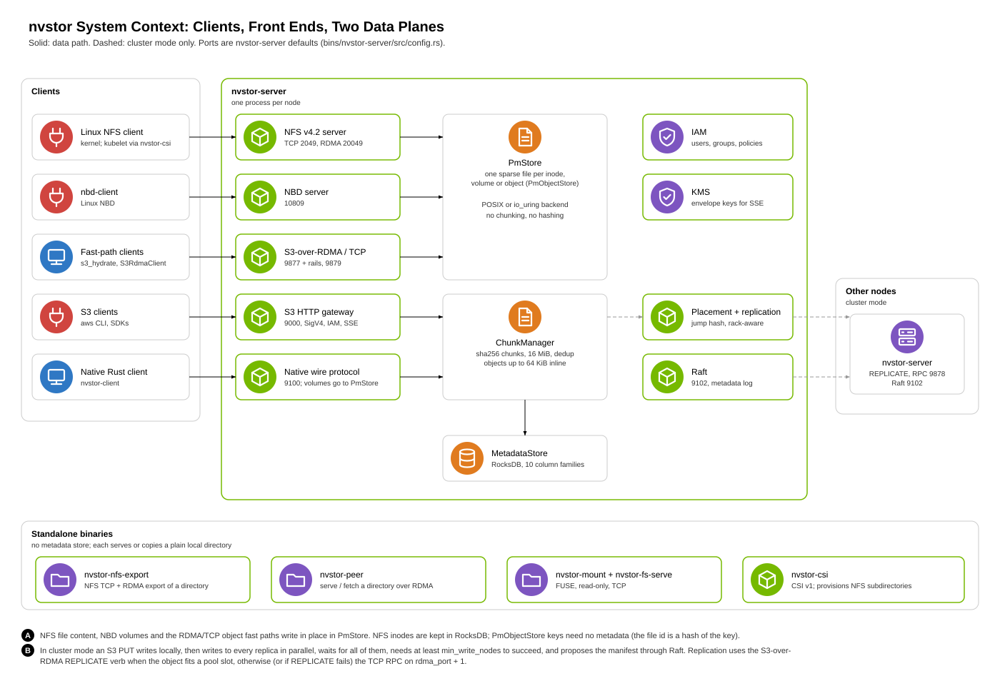

# nvstor

nvstor is a storage system written in Rust. One storage engine sits behind
several access protocols:

- an S3-compatible HTTP gateway,
- an NFS v4.2 server, over TCP and over RDMA (RPC-over-RDMA v1, RFC 8166,
  for the Linux kernel client),
- an NBD block server,
- a native TCP wire protocol with a Rust client,
- S3-over-RDMA and S3-over-TCP object transports,

plus `nvstor-peer`, which copies a directory from one node to another over
RDMA, optionally straight into GPU memory.

The design rule is that the fast path is the default: RDMA before TCP,
io_uring before POSIX, parallel pipelines before sequential ones, zero-copy
before buffer copies. TCP and POSIX are the fallbacks.

## Maturity

| Component | Status |
|---|---|
| `nvstor-core` (types, checksums, errors, WAL) | Stable |
| `nvstor-rdma`: authenticated RDMA bootstrap, multi-NIC rails, and the S3-over-RDMA read path (GET, HEAD, RAILS) that `nvstor-peer` uses | Stable. Validated on RDMA hardware through `nvstor-peer` |
| `nvstor-peer`: node-to-node directory copy over RDMA, fan-out, GPUDirect RDMA | Stable. Validated on RDMA hardware, including `bench --gpu` and `fetch --gpu`; the manifest v3 attribute handling is unit-tested only |
| `nvstor-rdma`: S3-over-RDMA PUT and REPLICATE, the node RPC, the KV protocol, S3-over-TCP and model hydration (`s3_hydrate`) | Experimental. PUT and REPLICATE are unit-tested only |
| `nvstor-server` and its front ends: S3 gateway, NFS server, NBD, native wire protocol | Experimental |
| `nvstor-nfs-export` and NFS over RDMA | Experimental. Exercised by a real kernel client over RDMA, including a server restart under a mounted client; recovery from a network drop is not yet tested |
| Cluster mode: Raft, placement, cross-node replication | Experimental. Mostly unit-tested; no failure tests |
| IAM, KMS | Experimental |
| CSI driver, FUSE | Experimental |
| KV tier: `nvstor-kv`, `integrations/vllm` | Experimental |

"Experimental" means the code builds, is tested, and works against real
clients in the cases the docs describe, but has not had the hardening or
failure testing you would want before trusting it with data you cannot
lose.

## What is in the tree

**Two data-plane primitives** in `nvstor-storage`:

- **Position-mapped (`PmStore`)**: one sparse file per volume or object,
  `pwrite`/`pread` at the offset, no chunk indirection. NBD volumes, NFS
  file content and the S3-over-RDMA/TCP object store use it.
- **Content-addressed (`ChunkManager`)**: sha256-keyed immutable chunks,
  for S3 objects, multipart uploads and dedup.

Both have POSIX and io_uring backends. The io_uring `PmStore` backend
shards submission rings (one per CPU) and chains write+fsync as linked
SQEs. Every write API takes a `SyncMode` (`None`, `Data`, `Full`);
metadata lives in RocksDB with an atomic `commit_batch`.

**Protocols and tools** built on it:

- **S3 gateway** (experimental): multipart, range reads, copy, batch
  delete, versioning, SigV4 and presigned URLs, virtual-host addressing,
  SSE, quotas.
- **NFS v4.2 server** (experimental): the COMPOUND dispatcher decodes every
  NFSv4.0–4.2 operation number (handler depth varies), up to 256 COMPOUNDs
  in flight per connection, persistent VFS in RocksDB. `nvstor-server`'s
  export admits only the clients listed in `[nfs] allow_clients` (loopback
  when the list is empty).
- **NFS over RDMA** (experimental): zero-copy READ and WRITE through
  registered pools, pipelined per connection, dual-stack listener so it
  serves both IPv4 front-end NICs and IPv6-only rails. Session trunking
  gives one transport per rail. See [`docs/nfs-rdma.md`](docs/nfs-rdma.md).
- **`nvstor-nfs-export`** (experimental): standalone NFS (TCP and RDMA)
  export of a local directory. Clients must be listed with
  `--allow-client`; every operation checks the caller's AUTH_SYS
  credentials against POSIX permissions; every inode is opened beneath the
  export root and symlinks are never followed; filehandles are HMAC-sealed
  and, with `--fh-key`, stay valid across a server restart. See
  [`crates/nvstor-nfs/README.md`](crates/nvstor-nfs/README.md).
- **S3-over-RDMA** (in `nvstor-rdma`; the read path GET, HEAD, RAILS is
  stable, PUT and REPLICATE are experimental): connectors authenticate in a
  challenge-response bootstrap over TCP before any queue pair exists; no
  server advertises or exposes its memory (GET is a server RDMA WRITE into
  the buffer the client named in a signed request, PUT a server RDMA READ
  from it); every request is HMAC-signed; every range carries a CRC-32C and
  is pinned to a file generation. One transport per NIC; clients pair
  NICs by reachability.
- **S3-over-TCP** (experimental, in `nvstor-rdma::tcp`): the same object verbs over TCP,
  for hosts without RDMA.
- **`nvstor-peer`** (stable): copies a directory node to node over RDMA.
  `serve` exports a directory read-only on every rail; `fetch` pulls a
  manifest and then every file's ranges in parallel, CRC-checked, into a
  private staging directory, renaming each file into place when complete,
  with mode, mtime and (given the capabilities) ownership applied. A
  source serves at most `--max-fetchers` sessions and answers BUSY before
  creating any queue pair; `fetch` takes several sources and fails over
  mid-copy to one with the same content identity; `--then-serve` turns a
  finished copy into a source, so copies spread as a tree. `bench`
  measures the transport without a destination. With `--gpu N`, `bench`
  and `fetch` land every range in GPU memory through GPUDirect RDMA (the
  CUDA driver is loaded at run time; nvstor links no CUDA and builds
  without the toolkit); `fetch --gpu` writes the disk copy in the
  background from GPU memory. A copy is usually bounded by the
  destination's write speed, not by the transport. See
  [`docs/peer-copy.md`](docs/peer-copy.md) and
  [`docs/design/fetch-gpu.md`](docs/design/fetch-gpu.md).
- **Model hydration** (experimental, `s3_hydrate` example in `nvstor-rdma`): parallel
  ranged GETs over S3-over-TCP or S3-over-RDMA into a local file, verified
  range by range, renamed into place only when complete. See
  [`docs/model-hydration.md`](docs/model-hydration.md).
- **NBD** (experimental): FUA, FLUSH, TRIM and WRITE_ZEROES (as
  `fallocate(PUNCH_HOLE)`), block size negotiation.
- **Native wire protocol** and Rust async client (experimental).
- **Cluster mode** (experimental): Raft consensus, placement (jump hash,
  rack-aware, capacity-aware), cross-node replication over RDMA (the
  replica pulls the bytes; cluster peers only) with a TCP RPC fallback. An
  S3 PUT writes to every placement target in parallel and waits for them.
  Erasure coding exists in `nvstor-placement` but the server does not
  select it.
- **IAM** policy evaluation and **KMS** envelope encryption (experimental).
- **CSI driver** (gRPC, CSI v1.10) and **FUSE** (passthrough and
  remote-backed) (experimental).
- **KV tier** (experimental): `nvstor-kv`, a KV-cache block server over
  RDMA, and its vLLM integration in `integrations/vllm`.

### Known gaps

- NBD, the native wire protocol and `nvstor-fs-serve` have no
  authentication. Run them only on a trusted network.
- NFS access control is by client address plus AUTH_SYS credentials; there
  is no cryptographic client authentication. Restrict an export to the
  addresses that need it.
- The RDMA paths need RoCE or InfiniBand; there is no AWS EFA transport.
- In cluster mode replicas carry no versions, so a partial failure can
  leave a stale replica that no read detects. Nothing in cluster mode has
  been failure-tested.
- Failure-injection tests are not automated, and operational tooling
  (rolling upgrades, repair, online compaction) is not built.

[`docs/ARCHITECTURE.md`](docs/ARCHITECTURE.md) has the details for each of
these.

## Architecture



[`docs/ARCHITECTURE.md`](docs/ARCHITECTURE.md) describes the crates, the two
storage primitives, when a write is durable, every protocol, the RDMA
bootstrap, `nvstor-peer`, cluster mode and the security model, with a figure
for each data path.

## Workspace

| Crate | Contents |
|---|---|
| `nvstor-core` | Shared types, CRC-32C, errors, WAL |
| `nvstor-metadata` | RocksDB metadata store, `WriteBatch`, `commit_batch(SyncMode)` |
| `nvstor-storage` | `PmStore` and `ChunkManager`, POSIX and io_uring backends, crypto, erasure coding, scrub |
| `nvstor-transport` | TCP transport and connection pooling |
| `nvstor-client` | Native Rust client |
| `nvstor-object` | S3-compatible HTTP gateway |
| `nvstor-block` | NBD server |
| `nvstor-nfs` | NFS v4.2 server over TCP and RDMA; `nvstor-nfs-export` |
| `nvstor-fuse` | FUSE filesystem; `nvstor-mount`, `nvstor-fs-serve` |
| `nvstor-raft` | Raft consensus |
| `nvstor-placement` | Placement policy and distributed manager |
| `nvstor-rdma` | ibverbs and RDMA-CM bindings, authenticated bootstrap, registered memory pools, multi-NIC rails, S3-over-RDMA and S3-over-TCP, request signing, hydration |
| `nvstor-peer` | Node-to-node directory copy over RDMA, GPUDirect RDMA |
| `nvstor-kv` | KV-cache block server over RDMA |
| `nvstor-iam` | IAM policy store and evaluation |
| `nvstor-kms` | Key management and envelope encryption |

### Binaries

| Binary | Purpose |
|---|---|
| `nvstor-server` | Multi-protocol server (S3, NFS, NBD, native wire, S3-over-RDMA/TCP) |
| `nvstor-nfs-export` | Standalone NFS (TCP and RDMA) export of a local directory |
| `nvstor-peer` | `serve`, `fetch` and `bench`: directory copy between nodes over RDMA |
| `nvstor-kv` | `serve` (experimental): KV-cache block server over RDMA with its own protocol, authenticated with `NVSTOR_KV_SECRET` and `NVSTOR_KV_ACCESS_KEY`; `bench`: benchmark client |
| `nvstor-csi` | CSI driver |
| `nvstor-mount`, `nvstor-fs-serve` | FUSE client and its file server |
| `s3_hydrate` (example in `nvstor-rdma`) | Node-to-node model hydration client |

## Building

Requirements: Rust 1.87 or newer, Linux, and the rdma-core development
files (`libibverbs`, `librdmacm`; see [`docs/RDMA_SETUP.md`](docs/RDMA_SETUP.md)).
`nvstor-metadata` builds RocksDB, so the first build takes a few minutes.

```bash
cargo build                                          # everything
cargo build --release --bin nvstor-server            # multi-protocol server
cargo build --release --bin nvstor-nfs-export        # standalone NFS export
cargo build --release --bin nvstor-peer              # node-to-node copy
```

If the rdma-core development files are in a custom prefix, set
`RDMA_CORE_PREFIX` to the directory containing `include` and `lib` during
the build. Runtime hosts need `libibverbs` and `librdmacm`.
`rust-toolchain.toml` pins the compiler the Bazel build uses, so `rustup`
picks it for Cargo too.

### Bazel

nvstor-peer and the two crates it uses (`nvstor-core`, `nvstor-rdma`) also
build with Bazel from the NVIDIA/nvcf repository root, the way nvcf builds
and releases its services. The other crates build with Cargo only.

```bash
bazel build //src/compute-plane-services/nvstor/...
bazel test //src/compute-plane-services/nvstor/...
```

Bazel links `libibverbs` from pinned Ubuntu noble packages for the target
architecture (`bazel/rdma_core.bzl`), so the build host needs no rdma-core and
an arm64 binary cross-builds on an x86_64 host:

```bash
bazel build --config=release --platforms=//platforms:linux_arm64 \
  //src/compute-plane-services/nvstor/crates/nvstor-peer:nvstor-peer
```

Build any binary that will be run or measured with `--config=release`.
nvcf's default compilation mode, `fastbuild`, compiles Rust without
optimisation; such a binary is correct but not suitable for running or
for performance evaluation. The `bazel build` and `bazel test` above use
the default, which is fine for checking that the code builds and its tests
pass.

`nvstor-peer --version` reports the nvcf commit the binary was built from.

#### nvstor-peer image

`nvstor-peer-image` is a multi-arch image (amd64 and arm64) on Ubuntu noble:
nvstor-peer at `/usr/local/bin/nvstor-peer`, built optimised whatever the
compilation mode, and a layer with `libibverbs`, the verbs providers
(`libmlx5` among them) and `libnl` from the same pinned packages, listed in
`/var/lib/dpkg/status.d` for image scanners (apt and dpkg do not read it, so
an image built on this one must not install rdma-core again). There is no
`iproute2`: inspect a pod's rails with `kubectl debug` or from the node. It
runs as root (a fetch
applies source owners only with `CAP_CHOWN`, `CAP_DAC_OVERRIDE` and
`CAP_FOWNER`) and sets `NVIDIA_DRIVER_CAPABILITIES=compute,utility` for
`--gpu`.

```bash
# both architectures, as an OCI image index
bazel build //src/compute-plane-services/nvstor/crates/nvstor-peer:nvstor-peer-image_index
# the host architecture's image into the local Docker
bazel run //src/compute-plane-services/nvstor/crates/nvstor-peer:nvstor-peer-image_load
```

For pre-merge testing, the `image-push (manual)` workflow
(`.github/workflows/image-push-manual.yml`) pushes the `nvstor-peer` image;
release publishing is configured outside this repository.

## Testing

```bash
cargo test --workspace                               # full suite
cargo test -p nvstor-storage --features io-uring     # PmStore with the io_uring backend
```

Tests that need an active RDMA device are marked `#[ignore]` and run only
when selected, for example
`cargo test -p nvstor-peer --test fanout_rdma -- --ignored`.

## Running

```bash
cargo run --release --bin nvstor-server -- --data-path /tmp/nvstor
```

`--config FILE` reads a TOML configuration; `--data-path` overrides its
data directory. With S3 authentication:

```bash
NVSTOR_ACCESS_KEY=... NVSTOR_SECRET_KEY=... \
  cargo run --release --bin nvstor-server -- --data-path /tmp/nvstor
```

### Ports

| Service | Default port |
|---|---|
| S3 HTTP | 9000 |
| Native wire protocol | 9100 (`grpc_port`; the configs in `deploy/bare-metal/` set 9002) |
| Health and metrics | 9101 |
| Raft | 9102 |
| NBD | 10809 |
| NFS | 2049 (12049 in development configs, to avoid the kernel nfsd) |
| NFS over RDMA | 20049, when an active RDMA device is found |
| S3-over-RDMA | 9877 (`rdma_port`); node RPC on `rdma_port + 1`; further NICs from `rdma_port + 16` |
| S3-over-TCP | 9879 (`s3_tcp_port`) |
| `nvstor-peer` | 9890; rail k on 9890 + k |
| `nvstor-kv serve` (experimental) | 9900; rail k on 9900 + k |

### Configuration

```toml
[storage]
data_path = "/var/lib/nvstor"
# Under data_path: chunks/ (content-addressed), volumes/ (position-mapped),
# meta/ (RocksDB), wal/
chunk_size = 16777216
# io_uring PmStore backend; falls back to POSIX if io_uring init fails.
direct_io = true
verify_checksums = true
gc_enabled = true
gc_interval_secs = 300

[network]
grpc_port = 9100      # field name kept for compatibility; serves the native wire protocol
http_port = 9101
s3_port = 9000
nbd_port = 10809
nfs_port = 2049
# nfs_rdma_port = 20049 # set to require NFS/RDMA; auto-detected by default, 0 disables
raft_port = 9102
rdma_port = 9877
s3_tcp_port = 9879

[nfs]
# NFS clients admitted (addresses, prefixes or "*"); loopback only when
# empty. A non-empty list admits exactly what it names.
allow_clients = ["127.0.0.1", "10.0.0.0/24"]

[limits]
max_connections = 10000
request_timeout_secs = 30
idle_timeout_secs = 300
max_object_size = 5368709120
```

## Deployment

`deploy/` holds Kubernetes manifests (`deploy/kubernetes/`), a Helm chart
(`deploy/helm/`), CSI manifests (`deploy/csi/`), bare-metal configs
(`deploy/bare-metal/`), a Grafana dashboard for the NFS server, the
NFS-over-RDMA deployment example with the `nvstor-peer` fan-out manifest
([`deploy/nfs-rdma/README.md`](deploy/nfs-rdma/README.md)). The
`nvstor-peer` image is built with Bazel (see [Bazel](#bazel)).

## Documentation

[`docs/README.md`](docs/README.md) lists every document. Start with
[`docs/ARCHITECTURE.md`](docs/ARCHITECTURE.md).

## Contributing

See [CONTRIBUTING.md](CONTRIBUTING.md). Report security issues as described
in [SECURITY.md](SECURITY.md), never in a public issue.

## License

Apache License, Version 2.0. See [LICENSE](LICENSE).
