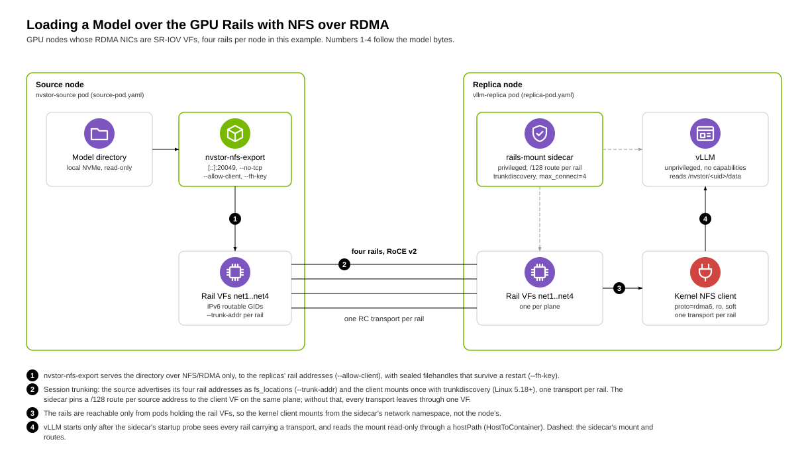

# NFS over RDMA across several rails: Kubernetes deployment example

Load model weights (or a checkpoint) on a new vLLM replica straight from
another node's local NVMe, over all of the nodes' RDMA NICs ("rails"), with
the kernel NFS client. No copy into a storage tier, no TCP.

**Status: experimental.** `nvstor-nfs-export` and NFS over RDMA are
experimental (see [docs/nfs-rdma.md](../../docs/nfs-rdma.md)). The `exec`
mode below and the sidecar layout of `replica-pod.yaml` (with a reader in
place of vLLM) have been exercised on nodes with four SR-IOV RoCE rails;
`peer-fanout.yaml` has not been applied to a cluster yet.

The manifests assume a common layout for GPU nodes: each node has four RDMA
NICs exposed to pods as SR-IOV VFs through Multus (a
`NetworkAttachmentDefinition`, `network-operator/sriov-net` in the examples)
and a device-plugin resource (`nvidia.com/mlnxnics` in the examples), with
IPv6-only routable addresses from router advertisements. Adjust the NAD
name, the resource name and the count to your cluster.

## How it works



- The rails are only reachable from pods that hold the rail VFs, and their
  routable addresses are IPv6 only. So both ends run in such pods, and the
  client mounts from inside its pod: the kernel NFS client connects from the
  network namespace of the process that mounts. A kubelet-mounted PV would
  use the node's front-end NIC instead.
- Session trunking puts one transport per rail on one NFS client; reads
  through the mount use all of them. On Linux 5.18+ `rails-mount.sh` mounts
  once with `trunkdiscovery,max_connect=4`: the source advertises its rail
  addresses (`nvstor-nfs-export --trunk-addr`, set by `source-pod.yaml`, as
  the `fs_locations` attribute) and the client adds one transport for each
  address it does not already use, 4 for 4 rails. On older kernels
  (`NVSTOR_TRUNKING=mounts`) it mounts the export once more through each
  other rail address; each such mount costs two transports, 7 for 4 rails.
- The routing table, not NFS, picks the client interface for each transport,
  and the RA default routes all point at one VF. `rails-mount.sh` pins each
  source address (`/128`) to the client VF on the same plane. Without that,
  all four transports share one VF.
- Filehandles carry kernel file handles sealed with the key in
  `NVSTOR_FH_KEY`, so a restarted source keeps clients' handles valid
  (needs the same key and `CAP_DAC_READ_SEARCH`; the pod is privileged).

### The mount and its lifetime

Mounting needs privilege (`mount(2)`, route changes, the host's `mount.nfs`
through `chroot /host`); serving a model does not. So the replica pod has
two containers:

- `rails-mount` is a native sidecar (an init container with
  `restartPolicy: Always`, Kubernetes 1.29+) and the only privileged
  container. `rails-mount.sh sidecar` mounts at
  `/var/lib/kubelet/nvstor-nfs-rail/<pod UID>/data` on the node through a
  hostPath with `mountPropagation: Bidirectional`, waits until every rail
  carries a transport, creates its ready file, and waits. Its startup probe
  (`rails-mount.sh check`) passes only then, so `vllm` starts after the
  model is mounted. The readiness probe keeps checking that the mount is
  there.
- `vllm` runs unprivileged (no capabilities, no privilege escalation, no
  host filesystem). It sees the hostPath read-only at `/nvstor` with
  `mountPropagation: HostToContainer` and loads `/nvstor/<pod UID>/data/...`.

Because the mount lives on the node, not in a container's namespace, it has
to be taken down explicitly, and it must be: a leftover mount keeps the dead
pod's network namespace, and the RDMA resources of its rail VFs, referenced
by the kernel NFS client.

- On pod deletion `vllm` stops first, then the sidecar gets SIGTERM and
  unmounts (`umount -f`, which aborts outstanding RPCs so a dead source does
  not stall it, then `umount -l` if still busy) and removes its directory.
  `terminationGracePeriodSeconds: 90` leaves room for both.
- On start the sidecar unmounts whatever is in its own directory (a sidecar
  that crashed and was restarted in the same pod) and in the directory of
  any pod whose `/var/lib/kubelet/pods/<uid>` no longer exists (a pod that
  was killed without unmounting, then deleted). A mount left by a pod
  killed with SIGKILL therefore lasts until the next replica pod starts on
  that node.
- If anything fails after the first mount (a trunk mount, a missing
  transport: with `trunkdiscovery`, a source started without `--trunk-addr`
  gives only one), the sidecar unmounts and exits non-zero; the kubelet restarts
  it and `vllm` never starts on a partial mount.

### Mount options

The mount is always `ro,soft,softerr,timeo=100,retrans=2`: if the source
dies, reads return ETIMEDOUT instead of hanging. The timeout grows linearly
per retry (10 s, 20 s, 30 s), so a read can take up to about 60 s to fail.
`NVSTOR_MOUNT_OPTS` adds options after these, and the kernel takes the last
value, so `NVSTOR_MOUNT_OPTS=timeo=50,retrans=1` fails faster. It cannot
contain `rw` or `hard`, nor `vers`, `proto`, `port`, `max_connect` or
`trunkdiscovery`, which the script sets.

`NVSTOR_MOUNT_UNSAFE_OPTS` is the explicit way to get `hard` or `rw`. A hard
mount hangs every reader in uninterruptible sleep (unkillable, and the pod
cannot terminate) for as long as the source or a rail is down; `rw` lets the
workload write to the source's disk if the export runs with `--read-write`.
The script logs a warning when it is set.

The other settings (`NVSTOR_SOURCE_ADDRS`, `NVSTOR_EXPORT_PATH`,
`NVSTOR_RDMA_PORT`, `NVSTOR_TRUNKING`, the wait times and paths) are listed
in the header of `rails-mount.sh`.

### Security

- **No cryptographic client authentication.** The export uses NFS AUTH_SYS:
  the client asserts its own uid/gid and the server believes it. Access
  control is the client address list plus those credentials:
  `nvstor-nfs-export` runs as root (privileged, through `chroot /host`) but
  checks every request against the caller's uid, gid and groups with POSIX
  permission rules, and squashes uid 0 to 65534 (no `--no-root-squash` in
  `source-pod.yaml`). A workload that runs as root in its container reads
  as 65534, so the served tree must be world-readable (files 0644,
  directories 0755), or the workload must run as a uid the files allow. Any
  admitted client can still claim any non-root uid, so a mode-0600 file is
  protected from clients outside the allow list and from honest clients
  only.
- **`NVSTOR_ALLOW_CLIENTS` is required.** `nvstor-nfs-export` refuses to
  start without at least one `--allow-client CIDR`, and `source-pod.yaml`
  passes one per prefix in `NVSTOR_ALLOW_CLIENTS` (no default). Set it to
  the replica nodes' rail addresses: the prefixes of their `net1..net4`
  addresses (`kubectl exec <a pod holding the VFs> -- ip -6 addr`, or the
  `rail netN (ADDR)` lines `rails-mount.sh` logs), as `/128`s or as the
  smallest prefix that covers only replica nodes. `::/0` (and `0.0.0.0/0` for
  IPv4) opens the export to every client that can reach it; use it only
  deliberately.
- **Filehandles are sealed.** Every filehandle carries an HMAC tag under the
  key in `NVSTOR_FH_KEY` (created on first start, mode 0600, in the
  writable hostPath `/var/lib/nvstor/state`), so clients cannot forge
  handles to reach files outside the export. Keep the key: the same key keeps
  clients' handles valid across a server restart; a new one makes them stale.
- **The rails may be shared.** Other tenants' pods can hold VFs on the
  same rail planes, and Kubernetes NetworkPolicy does not filter SR-IOV
  secondary networks. On the rails the address allow list is the only
  protection, and addresses on a shared L2/L3 fabric can be spoofed by anyone
  who controls a host on it. Serve sensitive weights this way only where
  that is acceptable: the rails carry no tenant you do not trust, or the
  fabric enforces source addresses per VF.
- **Pod network.** `source-pod.yaml` runs the export with `--no-tcp`: it
  serves NFS/RDMA on the rails only and listens on nothing on the pod IP,
  and its NetworkPolicy admits no ingress there. (Without `--no-tcp`
  the export also serves NFS/TCP, on `0.0.0.0` or the `--bind` addresses.)
  With TCP off, a fatal NFS/RDMA listener error (the device going away)
  makes the server exit non-zero, so the kubelet restarts the pod.
- **Privilege.** Only the `rails-mount` sidecar and the source container are
  privileged, and neither runs network-facing code other than
  `nvstor-nfs-export`. The `vllm` container can read other replica pods'
  mounts on the same node (it sees the whole hostPath, read-only); run
  replicas of different tenants on different nodes.

## Prerequisites

- Kubernetes 1.29 or later (native sidecar containers) for
  `replica-pod.yaml`.
- Client nodes: the kernel NFS/RDMA client (`rpcrdma`) and `mount.nfs`
  (`nfs-common` or `nfs-utils`) installed on the node; the sidecar runs the
  node's `mount.nfs` through `chroot /host`. With a MLNX/DOCA OFED driver
  stack, the inbox `rpcrdma` module may be rejected by the OFED `ib_core`;
  install the OFED NFS/RDMA package (`mlnx-nfsrdma-dkms`) instead.
  `/var/lib/kubelet` must be on a shared mount (it is on systemd hosts), or
  Bidirectional propagation fails at pod start.
- Both nodes: 4 free rail VFs, and privileged pods allowed.
- A build of `nvstor-nfs-export` for the nodes' architecture, linked
  against a glibc no newer than the nodes'. For aarch64 nodes, from an
  x86_64 Linux host with docker (or podman):

  ```sh
  deploy/nfs-rdma/build-aarch64.sh            # nvstor-nfs-export
  deploy/nfs-rdma/build-aarch64.sh nvstor-nfs-export nvstor-server
  ```

  The script builds an Ubuntu 24.04 builder image (glibc 2.39) with the
  aarch64 cross toolchain and aarch64 rdma-core headers and libraries,
  cross-compiles there, and leaves the binaries in
  `target/aarch64-unknown-linux-gnu/release/`. It needs network access the
  first time (Ubuntu packages, rustup, crates). On a host of the nodes'
  architecture, build natively instead, with `libibverbs-dev`,
  `librdmacm-dev`, `clang` and `cmake` installed:

  ```sh
  cargo build --release --locked --bin nvstor-nfs-export
  ```

## Deploy

1. Install the binary on the source node (and any node that will serve):

   ```sh
   deploy/nfs-rdma/install-binary.sh target/aarch64-unknown-linux-gnu/release/nvstor-nfs-export <source-node>
   ```

   `<source-node>` is the Kubernetes node name of the node that holds the
   data; the manifests use the same `<source-node>` (and `<replica-node>`)
   placeholders for you to fill in. `install-binary.sh` checks that the
   binary is aarch64; `DRYRUN=1` validates its helper pod manifest only.

2. Start the source. Set `nodeName` (`<source-node>`), `NVSTOR_EXPORT_DIR` and
   `NVSTOR_ALLOW_CLIENTS` (see Security) in `source-pod.yaml`, then:

   ```sh
   kubectl apply -f deploy/nfs-rdma/source-pod.yaml
   kubectl logs nvstor-source | awk '/^nvstor-rail/ {print $3}'
   ```

   The second command prints the source's four rail addresses. With
   `NVSTOR_ALLOW_CLIENTS` empty the pod exits with
   `nvstor-source: error: NVSTOR_ALLOW_CLIENTS is empty`.

3. Start the replica. Put those addresses in `NVSTOR_SOURCE_ADDRS` in
   `replica-pod.yaml` (space separated; the file has placeholder addresses),
   set the model directory (relative to the export) and vLLM arguments, then:

   ```sh
   kubectl create configmap nvstor-rails-mount --from-file=deploy/nfs-rdma/rails-mount.sh
   kubectl apply -f deploy/nfs-rdma/replica-pod.yaml
   kubectl logs vllm-replica -c rails-mount
   ```

   Expect one `rails-mount: rail netN (CLIENT) -> SOURCE` line per rail,
   `mounted ... over 4 rails` and `ready`. The mountstats count in that line
   can be higher than the number of rails with trunkdiscovery (the kernel
   can list a discovered transport twice); the source's log has one
   `NFS/RDMA connect request` per connection. Every failure is a
   `rails-mount: error:` line in the same log: a malformed address, a rail
   with no routable address after 60 s, no route, a refused mount, or fewer
   transports than rails.

For a replica that spans two nodes (LeaderWorkerSet, Ray), give every pod of
the replica the same sidecar and volumes; each node mounts and reads the
weights itself, from the same source or different ones.

### exec mode (less safe)

`rails-mount.sh exec -- COMMAND...` mounts in its own container's mount
namespace (no propagation, so nothing is left on the node when the container
dies) and then `exec`s COMMAND in that same privileged container, with the
host's `/` at `/host` and a symlink `$NVSTOR_LINK` (default `/models`) to
the mount. COMMAND keeps full privileges for its whole life, so a
code-execution bug in it is a node compromise: use it only for a trusted,
short-lived loader or for debugging, never for a network-facing server such
as vLLM.

### Serving from a running replica

The source pod needs the node's rail VFs. If a vLLM pod on the source node
already holds all of them, add the `nfs-export` container from
`source-pod.yaml` to that pod as a sidecar instead (same command, env,
`securityContext` and `/host` volume, without its own
`nvidia.com/mlnxnics` request: the VFs are already in the pod's network
namespace, and a privileged container sees the node's `/dev/infiniband`).
Every replica then serves its weights to the next one. This variant has not
been run yet.

### Copying the weights to many replicas (nvstor-peer fan-out)

The NFS layout above reads the weights from the source on every load. To
put a copy on every replica's own NVMe instead, without all replicas
pulling from one node at once, use `nvstor-peer`
([docs/peer-copy.md](../../docs/peer-copy.md)) with `peer-fanout.yaml`:

- `nvstor-peer-origin` serves `/var/lib/nvstor/models` from the node
  that has it, to at most 4 fetchers at once (`--max-fetchers`); more are
  told BUSY in the RDMA bootstrap, before any QP exists on the origin.
- The headless Service `nvstor-peer` lists every pod that is Ready to
  serve: the origin, and each replica whose copy is complete and served.
- Each `vllm-peer` pod runs a `peer` native sidecar: `nvstor-peer fetch
  --source nvstor-peer.<ns>.svc.cluster.local:9890 --then-serve`. The
  name resolves to every Ready server; the fetcher tries them in its own
  order, moves on from a busy or dead one, continues from another if its
  source dies mid-copy, and serves its copy once it is complete. The ready
  file it then writes gates the sidecar's startup probe, so `vllm` starts
  only with the whole model on local disk, and the pod joins the Service
  (becomes a source) at the same moment.
- With 4 fetchers per source the sources grow about five-fold per round
  of copies: 128 replicas are three rounds away from the origin.

```sh
deploy/nfs-rdma/build-aarch64.sh nvstor-peer
deploy/nfs-rdma/install-binary.sh target/aarch64-unknown-linux-gnu/release/nvstor-peer NODE...
kubectl create secret generic nvstor-peer --from-literal=secret="$(openssl rand -hex 32)"
kubectl apply -f deploy/nfs-rdma/peer-fanout.yaml      # after setting nodeName (<source-node>) and MODEL
kubectl logs deploy/vllm-peer -c peer | grep -E 'fetched|serving|BUSY|failed'
```

Every replica's `fetched ...` line ends with the same `content` digest.
The sidecar runs the node's binary through `chroot /host` (like
`source-pod.yaml`) and bind-mounts the pod's `resolv.conf` over the
node's inside its own mount namespace so the Service name resolves. This
manifest has not been applied to a cluster yet.

## Testing

`deploy/nfs-rdma/test-rails-mount.sh` runs `rails-mount.sh` without root,
RDMA or a cluster (fake `ip`, `mount` and `umount`, fake mount tables): the
argument checks, the rail and route failure paths, the mount options, exec
mode, and the sidecar lifecycle (ready file, probe, SIGTERM unmount, cleanup
after a crashed or deleted pod). It cannot check the kernel NFS client, real
routes or mount propagation; that needs the cluster:

1. Deploy the source with `NVSTOR_ALLOW_CLIENTS` set to the replica node's
   rail addresses, and the replica; `kubectl logs vllm-replica -c
   rails-mount` shows 4 rails, 4 transports, `ready`; `vllm` starts only
   after that.
2. On the replica node: `findmnt -R /var/lib/kubelet/nvstor-nfs-rail`
   shows `<uid>/data` with `proto=rdma6` (and `trunk1..3` with
   `NVSTOR_TRUNKING=mounts`);
   `kubectl exec vllm-replica -c vllm -- cat /proc/self/status | grep CapEff`
   is all zeros; the source's log shows one connection from each of the
   replica's rail addresses.
3. `kubectl delete pod vllm-replica`: after it is gone, `findmnt -R` on the
   node shows nothing under the hostPath and the `<uid>` directory is gone.
4. `kill -9` the sidecar's process from the node: the kubelet restarts it,
   it mounts again and becomes ready, and the node has exactly one mount
   for the pod. (If the old mount is still there when the sidecar restarts,
   the sidecar logs `unmounting what a previous run of this pod left` and
   removes it.)
5. Force-delete a replica pod (`--grace-period=0 --force`) while mounted,
   then start another: no mount of the deleted pod remains. (Usually the
   kubelet still stops the sidecar, which unmounts; when it cannot, the
   next sidecar logs `pod <uid> is gone from this node` and unmounts.)
6. From a pod whose rail addresses are not in `NVSTOR_ALLOW_CLIENTS`, the
   mount is refused.

## Not covered yet

- Discovery: the source's rail addresses are copied by hand from its log.
- The sidecar layout has been run with a reader in place of vLLM; a real
  vLLM server loading a model through it has not been run.
- Writes over the rails (the export here is read-only).
- `peer-fanout.yaml` has not been applied to a cluster.
