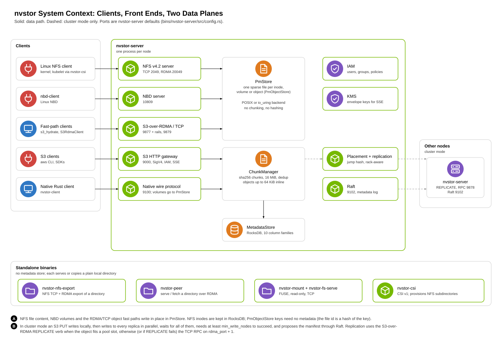
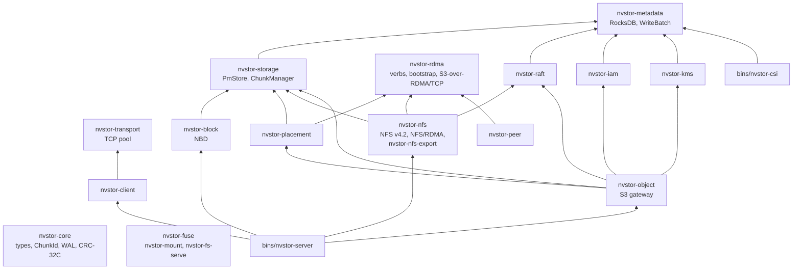
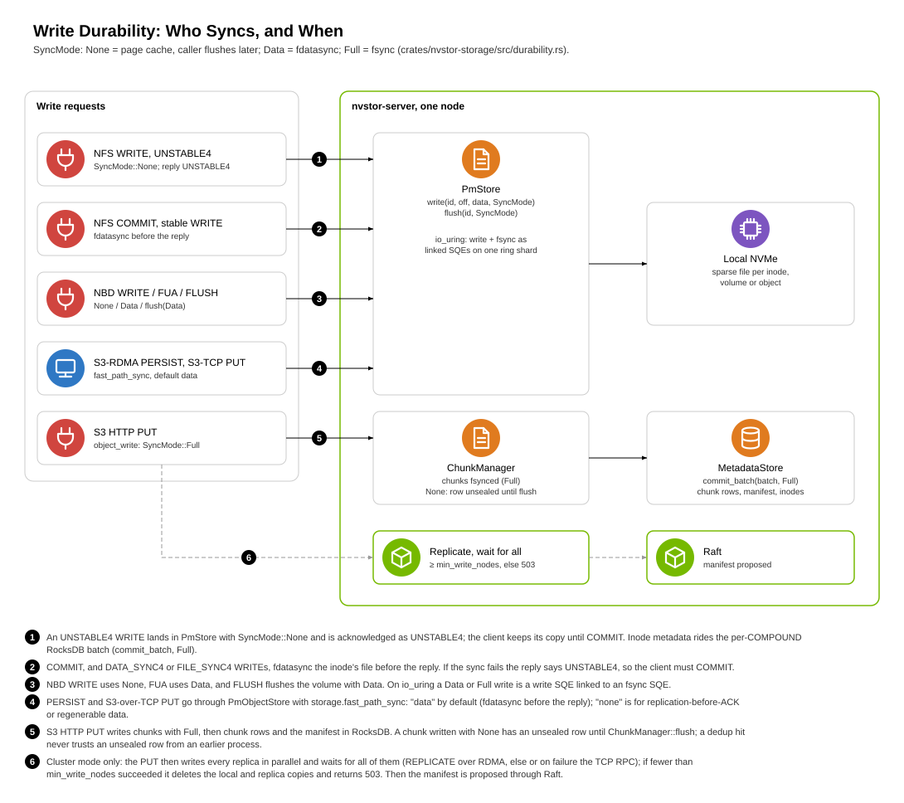
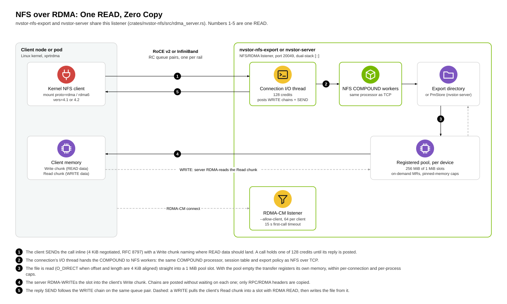
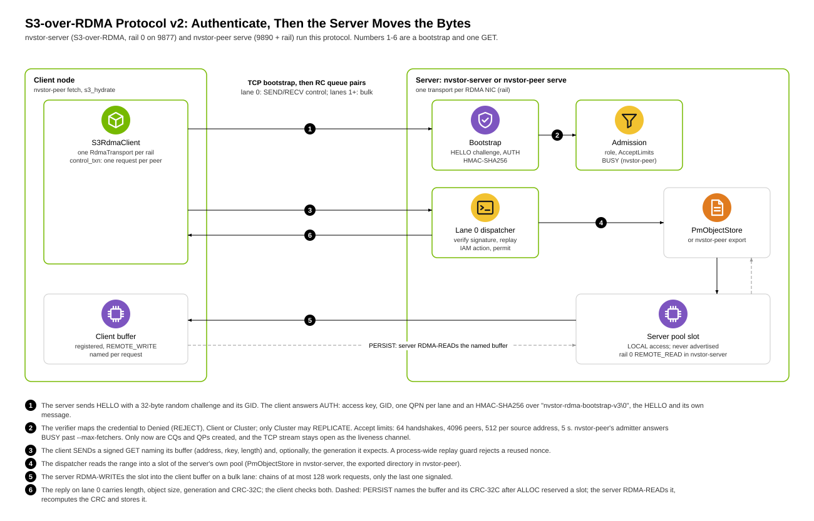
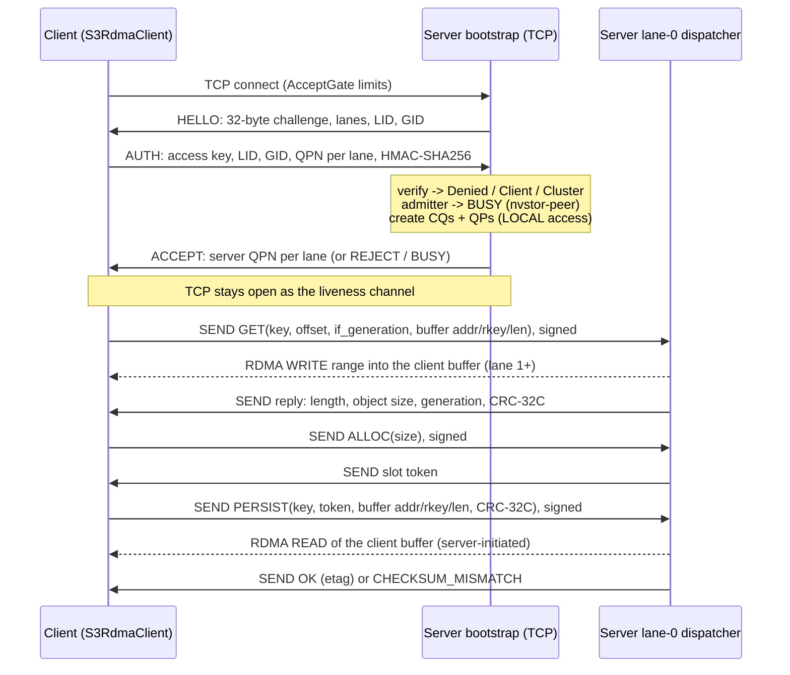
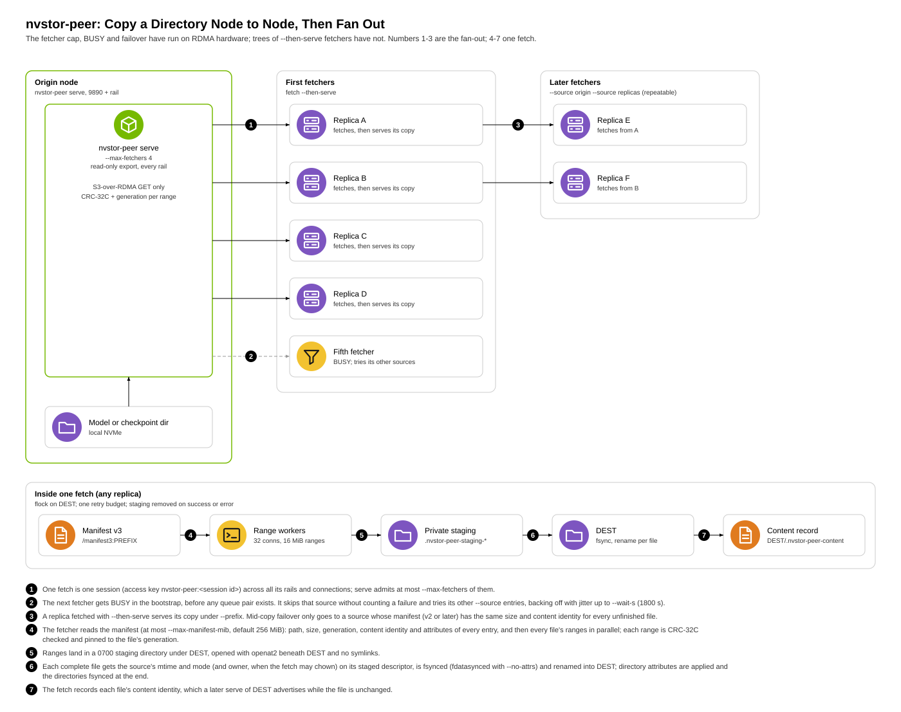
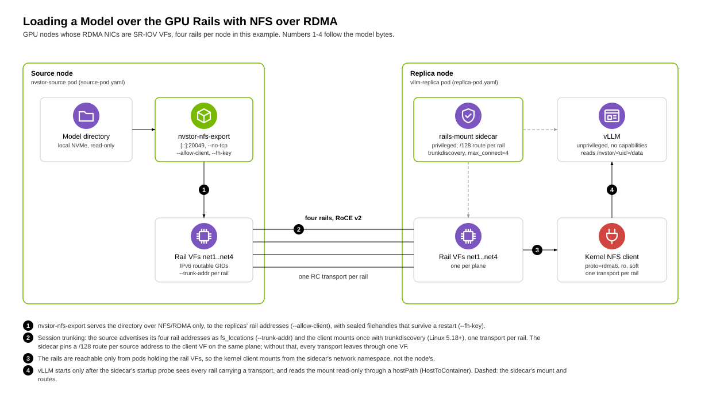

# nvstor architecture

This is the one technical document for nvstor: what the system is made of,
how bytes move through each protocol, when a write is durable, how the RDMA
paths are authenticated, how it is deployed and what is still open. Read it
before changing a crate. Each section names the source files that implement
what it describes. The map of all documents is [README.md](README.md).

<!-- toc: edit the headings, not this list -->
**Contents**

- [0. Maturity and evidence levels](#0-maturity-and-evidence-levels)
- [1. What nvstor is](#1-what-nvstor-is)
- [2. Crates and binaries](#2-crates-and-binaries)
- [3. The two data planes: PmStore and ChunkManager](#3-the-two-data-planes-pmstore-and-chunkmanager)
- [4. Write durability](#4-write-durability)
- [5. File: NFS v4.2, NFS over RDMA, nvstor-nfs-export](#5-file-nfs-v42-nfs-over-rdma-nvstor-nfs-export)
- [6. Object: S3 gateway, S3-over-RDMA v2, S3-over-TCP](#6-object-s3-gateway-s3-over-rdma-v2-s3-over-tcp)
- [7. Block, FUSE, CSI and the native wire protocol](#7-block-fuse-csi-and-the-native-wire-protocol)
- [8. Node-to-node copy: nvstor-peer and hydration](#8-node-to-node-copy-nvstor-peer-and-hydration)
- [9. Cluster mode: placement, replication, Raft, IAM, KMS](#9-cluster-mode-placement-replication-raft-iam-kms)
- [10. Security model](#10-security-model)
- [11. Deployment](#11-deployment)
- [12. Known gaps and open items](#12-known-gaps-and-open-items)
- [Figures](#figures)
<!-- /toc -->

## 0. Maturity and evidence levels

**Maturity.** Three components are **stable**: `nvstor-core`; in
`nvstor-rdma`, the authenticated bootstrap, rails and the S3-over-RDMA
read path (GET, HEAD, RAILS) that `nvstor-peer` uses; and `nvstor-peer`.
In `nvstor-rdma`, the S3-over-RDMA PUT and REPLICATE verbs (unit-tested
only), the node RPC, the KV protocol (`kv_proto`), S3-over-TCP and range
hydration (`s3_hydrate`) are experimental. Everything else is **experimental**: `nvstor-server` and its
front ends (S3 gateway, NFS server, NBD, native wire protocol),
`nvstor-nfs-export` and NFS over RDMA, cluster mode (Raft, placement,
replication), IAM, KMS, CSI, FUSE, and the KV tier (`nvstor-kv`,
`integrations/vllm`). Experimental components may change their
configuration, wire formats and on-disk formats without notice.

**Evidence.** One line per capability area. **Validated on RDMA hardware**:
runs end to end with a real client across nodes on RDMA NICs.
**Exercised**: runs end to end with a real client (kernel mount,
`aws s3 cp`, kubelet), on other hardware or only once. **Unit-tested**:
built and covered by `cargo test`, not yet run on the target hardware.
**Open**: known missing or broken. Anything not listed here is not claimed.

| Area | Level | Where |
|---|---|---|
| NFS over RDMA, Linux kernel client, read and write | validated on RDMA hardware, on a single front-end NIC and across several rails with session trunking; a restore-shaped file set read back with every file's sha256 checked | [§5.2](#52-nfs-over-rdma) |
| `nvstor-nfs-export` restart with sealed filehandles | validated on RDMA hardware: `kill -9` under a mounted client, no unresolved handles after restart | [§5.3](#53-nvstor-nfs-export) |
| NFS session trunking with `trunkdiscovery` + `fs_locations` (one transport per rail) | unit-tested; the older one-mount-per-rail method is validated on RDMA hardware | [§11.2](#112-gpu-rails-nfs-over-rdma) |
| NFS over RDMA, network drop and client reconnect | open | [§12](#12-known-gaps-and-open-items) |
| `nvstor-peer`, one source to one fetcher | validated on RDMA hardware (SR-IOV rail VFs, and RoCE NICs allocated through Kubernetes DRA) | [§8](#8-node-to-node-copy-nvstor-peer-and-hydration) |
| `nvstor-peer` fan-out (`--max-fetchers`, BUSY, several sources, failover) | validated on RDMA hardware for the cap, BUSY under load and failover from a killed source; trees of fetchers not yet run | [§8](#8-node-to-node-copy-nvstor-peer-and-hydration) |
| `nvstor-peer` file attributes (manifest v3) | unit-tested | [§8](#8-node-to-node-copy-nvstor-peer-and-hydration) |
| `nvstor-peer bench --gpu`, `fetch --gpu` (GPUDirect RDMA into GPU memory) | validated on RDMA hardware | [§8](#8-node-to-node-copy-nvstor-peer-and-hydration) |
| RDMA bootstrap protocol v2 (authenticate before any QP) | validated on RDMA hardware by `nvstor-peer` (a wrong secret is refused before any QP) | [§6.2](#62-s3-over-rdma-protocol-v2) |
| S3-over-RDMA GET (v2) | validated on RDMA hardware by `nvstor-peer` | [§6.2](#62-s3-over-rdma-protocol-v2) |
| S3-over-RDMA PUT (v2, server-pull) and REPLICATE | unit-tested | [§6.2](#62-s3-over-rdma-protocol-v2) |
| S3-over-TCP | exercised on TCP-only GPU nodes | [§6.3](#63-s3-over-tcp) |
| NBD on PmStore | exercised with the kernel NBD client on several nodes | [§7.1](#71-nbd) |
| NFS over TCP | exercised by the Linux kernel client (`mount -t nfs4`) | [§5.1](#51-nfs-v42-server-in-nvstor-server) |
| S3 HTTP gateway | exercised with `aws s3 cp` | [§6.1](#61-s3-http-gateway) |
| CSI driver | exercised: csi-sanity passes, kubelet mount and fio in a pod on k3s | [§7.3](#73-csi) |
| Cross-node replication, placement, Raft | exercised once (3-way replicated S3 PUT on three nodes over TCP, on older code); RDMA REPLICATE unit-tested only; no failure testing; replication cannot detect divergence | [§9](#9-cluster-mode-placement-replication-raft-iam-kms) |
| Erasure coding | built in `nvstor-storage`, not reachable from `nvstor-server` | [§9](#9-cluster-mode-placement-replication-raft-iam-kms) |
| AWS EFA | open: RDMA needs RoCE or InfiniBand | [§12](#12-known-gaps-and-open-items) |

## 1. What nvstor is

nvstor is a storage system in Rust that serves file (NFS v4.2, over TCP and
RDMA), object (S3 over HTTP, plus S3-shaped fast paths over RDMA and TCP),
block (NBD) and a native wire protocol from one server process,
`nvstor-server` (experimental). Under the protocols are two data-plane
primitives chosen per workload
([§3](#3-the-two-data-planes-pmstore-and-chunkmanager)) and one RocksDB
metadata store. A cluster mode (experimental) adds placement, replication
and Raft ([§9](#9-cluster-mode-placement-replication-raft-iam-kms)).

These standalone binaries need no metadata store:

- `nvstor-peer` (stable) copies a directory node to node over RDMA
  ([§8](#8-node-to-node-copy-nvstor-peer-and-hydration)).
- `nvstor-nfs-export` (experimental) exports a plain local directory over
  NFS/TCP and NFS/RDMA ([§5.3](#53-nvstor-nfs-export)).
- `nvstor-mount` and `nvstor-fs-serve` (experimental) give a read-only FUSE
  view of a local or remote directory ([§7.2](#72-fuse)).
- `nvstor-csi` (experimental) provisions NFS subdirectories for Kubernetes
  ([§7.3](#73-csi)).
- `nvstor-kv serve` (experimental) serves KV-cache blocks from DRAM over
  RDMA with its own protocol (`crates/nvstor-rdma/src/kv_proto.rs`).

The design rule is that the fast path is the default: RDMA before TCP,
io_uring before POSIX, parallel before sequential, zero copy before buffer
copy. Each fallback exists and is selected automatically when the fast path
is unavailable (no active RDMA device, io_uring init fails).

### Ports

Defaults from `bins/nvstor-server/src/config.rs` and each binary's flags.

| Port | Service | Notes |
|---|---|---|
| 9000 | S3 HTTP gateway | `s3_port` |
| 9100 | Native wire protocol | `grpc_port` (legacy name); `deploy/bare-metal/` sets 9002 |
| 9101 | Health and metrics | `/healthz`, `/readyz`, `/status`, `/metrics` |
| 9102 | Raft | cluster mode |
| 10809 | NBD | |
| 2049 | NFS over TCP | 12049 in dev and smoke-test configs, to avoid the kernel nfsd |
| 20049 | NFS over RDMA | enabled when an active RDMA device is found; `nfs_rdma_port = 0` disables; an explicit nonzero port that fails to bind stops startup |
| 9877 | S3-over-RDMA, rail 0 | `rdma_port`; rail k ≥ 1 on `rdma_rail_port_base + k - 1`, base defaults to `rdma_port + 16` (rail 1 is 9893). IPv4 only unless `listen_ipv6 = true` |
| 9878 | Node RPC (replication fallback) | `rdma_port + 1`, cluster mode |
| 9879 | S3-over-TCP | `s3_tcp_port`; 0 disables. Also the default of `nvstor-fs-serve` (FUSE remote), so the two clash on one host |
| 9890 | `nvstor-peer serve`, rail 0 | rail k on 9890 + k (`--port`); IPv4 and IPv6 unless `--listen` |
| 9900 | `nvstor-kv serve`, rail 0 (experimental) | rail k on 9900 + k (`--port`) |

## 2. Crates and binaries

Every crate except `nvstor-metadata` also depends on `nvstor-core`; those
edges are left out. `nvstor-server` lists every other library crate as a
direct dependency except `nvstor-peer`, `nvstor-fuse` and
`nvstor-transport`; only its edges to the protocol crates are drawn.
`nvstor-csi` depends only on core and metadata.

| Crate | Maturity | Responsibility | Main files |
|---|---|---|---|
| `nvstor-core` | stable | Shared types (`ChunkId` = SHA-256), constants (16 MiB chunks, 64 KiB inline threshold, default ports), errors, WAL, CRC-32C | `src/types.rs` |
| `nvstor-rdma` | stable: authenticated bootstrap, rails, S3-over-RDMA read path (GET, HEAD, RAILS); experimental: S3-over-RDMA PUT and REPLICATE, node RPC, KV protocol, S3-over-TCP, hydration | ibverbs FFI and RDMA-CM, devices and rails, authenticated bootstrap, lanes and chained work requests, S3-over-RDMA and S3-over-TCP, request signing and replay guard, admission, node RPC, range hydration, dma-buf regions for GPU memory | `src/bootstrap.rs`, `src/transport.rs`, `src/connection.rs`, `src/rail.rs`, `src/region.rs`, `src/s3_rdma.rs`, `src/s3_rdma_proto.rs`, `src/auth.rs`, `src/tcp/`, `src/rpc.rs`, `src/hydrate.rs` |
| `nvstor-peer` | stable | Directory export and parallel multi-source fetcher over S3-over-RDMA, transport benchmark, GPU memory targets | `src/server.rs`, `src/export.rs`, `src/sessions.rs`, `src/fetch.rs`, `src/rdma_sources.rs`, `src/manifest.rs`, `src/content.rs`, `src/bench.rs`, `src/gpu.rs` |
| `nvstor-metadata` | experimental | `MetadataStore` on RocksDB: 10 column families (default, chunks, manifests, volumes, inline, volume_chunks, buckets, multipart_uploads, multipart_parts, object_versions); `commit_batch(batch, SyncMode)`; schema version 1 | `src/store.rs` |
| `nvstor-storage` | experimental | `PmStore` (position-mapped sparse files, POSIX and io_uring backends), `PmObjectStore`, `ChunkManager` (content-addressed chunks), `SyncMode`, scrub, GC, Reed-Solomon erasure coding, AES-256-GCM chunk crypto | `src/pm/`, `src/pm_object.rs`, `src/manager.rs`, `src/durability.rs`, `src/erasure.rs` |
| `nvstor-nfs` | experimental | NFS v4.0–4.2 COMPOUND processor, persistent VFS, TCP server, RPC-over-RDMA v1 listener, `nvstor-nfs-export` with the passthrough VFS | `src/nfs4.rs`, `src/vfs.rs`, `src/server.rs`, `src/rdma_server.rs`, `src/rpcrdma/`, `src/passthrough.rs`, `src/kernel_handle.rs` |
| `nvstor-object` | experimental | S3 HTTP gateway (axum): buckets, objects, ranges, multipart, versioning, copy, batch delete, SigV4, presigning, SSE, quotas; replication and Raft hooks on PUT | `src/s3/handlers.rs`, `src/auth.rs` |
| `nvstor-block` | experimental | NBD server on `PmStore` | `src/nbd.rs` |
| `nvstor-placement` | experimental | Jump-hash, rack-aware, capacity-aware placement; replication and EC policies; `DistributedManager` (replicated write, repair pass) | `src/placement.rs`, `src/policy.rs`, `src/distributed.rs` |
| `nvstor-raft` | experimental | Raft with a RocksDB log and a state machine over `MetadataStore` | `src/log.rs`, `src/state_machine.rs` |
| `nvstor-iam` | experimental | Users, access keys, groups, JSON policies (AWS subset), deny-override evaluation | `src/lib.rs` |
| `nvstor-kms` | experimental | KEK → DEK envelope encryption (AES-256-GCM), rotation without re-encryption | `src/lib.rs` |
| `nvstor-transport`, `nvstor-client` | experimental | TCP connection pool and the native Rust client | |
| `nvstor-fuse` | experimental | Read-only FUSE mount: local passthrough, or a remote directory over TCP with a disk cache | `src/passthrough.rs`, `src/remote.rs`, `src/fs_server.rs` |
| `nvstor-kv` | experimental | KV-cache tier | |

| Binary | Built from | What it runs |
|---|---|---|
| `nvstor-server` | `bins/nvstor-server` | Every protocol in §5–7, health and metrics, cluster mode |
| `nvstor-csi` | `bins/nvstor-csi` | CSI v1 controller and node plugin |
| `nvstor-nfs-export` | `crates/nvstor-nfs` | NFS/TCP + NFS/RDMA export of a directory |
| `nvstor-peer` | `crates/nvstor-peer` | `serve`, `fetch`, `fetch --then-serve`, `bench` |
| `nvstor-kv` (experimental) | `crates/nvstor-kv` | `serve` (KV-cache block server over RDMA), `bench` |
| `nvstor-mount`, `nvstor-fs-serve` | `crates/nvstor-fuse` | FUSE client and its directory server |
| `s3_hydrate` (example, experimental) | `crates/nvstor-rdma` | Parallel ranged fetch of one object into a file |

## 3. The two data planes: PmStore and ChunkManager

Picking the primitive per workload is the core design decision.

**`PmStore`** (`crates/nvstor-storage/src/pm/`) is position-mapped: one
sparse file per volume id under `{data_path}/volumes/{uuid}`, written with
`pwrite` at the request's offset and read with `pread`. No chunking, no
hashing, no read-modify-write. The trait has `create`, `write(id, offset,
data, SyncMode)`, `replace` and `replace_from` (atomic new generation),
`read`, `read_versioned`, `stat`, `flush`, `punch_hole`, `set_size`,
`delete`. A file's generation is `(inode << 64) | ctime_ns`, which is what
range readers pin to. Two backends:

- POSIX (`posix.rs`).
- io_uring (`iouring.rs`, feature `io-uring`, used by `nvstor-server` when
  `storage.direct_io = true`, POSIX if init fails): one submission ring per
  CPU up to 16, a volume mapped to a ring by hashing its id, and a durable
  write submitted as a write SQE linked (`IO_LINK`) to an fsync SQE.

Both keep an LRU of open handles (default 1024, `with_handle_cap`), so the
number of open files stays bounded however many volumes a workload touches.

PmStore holds NBD volumes, NFS file content in `nvstor-server` (one volume
per inode, id `Uuid::new_v5(namespace, ino)`, up to 1 TiB each) and, through
**`PmObjectStore`** (`src/pm_object.rs`), the objects of the S3-over-RDMA and
S3-over-TCP fast paths. PmObjectStore names a key's file by the first 16
bytes of SHA-256(key), so it needs no metadata rows; by design it does not
replicate, dedup, version, encrypt or erasure-code.

**`ChunkManager`** (`src/manager.rs`) is content-addressed: objects are split
into chunks (16 MiB default) named by their SHA-256, with a ref-counted chunk
row in RocksDB; objects up to 64 KiB are stored inline in the metadata
store. A second write of the same bytes is a dedup hit that increments the
ref count. It backs the S3 HTTP gateway, multipart uploads, the native wire
protocol's objects, and replicas received through REPLICATE. Scrub and GC
run on it (`ChunkManager::scrub`, the GC loop every `gc_interval_secs`).

The split exists because content addressing costs a hash, a chunk table and
read-modify-write on every partial update. That is worth paying for
immutable, deduplicated, versioned objects and not for block volumes, file
content or checkpoint blobs, which is why those live on PmStore.

## 4. Write durability

Every write API takes a `SyncMode` (`crates/nvstor-storage/src/durability.rs`):

| Mode | Meaning | Used by |
|---|---|---|
| `None` | page cache; the caller makes it durable later | NFS UNSTABLE4 WRITE, NBD WRITE, streamed S3 bodies |
| `Data` | `fdatasync` | NFS DATA_SYNC4, NBD FUA and FLUSH, fast-path PUT by default |
| `Full` | `fsync` | NFS FILE_SYNC4, S3 PUT (`object_write`), S3 DELETE |

The metadata store has its own two-value mode for `commit_batch`: `None` (no
WAL fsync) or `Full`. The NFS server persists each COMPOUND's metadata
changes in one RocksDB batch.

The barriers that make `None` writes durable are the protocols' own:

- **NFS**: an UNSTABLE4 WRITE is answered UNSTABLE4 and the client keeps its
  copy until COMMIT, which fdatasyncs the inode's file. A stable WRITE is
  synced before the reply; if that sync fails the reply says UNSTABLE4, so
  the client has to COMMIT (`nfs4.rs`, `op_write`).
- **NBD**: FUA writes with `Data`; FLUSH flushes the volume with `Data`
  (`nbd.rs`).
- **S3-over-RDMA PERSIST and S3-over-TCP PUT**: `storage.fast_path_sync`,
  default `"data"` (fdatasync before the reply). `"none"` is documented for
  deployments that replicate before acknowledging or hold regenerable data.
- **S3 HTTP PUT**: chunks are written with `Full`, then the chunk rows and
  the manifest.
- **ChunkManager with `None`**: the chunk row is written unsealed and stays
  unsealed until `ChunkManager::flush` has synced the bytes. A dedup hit on
  an unsealed row left by an earlier process rewrites the bytes instead of
  trusting them (unit-tested with a simulated torn file).

Cluster replication ([§9](#9-cluster-mode-placement-replication-raft-iam-kms))
happens after the local write and before the S3 PUT is acknowledged.

## 5. File: NFS v4.2, NFS over RDMA, nvstor-nfs-export

Everything in this section is **experimental**.

### 5.1 NFS v4.2 server in nvstor-server

`crates/nvstor-nfs` implements the server in user space. The COMPOUND
dispatcher (`nfs4.rs`, `dispatch_op`) decodes every NFSv4 operation number
from 3 to 75: the 37 NFSv4.0 operations, the 11 NFSv4.1 session operations,
pNFS layout and device operations, the NFSv4.2 operations (ALLOCATE, COPY,
DEALLOCATE, READ_PLUS, SEEK, CLONE, the xattr operations and others) and the
delegation and SSV operations; anything else is NFS4ERR_OP_ILLEGAL. How
complete each handler is varies and has not been audited here; COPY, SEEK,
ALLOCATE and DEALLOCATE are unit-tested but not exercised by a kernel client.
Minor version 0 and minor versions ≥ 1 take different paths (SEQUENCE first
for ≥ 1); a minor version above 2 is not rejected.

- **Concurrency.** Each TCP connection runs a reader, one task per record,
  and a writer that drains a bounded channel; up to 256 records in flight
  per connection (`server.rs`, `MAX_INFLIGHT_PER_CONN`). COMPOUNDs run on the
  blocking pool.
- **Sessions.** CREATE_SESSION grants up to 64 slots
  (`SESSION_MAX_SLOTS`); SEQUENCE reports the server's highest slot (63 for
  a full table), not the client's `sa_highest_slotid`. A Linux client that
  is told the client's own value after using only slot 0 shrinks its slot
  table to one entry and runs one RPC at a time.
- **Namespace.** The VFS (`vfs.rs`) keeps inodes in memory and writes each
  through to RocksDB (`nfs/i/{ino}` in the inline column family), reloading
  them at startup. File content goes to PmStore, one volume per inode;
  a ChunkManager path remains for a VFS built without PmStore.
- **Who may connect.** NFS has no authentication of its own (AUTH_SYS ids
  are claimed by the client), so the export admits only the clients in
  `[nfs] allow_clients` (addresses, CIDR prefixes, or "*" for every client;
  `NVSTOR_NFS_ALLOW_CLIENTS`, comma-separated), checked when a TCP or RDMA
  connection is accepted. Empty, the default, admits loopback clients only;
  a non-empty list admits exactly what it names (list 127.0.0.1 for local
  mounts); a malformed pattern stops the server at startup.
- **Raft.** The NFS processor can hold a Raft handle, but the VFS log entries
  are applied as no-ops (`nvstor-raft/src/state_machine.rs`), so the NFS
  namespace is not replicated.

### 5.2 NFS over RDMA

An RPC-over-RDMA v1 listener (RFC 8166, RFC 8267, RFC 8797) feeds the same
COMPOUND processor, session table and export policy as NFS over TCP
(`rdma_server.rs`, `rpcrdma/`). `nvstor-server` and `nvstor-nfs-export`
both run it. Configuration, limits and the validation procedure are in
[nfs-rdma.md](nfs-rdma.md); the essentials:

- **Connection setup.** RDMA-CM on `[::]:20049`, dual-stack, so IPv4
  front-end NICs and IPv6-only GPU rails are served alike. A connect
  request is checked against the client allow list and the per-client limit
  (64 connections, TCP and RDMA together, and at most a quarter of
  `max_connections`) before it is accepted. A connection that sends no call
  within 15 s is closed. One `nfs-rdma-io` thread per connection.
- **Zero copy.** READ data is read (O_DIRECT when 4 KiB aligned) into a
  1 MiB slot of the device's registered pool (256 MiB by default,
  `--rdma-pool-mib`) and RDMA-written into the client's Write chunk. WRITE
  data is RDMA-read from the client's Read chunk into a slot. Only RPC/RDMA
  headers are copied. When the pool is empty a transfer registers its own
  memory, capped at about 136 MiB per connection (128 credits × the largest
  call) and 16 × the pool (4 GiB) per process.
- **Flow control.** 128 credits per connection; a call holds its credit
  until its reply is posted, so a client that stops taking replies cannot
  grow the server's queue. A connection whose SENDs and READs complete
  nothing for `write_timeout` (60 s) is torn down.
- **Validation before memory.** Read chunks are checked for size (1 MiB
  per chunk, 1 MiB + 64 KiB per call) and DDP eligibility before any memory
  is allocated or pinned.
- **Listener failure.** In `nvstor-nfs-export` a fatal listener error
  leaves NFS/TCP serving, sets `nvstor_nfs_rdma_listener_up` to 0 and
  re-creates the listener with backoff (1 s doubling to 30 s); with
  `--no-tcp` the process exits 1 for its supervisor to restart.
  `nvstor-server` treats a failed explicitly configured listener as fatal.

This is host-memory RDMA: data lands in host memory on both sides, not in GPU
memory. Writes are well below reads per stream.

### 5.3 nvstor-nfs-export

`nvstor-nfs-export` (`src/bin/nvstor-nfs-export.rs`, `src/passthrough.rs`)
serves one local directory over NFS/TCP and NFS/RDMA without the metadata
store. Flags, systemd unit and troubleshooting:
[crates/nvstor-nfs/README.md](../crates/nvstor-nfs/README.md).

- **Who may connect.** `--allow-client CIDR` is required (repeatable, checked
  at accept on TCP and RDMA; each prefix admits only its own address
  family). Startup fails without it.
- **What a caller may do.** Every operation checks the caller's AUTH_SYS uid,
  gid and supplementary gids against the inode with POSIX rules, in the
  server; uid 0 is squashed to `--anon-uid`/`--anon-gid` (65534) unless
  `--no-root-squash`; AUTH_NONE runs as the anonymous ids; created inodes are
  `fchown`ed to the caller; xattrs are confined to `user.*`. Read-only unless
  `--read-write`.
- **No path is ever followed.** Every inode is opened beneath the export root
  with `openat2(RESOLVE_BENEATH | RESOLVE_NO_SYMLINKS | RESOLVE_NO_MAGICLINKS)`
  or from its kernel handle. An operation that needs a file or directory and
  meets a symlink gets NFS4ERR_SYMLINK, as with Linux nfsd.
- **Filehandles.** `ino (8) | HMAC-SHA256 tag (16) | kernel handle type (4) |
  kernel handle`, at most 128 bytes; the kernel handle carries the inode
  generation, so a reused inode number does not revive a deleted file's
  handle. With `--fh-key FILE` (32 bytes, 0600) and `CAP_DAC_READ_SEARCH`,
  handles survive a restart; without the key each start uses a random key.
- **Durability.** COMMIT and stable WRITEs fsync; namespace changes fsync
  the directories they touch; READDIR cookies are the filesystem's `d_off`
  with a per-directory verifier.
- **Trunking.** `--trunk-addr ADDR` (repeatable) advertises the rail
  addresses as `fs_locations`; EXCHANGE_ID returns the same server owner and
  scope on every address, so a Linux 5.18+ client with `trunkdiscovery`
  treats them as one server with several transports.
- **pNFS.** `--pnfs-ds HOST` advertises HOST as a file-layout data server
  on the NFS port (off by default, ignored when NFS/RDMA is enabled).

## 6. Object: S3 gateway, S3-over-RDMA v2, S3-over-TCP

### 6.1 S3 HTTP gateway

**Experimental.** `crates/nvstor-object` serves S3 over HTTP on port 9000:
bucket and object CRUD, ranged GET, multipart, versioning, copy, batch
delete, SigV4 and presigned URLs, quotas, virtual-host addressing, and
SSE-S3/SSE-KMS/SSE-C through `nvstor-kms` when `kms.root_key_passphrase` is
set. TLS is on when `[tls] cert_path` and `key_path` are set. Authorization
is IAM policy evaluation in the auth middleware (`src/auth.rs`); there are no
bucket-ownership checks. Object content goes through ChunkManager. In
cluster mode a PUT is replicated and its manifest proposed through Raft
([§9](#9-cluster-mode-placement-replication-raft-iam-kms)).

### 6.2 S3-over-RDMA protocol v2

**Stable** for the bootstrap and the read path that `nvstor-peer` uses
(GET, HEAD, RAILS); the PUT and REPLICATE verbs are **experimental**
(unit-tested only). The object fast path for checkpoints and model
fan-out, and the transport under `nvstor-peer` and replication. Its rules:
authenticate before any queue pair exists, never advertise server memory,
and let the server start every one-sided transfer against the one buffer
the client named in a signed request. Request signing alone cannot protect
one-sided RDMA READ and WRITE, which never pass through a request; these
rules are what does.

**Bootstrap** (`bootstrap.rs`, over TCP on the rail's port). Every message
starts with `BRDM`, the wire version (`PROTOCOL_VERSION`, 3: protocol v2
with the nvstor name in the MAC contexts, so a build speaking an earlier
version fails the version check rather than the credential check) and a
kind (HELLO, AUTH, ACCEPT, REJECT, BUSY). REJECT is followed by one reason
byte: 1 credentials refused, 2 the server could not set the connection up,
3 malformed handshake. A REJECT with no reason byte (from an older server)
reads as "no reason", which callers treat as a credential refusal.

1. On accept, `AcceptGate` applies the limits (64 concurrent handshakes,
   4096 peers, 512 per source address and 8 × 512 per IPv6 /64, 5 s
   handshake timeout) before HELLO. `RdmaTransport::listen` binds
   `0.0.0.0` like the other nvstor listeners; `listen_on(addr, port)`
   binds `addr`, dual stack for `::`. `nvstor-server` binds its RDMA
   listeners to `::` only with `[network] listen_ipv6 = true`;
   `nvstor-peer serve` binds `::` unless `--listen` says otherwise.
2. HELLO carries a 32-byte random challenge, the server's lane count, LID
   and GID.
3. AUTH carries the access key, the client's LID and GID, one QPN per lane
   (at most 64), and an HMAC-SHA256 over `nvstor-rdma-bootstrap-v3\0`, the
   HELLO and the AUTH body, checked in constant time.
4. The verifier maps the credential to Denied (REJECT), Client or Cluster.
   In `nvstor-server` the `[auth]` credential is Cluster and an enabled IAM
   user is Client. An optional session admitter (installed only by
   `nvstor-peer`) answers BUSY when it has no room.
5. Only then are the CQs and QPs created and the control-ring memory
   registered; the reply is ACCEPT with the server's QPNs. Server QPs grant
   no remote access (`Access::LOCAL`).
6. The TCP stream stays open, carrying nothing, as the liveness channel: EOF
   or any byte tears the peer down and drains its parked slots.

The server's bulk pool is registered once at startup, not per peer, and is
never advertised, and every rail pool is LOCAL. A replica pulls a
REPLICATE push with RDMA READ through the QP the pushing node dialed, and
that QP grants remote read on the whole MR, so `nvstor-server` pushes from
a separate pool registered REMOTE_READ, on a dial-only transport over rail
0's HCA that never carries client slots (`open_replication_transport`; a
quarter of `rdma_pool_slots`, at most 64). A replica can therefore read
only other replication pushes, never a client's GET or PUT slot.

**Verbs** (`s3_rdma_proto.rs`): GET, HEAD, ALLOC, PERSIST, DELETE, RAILS,
REPLICATE. Lane 0 carries SEND/RECV control; lanes 1+ (4 lanes by default,
queue depth 256) carry bulk transfers. Every request is HMAC-SHA256 signed
over timestamp, nonce and body; a process-wide replay guard holds nonces for
the 300 s clock-skew window. Requests map to IAM actions (`s3:GetObject`,
`s3:PutObject`, `s3:DeleteObject`, `nvstor:ReplicateObject`); REPLICATE
also needs the Cluster role.

- **GET**: the request names offset, an optional expected generation and the
  client buffer (address, rkey, length). The server reads the range into a
  slot of its own pool, RDMA-writes it into that buffer and replies with
  length, object size, generation and CRC-32C. A generation mismatch is
  GENERATION_CHANGED.
- **ALLOC + PERSIST**: ALLOC parks a pool slot and returns an opaque token.
  PERSIST names the token, the client buffer and its CRC-32C; the server
  RDMA-reads the buffer into the slot, recomputes the CRC
  (CHECKSUM_MISMATCH stores nothing) and persists. A parked slot is freed
  when its peer disconnects, and a reaper thread frees any slot older than
  60 s (`SLOT_TTL`).
- **REPLICATE**: PERSIST into the replica's ChunkManager.

Bulk transfers (`connection.rs`, `run_chain`) are chains of work requests of
at most the port's `max_msg_sz`, at most 128 per chain (half the lane's
queue depth), posted with one `ibv_post_send` and only the last one
signaled; a partial post is fenced before the buffer is released.
Completion polling has a 5 s wall-clock deadline (longer than the RC retry
window). Clients serialize each request/response pair per peer with
`control_txn`; parallelism comes from more peers and the bulk lanes.

**Rails** (`rail.rs`): one transport per ACTIVE RDMA device. A RAILS request
lists the server's rails; the client pairs each with a local NIC by
reachability, not device index: a NIC on the rail's subnet first, then the
NIC the routing table sends the address out of, then the longest shared
address prefix, with ties spread by connection count. A new connection
whose path fails (RTR unreachable or timed out, retry exceeded, server
setup failure) moves to the next local NIC, and failed pairs are remembered
(`Pairing`).

**Backends in `nvstor-server`** (`main.rs`): GET, PUT and DELETE go to
`PmObjectStore`; REPLICATE goes to `ChunkManager::object_write` and is
enabled only in cluster mode. In `nvstor-peer` the server is read-only
(GET, HEAD, RAILS) over the exported directory.

**RAILS and server identity.** The RAILS reply carries, after the rail
list, an optional trailing field: a marker byte and the server process's
random 128-bit instance id (`s3_rdma::process_instance`). It is
backward compatible both ways: replies from older servers decode with
no instance id, and older clients never read the trailing bytes.
Trailing fields are ordered: marker 1 (the instance id, 16 bytes) is
always first; any later trailing field must follow it as TLV (marker,
length, value) so older decoders can skip it.
`nvstor-peer` uses the id as the server's identity (two serve
processes on one host, a replacement pod at the same address, two
addresses of one server).

**Control timeouts** (`s3_rdma_proto.rs`, where the constants and the
arithmetic live). A client holds one request per peer at a time, and
waits for its reply longer than a healthy server can take to answer:

| Term | Bound | What |
|---|---|---|
| `ADMIT_WAIT` | 1 s | dispatcher waits for a worker; then NO_SLOT |
| `SLOT_WAIT` | 2 s | GET / ALLOC wait for a pool slot; then NO_SLOT |
| `STORAGE_ALLOWANCE` | 10 s | one storage callback (documented, not enforced) |
| `LANE_OP_WORST` | 10 s | one RDMA WRITE / READ: credits 5 s + completion 5 s |
| `LANE_OP_WORST` | 10 s | the reply SEND |
| **`SERVER_REPLY_WORST`** | **33 s** | sum: longest a healthy server takes to answer |
| `REPLY_MARGIN` | 5 s | |
| **`CONTROL_REPLY_TIMEOUT`** | **38 s** | client wait for a reply (`transport.rs` `recv_response`) |

A server too busy to start a request within `ADMIT_WAIT` (or to get a
pool slot within `SLOT_WAIT`) answers NO_SLOT (only as the reply to the
request it names). Clients: GET range, HEAD/stat and RAILS return Busy
to their callers, which wait it out without spending retries
(hydration for up to `HydrateOptions::busy_wait`, 120 s by default;
`nvstor-peer` keeps the connection and its place on the busy source,
backs off per worker with decorrelated jitter or moves the range to
another eligible source, and ends Unavailable only after `--wait-s`
without any range completing); DELETE, HEAD
and whole-object GET retry it themselves (`BUSY_RETRIES` = 6 from 20 ms,
about 1.3 s of pauses at most); PUT starts over from ALLOC at most twice
and only within 1 s of its start (`PUT_BUSY_RETRIES`,
`PUT_BUSY_BUDGET`; each busy answer can hold a server permit for up to
3 s, so a PUT reports busy after about 4 s at worst); REPLICATE does not
retry: a busy replica's write goes over the TCP RPC and the RDMA
connection is kept (`distributed.rs` drops it only for other failures). A
reply that misses `CONTROL_REPLY_TIMEOUT` fails the lane and removes the
peer, so a late reply cannot pair with the next request.

Consequence: a server that hangs silently while its bootstrap TCP stream
stays open is detected only after 38 s per control call. That is how long
a REPLICATE waits before `distributed.rs` falls back to the TCP RPC, and
how long an `nvstor-peer` fetcher waits before it counts the failure toward
failing over. A server that crashes or exits is still detected at once:
its kernel closes the bootstrap stream, the liveness watcher sees
end-of-stream and removes the peer, and every waiter on it fails.

**Evidence.** The bootstrap and GET are validated on RDMA hardware under
`nvstor-peer`. PUT (server-pull) and REPLICATE are unit-tested only.

### 6.3 S3-over-TCP

**Experimental** (in `nvstor-rdma`, but not part of its stable surface). The
portable sibling for clusters without RDMA in pods (`src/tcp/`, port 9879):
PUT, GET, DELETE and HEAD, with the PUT body streamed in 8 MiB pieces into
`PmObjectStore::put_from`. Requests are signed per request; there is no
bootstrap handshake. Each peer connection carries one transaction at a
time; parallelism comes from more connections. Exercised end to end on
TCP-only GPU nodes.

## 7. Block, FUSE, CSI and the native wire protocol

Everything in this section is **experimental**.

### 7.1 NBD

`crates/nvstor-block/src/nbd.rs` on port 10809: fixed-newstyle handshake,
EXPORT_NAME, GO, INFO (export, block size), READ, WRITE, FLUSH, TRIM and
WRITE_ZEROES (both `fallocate(PUNCH_HOLE)`), FUA. Volumes are PmStore files.
No TLS and no authentication.

### 7.2 FUSE

`crates/nvstor-fuse` mounts a directory read-only: `nvstor-mount SRC MNT`
passes a local tree through; `nvstor-mount --remote host:9879` fetches files
on demand from `nvstor-fs-serve` over TCP into a disk cache (default
`/var/cache/nvstor`, 10 GB). The intended use is container-image lower
directories. `nvstor-fs-serve` has no authentication.

### 7.3 CSI

`bins/nvstor-csi` speaks CSI v1 over a Unix socket. CreateVolume makes a
`/nvstor-<uuid>` directory on the `nvstor-server` NFS export (mounting the
root briefly to `mkdir`) and records it in its own RocksDB; capacity is not
enforced (no quota; expansion is unimplemented). NodePublishVolume mounts the
directory with `mount -t nfs4 -o nfsvers=4.2,hard,intr,rsize=1048576,wsize=1048576,nconnect=4[,port=N]`.
Manifests: `deploy/csi/`. csi-sanity passes (`scripts/csi-sanity.sh`); a
real kubelet mount and fio in a pod have run on k3s.

### 7.4 Native wire protocol

`bins/nvstor-server/src/wire.rs` on port 9100: object PUT, GET, DELETE,
HEAD, LIST and COPY through ChunkManager, and volume create, delete, read,
write and info through PmStore, for `nvstor-client`. No authentication.

## 8. Node-to-node copy: nvstor-peer and hydration

**Stable.** `nvstor-peer` copies a directory tree (a checkpoint, model
weights) from the node that has it to the node that needs it, with no
storage tier in between. Usage, flags and how to measure it:
[peer-copy.md](peer-copy.md).

- **serve** exports a directory read-only through
  `S3RdmaServer::read_only`, one transport per rail, bootstrap on port
  9890 + rail index. The manifest (`manifest.rs`, magic `BRPM`) is served
  as version 3 under the key `/manifest3:<prefix>` (files and directories
  with their attributes) and as version 2 under `/manifest:<prefix>` (files
  only), so older fetchers keep working. Each file entry carries path,
  size, generation (the serving node's inode and ctime) and content
  identity (the bytes' identity across nodes).
- **fetch** takes `--source` (repeatable; a name that resolves to several
  addresses is several sources), reads the manifest (at most
  `--max-manifest-mib`, 256), then pulls every file's ranges in parallel
  (`--connections` 32, `--range-mib` 16), each CRC-32C checked and pinned to
  its generation, into a private 0700 staging directory under DEST. Each
  complete file is fdatasynced and renamed into place; a `flock` on DEST
  refuses a second concurrent fetch. A range has 5 retries with backoff from
  50 ms. A current fetcher refuses a source that serves only version 2
  unless `--no-attrs`.
- **Attributes** (manifest v3, unit-tested): every file and directory gets
  the source's mode (set-id bits dropped unless `--preserve-setid` and the
  owner was applied) and mtime; numeric owner and group are applied when
  the fetch holds `CAP_CHOWN`, `CAP_DAC_OVERRIDE` and `CAP_FOWNER` and
  `--no-owner` is not given. A copy records which attributes it really has
  in `.nvstor-peer-attrs`.
- **Authentication**: `NVSTOR_PEER_SECRET` (at least 16 characters) on both
  sides, proven in the bootstrap before any QP; a wrong secret is refused
  with REJECT.
- **Fan-out**: `serve --max-fetchers K` (default 4) counts fetch sessions
  (access key `nvstor-peer:<session id>`, one per fetch across all its
  rails and connections) and answers BUSY to the next one before any QP
  exists. The fetcher skips a busy or dead source and backs off with jitter
  up to `--wait-s` (1800 s). Mid-copy it fails over only to a source whose
  manifest has the same size and content identity for every unfinished file.
  `--then-serve` serves the finished copy, which records content identities
  in `DEST/.nvstor-peer-content`. Deploy pattern:
  `deploy/nfs-rdma/peer-fanout.yaml`.
- **Devices**: `--devices netns` (default) picks the RDMA devices of the
  pod's own network namespace and waits up to 30 s
  (`NVSTOR_RDMA_RAIL_WAIT_SECS`) for a VF still acquiring a routable GID.
- **GPU memory** (`gpu.rs`, `nvstor-rdma/src/region.rs`): `bench --gpu N`
  and `fetch --gpu N` land ranges in memory on GPU N through GPUDirect RDMA.
  The CUDA driver is loaded at run time (no build dependency on CUDA);
  GPU memory is exported as a dma-buf and registered on every rail as a
  `RailRegion`. `fetch --gpu` places each checked range at its file's
  offset in one GPU buffer, writes `--gpu-ready-file` (a CUDA IPC handle
  and each file's offset) once everything is in the GPU, and writes the
  disk copy in the background from the GPU buffer. Design:
  [design/fetch-gpu.md](design/fetch-gpu.md).

**Where the limit is.** A copy is bounded by its destination side (writing
and syncing the files), not by the transport: `nvstor-peer bench`, which
moves the same ranges over the same path without writing a destination,
moves considerably more than `fetch` on the same pair of nodes. The
transport's own limit for small ranges comes from completion waits that
spin and then sleep, one request at a time per peer connection, and a
thread per request. `fetch --gpu` does not yet reach the rate `bench --gpu`
does on the same nodes; the cause is not yet found.

**Hydration** (`nvstor-rdma/src/hydrate.rs`, `s3_hydrate` example;
experimental) is the
same range-fetch contract for a single object: parallel ranged GETs (8
connections, 16 MiB ranges by default) over S3-over-RDMA or S3-over-TCP
into `<dest>.partial`, each range CRC-checked and generation-pinned, renamed
after `fdatasync`. See [model-hydration.md](model-hydration.md).

## 9. Cluster mode: placement, replication, Raft, IAM, KMS

Everything in this section is **experimental**. Cluster mode turns on when
seeds or a bootstrap are configured (`bins/nvstor-server/src/main.rs`).

- **Placement** (`nvstor-placement/src/placement.rs`, `policy.rs`): jump
  consistent hash over the live nodes, spread across failure domains
  (racks), skipping nodes without enough free capacity. Policies are
  replicated (`replicated_3`, `replicated_2`, `single`) and erasure-coded
  (`ec_4_2`, `ec_8_3`). `nvstor-server` always picks `replicated_3` (three
  or more nodes) or `replicated_2`, so the erasure-coded write path
  (`distributed_write_ec`, Reed-Solomon in `nvstor-storage/src/erasure.rs`)
  is not reachable from the server.
- **Replication** (`distributed.rs`, called from the S3 PUT handler after
  the local write): one task per target. A remote target gets the
  S3-over-RDMA REPLICATE verb when an RDMA transport exists, the object fits
  a pool slot and the pool has REMOTE_READ; otherwise, or if REPLICATE
  fails, the TCP RPC (`OP_PERSIST_INLINE` on `rdma_port + 1`). The PUT waits
  for every target to finish and succeeds if at least `min_write_nodes`
  did; below that it deletes the local and replica copies and returns 503
  SlowDown, so one slow replica delays every PUT. The fan-out is parallel but
  the client's PUT waits for it: it is not a write-behind pipeline. There
  are no versions on replicas, so concurrent writers or a partial failure
  can leave replicas that differ without any read noticing. A repair pass
  runs in the GC loop and re-replicates missing copies.
- **Node RPC** (`nvstor-rdma/src/rpc.rs`): an AUTH frame
  (`nvstor-rpc-auth-v2` context) first; limits of 64 authenticating, 1024
  connections and 256 per source, 5 s for the AUTH frame and 30 s per
  read/write after it.
- **Raft** (`nvstor-raft`): a from-scratch implementation with its log in a
  separate RocksDB (synced writes). The state machine applies manifest,
  object-version, inline, volume and bucket entries to `MetadataStore`; the
  S3 gateway proposes manifests and versions through it, and KMS metadata is
  replicated through it. VFS entries are logged and not applied, so NFS
  state is not replicated.
- **IAM** (`nvstor-iam`): users with access keys, groups, JSON policies,
  deny overrides; stored in `MetadataStore`; evaluated by the S3 gateway and
  for every S3-over-RDMA request.
- **KMS** (`nvstor-kms`): KEK → DEK → data envelope encryption with
  AES-256-GCM, key rotation without re-encrypting data, zeroized key
  material; enabled when `kms.root_key_passphrase` is set. The per-chunk
  AES-256-GCM in `nvstor-storage/src/crypto.rs` is not used by any caller.

## 10. Security model

nvstor's surfaces differ in what they authenticate. This table is the
current state. Surfaces marked "none" must be reachable only from trusted
hosts: bind them to a private network or block them with a firewall.

| Surface | Who may connect | Per-request check | Notes |
|---|---|---|---|
| S3 HTTP | anyone who reaches the port | SigV4 or presigned URL, IAM policy | TLS when `[tls]` is configured; SSE through KMS; no bucket-ownership checks |
| S3-over-RDMA (`nvstor-server`, `nvstor-peer`) | bootstrap HMAC proof before any QP; `AcceptGate` limits | HMAC-signed requests, replay guard, IAM action, Cluster role for REPLICATE | server memory never advertised; server QPs grant no remote access; payloads not encrypted |
| S3-over-TCP | anyone who reaches the port | HMAC-signed requests | payloads not encrypted |
| KV over RDMA (`nvstor-kv serve`, experimental) | bootstrap HMAC proof before any QP with `NVSTOR_KV_ACCESS_KEY` (default `kv`) and `NVSTOR_KV_SECRET` (16+ characters); `--max-per-identity` connections | HMAC-signed requests, replay guard | one tenant: the one key may use every namespace; no address filtering; payloads not encrypted |
| Node RPC | AUTH frame with the cluster credential | | limits per source |
| NFS in `nvstor-server` | `[nfs] allow_clients` (or `NVSTOR_NFS_ALLOW_CLIENTS`): addresses, prefixes or `*`; loopback only when empty; a list admits exactly what it names | AUTH_SYS | AUTH_SYS is not cryptographic, and source ports are not checked (no `secure` option): a listed host's local users can claim any non-root uid |
| `nvstor-nfs-export` | `--allow-client` list, required | AUTH_SYS uid/gid checked with POSIX rules in the server; root squash | AUTH_SYS is not cryptographic: list only the hosts that should see the data |
| NBD, native wire protocol, `nvstor-fs-serve` | anyone who reaches the port | none | bind to a trusted network only |

Two design rules apply to all new code on these paths: request signing does
not cover one-sided RDMA verbs, so authenticate before creating queue pairs
and let the server initiate every one-sided transfer
([§6.2](#62-s3-over-rdma-protocol-v2)); and a passthrough server never
follows a path, it resolves by handle beneath the export root
([§5.3](#53-nvstor-nfs-export)). Kerberos (RPCSEC_GSS) is not implemented
for NFS.

## 11. Deployment

### 11.1 nvstor-server

- **Kubernetes**: `deploy/kubernetes/` (namespace, ConfigMap, StatefulSet,
  Service, PodDisruptionBudget, ServiceMonitor, an NFS PV example) and the
  Helm chart `deploy/helm/nvstor/` (StatefulSet, Service, ConfigMap,
  Secret, PDB).
- **CSI**: `deploy/csi/` (controller Deployment, node DaemonSet, RBAC,
  StorageClass, example PVC).
- **Bare metal**: `deploy/bare-metal/` (three node configs and a deploy
  script).
- **Dashboards**: `deploy/dashboards/nvstor-nfs.json`.

### 11.2 GPU rails: NFS over RDMA

`deploy/nfs-rdma/` loads model weights or a checkpoint on a new replica
straight from another node's NVMe over the GPU rails, with the kernel NFS
client ([deploy/nfs-rdma/README.md](../deploy/nfs-rdma/README.md)). The
rails are reachable only from pods that hold the rail VFs and have IPv6-only
routable addresses, so both ends run in such pods: the source pod runs
`nvstor-nfs-export --no-tcp` with `--allow-client`, `--fh-key` and one
`--trunk-addr` per rail; the replica pod's privileged `rails-mount` native
sidecar pins a /128 route per source address to the VF on the same plane
(without it the equal IPv6 default routes send every transport out of one
VF, so only one rail carries traffic), mounts once with
`trunkdiscovery,max_connect=4`, waits until every rail has a transport, and
shares the mount with the unprivileged workload through a hostPath. The
mount is `ro,soft,softerr` so a dead source makes reads fail instead of
hang. The `nvstor-peer` fan-out pattern is
`deploy/nfs-rdma/peer-fanout.yaml`; `nvstor-peer` needs no routes for its
own pairing ([§6.2](#62-s3-over-rdma-protocol-v2), Rails).

## 12. Known gaps and open items

- **Not on hardware yet**: S3-over-RDMA v2 PUT and REPLICATE; `nvstor-peer`
  file attributes (manifest v3) and trees of fetchers; NFS trunking via
  `trunkdiscovery`; cross-node replication over RDMA; any cluster-mode
  failure test (node loss, partition, Raft leader change under load).
- **NFS over RDMA**: network-drop and client-reconnect validation; writes
  are well below reads per stream.
- **`nvstor-peer` and the RDMA transport**: a copy is limited on the
  destination side (not yet profiled); the transport's small-request rate
  is limited by spin-then-sleep completion waits, one request at a time
  per peer connection and a thread per request; `fetch --gpu` is slower
  than `bench --gpu` for a reason not yet found.
- **Consistency**: NFS VFS persist failures are only logged while the
  in-memory namespace goes ahead; the Raft VFS entries are no-ops;
  replication cannot detect divergence between replicas.
- **Security**: NBD, the native wire protocol and `nvstor-fs-serve` have
  no authentication; NFS relies on AUTH_SYS and client address lists
  ([§10](#10-security-model)).
- **Not reachable**: erasure-coded writes; per-chunk AES-GCM in
  `nvstor-storage`.
- **Not built**: GPU memory as a target for NFS over RDMA or S3-over-RDMA
  outside `nvstor-peer`; an AWS EFA transport; Kerberos; pNFS beyond
  advertising one file-layout data server; chaos and failure-injection
  automation; rolling upgrades, online compaction and repair tooling.
- **Port clash**: S3-over-TCP and `nvstor-fs-serve` both default to 9879.

## Figures

Each SVG is generated by a script in `figures/scripts/` and rendered to a
light and a dark PNG beside it; how to regenerate them, and where the icons
come from, is in [figures/README.md](figures/README.md). The crate graph
and the protocol sequence above are Mermaid, because they are a software
stack and a sequence rather than architecture diagrams.

| Figure | Shows |
|---|---|
| [nvstor-system-context](figures/nvstor-system-context.svg) | Clients, front ends, the two data planes, cluster mode, standalone binaries |
| [nvstor-write-durability](figures/nvstor-write-durability.svg) | SyncMode per front end, barriers, replication and Raft |
| [nvstor-nfs-rdma-data-path](figures/nvstor-nfs-rdma-data-path.svg) | One NFS READ over RPC-over-RDMA, zero copy |
| [nvstor-s3-rdma-v2](figures/nvstor-s3-rdma-v2.svg) | Authenticated bootstrap, then a GET and a PERSIST |
| [nvstor-peer-fanout](figures/nvstor-peer-fanout.svg) | Fetcher cap, BUSY, serve-after-fetch, inside one fetch |
| [nvstor-gpu-rails](figures/nvstor-gpu-rails.svg) | Source and replica pods on the GPU rails |
