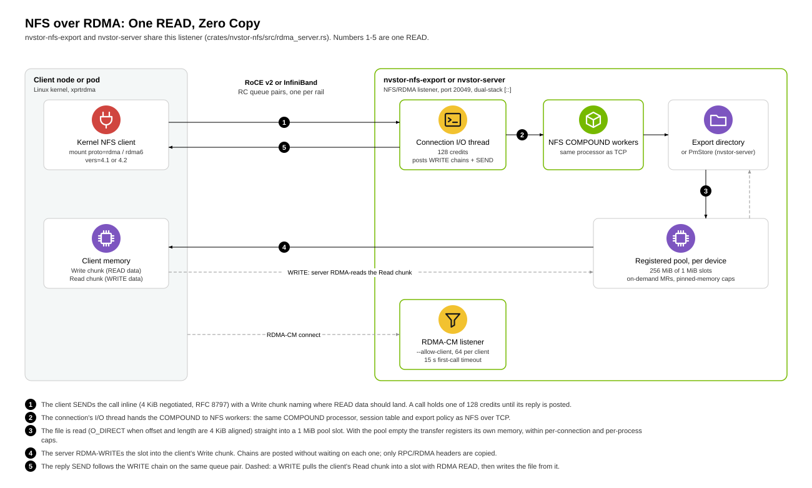

# NFS over RDMA

nvstor has an RPC-over-RDMA v1 (RFC 8166) forward-channel listener for its
NFSv4 server. TCP and RDMA use the same COMPOUND processor, export policy,
session state, and storage backend. Both `nvstor-server` and the standalone
`nvstor-nfs-export` expose the listener.

**Status: experimental.** The listener has been exercised with the Linux
kernel client (`mount -t nfs -o vers=4.1,proto=rdma` and `proto=rdma6`)
against `nvstor-nfs-export` on RoCE v2 hardware: over a single front-end NIC
(IPv4) and over several IPv6-only rails with session trunking, reads and
writes sha256-verified, a full export answering ENOSPC, and a `kill -9`
server restart under a mounted client with `--fh-key` (cached filehandles
resolved in the new process, a file held open across the restart read back
intact). Not yet validated: network drops and client-side reconnect.

## Filehandles and namespace safety

Filehandles carry each inode's own kernel handle (which includes the inode
generation, so a deleted file's handle is stale even when its inode number
is reused) and are sealed with an HMAC under a per-export secret, so clients
cannot forge handles. Handles survive a restart only when the server gets
the same secret: pass `--fh-key FILE` (32 random bytes, mode 0600, created
on first use; it must lie outside the export). Without it each start uses a
random key and every handle goes stale. Decoding a handle the process has
not seen (after a restart, or once the bounded inode cache evicted it) needs
`CAP_DAC_READ_SEARCH` (`open_by_handle_at`); without it the server warns at
startup that handles will not survive a restart.

The server never follows a symlink inside the export (READ, WRITE, SETATTR,
READDIR and the rest operate on the link itself or fail): every inode is
opened relative to the export root with `openat2(RESOLVE_BENEATH |
RESOLVE_NO_SYMLINKS)` or from its own kernel handle. An operation that needs
a directory or a regular file (LOOKUP, LOOKUPP, READDIR, OPEN, READ, WRITE,
COMMIT) and gets a symlink fails with NFS4ERR_SYMLINK, as with Linux nfsd;
the Linux client maps it to ELOOP and follows the link itself. PUTFH answers
NFS4ERR_BADHANDLE for a handle in a layout the server never issues and
NFS4ERR_STALE for a well-formed one that no longer resolves (file deleted,
or sealed with another key).

COMMIT and stable WRITEs fsync the file, namespace changes fsync the
directories they touch, and READDIR cookies are the filesystem's own
`d_off`, so paging stays consistent while a directory changes. Each listing
carries a cookie verifier derived from the directory's sealed handle; a
continuation with another directory's verifier is NFS4ERR_NOT_SAME (an
all-zero verifier is accepted), and the reserved cookies 1 and 2 are
NFS4ERR_BAD_COOKIE.

## Data path



Zero copy in both directions. READ: the file is read with O_DIRECT (when
offset and length are 4 KiB aligned) straight into a slot of a registered
buffer pool shared by all connections on the device, and RDMA-WRITTEN into
the client's Write chunk from there. WRITE: the client's Read chunk is
RDMA-READ into a pool slot and the file is written from it. Only RPC/RDMA
headers are copied. Each connection's I/O thread posts WRITE chains ending
in a signaled SEND and READ chains without waiting on any one of them; up to
128 credits per connection, 64 NFSv4.1 session slots per session. The pool
is 256 MiB of 1 MiB slots per device (`--rdma-pool-mib`, or
`NfsServerConfig::rdma_pool_bytes`); when it is exhausted a transfer
registers its own memory instead of copying, within the limits under
"Transport behavior and limits". Per-connection timing (worker,
send-queue wait, wire) is logged every 2 s at
`RUST_LOG=nvstor_nfs::server::rdma_server=debug`.

This is host-memory RDMA, not GPUDirect: data lands in the server's and the
client's host memory.

## Build and configure

Install `libibverbs-dev` and `librdmacm-dev`, then build:

```sh
cargo build --release --locked -p nvstor-server -p nvstor-nfs \
  --bin nvstor-server --bin nvstor-nfs-export
```

The NFS crate enables its `rdma` feature by default. A TCP-only standalone
export can be built with `-p nvstor-nfs --no-default-features`. If rdma-core
development files are installed in a custom prefix, set `RDMA_CORE_PREFIX`
to the directory containing `include` and `lib` during the build. Runtime
hosts need `libibverbs` and `librdmacm`. See [RDMA_SETUP.md](RDMA_SETUP.md)
for the fabric itself.

In `nvstor-server` configuration:

```toml
[network]
nfs_port = 2049
nfs_rdma_port = 20049
```

`NVSTOR_NFS_RDMA_PORT` overrides the configured RDMA port. When omitted,
nvstor tries port 20049 if it finds an active RDMA device. Zero disables
RDMA. An explicit nonzero port is mandatory: failure to create its listener
fails startup rather than silently continuing on TCP.

### nvstor-nfs-export

`nvstor-nfs-export` serves a local directory (passthrough, no nvstor storage
engine) over NFS/TCP and NFS/RDMA:

```sh
nvstor-nfs-export --port 12049 --rdma-port 20049 --read-write \
  --allow-client 10.0.0.0/8 --allow-client fd12:3456::/32 \
  --fh-key /var/lib/nvstor/fh.key /srv/nfs-rdma-test
```

| Flag | Default | Meaning |
|---|---|---|
| `--allow-client CIDR` | none; required | Client address or prefix allowed to connect, checked at accept on TCP and RDMA. Repeatable. |
| `--port PORT` | 2049 | NFS/TCP port (use a high port such as 12049 when not root). |
| `--bind ADDR` | `0.0.0.0` | NFS/TCP listen address, IPv4 or IPv6; repeatable. An IPv6 address is bound IPv6-only. |
| `--no-tcp` | off | Serve NFS/RDMA only. Startup fails unless an RDMA listener comes up. |
| `--rdma-port PORT` | 20049 if an active RDMA device exists | NFS/RDMA port; 0 disables RDMA. |
| `--rdma-pool-mib MIB` | 256 | Registered buffer pool per RDMA device (1 MiB slots). |
| `--trunk-addr ADDR` | none | An address of this server for the same export, one per rail; repeatable. Returned as `fs_locations` for `trunkdiscovery` (below). |
| `--read-write` (`--rw`) | read-only | Allow writes. |
| `--no-root-squash` | squash | Let uid 0 (and gid 0) act as root. |
| `--anon-uid UID`, `--anon-gid GID` | 65534 | Ids that squashed root and AUTH_NONE callers run as. |
| `--fh-key FILE` | random key per start | Filehandle sealing key (32 bytes, mode 0600, created if absent, outside the export). |
| `--metrics-port PORT` | 9101 | Prometheus `/metrics` and `/healthz`; 0 disables. |
| `--pnfs-ds HOST` | off | Advertise HOST as a pNFS file-layout data server on the NFS port; ignored when NFS/RDMA is enabled, so an RDMA export never diverts its data path to TCP. |

The default export is read-only; `--read-write` is necessary for write
tests. NFS/TCP listens on `0.0.0.0` unless `--bind` names the addresses.
SIGTERM and SIGINT stop admission and wait for admitted work.

### Access control

Access control is the client address list plus each request's credentials:

- `--allow-client CIDR` (repeatable) is required: without it the server
  refuses to start. It is checked when a connection is accepted on both the
  TCP and the RDMA listener (for RDMA, the peer address of the RDMA-CM
  connect request). Each prefix admits only its own address family:
  IPv6-only rails need IPv6 prefixes, and opening the export to everyone
  takes `--allow-client 0.0.0.0/0 --allow-client ::/0`.
- Each request an admitted client sends is checked against its AUTH_SYS uid,
  gid and supplementary gids with POSIX permission rules, by the server
  (which opens files with its own privileges, usually root): the same checks
  on TCP and RDMA. The rules are listed in
  [crates/nvstor-nfs/README.md](../crates/nvstor-nfs/README.md).
- uid 0 is squashed to the anonymous ids (`--anon-uid`/`--anon-gid`, 65534)
  unless `--no-root-squash`; AUTH_NONE callers run as the anonymous ids.
- AUTH_SYS uids are not authenticated: an admitted client can claim any
  non-root uid. List only the hosts that should see the data. Kerberos is
  not supported.

## Mounting over several rails

On a node with several RDMA NICs ("rails"), one NFS mount can use all of
them through NFSv4.1 session trunking: one RDMA transport per rail, all in
the same session. Two things decide whether it works.

**One transport per rail.** On Linux 5.18 and later, mount once with
`trunkdiscovery` and `max_connect=N` (N rails). The server returns its rail
addresses as the `fs_locations` attribute (`nvstor-nfs-export --trunk-addr
ADDR`, one per rail), and the client adds one transport for each address it
does not already use. On older kernels, mount the export once more through
each other rail address: each extra mount adds that address to the first
mount's session but keeps a second transport of its own, so N rails give
2N-1 transports.

**One local interface per transport.** The routing table, not NFS, picks
the client interface for each transport, and the NFS client cannot choose a
source interface per transport. On fabrics where every rail gets an equal
default route (for example IPv6 router advertisements on each rail), the
kernel sends every transport out of one NIC, and the mount runs at the rate
of one rail. Pin a host route (`/128` or `/32`) to each server rail address
through the client NIC on the same plane:

```sh
ip -6 route replace <server-rail-addr>/128 dev <client-rail-netdev> src <client-rail-addr>
```

Check the result on the server side: its log has one `NFS/RDMA connect
request` per connection, and the peer addresses should be the client's rail
addresses, not one address repeated. On the client, `/proc/self/mountstats`
lists each transport and the RPCs it carried.

[`deploy/nfs-rdma/`](../deploy/nfs-rdma/README.md) automates all of this for
Kubernetes pods (`rails-mount.sh`: route pins, trunkdiscovery or per-rail
mounts, a wait until every rail carries a transport).

### In Kubernetes pods

- The kernel NFS client connects from the network namespace of the process
  that mounts. To use RDMA NICs that are attached only to a pod (SR-IOV VFs
  through Multus, or devices allocated through Kubernetes DRA), mount from
  inside that pod; a kubelet-mounted PV uses the node's network namespace.
- The server needs `/dev/infiniband/rdma_cm` as well as the uverbs devices.
  Device plugins and DRA drivers that pass only the uverbs devices leave
  the server unable to listen; a privileged pod sees the host's
  `/dev/infiniband`.
- If each rail address is a `/32` with no routes (as some DRA setups
  assign), add a host route each way before mounting.

## Real kernel-client validation

Use two hosts with active RC-capable RDMA devices and working RDMA-CM IP
routing (RoCE or InfiniBand/IPoIB). Provision verbs/CM device access and
sufficient locked memory. This transport does not implement the AWS EFA SRD
provider. Verify the fabric independently with its RDMA tools before NFS.

On the client, install `nfs-common` or `nfs-utils` and load the kernel
`xprtrdma` (`rpcrdma`) module. Mount the server's RDMA-interface address.
The listener is dual-stack (`[::]`), so IPv4 (`proto=rdma`) and IPv6
(`proto=rdma6`, bracketed address) clients both work:

```sh
sudo mkdir -p /mnt/nvstor-rdma
sudo mount -t nfs -o vers=4.1,proto=rdma,port=20049,hard \
  SERVER_RDMA_IP:/ /mnt/nvstor-rdma
findmnt -T /mnt/nvstor-rdma -o SOURCE,FSTYPE,OPTIONS
python3 scripts/nfs-rdma-smoke.py /mnt/nvstor-rdma --phase lifecycle
```

The test refuses a TCP or local mount. It uses independent workers,
page-boundary sizes, growth/truncation, fsync, rename, and hard links. Reads
use `O_DIRECT` to bypass the client's data cache and compare every byte.
Unsupported direct I/O fails explicitly. Its timing is functional-test
timing, not a storage bandwidth benchmark.

For restart validation, retain a known dataset:

```sh
python3 scripts/nfs-rdma-smoke.py /mnt/nvstor-rdma \
  --phase write --prefix restart-001 --workers 8 --files 32
# Restart the server while keeping its backing directory (and --fh-key).
python3 scripts/nfs-rdma-smoke.py /mnt/nvstor-rdma \
  --phase verify --prefix restart-001
python3 scripts/nfs-rdma-smoke.py /mnt/nvstor-rdma \
  --phase cleanup --prefix restart-001
sudo umount /mnt/nvstor-rdma
```

Repeat with `vers=4.0` and `vers=4.2`, a second client, and the unified
`nvstor-server` PM backend. Exercise disconnects and server failure during
I/O; the retained-dataset check alone proves only recovery of a completed
write phase. When measuring bandwidth, use several streams (and `O_DIRECT`
or a final fsync) so the client page cache and a single in-flight request
do not set the number, start every read pass from a fresh mount, and check
which transports carried the traffic (`/proc/self/mountstats`).

## Error reporting

Errno to NFS status is mapped in one place, for every I/O error from any
data path: ENOSPC → NFS4ERR_NOSPC, EDQUOT → DQUOT, EFBIG → FBIG,
EROFS → ROFS, ESTALE → STALE, EACCES → ACCESS, EPERM → PERM, anything else
NFS4ERR_IO.

- A failed fsync is not lost. The kernel reports a writeback error to one
  fsync only, and the server opens a new descriptor for each, so a DATA_SYNC
  or FILE_SYNC WRITE whose fsync fails, and a COMMIT whose fsync fails,
  return the error; and any failed WRITE, stable-WRITE sync or COMMIT changes
  the write verifier, so every client resends what it has not committed (as
  Linux nfsd does).
- COPY replies UNSTABLE4, so the client COMMITs the copy.
- READ and WRITE permission failures are NFS4ERR_ACCESS, and a file removed
  after PUTFH is NFS4ERR_STALE.
- WRITE_SAME is NFS4ERR_NOTSUPP, as in Linux nfsd (the Linux client never
  sends it).

## Write performance notes

- `O_DIRECT` writes from the client scale with the number of streams.
- Buffered writes followed by fsync can get slower as streams are added.
  The client's writeback sends many concurrent WRITEs to each file; each
  becomes a `pwrite` on the server, which takes the inode's lock exclusively
  (`i_rwsem` on tmpfs; XFS takes its IOLOCK exclusively for buffered writes
  the same way), and the waiters spin. This is a property of the server's
  local filesystem under concurrent writes to one file, not of the
  transport; write files with `O_DIRECT`, or spread writes over more files,
  where the workload allows.

## Transport behavior and limits

- RDMA-CM establishes RC queue pairs; no nvstor-specific TCP QP exchange
  or RPC record marking is used on this listener.
- A connect request that fails on its own (out of memory or file
  descriptors, a non-IP peer) is rejected and logged, and the listener
  backs off (10 ms doubling to 1 s) and keeps accepting. Only a failure of
  the listener itself (device removal, its event channel failing) stops
  RDMA service. `nvstor-nfs-export` then logs it at error, sets the
  `nvstor_nfs_rdma_listener_up` gauge to 0 (and counts
  `nvstor_nfs_rdma_listener_failures_total`), keeps NFS/TCP serving, and
  re-creates the listener on the same port every 1 s doubling to 30 s
  until it binds again. With `--no-tcp` nothing else is serving, so the
  process exits non-zero instead and its supervisor restarts it.
  (`nvstor-server` still treats a failed NFS/RDMA listener as a service
  failure.)
- Inline messages, positioned Read chunks, position-zero long calls,
  Write chunks, and long Reply chunks follow RFC 8166. Read chunk padding
  is reconstructed; Write chunks exclude padding and report actual segment
  lengths. A short destination yields ERR_CHUNK before any reply transfers.
- RFC 8797 private data negotiates 4 KiB inline buffers, with the 1 KiB
  legacy fallback. SEND-with-invalidate is not negotiated.
- 128 credits bound per-connection work: a call counts until its reply is
  posted to the send queue, so a client that stops taking replies cannot
  make the server queue more, and a client that exceeds its credits is
  disconnected. A connection whose posted SENDs and RDMA READs complete
  nothing for `write_timeout` (60 s by default) is torn down; on shutdown,
  undelivered replies are given 5 s. Each connection has an I/O owner and
  concurrent NFS workers; completion events and worker wakeups avoid an
  idle busy loop. RDMA connections count against the shared NFS connection
  limit (`max_connections`); rejections are logged at warn. Connect
  requests are checked against the export client list (`allowed_clients`)
  first. One client address may hold at most 64 connections, TCP and RDMA
  together, and at most a quarter of `max_connections`, so one client
  cannot take every slot. A connection that sends no call within 15 s of
  being accepted is closed.
- Calls and replies are bounded at 16 MiB, with up to 16 chunks per list
  and 128 total segments. These bounds include long-call reconstruction.
  Read chunks are checked before any memory is allocated for them: a
  non-zero chunk may carry at most the 1 MiB maxwrite, all Read chunks of
  a call at most 1 MiB + 64 KiB (a whole maximal WRITE as a position-zero
  long call), and for inline (RDMA_MSG) calls each chunk must be WRITE data
  or a symlink target. Anything else gets ERR_CHUNK.
- Memory registered on demand (when the pool is empty or a transfer is
  larger than a slot) is capped per connection (128 credits' worth of
  maximal transfers) and across the process (16 x the pool size, 4 GiB by
  default). A transfer that does not fit waits for earlier ones to
  complete instead of registering more.
  READ allocations are limited by the remaining COMPOUND reply budget.
- Only WRITE data and CREATE symlink targets are DDP-eligible arguments;
  only READ data and READLINK targets are DDP-eligible results (RFC 8267).
  READ_PLUS and metadata results use inline or Reply-chunk encoding.
  Data-bearing compounds with argument layouts the preflight decoder does
  not recognize receive ERR_CHUNK; inline and position-zero calls still
  use the normal NFS operation dispatcher.
- On disconnect, timeout, or error, QPs are destroyed before registered
  memory is released. Admitted NFS workers drain before the connection is
  reported closed. Replacement connections can use existing NFS sessions.
- The bounded session cache preserves NFS reply bytes and DDP layout for
  retries. Same-slot calls serialize, false retries are rejected, and an
  uncached retry is not executed again. Negotiated cached replies are capped
  at 56 KiB; the complete slot including layout metadata stays below 64 KiB.
  A required cached reply that exceeds its limit returns and caches
  REP_TOO_BIG_TO_CACHE. Persistent-session and backchannel
  flags are not negotiated. Kerberos is not supported.

## Local checks

```sh
cargo test -p nvstor-nfs -p nvstor-rdma --locked
cargo check -p nvstor-nfs --no-default-features --locked
cc -std=c11 -Wall -Wextra -Werror -fsyntax-only crates/nvstor-rdma/src/cm.c
```

The chunk-transfer integration test uses simulated remote buffers with
the real NFS dispatcher and filesystem. Verbs tests that need an RDMA device
are ignored unless selected on a provisioned host. Neither replaces a
kernel mount.

Protocol references: [RFC 8166](https://www.rfc-editor.org/rfc/rfc8166),
[RFC 8267](https://www.rfc-editor.org/rfc/rfc8267),
[RFC 8797](https://www.rfc-editor.org/rfc/rfc8797),
[RFC 8881](https://www.rfc-editor.org/rfc/rfc8881).
