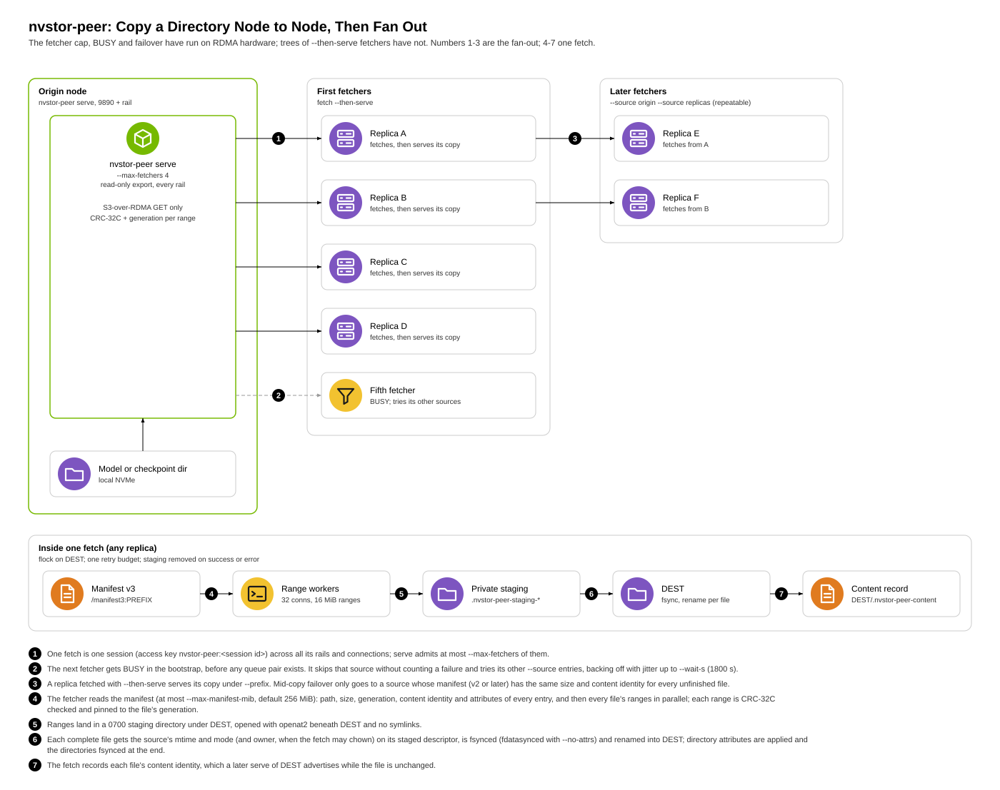

# nvstor-peer: copy a directory between nodes over RDMA

`nvstor-peer` copies a directory tree (a checkpoint, a model's weights)
from the node that has it to the node that needs it, over RDMA, with no
storage tier in between. One process serves a local directory read-only;
another fetches it into a local directory. Crate: `crates/nvstor-peer`.
Status: stable.

- `serve` exports a directory through the S3-over-RDMA server
  (`nvstor_rdma::s3_rdma::S3RdmaServer::read_only`), one transport per
  RDMA NIC ("rail"), so every rail serves.
- `fetch` asks the server for its rails, spreads its connections over
  them, each on the local NIC that reaches that rail, fetches the file
  list, then pulls every file's ranges in parallel into the destination.
- `bench` runs the fetch data path without a destination, to measure the
  transport and the server.
- Fan-out: a `serve` takes at most `--max-fetchers` (default 4) fetchers
  at once and tells the rest BUSY before creating any QP; a `fetch` takes
  several sources, moves on from busy or dead ones, and `--then-serve`
  turns a finished copy into a source. Many replicas then copy as a tree
  instead of all landing on one NIC. See
  [Fan-out](#fan-out-many-fetchers-one-origin).
- `fetch --gpu N` lands the copy in GPU memory first (GPUDirect RDMA) and
  writes the disk copy in the background. See
  [Fetch into GPU memory](#fetch-into-gpu-memory-fetch---gpu-n).



It shares the transport and the range-fetch contract with
`s3_hydrate` ([`model-hydration.md`](model-hydration.md)); the fetcher is
generic over `nvstor_rdma::hydrate::RangeSource`.

Copy speed: a fetch is normally bounded by its destination side (writing
each range into its destination file), not by the transport. `bench`,
which runs the same transport with no destination, moves considerably
more than a fetch on the same nodes. On tmpfs, the kernel takes a file's
inode lock for each write, so workers writing the same file serialize.

## Usage

Both sides need the same secret, at least 16 characters, in
`NVSTOR_PEER_SECRET`.

```sh
# source node
NVSTOR_PEER_SECRET=... nvstor-peer serve --root /var/lib/models

# destination node
NVSTOR_PEER_SECRET=... nvstor-peer fetch --source SOURCE_IP:9890 \
    --dest /nvme/models/llama-70b --prefix llama-70b

# destination node that then serves its copy to the next ones
NVSTOR_PEER_SECRET=... nvstor-peer fetch --source SOURCE_IP:9890 \
    --source peers.example:9890 --dest /nvme/models/llama-70b \
    --prefix llama-70b --then-serve
```

`serve` flags:

| Flag | Default | Meaning |
|---|---|---|
| `--root DIR` | required | Directory to export, read-only |
| `--export-as PREFIX` | none | Serve DIR as the directory PREFIX: file `x` is `PREFIX/x` (what `--then-serve` does with `--prefix`) |
| `--port P` | 9890 | Bootstrap port of rail 0; rail k listens on P + k |
| `--listen ADDR` | `::` | Address the bootstrap listeners bind. `::` takes IPv4 and IPv6 (dual stack, so a fetcher may name this node by either; IPv4 only on a host without IPv6); a specific address restricts them to it. Also taken by `fetch --then-serve`. See the note on exposure under [Authentication and access](#authentication-and-access) |
| `--devices SEL` | `netns` | `netns` (devices that belong to this network namespace, i.e. a pod's own VFs; see below), `all`, or a list such as `mlx5_0,mlx5_1` |
| `--max-fetchers K` | 4 | Fetchers served at once; more are told BUSY (see Fan-out) |
| `--slot-mib N` | 16 | Size of each registered buffer slot, the largest range served |
| `--slots N` | 64 | Slots per rail |
| `--max-in-flight N` | 256 | Requests in progress across all rails |
| `--ready-file PATH` | none | Written once every rail listens; removed at start |

`fetch` flags:

| Flag | Default | Meaning |
|---|---|---|
| `--source HOST:PORT` | required, repeatable | A server's rail-0 bootstrap address. A name that resolves to several addresses (a headless Service) is several sources; names are resolved again on every selection round. `--from` is the same flag |
| `--dest DIR` | required | Destination directory (created if missing) |
| `--prefix SUBDIR` | whole export | Copy only this directory of the export |
| `--connections N` | 32 | Parallel workers, one connection each |
| `--range-mib N` | 16 | Bytes per request (capped by the server's slot size) |
| `--devices SEL` | `netns` | As for `serve` |
| `--no-direct` | off | Write buffered instead of O_DIRECT |
| `--max-manifest-mib N` | 256 | Largest file list accepted from the server |
| `--wait-s S` | 1800 | Longest wait for a source to take the fetch while all are busy or unreachable, at the start or after losing one |
| `--client-name NAME` | host name | Seeds this fetcher's source order and backoff jitter |
| `--ready-file PATH` | none | Written when the copy is complete (with `--then-serve`: and served); holds the content digest. Removed at start |
| `--no-attrs` | off | Copy bytes only: no modes, mtimes or owners. Files stay 0600 and created directories 0700 (the caller sets modes). Also lets a fetch take a source that runs an older nvstor-peer, which is refused otherwise |
| `--no-owner` | off | Modes and mtimes, but not owners: the files are the caller's even with CAP_CHOWN (for a user namespace without the ids mapped, or NFS with root_squash, where a chown fails) |
| `--preserve-setid` | off | Keep set-user-ID and set-group-ID bits of files and directories (dropped by default) |
| `--json` | off | Print one JSON object on stdout at the end, on failure too; human output goes to stderr (see [Stable interface](#stable-interface)) |
| `--then-serve` | off | After a complete copy, serve DEST as `--prefix` with the same secret and devices; takes `--port`, `--listen`, `--max-fetchers`, `--slot-mib`, `--slots`, `--max-in-flight` as `serve` does (without `--then-serve` these are refused) |
| `--gpu N` | off | Land the copy in GPU N's memory first; see [Fetch into GPU memory](#fetch-into-gpu-memory-fetch---gpu-n). `--gpu-mapping`, `--gpu-ready-file` and `--gpu-check` require it |

With `--devices netns` a device belongs to the namespace when its GID is
an address of an interface here or its netdev is an interface here (same
name and MAC). A VF whose routable GID has not appeared yet (SLAAC still
running when the pod starts) is waited for, up to 30 s by default
(`NVSTOR_RDMA_RAIL_WAIT_SECS=N` to change, `0` not to wait). A VF still
without one after the wait is kept, with a warning naming the device; its
GID is read again on every connection, so it carries traffic once the
address appears.

`fetch` prints one line at the end: files, GiB, seconds, GiB/s, ranges,
retries, reconnects, failovers, the source it started from, the content
digest, the attributes applied and connections per local NIC. The
attributes read `attrs mode+mtime+owner`; `attrs mode+mtime (owner kept:
no CAP_CHOWN | no CAP_DAC_OVERRIDE | no CAP_FOWNER | --no-owner | owner
not authoritative at source)`; `attrs none (--no-attrs; files 0600,
directories 0700)` or `attrs none (not authoritative at source; ...)`;
with `, setid kept` under `--preserve-setid`. Its exit code says how it
ended ([Stable interface](#stable-interface)). Two complete copies of
the same tree print the same content digest, whichever sources they came
from.

### Stable interface

What another program (nvSnap, a job script) may depend on. Changing any
of it needs a new major version of `nvstor-peer` (below 1.0, a new minor
version).

- **Flags.** `serve --root DIR --devices all --port P --ready-file PATH`
  and `fetch --source HOST:PORT` (repeatable) `--devices all --dest DIR
  --connections N`, with the meanings in the tables above. Other flags
  may change in a minor version.
- **`nvstor-peer --version`** prints `nvstor-peer VERSION (commit
  SHA)`: the version and the git commit it was built from. The version
  is the release version for a release build (the Bazel build stamps the
  release tag's version), else the crate version. The commit is `NVSTOR_PEER_COMMIT` from the build environment when set
  (the cross-build script `deploy/nfs-rdma/build-aarch64.sh` passes the
  checkout's commit, with `-dirty` when it has uncommitted changes), else
  `git rev-parse HEAD`, else `unknown`.
- **`fetch` exit codes** (`crates/nvstor-peer/src/outcome.rs`, one
  exhaustive mapping per error type, so a new error has to be given a
  code):

  | Code | `error_kind` | Meaning | What to do |
  |---|---|---|---|
  | 0 | null | The copy is complete | |
  | 1 | `other` | Anything else, including a partial copy (some files could not be requested; the rest are in place) and a ready file that could not be written | Read the message |
  | 2 | `usage` | Bad flags, a bad `--source`, `NVSTOR_PEER_SECRET` missing or shorter than 16 characters | Fix the command |
  | 3 | `auth` | Every source refused the credentials in the bootstrap: a different `NVSTOR_PEER_SECRET`. A refusal is not retried. A server's REJECT says why (a reason byte); a server that could not set the connection up says so and counts as unavailable (4), and a server too old to give a reason counts as a credential refusal | Fix the secret |
  | 4 | `unavailable` | No source could serve the copy: all busy for `--wait-s`, unreachable, failed mid-copy with no replacement, or serving a manifest this build cannot use (an older or newer version, malformed, too large); also a mix of refusing and unavailable sources | Try the next tier |
  | 5 | `integrity` | The data could not be copied intact: data that failed its CRC-32C after every retry on the sources that served it (even when the other sources were merely unreachable), a source's file shorter than its manifest says, a file that changed or vanished on the source mid-copy, sources that disagree on the content, a GPU copy that differs from the disk copy under `--gpu-check` | Re-snapshot or use another source |
  | 6 | `destination` | Local I/O failed under `--dest` (disk full, permission, not a directory), or another fetch holds the destination's lock | Fix the destination |

  `serve` and `bench` exit 0, 2 on a usage error, 1 on any other.
- **`fetch --json`** prints exactly one JSON object on one line on stdout
  when the run ends, on success and on every failure (a usage error
  included); everything else (the human summary, logs, with
  `--then-serve` the serving lines) goes to stderr. With `--then-serve`
  the line is printed once serving has started and the ready file is
  written; if serving cannot start, the line reports that failure
  (exit 1, `other`, with the copy's counts). A process killed by a
  signal, or one that panics, prints no JSON line: treat a missing line
  as a failure of kind `other`.

  ```json
  {"ok":true,"exit_code":0,"error":null,"error_kind":null,"files":<n>,
   "bytes":<n>,"seconds":<s>,"retries":0,"reconnects":0,
   "failovers":0,"source":"<host:port>","content_digest":"<hex>",
   "attributes":"mode+mtime+owner","setid_kept":false,"setid_cleared":0,
   "gpu":null,"gpu_bytes":null,"gpu_ready_seconds":null,
   "version":"<version>","commit":"<sha>"}
  ```

  (wrapped here; one line on stdout). `error` is the message and
  `error_kind` the kind from the table, both null on success.
  `attributes` is what the summary line shows after `attrs` (which
  attributes the copy was given, and if not, why); `setid_kept` and
  `setid_cleared` as there. `gpu`, `gpu_bytes` and `gpu_ready_seconds`
  are null without `--gpu`. On failure the counts are what is known: an
  incomplete copy reports what it copied (with its `attributes`), other
  failures 0 and `attributes` null; `source` and `content_digest` are
  empty when no source was reached. `seconds` has millisecond resolution.
  Fields may be added in a minor version; none is removed or changes
  meaning without a major one.

## Rails, pairing and routes

`nvstor-peer` itself needs no routes, and no `NET_ADMIN`, to pair rails
or to connect them. Pairing without routes has been validated on RDMA
hardware (several RoCE NICs per node, one /32 per rail, pods without
`NET_ADMIN`): every source rail paired with the local rail on its plane
and no traffic crossed planes. The fabric may still need routes on some
clusters; this section says when, how to check, and the fix.

**Pairing.** A fetcher pairs each source rail with a local rail on the
same plane (`crates/nvstor-rdma/src/rail.rs`), then spreads connections
by load among the local rails that tie:

1. the routing table: the source rail's address is on a subnet attached
   to the local rail (on-link), else a route other than the default goes
   through it (a default route is no evidence: it would put everything on
   the front-end NIC);
2. otherwise the plane, by address. The source's rails (its RAILS reply)
   are clustered into planes by shared leading bits (single linkage),
   keeping the split with the widest gap between rails within a plane and
   rails of different planes; a plane must leave at least 8 host bits.
   For example, rails numbered `10.0.0.0/19`, `10.0.32.0/19`,
   `10.0.64.0/19`, ... split at /19, and a source with two NICs on one
   plane still splits correctly. A local rail sharing at least the plane
   prefix with the source rail is on its plane; every local rail on it
   ties. When the gap is under 4 bits (rails numbered within one subnet,
   say) planes are unknown: connections spread by load and the fetcher
   warns once per source rail.
3. The first connection to a source, before its rail list is known, ranks
   local rails by the raw shared prefix with the source's rail 0 (and does
   not warn).

Whatever the ranking says, a connection that cannot work does not stay:
each new connection is checked with one request (RAILS) before it is
used, and when the QP cannot reach RTR (no route or neighbour), the
source cannot set up its side, or the request is never acknowledged
(retry-exceeded, timeout), the next local rail is tried, each at most
once. A pair that failed is ranked last for the rest of the process; one
that worked is preferred among equals; the log names the pair that
worked. When no local rail connects, the error names every attempt.

**Connecting (RTR).** When a QP is moved to RTR the Linux kernel
resolves the peer's MAC from the GIDs, bound to the source GID's netdev
and address: `_ib_modify_qp` → `ib_resolve_eth_dmac`
(`drivers/infiniband/core/verbs.c`) → `rdma_addr_find_l2_eth_by_grh` →
`rdma_resolve_ip` with `resolve_by_gid_attr`
(`drivers/infiniband/core/addr.c`), which sets the netns and output
interface to the GID's netdev (`set_addr_netns_by_gid_rcu`) and looks up
with that interface and the GID's address as source (`addr4_resolve`,
`addr6_resolve`).

- IPv4: next hops through other interfaces are skipped
  (`fib_lookup_good_nhc`, `net/ipv4/fib_trie.c`), and with nothing left
  the kernel treats the destination as on-link through the rail
  (`net/ipv4/route.c`) and ARPs for it there.
- IPv6: with the source address set the lookup is not strict; routes
  through the rail score higher (`rt6_score_route`,
  `net/ipv6/route.c`), so the rail's own router-advertised default is
  normally used.

**TCP.** Bootstrap and liveness connections go to the `--source` host at
each rail's port, never to a rail address (`rdma_sources::rail_addrs`),
so they follow the host's normal routes.

**When the fabric still needs routes:**

- **Strict reverse-path filtering on the peer (IPv4).** With
  `rp_filter=1` a node drops ARP requests and packets from a rail address
  it would route through another interface: with a /32 per rail and no
  rail routes, that is every peer rail. RTR then times out. Check on
  both ends: `sysctl net.ipv4.conf.all.rp_filter
  net.ipv4.conf.<rail>.rp_filter` (the kernel uses the larger of the
  two; 1 is strict, 2 loose, 0 off). `serve`, `fetch` and `bench` log one
  warning at start when a rail of their host is strict. On a flat L2
  rail network strict filtering may not drop anything; where it does,
  set `rp_filter` to 2 on the rails (or `all`), or add per-rail routes.
- **IPv6 lookups that leave through another interface.** Because the
  lookup is not strict, the rail's default loses to a lower-metric
  default on `eth0`, a higher router preference, a more specific route
  through `eth0`, or no (or an expired) router-advertised default on the
  rail. RTR then succeeds with `eth0`'s gateway MAC and the QP later
  fails with retry-exceeded errors. Check, for each rail:
  `ip -6 route get <peer rail address> from <this rail's address> oif <rail netdev>`
  must name the rail netdev and a gateway on it. Fix: per-rail routes to
  the peer planes through the rail (or a /128 per peer rail address, as
  `deploy/nfs-rdma/rails-mount.sh` does for NFS).

No startup check covers the IPv6 cases: answering them needs a kernel
route lookup (netlink), which `nvstor-peer` does not do.

## Measuring the path: `bench`

`bench` runs the fetch data path against a `serve` without a
destination, so the number is the transport and the server, not the
destination disk. It is the tool for measuring changes to the RDMA
transport.

```sh
# against a serve of a data set (tmpfs for the transport alone, NVMe for
# the real read path)
NVSTOR_PEER_SECRET=... nvstor-peer bench --source SOURCE_IP:9890 \
    --connections 64 --range-kib 16384 --pattern seq --duration-s 20
```

It opens `--connections` workers exactly as a fetch does (one session, one
connection per worker, spread over the source's rails, each on the local
NIC that reaches its rail, one registered slot each), connects all of them
before the clock starts, runs `--warmup-s` unmeasured, then measures for
`--duration-s`. Every range is RDMA-written by the server into the
worker's slot and CRC-32C and generation checked, then discarded. `seq`
hands out the data set's ranges from one shared cursor, file by file
(wrapping); `rand` picks ranges uniformly. Only ranges that start and end
inside the measured window count. Any failed range voids the run: it
exits 1 with the error.

| Flag | Default | Meaning |
|---|---|---|
| `--source HOST:PORT` | required, repeatable | As for `fetch`; the first source that opens is measured |
| `--prefix SUBDIR` | whole export | Read the files under this directory |
| `--connections N` | 32 | Parallel workers, one connection each |
| `--range-kib N` | 16384 | Bytes per request, a multiple of 4; capped by the server's slot size |
| `--pattern seq\|rand` | `seq` | Sequential (shared cursor) or uniformly random ranges |
| `--warmup-s S` | 3 | Unmeasured time after every connection is up |
| `--duration-s S` | 20 | Measured window |
| `--devices SEL` | `netns` | As for `serve` |
| `--max-manifest-mib N` | 256 | As for `fetch` |
| `--client-name NAME` | host name | Seeds the random ranges |
| `--json` | off | Print one JSON object instead of the summary line |

Output: GiB/s, ranges/s, latency at p50, p99 and p99.9 and the maximum
(log-linear histogram, within 6.25 %), this process's CPU time over the
window and GiB per CPU-second, the data set's files and size, the source,
and connections per local NIC. Server CPU is not included; read it from the
server's cgroup (`cpu.stat`) around the run.

On a node with two CPU sockets, bind the server to the socket its NICs
are on (`numactl`): a server spread over both sockets runs slower and
less steadily.

### Into GPU memory (GPUDirect RDMA): `bench --gpu N`

With `--gpu N` every range lands in GPU N's memory instead of a host
slot: the server's RDMA WRITE goes from the NIC straight into the GPU,
with no host buffer on the way.

| Flag | Default | Meaning |
|---|---|---|
| `--gpu N` | off | GPU index in CUDA's order (`CUDA_DEVICE_ORDER=PCI_BUS_ID` makes it `nvidia-smi`'s) |
| `--gpu-mapping default\|pcie` | `default` | How the NIC reaches the memory: the driver's choice (C2C on Grace) or the GPU's PCIe BAR. Some platforms' mlx5 driver refuses `pcie` (ENOTSUPP) |
| `--no-gpu-verify` | verify | Skip the per-range check: measures the NIC-to-GPU path alone |

How it works:

- `nvstor-peer` loads the CUDA driver (`libcuda.so.1`) at run time; it
  links no CUDA and runs unchanged on nodes without a GPU. It allocates
  one buffer (`cuMemAlloc`, one range-sized slice per connection), exports
  it as a dma-buf (`cuMemGetHandleForAddressRange`) and registers that on
  every local NIC (`ibv_reg_dmabuf_mr`, rdma-core 34 or later, resolved at
  run time so hosts with an older rdma-core still run `fetch` and `serve`).
- The CPU cannot always read GPU memory directly (on some platforms a
  load faults and `cuMemSetAccess` refuses host access). So a range that
  landed is checked over a copy: the NIC's writes are first made visible
  to the GPU (`cuFlushGPUDirectRDMAWrites` on a device that does not order
  them itself; a device that can do neither is refused), then copied into
  the worker's pinned host buffer on its own stream and CRC-32C checked,
  all inside the measured operation.
- Security is the same as for host slots: the buffer is registered for
  remote write only, and only servers this client authenticated to are
  connected to it, each writing where a signed GET named.
- In Kubernetes the client pod must not be privileged: a privileged
  container that is also given GPUs fails to start ("device container path
  that already exists on the host"). `IPC_LOCK` is enough.
- `nvstor_rdma::region` is the library interface: `RailRegion::dmabuf`
  registers any dma-buf (for example memory another process exported)
  on every NIC of a `Rails`, and `RdmaSource::fetch_to` lands a range in a
  slice of it and returns it unchecked with the server's CRC-32C
  (`Landed`), for the caller to check where it can read the bytes.

## Authentication and access

- **Bootstrap (`crates/nvstor-rdma/src/bootstrap.rs`).** A fetcher
  connects to a rail's TCP bootstrap port. The server sends a fresh
  32-byte challenge; the fetcher answers with its access key, its GID and
  QP numbers, and an HMAC-SHA256 over the challenge and its own message,
  keyed by `NVSTOR_PEER_SECRET`. The server creates no QP, CQ or memory
  registration until that checks out; anyone else gets REJECT. The TCP
  connection then stays open as a liveness channel: when either side
  closes it, the other tears the peer down.
- **Requests.** Every request on the RDMA connection is also HMAC-signed
  with the secret, with a timestamp and nonce checked against a
  process-wide replay guard.
- **Server memory.** The server never advertises a pool address or rkey,
  its pool is registered for local access only, and its QPs grant peers no
  remote access. Data moves only by the server RDMA-WRITING a range into
  the buffer the fetcher named in its signed request.
- **Read-only.** `serve` refuses ALLOC, PERSIST, REPLICATE and DELETE
  before admission. A fetcher can read files under `--root` and nothing
  else.
- **Sessions.** A fetch picks a random session id once and every one of
  its connections presents the access key `nvstor-peer:<id>`, covered by
  the bootstrap MAC and by every request signature. The server counts
  fetchers by session ([`--max-fetchers`](#fan-out-many-fetchers-one-origin)).
  A fetcher that presents a plain `nvstor-peer` key (no session) is
  refused.
- **Listening address.** `serve` listens on `::` by default, so its
  bootstrap ports take IPv6 as well as IPv4. On a host whose firewall has
  IPv4 rules only, they are then reachable over IPv6 without those rules.
  What anyone who can reach them gets before authenticating is a TCP
  connection and the HELLO (a random challenge, the rail's GID and lane
  count); no QP, CQ or memory exists until the secret is proven. Restrict
  with `--listen ADDR` (an address of this host, or `0.0.0.0` for IPv4
  only) or with IPv6 firewall rules.
- **Limits on connectors.** At most 64 handshakes in progress, 4096 peers,
  and 512 peers per source address per rail (an IPv4-mapped address counts
  as the IPv4 address), and at most 8 × 512 from one IPv6 /64: a host can
  use any address of its /64, while every instance of a cloud subnet may
  share one /64, so the /64 alone would make neighbours share one quota.
  A handshake that does not finish in 5 s is dropped
  (`nvstor_rdma::bootstrap::AcceptLimits`).
- Traffic is not encrypted. Anyone who holds the secret can read the whole
  export.

## Fan-out: many fetchers, one origin

The problem: a NIC's message rate drops sharply once it holds a few
thousand active connections, because its cache of connection state
thrashes. Every fetch opens one peer per worker plus one more (the
anchor), each with 4 QPs (lanes): 33 peers and 132 QPs on the source for
a default fetch. A few dozen concurrent fetchers would put a source past
that point long before its disks or links are the limit, and a few
hundred replicas starting at once would also hit the 4,096-peer accept
limit.

The cap, BUSY under slot saturation and failover from a killed source
have been validated on RDMA hardware; trees of many fetchers with
`--then-serve` have not been measured yet.

### The cap: `serve --max-fetchers K`

- A fetcher is a session (above), not a connection: one fetch counts once
  however many rails, workers and reconnects it uses.
- A new session is admitted while fewer than K hold a connection; every
  connection of an admitted session is admitted after it.
- Over the cap, the bootstrap answers **BUSY** after checking the
  connector's MAC and before the server creates any QP, CQ or memory
  registration (`nvstor_rdma::bootstrap::SessionAdmitter`, hooked into
  `RdmaTransport::set_session_admitter`). A refused fetcher costs the
  source's NIC no connection state, and learns at once, without a timeout,
  to try another source. A connector without the secret still gets REJECT
  and never learns whether the server is busy.
- A session's place is freed when its last connection is torn down: a
  clean disconnect, or the transport's liveness watcher seeing the
  bootstrap stream close (a killed fetcher, within 200 ms). Each fetch
  keeps one connection to its source open for its whole life (the anchor,
  which also answers the rail lookup), so a fetch never has zero
  connections between reconnects and cannot lose its place mid-copy.

Why K = 4 by default. One fetch usually runs at its destination's write
rate, while a source can send several times that. Model the tree as
generations: every source serves K fetchers, each at the smaller of the
destination's rate and the source's rate divided by K, and when they
finish the number of sources grows (1 + K)-fold. With no cap, every
fetcher shares one source and the copy takes as long as one source
sending every copy. With K = 1 each generation is fast but the tree grows
slowly. In between, the time to N copies is lowest around K = 3 or 4,
where each fetcher still gets close to its destination's rate and the
tree grows four- or fivefold per generation. 4 is chosen over 3 because a
destination slower than the source's share (smaller disks, a busier node)
moves the optimum up, not down. Real fetches do not finish in lockstep,
so the tree grows continuously rather than in generations; the shape of
the trade-off is the same. At K = 4 a source holds 528 QPs for fetchers,
which leaves room for NFS over RDMA and NCCL on the same NIC. This is a
model, not a measurement.

### Several sources: `fetch --source ... --source ...`

- The source order is a hash of each name with the fetcher's seed (from
  `--client-name`, the host name by default): every fetcher has its own
  order, so the first choices spread over the list, and a name keeps its
  place when the list grows.
- A selection round tries every live source in that order. BUSY: next one.
  Connection or setup failure: next one; a source that fails
  `max_retries + 1` rounds in a row (6 in the CLI) is dropped. A source
  whose manifest is missing or malformed is dropped. When a round finds no
  taker, the fetcher sleeps 250 ms doubling to 5 s, with jitter in
  [half, full], and resolves the names again; after `--wait-s` without a
  taker it fails with "no source available". When every source has been
  dropped it fails at once with the reasons.
- Mid-copy failure: a worker that spends its retries on a source (a
  dropped connection that will not come back, repeated CRC errors) takes
  that source out of the running. The next worker to need a connection
  selects a replacement while the others wait; the replacement's manifest
  must list every file not yet complete with the same size and the same
  **content** identity. Its generations replace the old source's for the
  remaining ranges (they are that node's own version tokens and are never
  compared across nodes), and each range is still CRC-checked and pinned
  to a generation on the node that serves it. Files already renamed into
  place stay; a file in progress keeps its finished ranges and continues.
  A source with other content is never read from (`sources disagree on
  the content` when none is left).
  A source whose file ends before the size its own manifest gives served
  inconsistently: it is taken out of the running like one with CRC
  errors, and every file it wrote any bytes of (that file included, and
  files it had already finished) is fetched again whole from the
  replacement; writes still in flight from the old source to those files
  are refused, a finished file is fetched beside itself and replaces
  itself, and the content record follows. Each file is refetched by one
  worker. A finished file is refetched only from a source that lists it
  with the same size and content identity; when none does, the fetch
  ends with `sources disagree on the content` (exit 5).
  Bad data is held against the server, not the connection or the name:
  every name of that server (its IPv4 and IPv6 addresses, recognised by
  its identity as below) is out, no write served by any connection to it
  lands from then on, and every file any of them wrote is refetched. The
  sources still in use get fresh views at once, so the refetches can be
  served from them. A worker still connected to the server that used to
  answer at a revived name does not take the new server out.
- Failover timing. A source that crashes or exits is noticed at once:
  its bootstrap TCP stream closes, the transport removes the peer, and
  every request in flight on it fails. A source that hangs while its TCP
  stream stays open is noticed only when a control reply misses
  `CONTROL_REPLY_TIMEOUT`, 38 s; each such miss removes the connection
  and counts as one failed attempt, so a hung source costs up to
  `max_retries + 1` of them before it is taken out of the running. The
  bound is the server's worst case to answer plus a margin
  (`crates/nvstor-rdma/src/s3_rdma_proto.rs`):

  | Term | Bound | What |
  |---|---|---|
  | `ADMIT_WAIT` | 1 s | dispatcher waits for a worker; then NO_SLOT |
  | `SLOT_WAIT` | 2 s | GET / ALLOC wait for a pool slot; then NO_SLOT |
  | `STORAGE_ALLOWANCE` | 10 s | one storage callback (documented, not enforced) |
  | `LANE_OP_WORST` | 10 s | one RDMA WRITE / READ: credits 5 s + completion 5 s |
  | `LANE_OP_WORST` | 10 s | the reply SEND |
  | **`SERVER_REPLY_WORST`** | **33 s** | sum: longest a healthy server takes to answer |
  | `REPLY_MARGIN` | 5 s | |
  | **`CONTROL_REPLY_TIMEOUT`** | **38 s** | client wait for a reply (`transport.rs` `recv_response`) |

  A busy source is never a failed one. NO_SLOT (no free slot or worker)
  is load on one request, not a broken connection: the worker keeps its
  connection and the fetch keeps its place on that source (its anchor
  is never released for being busy, so a fetcher cap cannot give the
  place away). The worker pauses (decorrelated jitter per worker:
  uniform between `busy_backoff` and three times its last pause, capped
  at `max_busy_backoff`; it starts over after progress) and asks again
  on the same connection, or, if another eligible source is already
  validated in this fetch, or one can be validated (by one worker at a
  time, outside the selection lock), moves that range there while the
  busy source cools. A source's manifest is read once per fetch; a file
  that changes there later fails its ranges as Changed. A BUSY on a new
  connection (fetcher cap) is handled the same way. Busy answers spend
  no retries; the fetch ends with "no range completed for N s"
  (Unavailable) only after `--wait-s` passes without any range
  completing (counted from when the first source was chosen; an idle
  validated source still takes a busy range with `--wait-s 0`; a
  `--wait-s` too large to represent means no bound). Manifest reads wait
  out busy answers on their connection for up to `--wait-s` too, except
  while choosing or adding a source: there a source whose manifest stays
  busy past a short budget (`max_busy_backoff`) cools and the next one is
  tried, so a busy source never holds failover to an idle one. A source
  is checked (manifest read) by one worker at a time and never twice;
  selection, checks and name resolution run outside the shared state
  lock, and a claim on a source is released even if the check panics.
  Workers drop their connections to a source the fetch gave up on at
  their next range boundary.
- A file that changes on one source mid-copy (its generation moves, as a
  `touch`, `chmod` or rewrite does) takes that server out of the running
  (all its names, e.g. its IPv4 and IPv6 addresses, recognised by the
  server's identity: the random instance id its process sends in the
  RAILS reply, or, from a server without one, its rails' GIDs and
  ports) and the range moves to another server, whose content identity
  is checked as for any failover. So if the origin is rewritten
  mid-fetch, the copy is finished from a replica that holds the content
  the fetch started from, and the summary line says so ("files changed
  on ORIGIN during the fetch, finished from other sources with the
  original content"; `FetchReport::changed_on`). When that leaves no
  source at all, the fetch fails with "changed on the source during the
  fetch"; when sources are left but do not finish (busy past
  `--wait-s`), their failure is reported and the change is mentioned.
- A source given up on (dead) stays out for the fetch, unless its address
  later reaches another server (a reused pod address: another instance
  id): its name is checked again every `2 * max_busy_backoff` (a 1 s TCP
  connect first, at most two names per selection round, never past the
  busy bound) and, if the server's identity differs, it is a new
  candidate, at most three times per name. A source that died serving
  corrupt bytes is never tried again. Workers drop connections to the
  old server at that name at their next range.

### Content identity

The manifest (since version 2) carries, next to each file's size and
generation, a 128-bit `content` identity:

- On a node that has the original file, `content` is the file's
  generation there (device, inode, size, mtime, ctime). It names "this
  version of this file on the origin".
- A fetch records, for each file it renamed into place, the identity it
  fetched under and the local copy's generation right after the rename, in
  `DEST/.nvstor-peer-content` (`crates/nvstor-peer/src/content.rs`).
  Serving that directory, the export advertises the recorded identity for
  each file whose generation is still the recorded one, and the file's own
  generation for anything else. A file rewritten after the copy is never
  presented as the origin's bytes.
- So identities pass down the tree unchanged, two copies of one origin
  agree, and two independent copies (say, two nodes that each downloaded
  the weights) disagree even when the bytes are equal. That errs on the
  safe side: a fetch never mixes ranges of two sources unless both vouch
  for the same origin version. The tradeoff: identical bytes from
  unrelated origins are not recognised, which would need a whole-file hash
  on every source, read before serving.
- `fetch` prints `manifest::content_digest` (SHA-256 over path, size and
  content of every file) and puts it in `--ready-file`: equal digests mean
  equal trees from the same origin version. Directories and attributes
  (mode, mtime, owner) are not part of it, nor of the comparison a
  failover makes: a copy made from a version 2 manifest (which lists no
  attributes) has the same digest and identities as one made from
  version 3, and the content record stays in version 2.
- Names starting with `.nvstor-peer-` are nvstor-peer's own (staging,
  the record, a ready file placed in DEST): never listed or served, and a
  fetch refuses to create them.

### Serve after fetch

`fetch ... --then-serve` serves DEST after a complete copy, under
`--prefix`, so a downstream fetch with the same `--prefix` asks a replica
exactly what it would ask the origin. It is `serve --root DEST --export-as
PREFIX` with the fetch's secret and devices. A replica serves only a
complete copy: an incomplete fetch exits nonzero and does not serve.
`deploy/nfs-rdma/peer-fanout.yaml` puts this together for Kubernetes: one
headless Service over every pod that is Ready to serve, replicas fetching
from that one name, readiness (and the start of the workload) gated on
the ready file.

### Measuring fan-out

To find where a NIC's connection-state knee is and how a tree behaves:

1. One source, many concurrent fetchers (8, 32, 128), `--max-fetchers
   4096` (no cap) against the default: time until all copies are
   complete, the distribution of per-fetch times, the source NIC's QP
   count (`rdma res show qp | wc -l`) and its throughput, and any
   connection-context cache counters the NIC exposes (`ethtool -S`,
   `rdma statistic`).
2. The same fetchers with `--then-serve` (the tree) and K = 2, 4, 8:
   time to N complete copies, the highest number of concurrent sessions
   any source logged (never above K), the BUSY count per source, and the
   content digest on every replica (all equal) plus sha256 of every file.
3. BUSY cost: time from TCP connect to BUSY at the client, and no QP or
   thread growth on the source from refused fetchers.
4. Failover inside a tree: `kill -9` a source in the middle of the tree
   while its fetchers copy; they must finish from other sources with
   `failovers` 1, sha256 matching, and the killed source's places freed
   (a restart of it admits K new fetchers).
5. `cargo test -p nvstor-peer --test fanout_rdma -- --ignored` on RDMA
   hardware: the second fetcher is BUSY, the first leaves, the second
   copies.

When counting server QPs: the server creates QPs on short-lived accept
threads, and once a thread exits `rdma res show qp` prints the QP with
no pid or comm; count RC QPs on the server's rail devices that have no
owner or are owned by a live server thread.

## Fetch into GPU memory: `fetch --gpu N`

```sh
NVSTOR_PEER_SECRET=... CUDA_DEVICE_ORDER=PCI_BUS_ID nvstor-peer fetch \
    --source SOURCE_IP:9890 --dest /data/ckpt --gpu 0 \
    --gpu-ready-file /run/ckpt.gpu.json --json
```

Every range goes from the source over the rails straight into GPU N's
memory (GPUDirect RDMA, as `bench --gpu` above), is checked there
(read back, CRC-32C), and is placed at its file's offset in one GPU
buffer. The copy in `--dest` follows in the background: each
connection's disk writer reads its ranges back from the GPU buffer and
writes them with the usual staging, fsync and rename, so the GPU copy
never waits for the disk. Design: [`design/fetch-gpu.md`](design/fetch-gpu.md).
Validated on RDMA hardware with GPUs (every file's sha256 checked against
the source, and the GPU copy compared with the disk copy).

| Flag | Meaning |
|---|---|
| `--gpu N` | Fetch into GPU N (CUDA's order; `CUDA_DEVICE_ORDER=PCI_BUS_ID` makes it `nvidia-smi`'s) |
| `--gpu-ready-file PATH` | Written once every file is in GPU memory, before the disk copy is done: one JSON object, `{"gpu","ipc_handle","bytes","files_bytes","ready_ns","files":[{"path","offset","size"}]}`. `ipc_handle` is the buffer's CUDA IPC handle (hex) for `cuIpcOpenMemHandle` in another process on the node; each file is at `offset` in it |
| `--gpu-check` | After the disk copy, compare every file's GPU copy with its disk copy (a mismatch is an integrity failure, exit 5) |
| `--gpu-mapping default\|pcie` | As for `bench` |

Lifetime: with `--gpu-ready-file`, the process holds the GPU memory after
the JSON line until it is stopped (SIGTERM), also if the disk copy failed
after the ready file was written (the JSON line says so): a consumer may
be using it. Without one, nothing can open the memory and the process
exits. A fetch that cannot copy every listed file is refused before any
transfer (exit 1): the GPU copy is all or nothing. The JSON line fills
`gpu`, `gpu_bytes` and `gpu_ready_seconds`.

The container needs the CUDA driver library: with the NVIDIA container
runtime, set `NVIDIA_DRIVER_CAPABILITIES=compute,utility` (the
`nvstor-peer-image` Bazel target does, see the README).

## Protocol in brief

1. **Rails.** The fetcher opens a connection to rail 0 and sends a signed
   `RAILS` request. The answer lists each server rail's bootstrap port and
   GID. Each fetch connection goes to a server rail round-robin, on the
   local NIC on that rail's plane (see
   [Rails, pairing and routes](#rails-pairing-and-routes)).
2. **Manifest.** The file list under a prefix is served as an object under
   a reserved key (file keys never start with `/`): version 3 under
   `/manifest3:<prefix>`, version 2 under `/manifest:<prefix>`.
   Format (`crates/nvstor-peer/src/manifest.rs`): magic `BRPM`, version
   3, an authority word (bit 0: the modes and mtimes are the tree's own,
   bit 1: the owners are), count, then per entry: path, kind (file or
   directory), mode (`st_mode & 0o7777`), mtime (seconds and
   nanoseconds), uid, gid, and for a file its size, a 128-bit generation
   and a 128-bit content identity. Every regular file and every directory
   below the prefix is listed (the prefix directory itself is not).
   Version 2 is the files only (size, generation and identity), version 1
   without the identity; both are still decoded, and the decoder reports
   which version it read. The decoder refuses absolute paths, `.`, `..`
   and empty components, for directories as for files, so a server cannot
   make a fetcher write outside its destination; it also refuses an
   unknown kind, unknown authority bits, mode bits beyond `0o7777` and
   nanoseconds of a second or more. The fetcher maps the listing onto the
   destination as a tree keyed by (parent, name), so a listing costs its
   own size however deep its paths. The listing is built once and served
   from a cache for its ranges; if it changes while being read, the
   fetcher fetches it again (up to 3 times).
3. **Files.** Every file is split into ranges; one queue feeds all
   workers, so thousands of small files cost no connection setup and a few
   large files still use every worker. Each range is a signed `GET` of
   (path, offset, generation). The server reads the range into a slot of
   its registered pool (O_DIRECT when aligned) and RDMA-WRITEs it into the
   fetcher's registered buffer, then answers with the length, the
   generation and a CRC-32C of exactly those bytes. The fetcher checks the
   CRC and writes the range to disk from the same buffer (O_DIRECT when
   aligned).
4. **Generations.** The server derives a file's generation from `fstat`
   (device, inode, size, mtime, ctime) before and after every read and
   repeats a read during which it changed. A range whose generation no
   longer matches the manifest fails with `GENERATION_CHANGED`, and the
   fetch stops with an error naming the file instead of stitching two
   versions together.

## Attributes

A fetch gives every file and directory it creates the attributes the
source lists (`crates/nvstor-peer/src/fetch.rs` has the full contract).
Unit-tested only (mixed modes, owners, set-id files and directories,
sticky and empty directories, nanosecond mtimes, `--preserve-setid` and
`--no-owner`); not yet run on RDMA hardware.

- **Mode**: permission and sticky bits as listed, hardened: set-user-ID
  and set-group-ID bits are dropped, from files and directories, unless
  `--preserve-setid` and the listed owner was applied to that very file
  (a copy should not hand out privileges or group inheritance on its
  own: kept on a file the copier owns, a 04755 of uid 1000 would become
  set-user-ID root). Without the owner they are dropped and the summary
  says `setid dropped (owner not applied)`; `--preserve-setid` with
  `--no-owner` is refused. The bits are read back after they are set:
  the kernel clears S_ISGID without an error for a process without
  CAP_FSETID whose groups do not include the file's, and the summary
  then says `setid kept but cleared by the kernel on N`. Write for others
  is dropped from a directory without the sticky bit.
- **Mtime**, to the nanosecond. The atime is the time of the copy: the
  manifest does not carry one, and serving a file already reads it.
- **Owner and group**, as numbers (like `rsync --numeric-ids`: no name is
  looked up on either side, so the two nodes must agree on the ids), when
  the fetch has CAP_CHOWN, CAP_DAC_OVERRIDE and CAP_FOWNER in its
  effective set (not merely uid 0: root with its capabilities dropped has
  none) and `--no-owner` is not given. The last two are needed because a
  directory's end record and final mode come after its chown (below).
  This is decided once, up front, from the effective set read with
  capget(2): without all three the files are the caller's, nothing fails
  for it, and the summary names the capability that was missing (`owner
  kept: no CAP_DAC_OVERRIDE`). Likewise, when a uid or gid the source
  lists has no mapping in this process's user namespace
  (`/proc/self/uid_map`, `gid_map`), owners are not applied and the
  summary says `owner kept: ids not mapped in this user namespace`. A
  chown the system refuses (a user namespace without the ids mapped, NFS
  root_squash) ends the fetch at the first file, naming `--no-owner`.
- **Directories**, empty ones included, below `--prefix`. `DEST` itself
  is the operator's and keeps its attributes.

How: staging files are created 0600 and directories 0700, so nothing is
readable by others while the copy runs. A complete file gets, on its open
descriptor and before the rename, `futimens` and `fchmod` (without set-id
bits) while the fetch still owns it, so neither needs CAP_FOWNER; then
`fchown` (it moves ctime, not mtime); then, only when set-id bits are
kept, `fchmod` with them (the chown cleared them; this needs CAP_FOWNER);
then `fsync` (not `fdatasync`, so the attributes are as durable as the
bytes), and only then the rename: a file never appears in place with
other attributes, and if any step fails it does not appear at all.

A directory gets, in order: its owner (while it is still 0700 and the
fetcher's, so the fetcher's group never holds the listed group bits,
even across a crash), its mode with owner rwx added while its end record
is still to be written, the end record, its final mode (set-id bits when
kept), and its mtime last. A crash or a refused chown before the record
leaves the start record: never an end record over a directory that is
still the copier's. A directory whose attributes fail is put back to
0700 with its start record (0770 of the fetcher's would open it to the
fetcher's group) and fsynced. If the start record cannot be renamed
back, the record file is rewritten in place; if even that fails, a
full-authority start record is restored by removing the file, and a
lower one is logged as an error. This is why owners take
CAP_DAC_OVERRIDE and CAP_FOWNER as well as CAP_CHOWN: writing into and
chmod-ing a directory that is no longer the fetcher's. A directory that
fails in the final pass does not stop the others; the fetch then fails
with the first error.

After every file is in place each directory gets its attributes and is
fsynced, deepest first, on a descriptor opened beneath `DEST` without
following symlinks, so no later rename moves a directory's mtime and a
read-only directory (0555) still takes its files. A fetch again over a
copy whose directories are read-only works (the caller's own directories
get owner rwx for the copy), and puts back any attribute changed
locally, since every fetch rewrites every file.

With `--no-attrs` nothing is applied: files stay 0600, created
directories 0700, owned by the caller with the copy time. The caller sets
modes afterwards; a copy is private by default, never world-readable
because of a umask.

### Authority records

A copy only has the attributes its fetch applied. The fetch records that
in `.nvstor-peer-attrs` (`modes=1 owners=0`, written under fresh random
temporary names) in DEST and in every directory of the copy that has
something to say: a directory's record is what the fetch applies AND
every record at or above it, its own earlier one included, so files an
earlier copy left there keep what was said of them; only a directory
this fetch created (everything in it is this fetch's) may end with more
than it started with. Full authority in a directory that had no record
is not written (absence says it), and the end record is not written when
it equals the start one: a copy made with owners has records in no
directory but DEST, one made without has one per directory, written
once. A copy thereby describes itself in every directory. These are
`.nvstor-peer-*` names: never listed, served or copied, and to be left
out of any count of a copy's files (see
[Comparing a copy with its source](#comparing-a-copy-with-its-source)).

Durability: the start records are written unsynced and then fsynced
together (in parallel) with their directories before any file is
renamed in; the end records are written before each directory's fsync
in the final pass and their contents fsynced together after it. After a
crash a directory's record is therefore its start value, its end value,
or empty/partial (which reads as no authority): never higher than the
final one. `cargo test -p nvstor-peer --release --lib time_2000 --
--ignored --nocapture` times a fetch of a tree with thousands of
directories without owners, the case that writes the most records.

A `serve` puts the authority in its version 3 listing. The rule is
fail-safe: the authority of a listing is the AND of every record found
from the listed directory up to `/` and of every record in the listed
subtree. Only reaching `/` with no record and no error gives full
authority; any error on the way (a directory that cannot be opened or
searched, a record that cannot be read or does not parse) gives none.
`..` is opened with O_PATH, so an ancestor with search but no read
permission (0711) is gone through. A fetch uses the same rule for its
own record: before anything is renamed it writes what it applies AND
what holds over DEST from above; at the end, the same again (and, when
DEST held nothing else when it started, without DEST's old record). A
fetch into a directory of a copy made without owners therefore records
no owners either, and serving any directory of such a copy, or a parent
of it, says so. A listing reads the records above it both before and
after it walks the tree, and serves the AND of both: a fetch that starts
into the tree while it is being listed cannot have its files listed
under the authority from before. A fetch without the destination's lock
(a filesystem without `flock`, such as NFS) cannot rule out another
fetch renaming its files into the same tree: it never takes DEST for
empty, never takes a directory it made for all its own, and so no record
anywhere ends higher than it started. On such filesystems authority can
only stay or go down. NFS mounted with `local_lock=flock` (or `nolock`)
grants `flock` per host only: two fetches on two hosts into the same
DEST both count as locked there. Run one fetch per DEST across hosts.

A record counts only if it is owned by the serving user or root; one of
anyone else's counts as no authority. Records only ever lower authority:
a local user who can create `.nvstor-peer-attrs` somewhere inside an
export (a sticky world-writable directory, say) can take authority away
from what is served (the fetch then keeps its own ownership and private
modes), never add it.

A local user with write access to a directory that already exists in
the destination can plant something at its record's name (a directory
called `.nvstor-peer-attrs`, say): the fetch then cannot write the
record and skips that directory and everything below it, reporting it.
That denies the copy of that directory; it never raises authority.

Authority is per directory. A directory of a copy served on its own (a
bind mount, a Kubernetes subPath) still carries its own record, so it is
served with the copy's authority. Trees not produced by nvstor-peer
(copies made by other tools) have no record in their subdirectories:
served through a bind mount of a subdirectory, the walk cannot see the
record above the bind source, and the subtree is served as
authoritative. Likewise a file moved or hard-linked out of a reduced
copy into a tree without records is served as authoritative there: the
record describes the directory, not the file. When a directory's chown
fails, the fetch puts it back to 0700; if even that fails it logs an
error and says so in the fetch's error. A fetch from a copy made without
owners keeps its own ownership (`owner not authoritative at source`)
instead of giving every file the copier's uid; from a copy made with
`--no-attrs` it applies no mode either. A fan-out tree therefore keeps
attributes end to end when every hop applies them, and says so when one
did not. DEST is taken to hold one fetched tree.

**Failures.** A directory that cannot be created or opened (EACCES, a
name the filesystem refuses), and a path longer than PATH_MAX or with a
name longer than NAME_MAX, are reported per entry with everything below
them; the rest is copied and the fetch exits nonzero (`Incomplete`). When
a fetch fails, the directories it created or opened up still get their
listed attributes (or their old mode back) as far as possible; files
already in place are complete with their attributes; nothing else of the
copy is left.

**Versions and upgrade order.** A source serves two listings: version 3
(attributes, directories) under `/manifest3:<prefix>` and version 2
(files only) under `/manifest:<prefix>`. So:

- a fetcher that reads only version 2 keeps working against a current
  source (bytes only);
- a current fetcher refuses a source that serves no version 3 listing
  with `serves manifest version 2 only ... upgrade the source first`, and
  moves on to another source if it has one; `--no-attrs` takes it, bytes
  only, private modes;
- so upgrade sources (and replicas that serve) first, then fetchers.

After a failover the attributes still come from the listing the copy
started from. A replacement source is asked for the version 2 listing,
which every source serves: it must match sizes and content identities
only, and its own attributes are neither compared nor applied, so the
whole tree gets one listing's attributes. The content identity and digest
do not include attributes.

## Staging and atomicity

- Bytes land in a private staging directory,
  `DEST/.nvstor-peer-staging-<random>` (mode 0700), one file per target
  named by its index. Only a complete, verified file is given its
  attributes, synced and renamed (`renameat`) to its final name;
  directories are given theirs and fsynced at the end. A file that exists
  under its final name is complete.
- The staging directory is removed on success and on every error. A fetch
  that crashed leaves one behind; the next fetch into the same `DEST`
  removes it. The server never lists staging directories.
- A fetch holds `flock(LOCK_EX)` on `DEST`; a second fetch into the same
  directory fails at once ("another nvstor-peer fetch is writing into
  this directory", exit 6). On a filesystem without directory `flock` it
  warns and continues; staging is still private.
- Nothing under `DEST` is resolved through a symlink: directories are
  created and opened with `openat2(RESOLVE_BENEATH | RESOLVE_NO_SYMLINKS)`
  relative to `DEST`, and `renameat` replaces a name without writing
  through it. An existing entry that is not a regular file where a file
  goes, or not a directory where a directory goes, fails the fetch before
  any transfer.
- On the source, every directory is opened from the root descriptor with
  `openat2(RESOLVE_BENEATH | RESOLVE_NO_SYMLINKS)`, files with
  `RESOLVE_BENEATH`, and only regular files are read. Symlinks, FIFOs and
  devices are skipped (and logged); a file that vanishes during the walk is
  skipped.
- Errors that can be retried (a busy server, a CRC mismatch, a dropped
  connection) are retried with exponential backoff, up to 5 retries per
  range; failed reconnects count against the same budget. Finished ranges
  are kept.

## Comparing a copy with its source

A copy holds names of nvstor-peer's own next to the copied files; they
are never listed, served or copied on. Leave them out when comparing a
copy with its source:

| Where | Name | When |
|---|---|---|
| DEST | `.nvstor-peer-attrs` | always (the authority record) |
| DEST | `.nvstor-peer-content` | after a fetch that placed files (content identities) |
| DEST | `.nvstor-peer-staging-*/` | after a fetch that crashed (removed by the next fetch) |
| DEST | `.nvstor-peer-attrs.tmp-*`, `.nvstor-peer-content.tmp-*` | after a crash while a record was written |
| DEST | `.nvstor-peer-content.tmp` | after a crash while a record was written (older naming) |
| every directory of the copy | `.nvstor-peer-attrs` | when it has something to say (see Authority records) |
| every directory of the copy | `.nvstor-peer-attrs.tmp-*` | after a crash while a record was written |

```sh
find DIR -name '.nvstor-peer-*' -prune -o -type f -print
```

## Troubleshooting

| Symptom | Likely cause | What to check |
|---|---|---|
| Exit 3, "server refused this connector's credentials" | Different `NVSTOR_PEER_SECRET` on the two sides | The secret on both sides; nothing is written to DEST and the server creates no QP |
| Exit 4, "peer speaks nvstor RDMA protocol vN" or "peer does not speak the nvstor RDMA bootstrap" | The two sides run incompatible versions (for example one side is an older build) | `nvstor-peer --version` on both sides; upgrade both |
| Exit 4 after `--wait-s` | Every source busy (`--max-fetchers` reached) or unreachable | The sources' logs for BUSY; TCP reachability of port 9890 + k |
| Exit 4, "serves manifest version 2 only" | The source runs an older nvstor-peer | Upgrade the source, or fetch with `--no-attrs` |
| RTR timeout on every pair | Strict `rp_filter` on a peer (see the start-up warning) | [When the fabric still needs routes](#rails-pairing-and-routes) |
| Connections fail later with retry-exceeded on IPv6 rails | The kernel resolved the peer through `eth0` | `ip -6 route get ... oif <rail>` as above |
| Exit 6, "another nvstor-peer fetch is writing into this directory" | Another fetch holds DEST's lock | Wait for it, or use another DEST |
| Summary says `owner kept: no CAP_...` | The fetch lacks one of the owner capabilities | Run with CAP_CHOWN, CAP_DAC_OVERRIDE and CAP_FOWNER, or accept caller-owned files |
| Exit 1 naming `--no-owner` | A chown was refused (user namespace without the ids, NFS root_squash) | Add `--no-owner` |
| A VF warned about at start never carries traffic | Its routable GID never appeared | `ip addr` on the VF; `NVSTOR_RDMA_RAIL_WAIT_SECS` |
| `fetch --gpu` cannot load `libcuda.so.1` | The container was not given the CUDA driver | `NVIDIA_DRIVER_CAPABILITIES=compute,utility` |
| Fetch rate well below `bench` | The destination's write path is the limit | Write rate of the destination filesystem; files per worker; `--no-direct` on tmpfs |

## Running the tests

`cargo test -p nvstor-peer` means the same as root and as any other
user: each test decides owner behaviour itself (by default the fetch
sees no CAP_CHOWN and keeps owners; tests that want owners applied say
so), rather than depending on the capabilities of whoever runs it.
Temporary trees go under `NVSTOR_TEST_TMPDIR`, else `TMPDIR`, else the
crate directory (set one of them when running a cross-built test binary
elsewhere). Several fetch tests bound how long a busy or failing source
may hold a fetch; on a disk that stalls writes for seconds (a host busy
with other builds) they can fail on time alone. Pointing
`NVSTOR_TEST_TMPDIR` at tmpfs (`/dev/shm/...`) takes the disk out. A few
checks need what only one side has:

- not root only (root bypasses the permission or chown failure they
  provoke): a refused chown naming `--no-owner`, a directory that cannot
  be made or opened (0000), a directory whose owner fails (its start
  record kept, the others finished), a 0700 reset that fails, an
  ancestor without search permission giving no authority, and that the
  test process holds none of the owner capabilities;
- root, or a user namespace with mapped ids, only (ignored by default):
  `as_root_owner_and_group_are_applied_before_the_mode`, which applies
  real foreign owners;
- RDMA hardware (ignored by default): `--test fanout_rdma`.

## Limits

- Regular files and directories only. Symlinks, special files, hard
  links (each name is a separate file), atimes, ACLs and extended
  attributes are not copied. Owners only when the fetch has CAP_CHOWN,
  CAP_DAC_OVERRIDE and CAP_FOWNER.
- A fetch again over an earlier copy without the rights to open one of
  its directories (a non-root caller and a directory without owner read,
  say 0311) reports that directory and everything below it as failed.
- A replica serving under `--export-as` does not list the mount or its
  parents (`models`, `models/llama` for `--export-as models/llama`): it
  has no directory of the origin's for them, only its own DEST, whose
  attributes were never applied from the origin. A fetch through a
  parent of the mount creates them like any directory no listing vouches
  for: 0700, the fetcher's.
- Raising a copy's recorded authority (a non-root copy fetched again
  with CAP_CHOWN) takes a fetch into an empty DEST.
- Every fetch copies every file again: there is no incremental or resumed
  copy across runs. A killed fetch restarts from the beginning (completed
  files are overwritten). Within one run, a fetch that loses its source
  continues from another without recopying finished files.
- A replica serves only after its whole copy is complete; it does not
  serve the ranges it has while it is still copying.
- A path whose key is longer than `MAX_KEY_LEN` (4160 bytes) is not
  requested; the fetch copies everything else, lists those files and exits
  nonzero.
- A rewrite of a file that changes neither its size nor any timestamp,
  within one timestamp tick, is invisible to the generation check.
- RoCE or InfiniBand RC only: no AWS EFA, no TCP fallback in this tool.
- `fetch --gpu` fills one GPU per fetch; run one fetch per GPU.
- The server stays in the foreground until killed; there is no graceful
  drain. A killed source's fetchers fail over to other sources if they
  have any.
