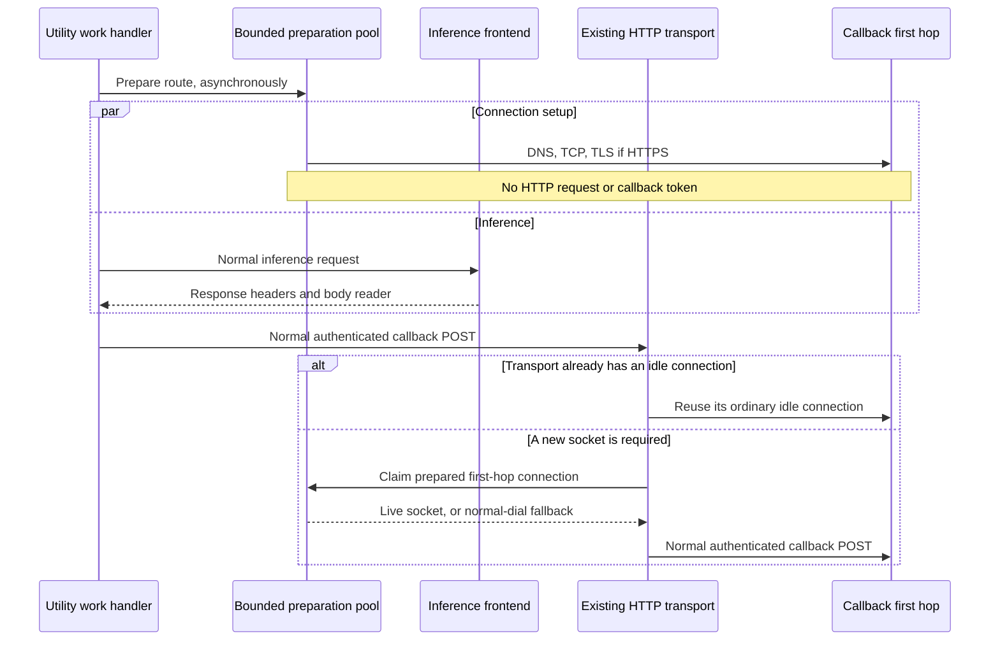

# Callback connection preparation

Proposal: bounded, default-off callback connection preparation.

## Problem and scope

Today `NewRequestStreamHandler` knows the callback target and proxy before
inference starts. `SendResponse` starts the callback POST after the inference
server returns response headers. On a new callback connection, DNS, TCP and
TLS setup delay delivery of both streaming and buffered responses.

Prepare the callback's first network hop concurrently with inference, without
starting an HTTP request, sending an authentication token, consuming response
data or changing the invocation service. This hides connection setup only
when preparation finishes before the callback needs it. It does not remove
dispatch, network transit, inference, buffering or response-transfer time.

## Design

`NVCF_CALLBACK_PRECONNECT_ENABLED` opts in; the default is false. The existing
HTTP/1 transport, proxy selection, callback URL, bearer token, content type,
streaming body and status handling stay authoritative.

Go does not expose a supported way to insert arbitrary sockets into
`http.Transport`'s idle pool. A small pool therefore supplies connections
through that transport's supported `DialContext` and `DialTLSContext` hooks.
The transport adopts a connection only when executing a real callback POST.
Once adopted, Go owns its normal HTTP lifecycle and idle reuse.

The pool coalesces preparation per route. A route includes the target origin
and complete proxy identity, plus first-hop scheme/address. Credentials in a
proxy URL are never logged or used as metric labels. Direct HTTPS prepares
DNS/TCP/TLS to the target. An HTTPS proxy prepares DNS/TCP/TLS to the proxy;
the transport still owns proxy authentication, CONNECT and any inner TLS.
HTTP first hops prepare TCP. No environment-proxy policy is added.

At most 16 speculative entries exist per utility. Setup has a 2-second budget;
a ready socket lives for at most 30 seconds. Parent cancellation, handler
close, expiry and `CloseIdleConnections` release speculative resources.
At most one attempt per route starts each second. A separate bounded map of
16 cooldown entries also limits aggregate starts to 16 per second without
retaining an unbounded history of origins. Cooldown does not block real POSTs.
There is no periodic refresh or keepalive HTTP traffic. Long inference can
outlast the prepared connection and then use normal dialing. Claiming removes an entry from the speculative pool. These limits bound
unclaimed preparation entries and their start rate, not all sockets or
active callback concurrency.

A read monitor detects a remote close while the socket is parked. Handoff
interrupts that read with a deadline, joins the monitor, and clears the
deadline before transferring exclusive ownership. Unexpected application
bytes, EOF, cancellation or expiration cause disposal and ordinary dialing.
As with every connection, a peer can still close after handoff; the feature
does not replay a non-replayable callback body or add POST retries.

Preparation starts when the stream handler has parsed its routing data,
before asset download and inference. Only the normal POST may claim a prepared
socket. The concurrent attachment GET cannot consume it. Requests sharing a
route may consume each other's preparation; no request token is associated
with a prepared socket. TLS authenticates the server; the subsequent POST
performs the existing request-level authorization.

## Workload and routing boundaries

The callback is invocation-plane traffic, not a control-plane lifecycle API.
The invocation service supplies `targetURI`, optional `proxyURI`, and tokens
in each work message. Its target can be derived from the invocation-service
pod IP and service address. Polling supplies fresh routing data too. There
is no single global callback origin, pinned gateway IP, or model-specific
route in this feature.

The preparation key includes target scheme, hostname and port plus the full
proxy identity. Different targets, proxy addresses and proxy credentials have
separate entries, even when they resolve to the same physical first hop.
Tokens remain on the actual request, never on the parked socket. DNS and TLS
follow the supplied destination; preparation does not bypass routing or TLS
verification, or replace normal DNS resolution with a permanent IP cache.

| Workload/path | Boundary and local coverage |
|---|---|
| Stateless HTTP, including non-LLM services | May opt in. Binary status/headers/body, buffering and streaming are tested without interpreting application content. |
| Attachment GET | Uses the existing shared client but cannot consume a prepared callback socket. Authentication and full-request/body reads stay on the existing path. |
| Legacy HTTP, assets and large results | Existing embedded-NATS integration scenarios run with the feature both off and on, including credential refresh, regional work and object-storage uploads. |
| HTTP 202 polling | Each new polling work item creates its own stream handler from its routing data. Both utility-generated and application-generated polling scenarios are exercised. |
| Stateful sessions and the gRPC proxy entry path | `handleWorkRequest` branches to `httpProxy.Proxy` before constructing a stream handler. That separate proxy is unchanged. The existing no-peer stateful acknowledgement test runs with both settings; a successful full session is not qualified by it. |
| Run-to-completion tasks | The separate `worker-task` service is unchanged and does not import this HTTP callback package. No task-runtime qualification was run. |

Source entry points: invocation
[POST](../../invocation-plane-services/http-invocation/crates/server/src/routes/post_pexec.rs),
[polling](../../invocation-plane-services/http-invocation/crates/server/src/routes/get_pexec.rs),
[target selection](../../invocation-plane-services/http-invocation/crates/server/src/worker_streams/mod.rs),
[stateful work](worker/stateful.go), and
[gRPC session work](../../invocation-plane-services/grpc-proxy/proxy/invocation/function_invoker.go).

Default-off is the compatibility boundary for existing deployments. Enable
the flag only on the utility being qualified, not globally for every workload.
When enabled, speculative DNS/socket work and a possible remaining setup wait
are observable changes. Local regression tests cannot establish zero latency
or resource impact for every NVCF workload.

## Failure behavior and observability

Preparation failures never fail inference. If preparation is still running
at callback time, the caller waits for its remaining bounded setup, honoring
callback cancellation. Failed or unusable preparation falls back to the
unchanged normal dial path. Callback POST semantics and errors remain intact.
On a failed in-progress preparation, this can add up to the remaining
2-second setup budget before normal dialing. This is a rollout latency risk
to measure, not a guarantee of improvement for every request. No HTTP request
has been sent at that point, so fallback does not replay a POST.

Use structured debug logs with request ID, available organization ID, and a
bounded result. Do not copy arbitrary request headers into telemetry. Use a
`worker.callback_preconnect` span for setup, and pre-initialized bounded
result counters plus setup-duration histograms. Never record callback URLs,
proxy credentials, tokens or bodies. Canceled setup has its own lifecycle result and is not counted as a setup
failure. Existing POST instrumentation continues
to describe actual callback transfer; setup spans describe speculative work.

## Alternatives

- Starting the POST early with a blocked body changes gateway timeout and
  authentication behavior, so it is outside this feature.
- Forking Go's transport to add a preconnect API creates a large maintenance
  surface. No private runtime hooks or unsafe transport access are used.
- Increasing idle timeouts does not help the first callback or exhausted
  pools, and requires coordination with gateway timeout policies.
- Reserving one socket for every request wastes sockets under warm traffic.
  One preparation per route and a global bound limit that waste. Warm traffic
  can still create an unused preparation; measure this before enabling broadly.

## Rollout proposal

First enable one isolated utility, compare matched cold and warm requests,
and inspect resource and lifecycle counters. Expand only if useful setup
overlap outweighs speculative work.
Disable the flag and recycle the utility to roll back. No gateway changes or
idle-timeout changes are part of this implementation.

Production acceptance requires exact image/source pins, an isolated target,
both streaming modes, proxy topology coverage, and correlated client plus
utility traces. Local synthetic results cannot establish production savings.

## Trace interpretation

Preparation includes HTTP client DNS/TCP trace hooks. Physical first-hop TLS
handshakes are measured by `worker.callback_tls_handshake`, including fallback
dials. Go also calls HandshakeContext after a custom TLS dialer returns a TLS
connection; that standard transport TLS span can be a near-zero validation of
an already-complete handshake. Do not interpret it as the physical setup time.
The real POST span receives a `callback.prepared_connection.claimed` event
when its dial hook adopts a prepared connection. Transport idle reuse is still
reported by the normal GotConn instrumentation.
A prepared socket's first HTTP use still has GotConn.Reused=false: it has
not served an HTTP request before. Use the claim event and preparation span
to distinguish it from a socket whose DNS/TCP/TLS setup is on the POST path.
