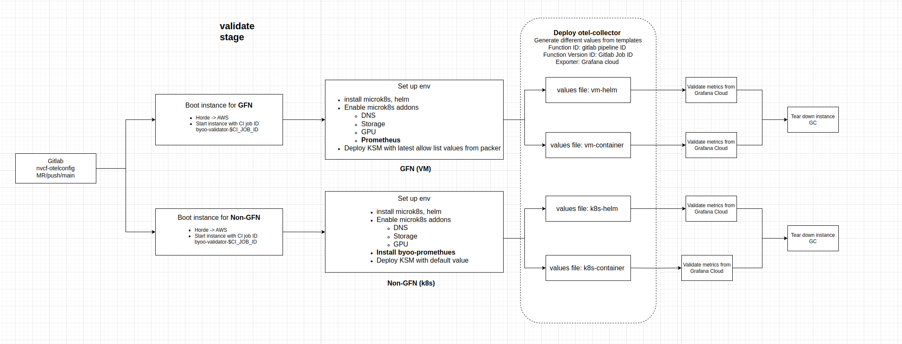

# Validator

This is a script that validates the byoo metrics and labels are correct.

## Workload images

The `scripts/deploy_*.sh` scripts and `scripts/values-function.yaml` pin prebuilt workloads: `byoo-test:0.11`, `byoo-validation-0.5.tgz`, and `task_byoo_sample:0.0.9`. These builds predate `http/protobuf` support. NVCA now sets `OTEL_EXPORTER_OTLP_<SIGNAL>_PROTOCOL=http/protobuf`, the OTLP spec value, and these builds exit at startup when they receive it.

Rebuild the workloads and update the pinned references before you run these scripts:

- Build the task image from `examples/task-samples/task-byoo-sample` and update `TASK_CONTAINER_IMAGE`.
- Package the task chart from `examples/task-samples/task-helmchart-byoo-sample` with its `image` values pointing at that build, and update `TASK_HELM_CHART`.
- Rebuild the function image with an OTLP exporter setup that accepts `http/protobuf`. Update `FUNCTION_CONTAINER_IMAGE` and the image in `scripts/values-function.yaml`, and repackage the `byoo-validation` chart if it pins an older image. If the repackaged chart gets a new version or URI, update `FUNCTION_HELM_CHART` in both `scripts/deploy_function_gfn_helm.sh` and `scripts/deploy_function_non-gfn_helm.sh`.

The scripts pull every workload from a registry. Before you run them, push each rebuilt image to the registry in its reference and publish each repackaged chart to its chart repository.

## Usage

### Start Instance (optional)

Start a instance by horde or aws. The host name will be saved in `instance_info.env` file. The host name format is `${OWNER}-validator-$(date +%s)` e.g. `lachen-validator-1712575200`. In CI job, the host name will be `nvcf-byoo-validator-$CI_JOB_ID`.

```bash
./start_instance.sh --preferred-cloud-backend=none --output-file=instance_info.env
# --preferred-cloud-backend(optional): horde or aws, if not set or set to none, we will check and start horde first and then aws if horde is not available.
# --output-file(optional): output instance_info to instance_info.env file including ip, instance_id and cloud_backend. Now we support horde and aws.
```

### Setup MicroK8s Environment

- Setup Remote K8s(non-gfn) Environment

```bash
./validator/setup.sh --ip=10.176.221.36 --user=horde --password=<pwd> --env=k8s --kubeconfig_output_path=$(pwd) --cloud-backend=horde
```

- Setup Remote VM(gfn) Environment
  - This deploys gfn specific kube-state-metrics

```bash
./validator/setup.sh --ip=10.176.221.36 --user=horde --password=<pwd> --env=vm --kubeconfig_output_path=$(pwd) --cloud-backend=horde
```

- (Or) Setup Environment on Local Machine

```bash
sudo ./validator/setup.sh --local --env=k8s --kubeconfig_output_path=$(pwd)
```

- A kubeconfig file called `.microk8s_kubeconfig.yaml` will be created under `$kubeconfig_output_path`

### Deploy Otel Collector for Validation

- Export the kubeconfig file created from previous step

```bash
export KUBECONFIG=$(pwd)/.microk8s_kubeconfig.yaml
```

- Deploy otel collector with vm-helm config

```bash
export COLLECTOR_CONFIG=vm-helm
helm upgrade --create-namespace --install --wait --timeout=60s \
    --namespace otel-collector-$COLLECTOR_CONFIG \
    opentelemetry-collector validator/charts/otel-collector/ \
    -f ./validator/charts/otel-collector/values-$COLLECTOR_CONFIG.yaml
```

- Deploy otel collector with vm-container config

```bash
export COLLECTOR_CONFIG=vm-container
helm upgrade --create-namespace --install --wait --timeout=60s \
    --namespace otel-collector-$COLLECTOR_CONFIG \
    opentelemetry-collector validator/charts/otel-collector/ \
    -f ./validator/charts/otel-collector/values-$COLLECTOR_CONFIG.yaml
```

### CI Validation Flow

- Start 2 Instances by Horde
  - 1 for GFN (VM) Instance
  - 1 for Non-GFN (k8s) Instance
- Install MicroK8s Environment on Instance
  - Use submodules to pin the packer and byoo-prometheus sources used by the validator job. Refer to the [GitLab submodules documentation](https://docs.gitlab.com/ci/runners/git_submodules/#use-git-submodules-in-cicd-jobs).
  - For Non-GFN (k8s)
    - Enable MicroK8s addons (DNS, Storage, GPU, Prometheus)
    - Deploy kube-state-metrics with helm chart
  - For GFN (VM)
    - Enable MicroK8s addons (DNS, Storage, GPU)
    - Install byoo-prometheus from the version pinned by the validator job
    - Deploy kube-state-metrics using the override template from the pinned packer configuration
- Deploy Otel Collector
  - GFN with vm-helm/vm-container values file
  - Non-GFN with k8s-helm/k8s-container values file
- Validate byoo metrics and labels from Grafana Cloud API
- Teardown instances
- Flow Diagram
  - 
  - [Source](https://drive.google.com/file/d/1xK-WFZu6_nHbOuDZ2Lw8bGt5YSFvFnUB/view?usp=sharing)
